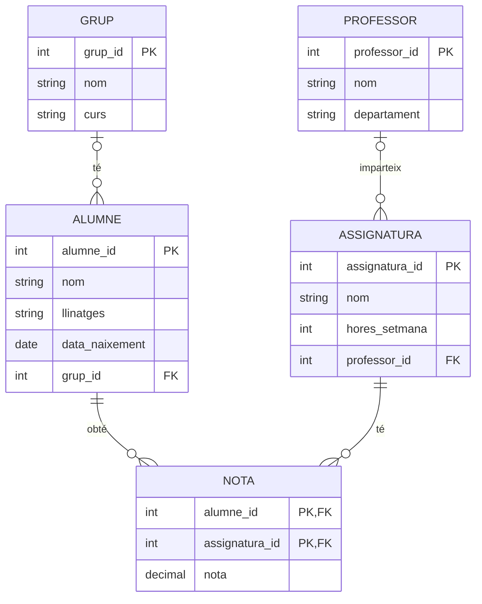

# Bases de dades relacionals: fonaments i disseny

Les aplicacions que fas servir cada dia (la xarxa social, la plataforma de l'institut, el joc en línia) guarden milions de dades i les consulten en mil·lisegons. Ho fan amb **bases de dades**. En aquest mòdul aprendràs com s'organitzen les dades en una base de dades relacional i, sobretot, a **dissenyar-ne una** abans d'escriure cap línia de codi. Al mòdul de [SQL](sql.md) aprendràs a crear-la i consultar-la.

| Fitxa del mòdul | |
| --- | --- |
| **Nivell** | PTD II |
| **Requisits previs** | Cap |
| **Vídeo** | [Curs «Hello SQL» de MoureDev](https://youtu.be/OuJerKzV5T0), lliçons 1 a 3 i 14 (uns 50 minuts) |
| **Durada orientativa** | 6-8 sessions |
| **Relació amb el currículum** | PTD II, criteri d'avaluació 3.1: dissenyar bases de dades que assegurin la integritat i la consistència de les dades, complint les formes normals. Sabers: model entitat-relació, model relacional, integritat, normalització i SGBD |

!!! tip "Com fer servir el vídeo"
    Cada apartat indica quina lliçó del vídeo li correspon i hi enllaça al minut exacte. Pots mirar el vídeo abans de llegir l'apartat, per tenir-ne una primera idea, o després, per repassar-lo. El vídeo és en castellà i fa servir MySQL.

## El curs en vídeo

Aquest mòdul i els tres següents ([SQL: consultar i modificar dades](sql.md), [SQL: taules i dades relacionades](sql-taules.md) i [SQL avançat i accés des de Python](sql-avancat.md)) segueixen el curs «Hello SQL» de Brais Moure (MoureDev), un curs des de zero d'unes set hores. Les primeres lliçons, fins al minut 45 aproximadament, corresponen a aquest mòdul.

<div class="video">
<iframe src="https://www.youtube-nocookie.com/embed/OuJerKzV5T0" title="Curs «Hello SQL» de MoureDev" loading="lazy" allowfullscreen></iframe>
</div>

| Mòdul | Lliçons del vídeo |
| --- | --- |
| Fonaments i disseny (aquest) | 1 a 3 i 14 |
| [SQL: consultar i modificar dades](sql.md) | 4 a 11 |
| [SQL: taules i dades relacionades](sql-taules.md) | 12 a 17 |
| [SQL avançat i accés des de Python](sql-avancat.md) | 18 a 22 |

## 1. Dades, informació i bases de dades

> **Vídeo:** [lliçó 1, «Bases de datos SQL»](https://youtu.be/OuJerKzV5T0?t=234)

Convé distingir dos conceptes:

- Una **dada** és un valor aïllat: un nom, una nota, una data.
- La **informació** apareix quan les dades s'organitzen i adquireixen sentit. Quan consultes les teves qualificacions a la plataforma de l'institut no veus dades soltes, sinó informació elaborada a partir de moltes dades relacionades.

Fins ara has guardat informació en fitxers: documents de text, fulls de càlcul, fitxers de codi… Això funciona bé amb poques dades i un ús senzill, però falla quan el volum creix o quan moltes persones hi accedeixen alhora: dades repetides, versions contradictòries, fitxers bloquejats…

Una **base de dades** és un conjunt de dades organitzades de manera estructurada, emmagatzemades perquè es puguin consultar, modificar i gestionar de manera eficient. No és un calaix on es guarden coses, sinó un arxiu intel·ligent capaç de respondre preguntes com:

- Quins alumnes tenen més d'una assignatura suspesa?
- Quins productes s'han venut aquest mes?
- Quins jugadors estan connectats ara mateix?

## 2. El model relacional

> **Vídeo:** [lliçó 3, «Fundamentos de SQL y bases de datos»](https://youtu.be/OuJerKzV5T0?t=1347)

El tipus de base de dades més utilitzat és la **base de dades relacional**, que organitza la informació en **taules relacionades entre elles**. Cada taula guarda dades d'un mateix tipus, i les relacions permeten connectar-les sense haver de repetir-les.

### 2.1. Taules, camps i registres

Una **taula** és una quadrícula de files i columnes, semblant a un full de càlcul però amb normes molt més estrictes. Cada taula representa un conjunt d'elements del mateix tipus: alumnes, assignatures, professors…

Taula `alumnes`:

| alumne_id | nom | llinatges | municipi | grup_id |
| --- | --- | --- | --- | --- |
| 1 | Aina | Ferrer Pons | Palma | 1 |
| 2 | Biel | Mas Riera | Marratxí | 1 |
| 3 | Carla | Vidal Bauzà | Palma | 1 |
| 4 | Dani | Oliver Serra | Inca | 2 |

| Element | També s'anomena | Què és | Exemple |
| --- | --- | --- | --- |
| **Camp** | Atribut, columna | Una característica que es guarda de cada element | `municipi` |
| **Registre** | Tupla, fila | Un element concret | La fila de la Carla |
| **Valor** | — | La dada d'una cel·la | `Inca` |

Cada camp té un **tipus de dada**, i tots els valors d'aquell camp han de ser d'aquest tipus. Els més habituals són:

| Tipus | Exemples en MySQL | Per a… |
| --- | --- | --- |
| Enter | `INT` | Identificadors, edats, quantitats |
| Decimal | `DECIMAL(4,2)`, `FLOAT` | Notes, preus, mesures |
| Text | `VARCHAR(100)`, `TEXT` | Noms, adreces, descripcions. El nombre indica la longitud màxima |
| Data i hora | `DATE`, `DATETIME` | Dates de naixement, de compra… |
| Booleà | `BOOLEAN` | Valors de sí o no |
| Binari | `BLOB` | Imatges, àudios o altres fitxers |

!!! warning "Preus i notes: `DECIMAL`, no `FLOAT`"
    Els tipus `FLOAT` i `DOUBLE` guarden els decimals de manera aproximada, igual que el `float` de Python. Per a quantitats que han de ser exactes, com els doblers, es fa servir `DECIMAL`: `DECIMAL(6,2)` guarda nombres de fins a 6 xifres, 2 de les quals decimals.

### 2.2. La clau primària

Cada fila d'una taula s'ha de poder identificar de manera única. Per això cada taula té una **clau primària** (*primary key*, PK): un camp, o un conjunt de camps, el valor del qual **no es pot repetir ni pot quedar buit**.

La clau primària serveix per:

- **Identificar** un registre sense ambigüitat.
- **Accedir-hi** ràpidament.
- **Relacionar-lo** amb registres d'altres taules.

Als diagrames, la clau primària se sol marcar subratllada o amb les sigles **PK**.

!!! info "Claus naturals i claus artificials"
    Una **clau natural** és un dada real que ja és única, com el DNI. Una **clau artificial** és un número que s'inventa la base de dades, com `alumne_id`. Avui es prefereixen les artificials: no canvien mai, no són dades personals i no tots els alumnes tenen DNI. A més, si una dada personal com el DNI fa de clau, s'acaba repetint a moltes taules, cosa poc recomanable des del punt de vista de la protecció de dades.

### 2.3. Les claus foranes

Per què no posar-ho tot en una sola taula? Perquè les dades es repetirien i apareixerien errors. Imagina que guardam el nom del grup i el del curs a cada alumne: si un dia canvia el nom del curs, l'hauríem de canviar a desenes de files, i si en deixam alguna, la informació es contradiu.

La solució és separar la informació en diverses taules i relacionar-les amb una **clau forana** (*foreign key*, FK): un camp que conté el valor de la clau primària d'una fila d'**una altra taula**.

Taula `grups`:

| grup_id (PK) | nom | curs |
| --- | --- | --- |
| 1 | 1BA | 1r de Batxillerat |
| 2 | 1BB | 1r de Batxillerat |

A la taula `alumnes`, el camp `grup_id` és una clau forana: el `1` de l'Aina indica que pertany al grup amb `grup_id = 1`, el 1BA. Si el nom del grup canvia, només s'ha de canviar en un lloc.

!!! example "Exercici 1. Identifica-ho"
    A la taula `alumnes` de l'apartat 2.1:

    1. Quants de camps i quants de registres hi ha?
    2. Quina és la clau primària? Quina és la clau forana, i a quina taula apunta?
    3. Per què `municipi` no podria ser la clau primària?
    4. Quin tipus de dada triaries per a cada camp?

    ??? success "Solució"
        1. Cinc camps i quatre registres.
        2. La clau primària és `alumne_id`. La clau forana és `grup_id`, que apunta a la taula `grups`.
        3. Perquè es repeteix (dos alumnes són de Palma), i una clau primària ha de ser única.
        4. `alumne_id` i `grup_id`: `INT`; `nom`, `llinatges` i `municipi`: `VARCHAR`, per exemple de 50, 100 i 50 caràcters.

## 3. Sistemes gestors de bases de dades

> **Vídeo:** [lliçó 2, «Sistema de gestión de base de datos»](https://youtu.be/OuJerKzV5T0?t=1011)

Un **sistema gestor de bases de dades** (SGBD) és el programa que emmagatzema, organitza i administra les bases de dades. Mai no accedim directament als fitxers on hi ha les dades: sempre ho feim **a través del gestor**, enviant-li instruccions. Aquesta separació garanteix la seguretat, la coherència i la fiabilitat de les dades.

### 3.1. Funcions d'un SGBD

| Funció | En què consisteix |
| --- | --- |
| Definició | Crear l'estructura: bases de dades, taules, tipus, restriccions |
| Manipulació | Inserir, consultar, modificar i esborrar dades |
| Integritat | Impedir dades incorrectes o contradictòries (vegeu l'apartat 5) |
| Seguretat | Controlar quins usuaris poden fer què |
| Concurrència | Permetre que moltes persones hi treballin alhora sense trepitjar-se |
| Recuperació | Fer còpies de seguretat i recuperar-se d'errors |

### 3.2. Tipus de SGBD

| Criteri | Tipus | Exemples |
| --- | --- | --- |
| Model de dades | **Relacionals** (taules i SQL) | MySQL, MariaDB, PostgreSQL, SQLite, Oracle, SQL Server |
| | **No relacionals** o NoSQL (documents, clau-valor, grafs…) | MongoDB, Redis, Neo4j. Ho estudiaràs al mòdul de [NoSQL](nosql.md) |
| Arquitectura | **Client-servidor**: un programa servidor al qual es connecten els clients | MySQL, PostgreSQL |
| | **Incrustats**: la base de dades és un fitxer dins l'aplicació | SQLite, que fan servir moltes aplicacions de mòbil |
| Llicència | **Lliures** | MariaDB, PostgreSQL, SQLite; MySQL té una edició lliure |
| | **Propietaris** | Oracle, SQL Server |

Nosaltres farem servir **MySQL** o **MariaDB**, que és una derivació lliure de MySQL i funciona pràcticament igual. Tots dos són SGBD relacionals molt utilitzats en webs, plataformes educatives i aplicacions de tot tipus.

## 4. Disseny d'una base de dades

> **Vídeo:** [lliçó 14, «Relaciones entre tablas»](https://youtu.be/OuJerKzV5T0?t=12781)

És temptador començar a crear taules directament, però és la millor manera de cometre errors difícils de corregir després. **Una base de dades ben dissenyada comença abans d'obrir l'ordinador.** Si el disseny és dolent, el sistema funcionarà malament encara que l'SQL estigui ben escrit.

El disseny té tres passes:


### 4.1. Entitats i atributs

Una **entitat** és un element del món real del qual volem guardar informació: un alumne, una assignatura, un professor. Cada entitat té **atributs**, les característiques que la descriuen: un alumne té nom, llinatges, data de naixement…

Una pista per trobar-les: a l'enunciat d'un problema, les entitats solen ser **substantius** importants («alumnes», «cursos») i els atributs, les dades que se'n demanen («nom», «edat»).

### 4.2. Relacions i cardinalitat

> **Vídeo:** [1:1](https://youtu.be/OuJerKzV5T0?t=12852) · [1:N](https://youtu.be/OuJerKzV5T0?t=13117) · [N:M](https://youtu.be/OuJerKzV5T0?t=13208) · [autoreferència](https://youtu.be/OuJerKzV5T0?t=13343)

Les entitats es relacionen entre elles: un alumne pertany a un grup, un professor imparteix assignatures, un alumne té notes de diverses assignatures. La **cardinalitat** indica quants d'elements de cada entitat poden participar en la relació:

| Cardinalitat | Significat | Exemple |
| --- | --- | --- |
| **1:1** (u a u) | Un element d'A es relaciona amb un sol element de B, i a l'inrevés | Un alumne té un sol carnet d'estudiant, i cada carnet és d'un sol alumne |
| **1:N** (u a molts) | Un element d'A es relaciona amb molts de B, però cada element de B, amb un sol d'A | Un grup té molts alumnes; cada alumne és d'un sol grup |
| **N:M** (molts a molts) | Un element d'A es relaciona amb molts de B, i a l'inrevés | Un alumne cursa moltes assignatures; una assignatura té molts alumnes |

A més, una entitat es pot relacionar amb **ella mateixa** (relació reflexiva o d'autoreferència): per exemple, un alumne pot ser el tutor entre iguals d'un altre alumne.

### 4.3. El diagrama entitat-relació

El **diagrama entitat-relació** (E-R) representa les entitats, els seus atributs i les relacions. És una eina d'anàlisi: no depèn de cap SGBD ni de cap llenguatge. N'hi ha diverses notacions. La clàssica, de Chen, dibuixa les entitats amb rectangles, els atributs amb el·lipses i les relacions amb rombes. Nosaltres farem servir la **notació de peu de gall**, molt habitual a les eines informàtiques, on cada entitat és una caixa amb els seus atributs i les línies indiquen la cardinalitat:



Com es llegeixen els extrems de les línies:

| Símbol | Significat |
| --- | --- |
| `||` | Exactament un |
| `|o` | Zero o un |
| `o{` | Zero o molts |
| `|{` | Un o molts |

Per exemple, `GRUP |o--o{ ALUMNE` es llegeix: «cada alumne pertany a zero o un grup, i cada grup té zero o més alumnes». Hem posat «zero o un» i no «exactament un» perquè un alumne acabat de matricular encara pot no tenir grup assignat. Aquests matisos els ha de decidir l'anàlisi, no l'eina.

!!! tip "Eines per dibuixar diagrames E-R"
    Pots fer-los a mà o amb eines com [draw.io](https://www.drawio.com/) o [dbdiagram.io](https://dbdiagram.io/). MySQL Workbench també els pot generar a partir d'una base de dades ja creada.

### 4.4. Del diagrama E-R al model relacional

El **model relacional** (o esquema relacional) transforma el diagrama en taules. Les regles són:

1. Cada **entitat** es converteix en una **taula**, i cada atribut, en una columna. Cada taula necessita la seva clau primària.
2. Una relació **1:N** es converteix en una **clau forana a la taula del costat N**. Exemple: `alumnes.grup_id` apunta a `grups`.
3. Una relació **N:M** es converteix en una **taula intermèdia** que conté les claus primàries de les dues entitats com a claus foranes. Exemple: la taula `notes`, amb `alumne_id` i `assignatura_id`. Si la relació té atributs propis, com la nota, van a aquesta taula.
4. Una relació **1:1** es converteix en una clau forana en una de les dues taules, amb la restricció que no es pugui repetir (`UNIQUE`).

El resultat s'escriu així, amb la clau primària subratllada (o marcada amb PK) i les claus foranes indicades:

- **grups** (<u>grup_id</u>, nom, curs)
- **alumnes** (<u>alumne_id</u>, nom, llinatges, data_naixement, municipi, correu, *grup_id* → grups)
- **professors** (<u>professor_id</u>, nom, llinatges, departament)
- **assignatures** (<u>assignatura_id</u>, nom, hores_setmana, *professor_id* → professors)
- **notes** (<u>*alumne_id* → alumnes, *assignatura_id* → assignatures</u>, nota)

Aquesta és, precisament, la base de dades `institut` amb què faràs els exercicis de SQL: [`institut.sql`](fitxers/institut.sql).

!!! example "Exercici 2. Quina cardinalitat?"
    Indica la cardinalitat de cada relació i com la passaries al model relacional:

    1. Un país té una capital, i cada capital és d'un país.
    2. Un autor escriu molts llibres, i cada llibre té un sol autor.
    3. Un llibre té molts autors, i un autor escriu molts llibres.
    4. Un client fa moltes comandes, i cada comanda és d'un client.
    5. Un jugador juga a molts videojocs, i cada videojoc té molts jugadors. Es vol guardar quantes hores ha jugat cada jugador a cada joc.

    ??? success "Solució"
        1. **1:1**. Clau forana `capital_id` a la taula `paisos`, amb `UNIQUE`.
        2. **1:N**. Clau forana `autor_id` a la taula `llibres`.
        3. **N:M**. Taula intermèdia `llibres_autors` (<u>llibre_id, autor_id</u>).
        4. **1:N**. Clau forana `client_id` a la taula `comandes`.
        5. **N:M amb atribut**. Taula intermèdia `partides` (<u>jugador_id, videojoc_id</u>, hores). Les hores no són ni del jugador ni del joc, sinó de la relació entre tots dos.

        Fixa't que els casos 2 i 3 parlen d'autors i llibres però tenen cardinalitats diferents: depèn del que digui l'enunciat, és a dir, de la realitat que volem representar.

!!! example "Exercici 3. Dissenya"
    Per a cada un d'aquests sistemes d'informació, fes el **diagrama E-R** i el **model relacional**: identifica les taules, els camps amb el seu tipus de dada, les claus primàries i les claus foranes. Si creus que falta algun camp necessari, afegeix-lo.

    1. **Sabates Ràpides**, una sabateria en línia. Vol guardar els productes (model, talla, color, preu i estoc), els clients i les comandes, amb el detall de cada comanda i l'estat de l'enviament.
    2. **Club Esportiu Tramuntana**. Vol gestionar els socis (nom, edat, contacte), les activitats que ofereix (nom, horari, entrenador) i les inscripcions dels socis a les activitats.
    3. **Acadèmia d'idiomes**. Vol registrar els estudiants (nom, nivell, contacte), els cursos (nom, nivell, horari, professor) i les matrícules dels estudiants als cursos, amb la qualificació obtinguda.
    4. **Concessionari de motos**. Vol guardar les motos (marca, model, any, preu, característiques), els clients (nom, adreça, contacte) i les vendes (moto, client i data).
    5. **Restaurant**. Vol gestionar els plats del menú (nom, ingredients, preu), les reserves (client, nombre de comensals, data i hora) i les comandes a domicili (plats, adreça i estat).

    ??? success "Solució orientativa del club esportiu"
        - **socis** (<u>soci_id</u>, nom, data_naixement, telefon, correu)
        - **entrenadors** (<u>entrenador_id</u>, nom, telefon)
        - **activitats** (<u>activitat_id</u>, nom, dia_setmana, hora_inici, *entrenador_id* → entrenadors)
        - **inscripcions** (<u>*soci_id* → socis, *activitat_id* → activitats</u>, data_inscripcio)

        ```mermaid
        erDiagram
            SOCI ||--o{ INSCRIPCIO : "fa"
            ACTIVITAT ||--o{ INSCRIPCIO : "rep"
            ENTRENADOR ||--o{ ACTIVITAT : "dirigeix"
        ```

        Decisions que convé justificar:

        - Guardam la **data de naixement** i no l'edat, perquè l'edat canvia cada any i es pot calcular.
        - L'**entrenador** és una entitat pròpia i no un simple camp de text, perquè un entrenador pot dirigir diverses activitats i en volem guardar dades.
        - La relació entre socis i activitats és **N:M**: un soci es pot inscriure a moltes activitats i una activitat té molts socis. Per això cal la taula `inscripcions`.

        Hi ha altres dissenys correctes. Per exemple, si una activitat té diversos horaris a la setmana, caldria una taula `horaris`.

    ??? success "Pista per a la sabateria"
        Una comanda pot tenir molts productes, i un producte apareix a moltes comandes. Necessitaràs una taula `linies_comanda` (<u>comanda_id, producte_id</u>, quantitat, preu_unitari). Per què convé guardar el preu a la línia de comanda si ja és a la taula de productes? Pensa què passa si el preu del producte canvia l'any que ve.

## 5. Integritat de les dades

Un SGBD no només guarda dades: també impedeix que n'entrin de **incorrectes o contradictòries**. Això és la **integritat**, i n'hi ha de tres tipus:

| Tipus | Què garanteix | Com es defineix |
| --- | --- | --- |
| **D'entitat** | Cada fila es pot identificar: la clau primària no es repeteix ni és nul·la | `PRIMARY KEY` |
| **Referencial** | Les claus foranes apunten a files que existeixen | `FOREIGN KEY … REFERENCES …` |
| **De domini** | Els valors són vàlids per a cada camp | El tipus de dada, `NOT NULL`, `UNIQUE`, `CHECK`, `DEFAULT` |

Per exemple, amb la integritat referencial activada, l'SGBD **no deixa**:

- Inserir un alumne amb `grup_id = 99` si no existeix el grup 99.
- Esborrar el grup 1 mentre hi hagi alumnes que hi pertanyen.

Quan es defineix la clau forana es pot triar què ha de passar en aquest darrer cas: impedir-ho (l'opció per defecte), esborrar també els alumnes en cascada (`ON DELETE CASCADE`) o deixar el seu grup en blanc (`ON DELETE SET NULL`).

!!! example "Exercici 4. Quina restricció?"
    Quina restricció posaries a cada camp de la base de dades `institut`?

    1. El correu d'un alumne no es pot repetir.
    2. La nota ha d'estar entre 0 i 10.
    3. Tot alumne ha de tenir nom.
    4. Les hores setmanals d'una assignatura, si no s'indiquen, són 3.
    5. No es pot posar una nota a un alumne que no existeix.

    ??? success "Solució"
        1. `UNIQUE`. 2. `CHECK (nota BETWEEN 0 AND 10)`. 3. `NOT NULL`. 4. `DEFAULT 3`. 5. `FOREIGN KEY (alumne_id) REFERENCES alumnes(alumne_id)`: és integritat referencial.

## 6. Normalització

Una base de dades pot funcionar i, tot i així, estar mal dissenyada. El símptoma més habitual és la **redundància**: la mateixa informació repetida a diversos llocs. La redundància provoca **anomalies**:

| Anomalia | Exemple, amb una única taula de notes que també guarda el nom i el grup de cada alumne |
| --- | --- |
| D'actualització | Si un alumne canvia de grup, s'ha de canviar a totes les seves files. Si se n'oblida alguna, les dades es contradiuen |
| D'inserció | No es pot registrar un alumne nou fins que no tengui cap nota |
| D'eliminació | Si s'esborren les notes d'un alumne, desapareix tota la informació sobre ell |

La **normalització** és el procés de reorganitzar les taules seguint unes regles, les **formes normals**, perquè cada dada es guardi una sola vegada i al lloc adequat. Cada forma normal inclou les anteriors.

### 6.1. Primera forma normal (1FN)

**Cada cel·la conté un sol valor**, indivisible (atòmic): no s'hi poden guardar llistes.

Aquesta taula **no** compleix la 1FN, perquè el camp `assignatures` conté llistes:

| alumne_id | nom | grup | assignatures |
| --- | --- | --- | --- |
| 1 | Aina | 1BA | PTD I, Matemàtiques I |
| 2 | Biel | 1BA | PTD I |

Per complir-la, cada parella alumne-assignatura passa a ser una fila:

| alumne_id | nom | grup | assignatura |
| --- | --- | --- | --- |
| 1 | Aina | 1BA | PTD I |
| 1 | Aina | 1BA | Matemàtiques I |
| 2 | Biel | 1BA | PTD I |

### 6.2. Segona forma normal (2FN)

Compleix la 1FN i, a més, **tots els camps que no formen part de la clau depenen de la clau sencera**, no només d'una part. Només pot fallar quan la clau primària està formada per diversos camps.

A la taula anterior, la clau és (<u>alumne_id, assignatura</u>), perquè és la combinació que no es repeteix. Però `nom` i `grup` depenen només de l'alumne, no de l'assignatura: per això l'Aina i el seu grup es repeteixen. Es divideix en dues taules:

**alumnes** (<u>alumne_id</u>, nom, grup)

| alumne_id | nom | grup |
| --- | --- | --- |
| 1 | Aina | 1BA |
| 2 | Biel | 1BA |

**matricules** (<u>alumne_id, assignatura</u>)

| alumne_id | assignatura |
| --- | --- |
| 1 | PTD I |
| 1 | Matemàtiques I |
| 2 | PTD I |

### 6.3. Tercera forma normal (3FN)

Compleix la 2FN i, a més, **cap camp que no forma part de la clau depèn d'un altre camp que tampoc no en forma part**. És a dir, no hi ha dependències «encadenades».

Suposa que afegim el tutor de cada grup a la taula `alumnes`:

| alumne_id | nom | grup | tutor |
| --- | --- | --- | --- |
| 1 | Aina | 1BA | Marta Coll |
| 2 | Biel | 1BA | Marta Coll |
| 4 | Dani | 1BB | Pere Llull |

El tutor no depèn de l'alumne, sinó del **grup**: `alumne_id` → `grup` → `tutor`. Per això es repeteix per a cada alumne del grup, i si el 1BA canvia de tutora, s'ha de canviar a moltes files. Es resol amb una taula per als grups:

- **alumnes** (<u>alumne_id</u>, nom, *grup* → grups)
- **grups** (<u>grup</u>, tutor)

!!! tip "Una regla per recordar-ho"
    Una manera clàssica de resumir les tres formes normals: cada camp ha de dependre **de la clau** (1FN), **de tota la clau** (2FN) i **de res més que la clau** (3FN).

!!! info "Desnormalitzar a consciència"
    De vegades es trenca una forma normal **a propòsit**, normalment per fer més ràpides consultes molt freqüents. Per exemple, guardar el total d'una comanda encara que es pugui calcular a partir de les línies. És acceptable si es fa sabent-ho, es justifica i es controla que les dades no es contradiguin.

!!! example "Exercici 5. Normalitza"
    Una botiga en línia guarda totes les comandes en aquesta taula. Indica quines formes normals incompleix i normalitza-la fins a la 3FN.

    | comanda_id | data | client | correu_client | productes |
    | --- | --- | --- | --- | --- |
    | 1 | 2026-10-02 | Laura Pons | laura@exemple.cat | Ratolí (12 €) x1, Teclat (35 €) x1 |
    | 2 | 2026-10-05 | Marc Vich | marc@exemple.cat | Ratolí (12 €) x2 |
    | 3 | 2026-10-07 | Laura Pons | laura@exemple.cat | Auriculars (25 €) x1 |

    ??? success "Solució"
        - **No compleix la 1FN**: la columna `productes` conté llistes, i cada element barreja nom, preu i quantitat.
        - Després de passar-la a 1FN (una fila per producte de cada comanda), **tampoc no compliria la 2FN**: la `data` i el client depenen només de la comanda, no del producte; i el preu depèn només del producte.
        - **Ni la 3FN**: el `correu_client` depèn del client, no de la comanda.

        Disseny normalitzat:

        - **clients** (<u>client_id</u>, nom, correu)
        - **productes** (<u>producte_id</u>, nom, preu)
        - **comandes** (<u>comanda_id</u>, data, *client_id* → clients)
        - **linies_comanda** (<u>*comanda_id* → comandes, *producte_id* → productes</u>, quantitat, preu_unitari)

        El `preu_unitari` de cada línia és una desnormalització justificada: guarda el preu que tenia el producte **el dia de la compra**, que no ha de canviar encara que després en pugi el preu.

## 7. Repte

!!! example "Repte. La base de dades de la biblioteca"
    La biblioteca de l'institut vol informatitzar els préstecs. Vol saber quins llibres té (títol, autors, editorial, any, ISBN), de quins llibres té més d'un exemplar, quins alumnes i professors s'emporten llibres, i quan els tornen. Un usuari no pot tenir més de tres llibres alhora.

    1. Fes l'anàlisi: quines entitats, atributs i relacions hi ha? Quines preguntes hauria de poder respondre la base de dades?
    2. Dibuixa el diagrama E-R.
    3. Passa'l al model relacional, amb tipus de dada, claus i restriccions.
    4. Comprova que compleix la 3FN.
    5. Quina regla no es pot garantir només amb el disseny de les taules? Com es podria controlar?

    Al mòdul [SQL: taules i dades relacionades](sql-taules.md) crearàs aquesta base de dades.

    ??? success "Solució orientativa"
        **Entitats**: autor, llibre, exemplar (cada còpia física), usuari i préstec.

        ```mermaid
        erDiagram
            AUTOR ||--o{ LLIBRE_AUTOR : "escriu"
            LLIBRE ||--o{ LLIBRE_AUTOR : "és escrit per"
            LLIBRE ||--|{ EXEMPLAR : "té"
            EXEMPLAR ||--o{ PRESTEC : "es presta en"
            USUARI ||--o{ PRESTEC : "fa"
        ```

        **Model relacional**:

        - **autors** (<u>autor_id</u>, nom)
        - **llibres** (<u>llibre_id</u>, titol, editorial, any_publicacio, isbn `UNIQUE`)
        - **llibres_autors** (<u>*llibre_id* → llibres, *autor_id* → autors</u>)
        - **exemplars** (<u>exemplar_id</u>, *llibre_id* → llibres)
        - **usuaris** (<u>usuari_id</u>, nom, llinatges, tipus, correu): `tipus` només pot ser «alumne» o «professor»
        - **prestecs** (<u>prestec_id</u>, *exemplar_id* → exemplars, *usuari_id* → usuaris, data_prestec, data_retorn): la data de retorn és `NULL` mentre el llibre no s'ha tornat

        Claus del disseny:

        - **Llibre i exemplar són entitats diferents.** El llibre és l'obra; l'exemplar, la còpia que es presta. Amb una sola taula, el títol i els autors es repetirien per a cada còpia (incompliria la 2FN o la 3FN).
        - Llibres i autors tenen una relació **N:M**, perquè hi ha llibres amb diversos autors.
        - El préstec relaciona un **exemplar** (no un llibre) amb un usuari, i un mateix exemplar es pot prestar moltes vegades. Per això té clau artificial pròpia: la parella exemplar-usuari es pot repetir en dates diferents.
        - Alumnes i professors poden anar a una sola taula `usuaris` amb un camp `tipus`, perquè la biblioteca en guarda les mateixes dades.

        **La regla que el disseny no garanteix**: «màxim tres llibres alhora». Les restriccions d'una taula comproven cada fila per separat, però aquesta regla depèn de quantes files pendents té l'usuari. S'ha de controlar des de l'aplicació o amb un *trigger*, que s'estudia al mòdul d'SQL avançat.

---

!!! quote "Fonts"
    Mòdul elaborat a partir de [«Tema 4. Bases de datos relacionales»](https://lopegonzalez.es/eso-y-bachillerato/programacion-y-computacion-2o-bachillerato/tema-4-bases-de-datos-relacionales/) de Lope González Vázquez ([CC BY-NC-SA 4.0](https://creativecommons.org/licenses/by-nc-sa/4.0/deed.ca)) i del curs en vídeo [«Hello SQL»](https://youtu.be/OuJerKzV5T0) de Brais Moure (MoureDev), al qual s'enllaça per lliçons. Canvis respecte de Lope: traducció al català, exemples basats en una base de dades d'un institut, i taules i diagrames refets en català (no s'han reproduït les imatges originals). L'exercici 3 adapta els cinc supòsits de l'«Ejercicio 4.1» de Lope, amb noms nous. Són propis: la diferència entre claus naturals i artificials, la classificació dels SGBD, la notació del diagrama E-R i les regles de pas al model relacional, l'apartat d'integritat, la tercera forma normal i la desnormalització, la resta d'exercicis, el repte i totes les solucions.
