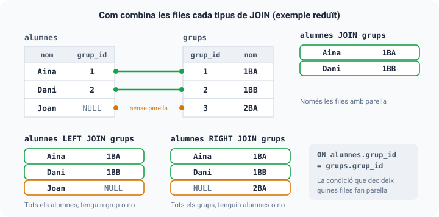

# SQL: taules i dades relacionades

Al mòdul anterior vas consultar i modificar les dades d'una base de dades que ja existia, i sempre d'una taula cada vegada. En aquest mòdul fas les dues passes que falten: **crear l'estructura** d'una base de dades (taules, restriccions i relacions) a partir d'un disseny, i **combinar dades de diverses taules** en una sola consulta amb `JOIN`.

| Fitxa del mòdul | |
| --- | --- |
| **Nivell** | PTD II |
| **Requisits previs** | [Fonaments i disseny](fonaments.md) i [SQL: consultar i modificar dades](sql.md) |
| **Vídeo** | [Curs «Hello SQL» de MoureDev](https://youtu.be/OuJerKzV5T0), lliçons 12 a 17 (unes 2 hores) |
| **Durada orientativa** | 8-10 sessions |
| **Relació amb el currículum** | PTD II, criteris d'avaluació 3.1 (restriccions d'integritat associades a les claus) i 3.2 (crear les taules amb el llenguatge de definició de dades; consultes combinades de diverses taules). Sabers: DDL |

!!! tip "Abans de començar"
    Fes servir la base de dades `institut` del mòdul anterior ([`institut.sql`](fitxers/institut.sql)). Si l'has modificada, torna-la a carregar per partir de les dades originals: els resultats de les solucions corresponen a aquestes dades.

## 1. Crear i esborrar bases de dades

> **Vídeo:** [`CREATE DATABASE`](https://youtu.be/OuJerKzV5T0?t=11064) · [`DROP DATABASE`](https://youtu.be/OuJerKzV5T0?t=11180)

```sql
CREATE DATABASE biblioteca;              -- crea una base de dades buida
USE biblioteca;                          -- la selecciona per treballar-hi
DROP DATABASE biblioteca;                -- l'esborra amb totes les seves taules i dades
```

Per evitar errors quan un script s'executa diverses vegades, s'hi pot afegir `IF NOT EXISTS` o `IF EXISTS`:

```sql
DROP DATABASE IF EXISTS biblioteca;      -- no dona error si no existeix
CREATE DATABASE IF NOT EXISTS biblioteca;
```

!!! danger "`DROP` no demana confirmació"
    `DROP DATABASE` i `DROP TABLE` esborren l'estructura i totes les dades a l'instant, sense cap avís i sense paperera. Fes-los servir només sobre bases de dades de prova.

!!! info "Les eines gràfiques també escriuen SQL"
    phpMyAdmin i MySQL Workbench permeten crear bases de dades i taules amb formularis i botons. Per darrere, però, generen les mateixes instruccions SQL que aprendràs aquí, i normalment te les mostren abans d'executar-les. Saber escriure-les et permet entendre què fa l'eina i guardar l'estructura en un fitxer `.sql` per tornar-la a crear quan vulguis, com fa [`institut.sql`](fitxers/institut.sql).

## 2. Crear taules

> **Vídeo:** [`CREATE TABLE`](https://youtu.be/OuJerKzV5T0?t=11292) · [`NOT NULL`](https://youtu.be/OuJerKzV5T0?t=11619) · [`UNIQUE`](https://youtu.be/OuJerKzV5T0?t=11787) · [`PRIMARY KEY`](https://youtu.be/OuJerKzV5T0?t=11911) · [`CHECK`](https://youtu.be/OuJerKzV5T0?t=12121) · [`DEFAULT`](https://youtu.be/OuJerKzV5T0?t=12243) · [`AUTO_INCREMENT`](https://youtu.be/OuJerKzV5T0?t=12362) · [`DROP TABLE`](https://youtu.be/OuJerKzV5T0?t=12412)

`CREATE TABLE` defineix una taula: el nom, les columnes amb el seu tipus i les **restriccions** que han de complir les dades. Així es va crear la taula `alumnes` de l'institut:

```sql
CREATE TABLE alumnes (
    alumne_id INT AUTO_INCREMENT PRIMARY KEY,
    nom VARCHAR(50) NOT NULL,
    llinatges VARCHAR(100) NOT NULL,
    data_naixement DATE,
    municipi VARCHAR(50),
    correu VARCHAR(100) UNIQUE,
    grup_id INT,
    FOREIGN KEY (grup_id) REFERENCES grups(grup_id)
);
```

Les restriccions són la manera de fer complir, dins la base de dades, les regles d'integritat que vas estudiar al [mòdul de fonaments](fonaments.md#5-integritat-de-les-dades):

| Restricció | Què obliga | Exemple |
| --- | --- | --- |
| `PRIMARY KEY` | Valor únic i no nul; identifica la fila | `alumne_id INT PRIMARY KEY` |
| `AUTO_INCREMENT` | El gestor hi posa automàticament el número següent | `alumne_id INT AUTO_INCREMENT PRIMARY KEY` |
| `NOT NULL` | El camp no pot quedar buit | `nom VARCHAR(50) NOT NULL` |
| `UNIQUE` | No es pot repetir cap valor (però sí que hi pot haver diversos `NULL`) | `correu VARCHAR(100) UNIQUE` |
| `CHECK` | El valor ha de complir una condició | `nota DECIMAL(4,2) CHECK (nota BETWEEN 0 AND 10)` |
| `DEFAULT` | Valor que es posa si no se n'indica cap | `hores_setmana INT DEFAULT 3` |
| `FOREIGN KEY … REFERENCES` | El valor ha d'existir com a clau primària d'una altra taula | `FOREIGN KEY (grup_id) REFERENCES grups(grup_id)` |

Les restriccions es poden escriure al costat de la columna (com `NOT NULL`) o al final, separades per comes. Les que afecten **diverses columnes**, com una clau primària composta, s'han d'escriure al final:

```sql
CREATE TABLE notes (
    alumne_id INT,
    assignatura_id INT,
    nota DECIMAL(4,2) CHECK (nota BETWEEN 0 AND 10),
    PRIMARY KEY (alumne_id, assignatura_id),
    FOREIGN KEY (alumne_id) REFERENCES alumnes(alumne_id),
    FOREIGN KEY (assignatura_id) REFERENCES assignatures(assignatura_id)
);
```

!!! warning "L'ordre de creació importa"
    Una clau forana només pot apuntar a una taula que **ja existeix**. Per això `institut.sql` crea primer `grups` i després `alumnes`, i deixa `notes` per al final. A l'hora d'esborrar és a l'inrevés: no pots esborrar `grups` mentre `alumnes` hi apunti.

!!! info "Una redundància del vídeo"
    Al vídeo, les taules d'exemple declaren el camp `id` com a `UNIQUE` i també com a `PRIMARY KEY`. No és un error, però és redundant: una clau primària ja és única per definició.

Per veure l'estructura d'una taula ja creada:

```sql
DESCRIBE alumnes;
```

!!! example "Exercici 1. Detecta els errors"
    Aquesta instrucció vol crear una taula de llibres, però té quatre problemes de disseny o de sintaxi. Troba'ls i corregeix-los.

    ```sql
    CREATE TABLE llibres (
        llibre_id INT,
        titol VARCHAR(200),
        isbn VARCHAR(17),
        preu FLOAT,
        pagines INT
    )
    ```

    Requisits: cada llibre s'identifica amb un número automàtic; el títol és obligatori; no hi pot haver dos llibres amb el mateix ISBN; el preu ha de ser exacte; el nombre de pàgines ha de ser positiu.

    ??? success "Solució"
        ```sql
        CREATE TABLE llibres (
            llibre_id INT AUTO_INCREMENT PRIMARY KEY,
            titol VARCHAR(200) NOT NULL,
            isbn VARCHAR(17) UNIQUE,
            preu DECIMAL(6,2),
            pagines INT CHECK (pagines > 0)
        );
        ```

        1. Faltava la clau primària i l'`AUTO_INCREMENT`.
        2. El títol havia de ser `NOT NULL`.
        3. L'ISBN havia de ser `UNIQUE`.
        4. El preu havia de ser `DECIMAL`, perquè `FLOAT` és aproximat.
        5. A més, faltava el `CHECK` de les pàgines i el punt i coma final.

        L'ISBN és `VARCHAR` i no `INT` perquè pot dur guions i perquè no s'hi fan operacions matemàtiques. El mateix passa amb els telèfons o els codis postals: si un número no serveix per calcular, se sol guardar com a text.

## 3. Modificar taules: `ALTER TABLE`

> **Vídeo:** [`ALTER TABLE`](https://youtu.be/OuJerKzV5T0?t=12461) · [`ADD`](https://youtu.be/OuJerKzV5T0?t=12578) · [`RENAME COLUMN`](https://youtu.be/OuJerKzV5T0?t=12624) · [`MODIFY COLUMN`](https://youtu.be/OuJerKzV5T0?t=12675) · [`DROP COLUMN`](https://youtu.be/OuJerKzV5T0?t=12712)

Una base de dades evoluciona: sovint cal afegir una columna o canviar-ne el tipus quan la taula ja té dades. Per això no s'esborra i es torna a crear, sinó que es modifica amb `ALTER TABLE`:

```sql
ALTER TABLE alumnes ADD telefon VARCHAR(9);                    -- afegir una columna
ALTER TABLE alumnes MODIFY COLUMN telefon VARCHAR(15);         -- canviar-ne el tipus
ALTER TABLE alumnes RENAME COLUMN telefon TO mobil;            -- canviar-ne el nom
ALTER TABLE alumnes DROP COLUMN mobil;                         -- esborrar-la
```

També es poden afegir restriccions a una taula existent. Convé donar-los un nom, amb `CONSTRAINT`, per poder-les identificar o esborrar més endavant:

```sql
ALTER TABLE grups
ADD CONSTRAINT fk_grups_tutor FOREIGN KEY (tutor_id) REFERENCES professors(professor_id);
```

!!! example "Exercici 2. El tutor de cada grup"
    Al mòdul de fonaments vas veure que el tutor depèn del grup, no de l'alumne, i que per complir la tercera forma normal s'ha de guardar a la taula `grups`. Fes-ho ara a la base de dades `institut`:

    1. Afegeix a `grups` la columna `tutor_id`. Cada professor pot ser tutor d'un sol grup.
    2. Converteix-la en clau forana que apunti a `professors`.
    3. Assigna els tutors: la Marta Coll (professora 1) al 1BA, en Pere Llull (2) al 1BB i en Xavier Ramon (4) al 2BA. El 4EA, de moment, no té tutor.
    4. Intenta fer la Marta tutora també del 4EA. Què passa? I si intentes posar-hi el professor 9?

    ??? success "Solució"
        ```sql
        ALTER TABLE grups ADD tutor_id INT UNIQUE;

        ALTER TABLE grups
        ADD CONSTRAINT fk_grups_tutor FOREIGN KEY (tutor_id) REFERENCES professors(professor_id);

        UPDATE grups SET tutor_id = 1 WHERE nom = '1BA';
        UPDATE grups SET tutor_id = 2 WHERE nom = '1BB';
        UPDATE grups SET tutor_id = 4 WHERE nom = '2BA';

        UPDATE grups SET tutor_id = 1 WHERE nom = '4EA';   -- error: valor duplicat
        UPDATE grups SET tutor_id = 9 WHERE nom = '4EA';   -- error: clau forana
        ```

        El `UNIQUE` fa que la relació sigui **1:1**: sense ell, un professor podria ser tutor de diversos grups i seria una relació 1:N. El primer intent falla per valor duplicat, i el segon, perquè no existeix el professor 9 (integritat referencial).

        Pots continuar fent servir la base de dades amb aquesta columna nova: els exercicis següents no hi depenen, excepte el 5.

## 4. Relacions entre taules

> **Vídeo:** [lliçó 15, «Creación de tablas relacionadas»](https://youtu.be/OuJerKzV5T0?t=13428) · [taules 1:1](https://youtu.be/OuJerKzV5T0?t=13490) · [1:N](https://youtu.be/OuJerKzV5T0?t=13732) · [N:M](https://youtu.be/OuJerKzV5T0?t=14313) · [lliçó 16, «Almacenamiento de datos relacionados»](https://youtu.be/OuJerKzV5T0?t=14635)

Al [mòdul de fonaments](fonaments.md#44-del-diagrama-e-r-al-model-relacional) vas aprendre a passar cada tipus de relació al model relacional. En SQL, queda així:

| Relació | Com es crea | A l'institut |
| --- | --- | --- |
| **1:N** | Clau forana a la taula del costat N | `alumnes.grup_id` → `grups` |
| **1:1** | Clau forana **amb `UNIQUE`** a una de les dues taules | `grups.tutor_id` → `professors` (exercici 2) |
| **N:M** | Taula intermèdia amb dues claus foranes; la clau primària sol ser la parella | `notes` (alumne_id, assignatura_id) |

!!! warning "Una relació 1:1 necessita `UNIQUE`"
    Al vídeo, la taula `dni` té una clau forana cap a `users`, però sense `UNIQUE`. Tal com està escrita, res no impedeix que dos DNI apuntin al mateix usuari: la base de dades no garanteix la relació 1:1, només la descriu. Afegir `UNIQUE` a la clau forana fa que l'SGBD la imposi.

!!! info "La clau primària de la taula intermèdia"
    Al vídeo, la taula intermèdia `users_languages` té una clau artificial pròpia i una restricció `UNIQUE (user_id, language_id)`. A `notes` hem fet servir directament la parella com a clau primària. Les dues opcions impedeixen que la mateixa parella es repeteixi, i les dues són correctes.

Quan s'**insereixen** dades relacionades, primer van les files a les quals s'apunta i després les que apunten: primer el grup, després els alumnes del grup; primer l'alumne i l'assignatura, després la nota.

!!! example "Exercici 3. Crea la base de dades de la biblioteca"
    Al repte del mòdul de fonaments vas dissenyar la base de dades de la biblioteca de l'institut. Ara crea-la en SQL i omple-la amb unes quantes dades de prova. Si no vas fer aquell repte, mira'n abans la solució al [mòdul de fonaments](fonaments.md#7-repte).

    1. Escriu un script que esborri la base de dades `biblioteca` si existeix, la torni a crear i hi creï totes les taules amb les seves restriccions.
    2. Insereix almenys tres autors, tres llibres (un d'ells amb tres exemplars), tres usuaris i cinc préstecs, alguns ja retornats i d'altres no.
    3. Comprova que l'SGBD rebutja un préstec amb data de retorn anterior a la data de préstec i un usuari d'un tipus que no és «alumne» ni «professor».

    ??? success "Solució"
        ```sql
        DROP DATABASE IF EXISTS biblioteca;
        CREATE DATABASE biblioteca;
        USE biblioteca;

        CREATE TABLE autors (
            autor_id INT AUTO_INCREMENT PRIMARY KEY,
            nom VARCHAR(100) NOT NULL
        );

        CREATE TABLE llibres (
            llibre_id INT AUTO_INCREMENT PRIMARY KEY,
            titol VARCHAR(200) NOT NULL,
            editorial VARCHAR(100),
            any_publicacio INT,
            isbn VARCHAR(17) UNIQUE
        );

        CREATE TABLE llibres_autors (
            llibre_id INT,
            autor_id INT,
            PRIMARY KEY (llibre_id, autor_id),
            FOREIGN KEY (llibre_id) REFERENCES llibres(llibre_id),
            FOREIGN KEY (autor_id) REFERENCES autors(autor_id)
        );

        CREATE TABLE exemplars (
            exemplar_id INT AUTO_INCREMENT PRIMARY KEY,
            llibre_id INT NOT NULL,
            FOREIGN KEY (llibre_id) REFERENCES llibres(llibre_id)
        );

        CREATE TABLE usuaris (
            usuari_id INT AUTO_INCREMENT PRIMARY KEY,
            nom VARCHAR(50) NOT NULL,
            llinatges VARCHAR(100) NOT NULL,
            tipus VARCHAR(10) NOT NULL CHECK (tipus IN ('alumne', 'professor')),
            correu VARCHAR(100) UNIQUE
        );

        CREATE TABLE prestecs (
            prestec_id INT AUTO_INCREMENT PRIMARY KEY,
            exemplar_id INT NOT NULL,
            usuari_id INT NOT NULL,
            data_prestec DATE NOT NULL DEFAULT (CURRENT_DATE),
            data_retorn DATE,
            FOREIGN KEY (exemplar_id) REFERENCES exemplars(exemplar_id),
            FOREIGN KEY (usuari_id) REFERENCES usuaris(usuari_id),
            CHECK (data_retorn IS NULL OR data_retorn >= data_prestec)
        );

        INSERT INTO autors (nom) VALUES
        ('Mercè Rodoreda'), ('Llorenç Villalonga'), ('Joan Fuster');

        INSERT INTO llibres (titol, any_publicacio) VALUES
        ('La plaça del Diamant', 1962),
        ('Mort de dama', 1931),
        ('Nosaltres, els valencians', 1962);

        INSERT INTO llibres_autors VALUES (1, 1), (2, 2), (3, 3);

        INSERT INTO exemplars (llibre_id) VALUES (1), (1), (1), (2), (3);

        INSERT INTO usuaris (nom, llinatges, tipus, correu) VALUES
        ('Aina', 'Ferrer Pons', 'alumne', 'aina.ferrer@exemple.cat'),
        ('Marta', 'Coll Ripoll', 'professor', 'marta.coll@exemple.cat'),
        ('Biel', 'Mas Riera', 'alumne', NULL);

        INSERT INTO prestecs (exemplar_id, usuari_id, data_prestec, data_retorn) VALUES
        (1, 1, '2026-10-01', '2026-10-15'),
        (4, 1, '2026-10-20', NULL),
        (2, 2, '2026-10-22', NULL),
        (5, 3, '2026-10-05', '2026-10-19');

        INSERT INTO prestecs (exemplar_id, usuari_id) VALUES (3, 3);   -- data d'avui per defecte

        -- Han de fallar:
        INSERT INTO prestecs (exemplar_id, usuari_id, data_prestec, data_retorn)
        VALUES (1, 1, '2026-10-10', '2026-10-01');
        INSERT INTO usuaris (nom, llinatges, tipus) VALUES ('Pep', 'Vic Pol', 'conserge');
        ```

        Decisions de disseny:

        - **Llibre i exemplar són entitats diferents**: el llibre és l'obra (títol, autors, ISBN) i l'exemplar és cada còpia física que es pot prestar. Si hi hagués una sola taula, el títol i els autors es repetirien per a cada còpia.
        - Un préstec **pendent** és el que té `data_retorn` a `NULL`.
        - `DEFAULT (CURRENT_DATE)`, amb parèntesis, posa la data del dia. Funciona amb MariaDB i amb MySQL 8.0.13 o posterior.
        - La regla «màxim tres llibres alhora» **no** es pot imposar només amb `CHECK`, perquè depèn d'altres files de la taula. Es controla des de l'aplicació o amb un *trigger*, que veuràs al mòdul d'SQL avançat.

## 5. Consultar dades relacionades: `JOIN`

> **Vídeo:** [lliçó 17, «Consulta de datos relacionados»](https://youtu.be/OuJerKzV5T0?t=16013) · [`INNER JOIN`](https://youtu.be/OuJerKzV5T0?t=16101) · [`LEFT JOIN`](https://youtu.be/OuJerKzV5T0?t=17045) · [`RIGHT JOIN`](https://youtu.be/OuJerKzV5T0?t=17399)

Les dades normalitzades estan repartides en diverses taules: la taula `notes` només té números. Per veure el nom de l'alumne i el de l'assignatura al costat de cada nota, s'han de **combinar** les taules. Això ho fa `JOIN`.

### 5.1. `INNER JOIN`

`JOIN` (o `INNER JOIN`, que és el mateix) combina cada fila d'una taula amb les files de l'altra que compleixen la condició indicada a `ON`. Normalment, la condició és que la clau forana d'una coincideixi amb la clau primària de l'altra:

```sql
SELECT alumnes.nom, alumnes.llinatges, grups.nom AS grup
FROM alumnes
JOIN grups ON alumnes.grup_id = grups.grup_id;
```

Com que les dues taules tenen una columna `nom`, s'ha d'indicar de quina taula és cada una: `alumnes.nom`, `grups.nom`. Per escriure menys, es donen **àlies** a les taules:

```sql
SELECT a.nom, a.llinatges, g.nom AS grup
FROM alumnes a
JOIN grups g ON a.grup_id = g.grup_id
ORDER BY g.nom, a.llinatges;
```

Aquesta consulta retorna **nou** alumnes, no deu: el Joan no té grup, i `INNER JOIN` només mostra les files que tenen parella a totes dues taules.

Es poden encadenar tants `JOIN` com calgui. Per exemple, per veure les notes amb el nom de l'alumne i el de l'assignatura:

```sql
SELECT CONCAT(a.nom, ' ', a.llinatges) AS alumne, s.nom AS assignatura, n.nota
FROM notes n
JOIN alumnes a ON n.alumne_id = a.alumne_id
JOIN assignatures s ON n.assignatura_id = s.assignatura_id;
```

!!! warning "No t'oblidis de l'`ON`"
    Sense la condició `ON`, MySQL combina **cada** fila d'una taula amb **totes** les de l'altra (producte cartesià). `alumnes JOIN grups` sense `ON` retorna 10 × 4 = 40 files, la majoria sense sentit. El vídeo mostra aquest error a l'inici de la lliçó d'`INNER JOIN`.

### 5.2. `LEFT JOIN` i `RIGHT JOIN`

`LEFT JOIN` retorna **totes** les files de la taula de l'esquerra (la del `FROM`), tant si tenen parella a l'altra taula com si no. Quan no en tenen, les columnes de l'altra taula surten a `NULL`:

```sql
SELECT a.nom, g.nom AS grup
FROM alumnes a
LEFT JOIN grups g ON a.grup_id = g.grup_id;
```

Ara surten els deu alumnes, i el Joan apareix amb el grup a `NULL`.

`RIGHT JOIN` fa el mateix amb la taula de la dreta. A la pràctica, gairebé sempre es fa servir `LEFT JOIN`, canviant l'ordre de les taules si cal: `A RIGHT JOIN B` dona el mateix que `B LEFT JOIN A`.

| Tipus | Retorna | Alumnes i grups de l'institut |
| --- | --- | --- |
| `A JOIN B` | Només les files amb parella a totes dues taules | 9 alumnes (el Joan no hi surt) |
| `A LEFT JOIN B` | Totes les files d'A, i les de B si en tenen | 10 alumnes (el Joan, amb grup `NULL`) |
| `A RIGHT JOIN B` | Totes les files de B, i les d'A si en tenen | Tots els grups, amb els seus alumnes |

<figure markdown="span">
  { width="720" }
  <figcaption>Exemple reduït, amb tres alumnes i tres grups, per veure què afegeix cada tipus de `JOIN`. A la base de dades `institut` hi ha més files.</figcaption>
</figure>

!!! tip "Trobar el que falta"
    Un ús molt habitual del `LEFT JOIN` és trobar files **sense** parella: alumnes sense notes, grups sense alumnes, llibres que no s'han prestat mai… Es fa un `LEFT JOIN` i es filtren les files on l'altra taula ha quedat a `NULL`:

    ```sql
    -- Alumnes que no tenen cap nota
    SELECT a.nom
    FROM alumnes a
    LEFT JOIN notes n ON a.alumne_id = n.alumne_id
    WHERE n.alumne_id IS NULL;
    ```

!!! example "Exercici 4"
    1. Llista de totes les assignatures amb el nom complet del professor que les imparteix. Han de sortir també les que no tenen professor.
    2. Alumnes que no tenen cap nota.
    3. Notes dels alumnes del grup 1BA, amb el nom complet de l'alumne i el nom de l'assignatura, ordenades per llinatges i, dins cada alumne, de la nota més alta a la més baixa. Filtra pel nom del grup, `'1BA'`, no pel seu identificador.
    4. Notes de les assignatures que imparteix la professora Marta Coll (professora 1), amb el nom de l'alumne i de l'assignatura, de la més alta a la més baixa.

    ??? success "Solució"
        ```sql
        -- 1
        SELECT s.nom AS assignatura, CONCAT(p.nom, ' ', p.llinatges) AS professor
        FROM assignatures s
        LEFT JOIN professors p ON s.professor_id = p.professor_id;

        -- 2
        SELECT a.nom
        FROM alumnes a
        LEFT JOIN notes n ON a.alumne_id = n.alumne_id
        WHERE n.alumne_id IS NULL;

        -- 3
        SELECT CONCAT(a.nom, ' ', a.llinatges) AS alumne, s.nom AS assignatura, n.nota
        FROM notes n
        JOIN alumnes a ON n.alumne_id = a.alumne_id
        JOIN assignatures s ON n.assignatura_id = s.assignatura_id
        JOIN grups g ON a.grup_id = g.grup_id
        WHERE g.nom = '1BA'
        ORDER BY a.llinatges, n.nota DESC;

        -- 4
        SELECT a.nom AS alumne, s.nom AS assignatura, n.nota
        FROM notes n
        JOIN alumnes a ON n.alumne_id = a.alumne_id
        JOIN assignatures s ON n.assignatura_id = s.assignatura_id
        WHERE s.professor_id = 1
        ORDER BY n.nota DESC;
        ```

        1. Cinc assignatures; Tecnologia surt amb el professor a `NULL`. Amb `JOIN` en lloc de `LEFT JOIN`, Tecnologia no sortiria.
        2. El Joan.
        3. Vuit notes: tres de l'Aina, tres d'en Biel i dues de la Carla.
        4. Carla (9,75), Aina (8,50), Elena (7,50), Dani (6,25) i Biel (4,75), totes de Programació i Tractament de Dades I.

### 5.3. `JOIN` amb `GROUP BY`

Els `JOIN` es combinen amb tot el que ja saps: `WHERE`, `GROUP BY`, `HAVING`, `ORDER BY`… Primer es combinen les taules i després s'agrupa el resultat:

```sql
-- Nota mitjana de cada grup
SELECT g.nom AS grup, COUNT(*) AS notes, ROUND(AVG(n.nota), 2) AS mitjana
FROM notes n
JOIN alumnes a ON n.alumne_id = a.alumne_id
JOIN grups g ON a.grup_id = g.grup_id
GROUP BY g.nom
ORDER BY mitjana DESC;
```

| grup | notes | mitjana |
| --- | --- | --- |
| 4EA | 2 | 7.38 |
| 1BA | 8 | 7.34 |
| 2BA | 2 | 6.63 |
| 1BB | 5 | 6.20 |

!!! example "Exercici 5"
    1. Nombre d'alumnes de cada grup, pel nom del grup.
    2. Nombre de notes i nota mitjana (arrodonida a dos decimals) per departament del professor.
    3. Nom complet dels alumnes que tenen alguna assignatura suspesa i quantes en tenen.
    4. Nom complet dels alumnes de Palma i nom complet del seu tutor (necessites la columna `tutor_id` de l'exercici 2). Per què no hi surt la Irene, que és de Palma?

    ??? success "Solució"
        ```sql
        -- 1
        SELECT g.nom AS grup, COUNT(a.alumne_id) AS alumnes
        FROM grups g
        LEFT JOIN alumnes a ON a.grup_id = g.grup_id
        GROUP BY g.nom;

        -- 2
        SELECT p.departament, COUNT(*) AS notes, ROUND(AVG(n.nota), 2) AS mitjana
        FROM notes n
        JOIN assignatures s ON n.assignatura_id = s.assignatura_id
        JOIN professors p ON s.professor_id = p.professor_id
        GROUP BY p.departament;

        -- 3
        SELECT CONCAT(a.nom, ' ', a.llinatges) AS alumne, COUNT(*) AS suspeses
        FROM notes n
        JOIN alumnes a ON n.alumne_id = a.alumne_id
        WHERE n.nota < 5
        GROUP BY a.alumne_id, a.nom, a.llinatges;

        -- 4
        SELECT CONCAT(a.nom, ' ', a.llinatges) AS alumne,
               CONCAT(p.nom, ' ', p.llinatges) AS tutor
        FROM alumnes a
        JOIN grups g ON a.grup_id = g.grup_id
        JOIN professors p ON g.tutor_id = p.professor_id
        WHERE a.municipi = 'Palma';
        ```

        1. 1BA: 3; 1BB: 2; 2BA: 2; 4EA: 2. Es fa `LEFT JOIN` des de `grups` i es compta `a.alumne_id` (no `*`) perquè, si hi hagués un grup sense alumnes, sortís amb un 0.
        2. Llengua catalana: 4 notes, 7,25; Matemàtiques: 4 notes, 6,00; Tecnologia: 7 notes, 7,14. Les dues notes de l'assignatura Tecnologia no hi compten, perquè no té professor i l'`INNER JOIN` les descarta.
        3. Biel Mas Riera, Dani Oliver Serra i Gemma Sastre Pujol, amb una cadascun. S'agrupa per `alumne_id` i no només pel nom perquè dos alumnes es podrien dir igual.
        4. Aina i Carla (tutora Marta Coll), Elena (Pere Llull) i Gemma (Xavier Ramon). La Irene és del 4EA, que no té tutor: l'`INNER JOIN` amb `professors` la descarta. Amb `LEFT JOIN professors` hi sortiria amb el tutor a `NULL`.

## 6. Unir resultats: `UNION`

> **Vídeo:** [`UNION`](https://youtu.be/OuJerKzV5T0?t=17536)

`JOIN` posa columnes d'una taula **al costat** de les d'una altra. `UNION`, en canvi, posa els resultats de dues consultes **un davall l'altre**. Les dues consultes han de tenir el mateix nombre de columnes, i de tipus compatibles:

```sql
-- Persones de l'institut relacionades amb Marratxí o amb Tecnologia
SELECT nom, llinatges, 'Alumne' AS rol FROM alumnes WHERE municipi = 'Marratxí'
UNION
SELECT nom, llinatges, 'Professor' FROM professors WHERE departament = 'Tecnologia';
```

`UNION` elimina les files repetides; `UNION ALL` les conserva i és més ràpid.

!!! info "`FULL JOIN` amb `UNION`"
    Alguns SGBD tenen `FULL JOIN`, que retorna totes les files de les dues taules, tenguin parella o no. MySQL i MariaDB no en tenen, i per això el vídeo l'obté unint un `LEFT JOIN` i un `RIGHT JOIN` amb `UNION`.

## 7. Repte

!!! example "Repte. Consultes per a la biblioteca"
    Sobre la base de dades `biblioteca` que vas crear a l'exercici 3, escriu les consultes que necessitaria la bibliotecària:

    1. Quants d'exemplars hi ha de cada llibre (títol i nombre d'exemplars)?
    2. Quins préstecs estan pendents de retornar? Mostra el nom complet de l'usuari, el títol del llibre i la data del préstec, del més antic al més recent.
    3. Quants de llibres té pendents cada usuari? Han de sortir tots els usuaris, també els que no en tenen cap.
    4. Quins usuaris podrien endur-se un altre llibre, tenint en compte la norma dels tres llibres alhora?
    5. Quins llibres no s'han prestat mai?

    Els resultats depenen de les dades que hagis inserit. Si fas servir les de la solució de l'exercici 3, comprova que els teus resultats coincideixen amb els de la solució.

    ??? success "Solució"
        ```sql
        -- 1
        SELECT l.titol, COUNT(*) AS exemplars
        FROM llibres l
        JOIN exemplars e ON e.llibre_id = l.llibre_id
        GROUP BY l.llibre_id, l.titol;

        -- 2
        SELECT CONCAT(u.nom, ' ', u.llinatges) AS usuari, l.titol, p.data_prestec
        FROM prestecs p
        JOIN usuaris u ON p.usuari_id = u.usuari_id
        JOIN exemplars e ON p.exemplar_id = e.exemplar_id
        JOIN llibres l ON e.llibre_id = l.llibre_id
        WHERE p.data_retorn IS NULL
        ORDER BY p.data_prestec;

        -- 3
        SELECT u.nom, u.llinatges, COUNT(p.prestec_id) AS pendents
        FROM usuaris u
        LEFT JOIN prestecs p ON p.usuari_id = u.usuari_id AND p.data_retorn IS NULL
        GROUP BY u.usuari_id, u.nom, u.llinatges;

        -- 4
        SELECT u.nom, u.llinatges, COUNT(p.prestec_id) AS pendents
        FROM usuaris u
        LEFT JOIN prestecs p ON p.usuari_id = u.usuari_id AND p.data_retorn IS NULL
        GROUP BY u.usuari_id, u.nom, u.llinatges
        HAVING COUNT(p.prestec_id) < 3;

        -- 5
        SELECT l.titol
        FROM llibres l
        JOIN exemplars e ON e.llibre_id = l.llibre_id
        LEFT JOIN prestecs p ON p.exemplar_id = e.exemplar_id
        GROUP BY l.llibre_id, l.titol
        HAVING COUNT(p.prestec_id) = 0;
        ```

        Amb les dades de la solució de l'exercici 3:

        1. *La plaça del Diamant*: 3; *Mort de dama*: 1; *Nosaltres, els valencians*: 1.
        2. Aina Ferrer Pons, *Mort de dama*, 2026-10-20; Marta Coll Ripoll, *La plaça del Diamant*, 2026-10-22; i Biel Mas Riera, *La plaça del Diamant*, amb la data del dia que vas inserir el préstec.
        3. i 4. Cada usuari té un préstec pendent, i per tant tots tres en poden demanar un altre.
        5. Cap: tots els llibres tenen algun exemplar prestat. Insereix un llibre nou amb un exemplar per comprovar que la consulta funciona.

        A les consultes 3 i 4, la condició `p.data_retorn IS NULL` va dins l'`ON` i no al `WHERE`. La diferència es nota amb un usuari que **ha retornat tots els seus llibres**: amb la condició a l'`ON`, surt amb 0 pendents; amb la condició al `WHERE`, desapareix del resultat, perquè el `WHERE` s'aplica després del `LEFT JOIN` i descarta totes les seves files, que tenen data de retorn. Prova-ho: insereix un usuari nou amb un sol préstec ja retornat i compara les dues versions.

## 8. Exercicis de repàs

Disset exercicis més sobre la base de dades `institut`: consultes amb `JOIN`, agrupacions sobre diverses taules i creació de taules relacionades. Parteix de les dades originals de `institut.sql`.

!!! example "Repàs 1. Alumnes amb el seu grup"
    Mostra el nom i els llinatges de cada alumne amb el nom i el curs del seu grup, ordenats pel nom del grup i pels llinatges.

    ??? success "Solució"
        ```sql
        SELECT a.nom, a.llinatges, g.nom AS grup, g.curs
        FROM alumnes a
        JOIN grups g ON a.grup_id = g.grup_id
        ORDER BY g.nom, a.llinatges;
        ```

        Resultat:

        | nom | llinatges | grup | curs |
        | --- | --- | --- | --- |
        | Aina | Ferrer Pons | 1BA | 1r de Batxillerat |
        | Biel | Mas Riera | 1BA | 1r de Batxillerat |
        | Carla | Vidal Bauzà | 1BA | 1r de Batxillerat |
        | Elena | Garcia Ramis | 1BB | 1r de Batxillerat |
        | Dani | Oliver Serra | 1BB | 1r de Batxillerat |
        | Fèlix | Roig Coll | 2BA | 2n de Batxillerat |
        | Gemma | Sastre Pujol | 2BA | 2n de Batxillerat |
        | Hug | Bennàssar Vich | 4EA | 4t d'ESO |
        | Irene | Fiol Torres | 4EA | 4t d'ESO |

        Hi surten nou alumnes: en Joan no té grup i l'`INNER JOIN` el descarta.

!!! example "Repàs 2. Tots els alumnes, tenguin grup o no"
    Repeteix la consulta anterior de manera que hi surtin tots els alumnes. Per als que no tenen grup, ha de sortir el text «Sense grup».

    ??? success "Solució"
        ```sql
        SELECT a.nom, a.llinatges, IFNULL(g.nom, 'Sense grup') AS grup
        FROM alumnes a
        LEFT JOIN grups g ON a.grup_id = g.grup_id
        ORDER BY a.llinatges;
        ```

        Resultat:

        | nom | llinatges | grup |
        | --- | --- | --- |
        | Joan | Amengual Mir | Sense grup |
        | Hug | Bennàssar Vich | 4EA |
        | Aina | Ferrer Pons | 1BA |
        | Irene | Fiol Torres | 4EA |
        | Elena | Garcia Ramis | 1BB |
        | Biel | Mas Riera | 1BA |
        | Dani | Oliver Serra | 1BB |
        | Fèlix | Roig Coll | 2BA |
        | Gemma | Sastre Pujol | 2BA |
        | Carla | Vidal Bauzà | 1BA |

!!! example "Repàs 3. Qui imparteix cada assignatura?"
    Mostra el nom de cada assignatura amb el nom complet i el departament del professor que la imparteix. Han de sortir totes les assignatures.

    ??? success "Solució"
        ```sql
        SELECT s.nom AS assignatura,
               CONCAT(p.nom, ' ', p.llinatges) AS professor,
               p.departament
        FROM assignatures s
        LEFT JOIN professors p ON s.professor_id = p.professor_id;
        ```

        Resultat:

        | assignatura | professor | departament |
        | --- | --- | --- |
        | Programació i Tractament de Dades I | Marta Coll Ripoll | Tecnologia |
        | Matemàtiques I | Pere Llull Sureda | Matemàtiques |
        | Llengua Catalana i Literatura I | Laura Bonnín Font | Llengua catalana |
        | Programació i Tractament de Dades II | Xavier Ramon Alzina | Tecnologia |
        | Tecnologia | NULL | NULL |

        `CONCAT` retorna `NULL` si algun dels seus trossos és `NULL`; per això el professor de Tecnologia surt nul.

!!! example "Repàs 4. Les cinc millors notes"
    Mostra les cinc notes més altes, amb el nom complet de l'alumne i el nom de l'assignatura.

    ??? success "Solució"
        ```sql
        SELECT CONCAT(a.nom, ' ', a.llinatges) AS alumne, s.nom AS assignatura, n.nota
        FROM notes n
        JOIN alumnes a ON n.alumne_id = a.alumne_id
        JOIN assignatures s ON n.assignatura_id = s.assignatura_id
        ORDER BY n.nota DESC
        LIMIT 5;
        ```

        Resultat:

        | alumne | assignatura | nota |
        | --- | --- | --- |
        | Carla Vidal Bauzà | Programació i Tractament de Dades I | 9.75 |
        | Aina Ferrer Pons | Llengua Catalana i Literatura I | 9.25 |
        | Fèlix Roig Coll | Programació i Tractament de Dades II | 9.00 |
        | Elena Garcia Ramis | Llengua Catalana i Literatura I | 8.75 |
        | Aina Ferrer Pons | Programació i Tractament de Dades I | 8.50 |

!!! example "Repàs 5. Les notes de l'Aina"
    Mostra les notes de l'alumna Aina Ferrer Pons, amb el nom de cada assignatura. Filtra pel nom i els llinatges, no per l'identificador.

    ??? success "Solució"
        ```sql
        SELECT s.nom AS assignatura, n.nota
        FROM notes n
        JOIN alumnes a ON n.alumne_id = a.alumne_id
        JOIN assignatures s ON n.assignatura_id = s.assignatura_id
        WHERE a.nom = 'Aina' AND a.llinatges = 'Ferrer Pons';
        ```

        Resultat:

        | assignatura | nota |
        | --- | --- |
        | Programació i Tractament de Dades I | 8.50 |
        | Matemàtiques I | 7.00 |
        | Llengua Catalana i Literatura I | 9.25 |

!!! example "Repàs 6. Assignatures suspeses"
    Mostra el nom complet de l'alumne, el nom de l'assignatura i la nota de totes les notes inferiors a 5.

    ??? success "Solució"
        ```sql
        SELECT CONCAT(a.nom, ' ', a.llinatges) AS alumne, s.nom AS assignatura, n.nota
        FROM notes n
        JOIN alumnes a ON n.alumne_id = a.alumne_id
        JOIN assignatures s ON n.assignatura_id = s.assignatura_id
        WHERE n.nota < 5
        ORDER BY n.nota;
        ```

        Resultat:

        | alumne | assignatura | nota |
        | --- | --- | --- |
        | Dani Oliver Serra | Matemàtiques I | 3.50 |
        | Gemma Sastre Pujol | Programació i Tractament de Dades II | 4.25 |
        | Biel Mas Riera | Programació i Tractament de Dades I | 4.75 |

!!! example "Repàs 7. La mitjana de cada alumne"
    Mostra el nom complet de **tots** els alumnes amb el nombre de notes que tenen i la seva mitjana amb dos decimals, de la més alta a la més baixa.

    ??? success "Solució"
        ```sql
        SELECT CONCAT(a.nom, ' ', a.llinatges) AS alumne,
               COUNT(n.nota) AS notes,
               ROUND(AVG(n.nota), 2) AS mitjana
        FROM alumnes a
        LEFT JOIN notes n ON n.alumne_id = a.alumne_id
        GROUP BY a.alumne_id, a.nom, a.llinatges
        ORDER BY mitjana DESC;
        ```

        Resultat:

        | alumne | notes | mitjana |
        | --- | --- | --- |
        | Fèlix Roig Coll | 1 | 9.00 |
        | Carla Vidal Bauzà | 2 | 8.88 |
        | Aina Ferrer Pons | 3 | 8.25 |
        | Irene Fiol Torres | 1 | 8.25 |
        | Elena Garcia Ramis | 2 | 8.13 |
        | Hug Bennàssar Vich | 1 | 6.50 |
        | Biel Mas Riera | 3 | 5.42 |
        | Dani Oliver Serra | 3 | 4.92 |
        | Gemma Sastre Pujol | 1 | 4.25 |
        | Joan Amengual Mir | 0 | NULL |

        En Joan no té notes: `COUNT(n.nota)` dona 0 i `AVG` dona `NULL`. Si s'hagués escrit `COUNT(*)`, li comptaria una nota, perquè el `LEFT JOIN` li crea una fila.

!!! example "Repàs 8. La mitjana de cada assignatura"
    Mostra el nom de cada assignatura, quants alumnes hi tenen nota i la mitjana amb dos decimals, de la més alta a la més baixa.

    ??? success "Solució"
        ```sql
        SELECT s.nom AS assignatura,
               COUNT(*) AS alumnes,
               ROUND(AVG(n.nota), 2) AS mitjana
        FROM notes n
        JOIN assignatures s ON n.assignatura_id = s.assignatura_id
        GROUP BY s.assignatura_id, s.nom
        ORDER BY mitjana DESC;
        ```

        Resultat:

        | assignatura | alumnes | mitjana |
        | --- | --- | --- |
        | Tecnologia | 2 | 7.38 |
        | Programació i Tractament de Dades I | 5 | 7.35 |
        | Llengua Catalana i Literatura I | 4 | 7.25 |
        | Programació i Tractament de Dades II | 2 | 6.63 |
        | Matemàtiques I | 4 | 6.00 |

!!! example "Repàs 9. Alumnes per curs"
    Mostra quants alumnes hi ha a cada curs (no a cada grup).

    ??? success "Solució"
        ```sql
        SELECT g.curs, COUNT(*) AS alumnes
        FROM alumnes a
        JOIN grups g ON a.grup_id = g.grup_id
        GROUP BY g.curs;
        ```

        Resultat:

        | curs | alumnes |
        | --- | --- |
        | 1r de Batxillerat | 5 |
        | 2n de Batxillerat | 2 |
        | 4t d'ESO | 2 |

!!! example "Repàs 10. Notes posades per cada professor"
    Mostra el nom complet de cada professor, quantes notes ha posat i la mitjana d'aquestes notes amb dos decimals.

    ??? success "Solució"
        ```sql
        SELECT CONCAT(p.nom, ' ', p.llinatges) AS professor,
               COUNT(*) AS notes,
               ROUND(AVG(n.nota), 2) AS mitjana
        FROM notes n
        JOIN assignatures s ON n.assignatura_id = s.assignatura_id
        JOIN professors p ON s.professor_id = p.professor_id
        GROUP BY p.professor_id, p.nom, p.llinatges;
        ```

        Resultat:

        | professor | notes | mitjana |
        | --- | --- | --- |
        | Marta Coll Ripoll | 5 | 7.35 |
        | Pere Llull Sureda | 4 | 6.00 |
        | Laura Bonnín Font | 4 | 7.25 |
        | Xavier Ramon Alzina | 2 | 6.63 |

!!! example "Repàs 11. Els millors de 1r de Batxillerat"
    Mostra el nom complet i la mitjana dels alumnes de 1r de Batxillerat que tenen una mitjana de 7 o més.

    ??? success "Solució"
        ```sql
        SELECT CONCAT(a.nom, ' ', a.llinatges) AS alumne, ROUND(AVG(n.nota), 2) AS mitjana
        FROM notes n
        JOIN alumnes a ON n.alumne_id = a.alumne_id
        JOIN grups g ON a.grup_id = g.grup_id
        WHERE g.curs = '1r de Batxillerat'
        GROUP BY a.alumne_id, a.nom, a.llinatges
        HAVING AVG(n.nota) >= 7
        ORDER BY mitjana DESC;
        ```

        Resultat:

        | alumne | mitjana |
        | --- | --- |
        | Carla Vidal Bauzà | 8.88 |
        | Aina Ferrer Pons | 8.25 |
        | Elena Garcia Ramis | 8.13 |

        El curs es filtra amb `WHERE` (és una condició sobre les files) i la mitjana, amb `HAVING` (és una condició sobre els grups).

!!! example "Repàs 12. El resum de cada grup"
    Per a cada grup, mostra'n el nom, la nota mitjana amb dos decimals, la nota més alta i el nombre de notes suspeses.

    ??? success "Solució"
        ```sql
        SELECT g.nom AS grup,
               ROUND(AVG(n.nota), 2) AS mitjana,
               MAX(n.nota) AS maxima,
               SUM(CASE WHEN n.nota < 5 THEN 1 ELSE 0 END) AS suspeses
        FROM notes n
        JOIN alumnes a ON n.alumne_id = a.alumne_id
        JOIN grups g ON a.grup_id = g.grup_id
        GROUP BY g.grup_id, g.nom;
        ```

        Resultat:

        | grup | mitjana | maxima | suspeses |
        | --- | --- | --- | --- |
        | 1BA | 7.34 | 9.75 | 1 |
        | 1BB | 6.20 | 8.75 | 1 |
        | 2BA | 6.63 | 9.00 | 1 |
        | 4EA | 7.38 | 8.25 | 0 |

!!! example "Repàs 13. Notables del departament de Tecnologia"
    Mostra el nom de l'alumne, el de l'assignatura i la nota de les notes de 8 o més posades per professors del departament de Tecnologia.

    ??? success "Solució"
        ```sql
        SELECT a.nom AS alumne, s.nom AS assignatura, n.nota
        FROM notes n
        JOIN alumnes a ON n.alumne_id = a.alumne_id
        JOIN assignatures s ON n.assignatura_id = s.assignatura_id
        JOIN professors p ON s.professor_id = p.professor_id
        WHERE p.departament = 'Tecnologia' AND n.nota >= 8
        ORDER BY n.nota DESC;
        ```

        Resultat:

        | alumne | assignatura | nota |
        | --- | --- | --- |
        | Carla | Programació i Tractament de Dades I | 9.75 |
        | Fèlix | Programació i Tractament de Dades II | 9.00 |
        | Aina | Programació i Tractament de Dades I | 8.50 |

        La nota de la Irene a l'assignatura Tecnologia (8,25) no hi surt: aquesta assignatura no té professor assignat.

!!! example "Repàs 14. El directori del centre"
    Amb `UNION`, fes una llista única de totes les persones del centre amb el nom, els llinatges i una columna `rol` que digui «Alumne» o «Professor», ordenada pels llinatges.

    ??? success "Solució"
        ```sql
        SELECT nom, llinatges, 'Alumne' AS rol FROM alumnes
        UNION
        SELECT nom, llinatges, 'Professor' FROM professors
        ORDER BY llinatges;
        ```

        Resultat:

        | nom | llinatges | rol |
        | --- | --- | --- |
        | Joan | Amengual Mir | Alumne |
        | Hug | Bennàssar Vich | Alumne |
        | Laura | Bonnín Font | Professor |
        | Marta | Coll Ripoll | Professor |
        | Aina | Ferrer Pons | Alumne |
        | Irene | Fiol Torres | Alumne |
        | Elena | Garcia Ramis | Alumne |
        | Pere | Llull Sureda | Professor |
        | Biel | Mas Riera | Alumne |
        | Dani | Oliver Serra | Alumne |

        En total, 14 files; se'n mostren les 10 primeres.

        L'`ORDER BY` final ordena el resultat de tota la unió.

!!! example "Repàs 15. Troba l'error"
    Explica què falla en cada consulta i corregeix-la.

    ```sql
    -- 1. Retorna 40 files en lloc de 9
    SELECT a.nom, g.nom FROM alumnes a JOIN grups g;

    -- 2. Dona l'error «Column 'nom' in field list is ambiguous»
    SELECT nom, curs FROM alumnes a JOIN grups g ON a.grup_id = g.grup_id;

    -- 3. Hauria de mostrar tots els alumnes, però en Joan no hi surt
    SELECT a.nom, g.nom AS grup
    FROM alumnes a LEFT JOIN grups g ON a.grup_id = g.grup_id
    WHERE g.curs <> '4t d''ESO';
    ```

    ??? success "Solució"
        ```sql
        SELECT a.nom, g.nom FROM alumnes a JOIN grups g ON a.grup_id = g.grup_id;

        SELECT a.nom, g.curs FROM alumnes a JOIN grups g ON a.grup_id = g.grup_id;

        SELECT a.nom, g.nom AS grup
        FROM alumnes a LEFT JOIN grups g ON a.grup_id = g.grup_id
        WHERE g.curs <> '4t d''ESO' OR g.curs IS NULL;
        ```

        1. Falta la condició `ON`: sense ella, cada alumne es combina amb tots els grups (10 × 4 = 40 files).
        2. Les dues taules tenen una columna `nom`: s'ha d'indicar de quina taula és, `a.nom` o `g.nom`.
        3. Per a en Joan, `g.curs` és `NULL`, i la comparació `NULL <> '4t d''ESO'` no és vertadera: el `WHERE` desfà l'efecte del `LEFT JOIN`. S'hi ha d'afegir `OR g.curs IS NULL`. Fixa't també que, dins un text, l'apòstrof s'escriu dues vegades: `'4t d''ESO'`.

!!! example "Repàs 16. Una taula nova: les aules"
    L'institut vol guardar a quina aula fa classe cada grup.

    1. Crea la taula `aules`, amb un identificador automàtic, un nom obligatori i que no es pugui repetir, una capacitat que ha de ser positiva i que per defecte és 30, i la planta.
    2. Insereix-hi les aules `A12` (planta 1, capacitat per defecte) i `B03` (planta 0, capacitat 24).
    3. Afegeix a `grups` una columna `aula_id` que sigui clau forana cap a `aules`.
    4. Assigna l'aula `A12` al grup 1BA i la `B03` al 4EA.
    5. Mostra tots els grups amb el nom i la capacitat de la seva aula.

    ??? success "Solució"
        ```sql
        CREATE TABLE aules (
            aula_id INT AUTO_INCREMENT PRIMARY KEY,
            nom VARCHAR(10) NOT NULL UNIQUE,
            capacitat INT DEFAULT 30 CHECK (capacitat > 0),
            planta INT
        );

        INSERT INTO aules (nom, planta) VALUES ('A12', 1);
        INSERT INTO aules (nom, planta, capacitat) VALUES ('B03', 0, 24);

        ALTER TABLE grups ADD aula_id INT;
        ALTER TABLE grups
        ADD CONSTRAINT fk_grups_aula FOREIGN KEY (aula_id) REFERENCES aules(aula_id);

        UPDATE grups SET aula_id = 1 WHERE nom = '1BA';
        UPDATE grups SET aula_id = 2 WHERE nom = '4EA';

        SELECT g.nom AS grup, a.nom AS aula, a.capacitat
        FROM grups g
        LEFT JOIN aules a ON g.aula_id = a.aula_id;
        ```

        Resultat:

        | grup | aula | capacitat |
        | --- | --- | --- |
        | 1BA | A12 | 30 |
        | 1BB | NULL | NULL |
        | 2BA | NULL | NULL |
        | 4EA | B03 | 24 |

        Com que diversos grups podrien compartir aula en hores diferents, la relació és 1:N i la clau forana no du `UNIQUE`. Torna a carregar `institut.sql` abans de continuar.

!!! example "Repàs 17. Una relació N:M: les activitats extraescolars"
    Els alumnes es poden apuntar a diverses activitats extraescolars, i cada activitat té molts alumnes.

    1. Crea la taula `activitats` (identificador automàtic i nom obligatori) i la taula intermèdia `inscripcions`, amb les claus foranes i una clau primària que impedeixi apuntar dues vegades el mateix alumne a la mateixa activitat.
    2. Insereix les activitats Robòtica i Escacs. Apunta els alumnes 1, 2 i 3 a Robòtica, i els alumnes 1 i 9 a Escacs.
    3. Mostra el nom de cada activitat i quants alumnes hi ha apuntats.

    ??? success "Solució"
        ```sql
        CREATE TABLE activitats (
            activitat_id INT AUTO_INCREMENT PRIMARY KEY,
            nom VARCHAR(50) NOT NULL
        );

        CREATE TABLE inscripcions (
            alumne_id INT,
            activitat_id INT,
            PRIMARY KEY (alumne_id, activitat_id),
            FOREIGN KEY (alumne_id) REFERENCES alumnes(alumne_id),
            FOREIGN KEY (activitat_id) REFERENCES activitats(activitat_id)
        );

        INSERT INTO activitats (nom) VALUES ('Robòtica'), ('Escacs');
        INSERT INTO inscripcions VALUES (1, 1), (2, 1), (3, 1), (1, 2), (9, 2);

        SELECT ac.nom AS activitat, COUNT(*) AS alumnes
        FROM inscripcions i
        JOIN activitats ac ON i.activitat_id = ac.activitat_id
        GROUP BY ac.activitat_id, ac.nom;
        ```

        Resultat:

        | activitat | alumnes |
        | --- | --- |
        | Robòtica | 3 |
        | Escacs | 2 |

        Si intentes tornar a inserir `(1, 1)`, la clau primària composta ho impedeix. Torna a carregar `institut.sql` en acabar.

---

!!! quote "Fonts"
    Mòdul elaborat a partir del curs en vídeo [«Hello SQL»](https://youtu.be/OuJerKzV5T0) de Brais Moure (MoureDev), al qual s'enllaça per lliçons, i del seu repositori de codi [mouredev/hello-sql](https://github.com/mouredev/hello-sql) ([llicència Apache 2.0](https://www.apache.org/licenses/LICENSE-2.0)). Canvis respecte del repositori: no se'n reprodueix el codi literalment; els exemples s'han reescrit per a les bases de dades `institut` i `biblioteca`, amb comentaris en català, i s'hi afegeixen observacions sobre la relació 1:1 i les claus redundants. Són propis: les explicacions, la base de dades `biblioteca`, els exercicis, el repte i totes les solucions, provades amb MariaDB.
