# CSS: l'aspecte de les pàgines web

Si l'HTML és l'esquelet d'una pàgina web, el **CSS** és la roba: decideix els colors, els tipus de lletra, les mides, els marges i la col·locació de cada element. En aquest mòdul aprendràs a seleccionar els elements d'una pàgina i a canviar-ne l'aspecte.

| Fitxa del mòdul | |
| --- | --- |
| **Nivell** | Itinerari opcional per a PTD I i PTD II. També adequat per a Digitalització |
| **Requisits previs** | Mòdul d'[HTML](html.md) |
| **Eines** | Visual Studio Code amb l'extensió Live Server, i un navegador |
| **Durada orientativa** | 8-10 sessions |
| **Relació amb el currículum** | PTD: competència específica 4 (publicar els programes i les dades en diferents formats). Digitalització: desenvolupament d'aplicacions senzilles per a dispositius mòbils i web |

## 1. Què és CSS

CSS (*Cascading Style Sheets*, «fulls d'estil en cascada») és el llenguatge que descriu **com s'han de mostrar** els elements HTML. Funciona amb **regles generals**, de manera que no cal donar format a cada element un per un. Per exemple:

- «Els títols de nivell 1 són de color blau marí i fan 32 píxels.»
- «Els paràgrafs estan justificats, en lletra gris fosc de 16 píxels.»

Amb aquestes dues regles, tots els títols i paràgrafs de la web tenen el mateix aspecte, i si vols canviar-lo, només has de modificar la regla.

## 2. Com s'afegeixen els estils

Hi ha tres maneres d'afegir CSS a una pàgina. La tercera és la recomanada.

### 2.1. A l'atribut `style` de cada element

```html
<p style="color: red;">Un paràgraf de color vermell.</p>
```

El problema: si tens 200 paràgrafs que han de ser vermells, has d'escriure 200 vegades el mateix.

### 2.2. A l'element `style` de la capçalera

```html
<head>
    <title>Estils</title>
    <style>
        p { color: red; }
    </style>
</head>
<body>
    <p>Primer paràgraf: surt vermell.</p>
    <p>Segon paràgraf: també surt vermell.</p>
    <h3>Aquest encapçalament no surt vermell.</h3>
</body>
```

Ara tots els paràgrafs de la pàgina són vermells. El problema: si la web té moltes pàgines, has de copiar aquests estils a cada una.

### 2.3. En un fitxer `.css` a part (recomanat)

Escrius tots els estils en un fitxer, per exemple `estils.css`:

```css
p { color: red; }
```

I l'enllaces des de la capçalera de **cada pàgina** amb l'element `link`:

```html
<head>
    <title>Estils</title>
    <link rel="stylesheet" href="estils.css">
</head>
```

Així, totes les pàgines comparteixen els mateixos estils, i per canviar l'aspecte de tota la web només s'ha de modificar un fitxer. A més, l'HTML queda net: només conté l'estructura.

!!! example "Exercici 1. Tres maneres"
    1. Crea un paràgraf de color vermell fent servir l'atribut `style`.
    2. Crea una pàgina on tots els paràgrafs siguin blaus, fent servir l'element `style`.
    3. Crea un fitxer `estils.css` que posi els paràgrafs de color verd i enllaça'l des d'una pàgina HTML.

    ??? success "Solució"
        ```html
        <!-- 1 -->
        <p style="color: red;">Paràgraf vermell</p>

        <!-- 2: dins el head -->
        <style>
            p { color: blue; }
        </style>

        <!-- 3: dins el head de la pàgina -->
        <link rel="stylesheet" href="estils.css">
        ```

        ```css
        /* 3: fitxer estils.css */
        p { color: green; }
        ```

## 3. Sintaxi: regles, selectors i declaracions

Un full d'estil és una llista de **regles**. Cada regla té dues parts:

- El **selector**: indica a quins elements s'aplica la regla.
- Les **declaracions**, entre claus: cada una té la forma `propietat: valor;` i indica com han de ser aquests elements.

```css
body {
    text-align: center;
    font-family: Verdana, sans-serif;
    background-color: brown;
    color: white;
}
```

Aquesta regla té el selector `body` i quatre declaracions, que alineen el text al centre, canvien el tipus de lletra, posen el fons de color marró i el text de color blanc. Com que tots els elements visibles són descendents de `body`, la majoria d'aquestes propietats les **hereten**.

!!! info "Per què «en cascada»?"
    Quan diverses regles afecten el mateix element, el navegador decideix quina s'aplica segons unes normes: en general, guanya la regla **més específica** (un `id` és més específic que una classe, i una classe més que un nom d'element) i, si són igual d'específiques, **la darrera** que s'ha escrit. Si un estil no s'aplica com esperaves, sovint és perquè una altra regla el sobreescriu.

Els comentaris, a CSS, s'escriuen així:

```css
/* Això és un comentari: el navegador no el llegeix */
```

## 4. Valors i unitats

### 4.1. Unitats de longitud

| Unitat | Tipus | Significat |
| --- | --- | --- |
| `px` | Absoluta | Píxel |
| `cm`, `mm`, `in`, `pt` | Absoluta | Centímetre, mil·límetre, polzada, punt (1/72 de polzada). Gairebé només es fan servir per imprimir |
| `em` | Relativa | Mida de la lletra. Dins `font-size`, la de l'element pare; en altres propietats, la de l'element mateix |
| `rem` | Relativa | Mida de la lletra de l'element arrel (`html`) |
| `%` | Relativa | Percentatge del valor de l'element pare (per exemple, de l'amplada del contenidor) |
| `vw`, `vh` | Relativa | 1 % de l'amplada o de l'altura de la finestra del navegador |

Les unitats absolutes són més fàcils d'entendre, però les **relatives** fan que la pàgina s'adapti millor a pantalles de mides diferents.

```css
body { text-align: center; background-color: #c0392b; color: white; }
#doble { font-size: 2em; }
#triple { font-size: 3em; }
#percent { font-size: 300%; }
```

```html
<body>
    Text sense cap estil modificat
    <p id="percent">300%</p>
    <p id="doble">2em</p>
    <p id="triple">3em</p>
</body>
```

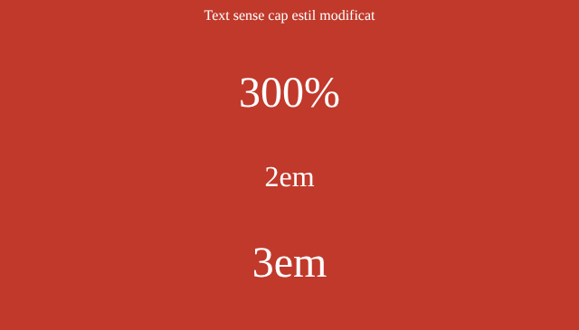

`3em` i `300%` tenen el mateix efecte: multipliquen per 3 la mida de la lletra del pare.

### 4.2. Colors

Els colors es poden escriure de diverses maneres:

| Notació | Exemple | Explicació |
| --- | --- | --- |
| Nom | `burlywood` | Hi ha una llista de [noms de color estàndard](https://developer.mozilla.org/ca/docs/Web/CSS/named-color) |
| RGB | `rgb(200, 200, 200)` | Quantitat de vermell, verd i blau, de 0 a 255 |
| RGBA | `rgba(255, 0, 0, 0.3)` | Com RGB, amb un quart valor, l'**opacitat**, de 0 (transparent) a 1 (opac) |
| Hexadecimal | `#9fd3c7` | Els tres components RGB escrits en hexadecimal, de `00` a `ff` |

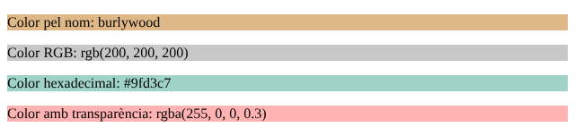

!!! tip "Tria colors amb el selector de VS Code"
    A VS Code, al costat de cada color d'un fitxer CSS apareix un quadradet del color. Si hi passes el ratolí per damunt, s'obre un selector per triar-lo visualment.

### 4.3. Tipus de lletra

La propietat `font-family` indica el tipus de lletra. Com que no tots els ordinadors tenen les mateixes fonts, s'hi escriu una **llista** de preferència que acaba amb un dels cinc tipus genèrics: `serif`, `sans-serif`, `monospace`, `cursive` o `fantasy`.

```css
p { font-family: Verdana, Arial, sans-serif; }
```

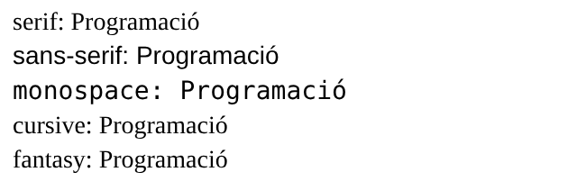

Fixa't que, a l'ordinador on s'ha fet aquesta captura, `cursive` i `fantasy` es veuen igual que `serif`: no tenia cap font d'aquests tipus. Per això sempre convé acabar la llista amb un tipus genèric segur, com `sans-serif`.

Si vols una font concreta, la pots carregar des d'Internet, per exemple des de [Google Fonts](https://fonts.google.com/), amb `@import` al principi del fitxer CSS:

```css
@import url('https://fonts.googleapis.com/css2?family=Roboto&display=swap');
p { font-family: "Roboto", sans-serif; }
```

### 4.4. Imatges de fons

Les imatges es fan servir a CSS amb la funció `url()`, sobretot com a fons d'un element:

```css
#capcalera {
    background-image: url(img/fons.jpg);
    color: white;
    padding: 2em;
}
```

!!! example "Exercici 2. Primers estils"
    En un fitxer `estils.css`:

    1. Fes que els títols `h1` tenguin una mida de 40 píxels.
    2. Canvia el color de fons de tota la pàgina a gris clar.
    3. Centra el text de tots els paràgrafs.
    4. Fes servir una font de Google Fonts per als títols.

    ??? success "Solució"
        ```css
        @import url('https://fonts.googleapis.com/css2?family=Roboto&display=swap');

        h1 {
            font-size: 40px;
            font-family: "Roboto", sans-serif;
        }
        body { background-color: lightgray; }
        p { text-align: center; }
        ```

        L'`@import` ha d'anar sempre al principi del fitxer.

## 5. Selectors

Els **selectors** decideixen a quins elements s'aplica cada regla. N'hi ha de molt generals i de molt precisos.

### 5.1. Selectors bàsics

| Selector | Selecciona | Sintaxi |
| --- | --- | --- |
| Universal | Tots els elements | `*` |
| De tipus | Tots els elements d'un tipus | `p`, `h1`, `li`… |
| De classe | Els elements amb una classe | `.nomClasse` |
| D'identificador | L'element amb un `id` | `#identificador` |
| D'atribut | Els elements que tenen un atribut, o un atribut amb un valor | `[title]`, `input[type="text"]` |

```css
* { margin: 3px; }                                        /* universal */
h1 { color: #999; font-style: italic; }                   /* de tipus */
#introduccio { border-style: dotted; padding: 1em; }      /* d'identificador */
.negatiu { color: crimson; font-weight: bolder; }         /* de classe */
.positiu { color: green; font-weight: bolder; }           /* de classe */
input[type] { background-color: #ddd; }                   /* d'atribut */
input[type="text"] { color: darkorange; font-weight: bolder; }
```

```html
<h1>Resum anual</h1>
<form>
    <input type="text" value="Departament">
    <input type="number" placeholder="Límit de vendes">
</form>
<p id="introduccio">Resultats satisfactoris en dos dels tres trimestres.</p>
<table>
    <tr><th>Ingressos</th><th>Despeses</th><th>Diferència</th></tr>
    <tr><td>100</td><td>50</td><td class="positiu">50</td></tr>
    <tr><td>200</td><td>190</td><td class="positiu">10</td></tr>
    <tr><td>80</td><td>180</td><td class="negatiu">-100</td></tr>
</table>
```

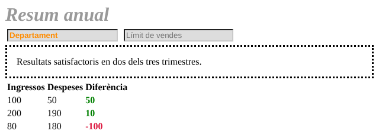

!!! tip "Classe o identificador?"
    Fes servir un **`id`** per a un element únic de la pàgina (la capçalera, el menú principal) i una **classe** per a tot allò que es pot repetir (els avisos, els botons, les targetes). En cas de dubte, fes servir una classe.

!!! example "Exercici 3. Classes i identificadors"
    1. Crea una classe anomenada `destacat` que posi el text en vermell i aplica-la a un paràgraf.
    2. Crea un element amb l'`id` `titol` i fes que el seu text sigui blau.
    3. Fes que els camps de text d'un formulari (i només aquests) tenguin el fons groc clar.

    ??? success "Solució"
        ```css
        .destacat { color: red; }
        #titol { color: blue; }
        input[type="text"] { background-color: lightyellow; }
        ```

        ```html
        <h1 id="titol">Títol</h1>
        <p class="destacat">Aquest paràgraf surt en vermell.</p>
        ```

### 5.2. Agrupar selectors

Per aplicar les mateixes declaracions a diversos selectors, s'escriuen separats per comes:

```css
h1, h2, .blaus, #titolSeccio {
    color: blue;
    padding: 2em;
}
```

### 5.3. Combinadors

Els **combinadors** seleccionen elements segons la seva posició a l'arbre del document (recorda les relacions de parentiu del mòdul d'HTML):

| Combinador | Sintaxi | Selecciona |
| --- | --- | --- |
| De descendents | `A B` | Els B que estan dins A, a qualsevol nivell |
| De fills | `A > B` | Els B que són fills directes de A |
| De germà adjacent | `A + B` | El B que va **just després** de A, amb el mateix pare |
| De germans | `A ~ B` | Tots els B que van **després** de A, amb el mateix pare |

```css
article > p { text-align: center; }   /* els p fills directes d'un article */
h2 ~ p { text-align: center; }        /* els p germans posteriors d'un h2 */
div p { text-align: center; }         /* els p que estan dins un div */
```

### 5.4. Pseudoclasses

Les **pseudoclasses** seleccionen elements segons el seu **estat** o la seva **posició**. S'escriuen després del selector amb dos punts: `selector:pseudoclasse`.

| Pseudoclasse | Selecciona l'element quan… |
| --- | --- |
| `:hover` | el ratolí hi passa per damunt |
| `:focus` | té el focus (per exemple, un camp on escrius) |
| `:active` | s'està activant (mentre fas clic) |
| `:checked` | és una casella o un botó d'opció marcat |
| `:disabled` / `:enabled` | està deshabilitat / habilitat |
| `:required` | és un camp obligatori |
| `:empty` | no té contingut |
| `:first-child` / `:last-child` | és el primer / el darrer dels seus germans |
| `:nth-child(n)` | és el germà número `n`. Admet `odd` (senars) i `even` (parells) |
| `:not(selector)` | **no** compleix el selector indicat |

```css
li { font-weight: bolder; }
li:first-child { color: red; }
li:nth-child(3) { color: green; }
li:last-child { color: blue; }
```

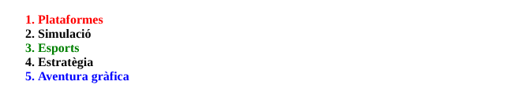

### 5.5. Pseudoelements

Els **pseudoelements** seleccionen **una part** d'un element. S'escriuen amb dos parells de dos punts: `selector::pseudoelement`.

| Pseudoelement | Selecciona |
| --- | --- |
| `::first-letter` | La primera lletra |
| `::first-line` | La primera línia |
| `::before` / `::after` | Un contingut nou, definit amb la propietat `content`, abans / després de l'element |
| `::selection` | La part del text que l'usuari ha seleccionat amb el ratolí |

```css
#quixot::first-letter { font-size: 3em; }
#quixot::after { content: " [CONTINUA LLEGINT...]"; color: #888; }
```

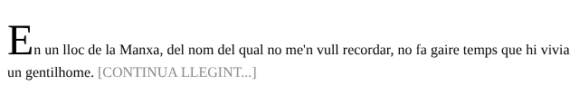

!!! example "Exercici 4. Pràctica de selectors"
    Copia aquest HTML en un fitxer i enllaça'l a un fitxer `estils.css`:

    ```html
    <!DOCTYPE html>
    <html lang="ca">
    <head>
        <meta charset="utf-8">
        <title>Pràctica de selectors</title>
        <link rel="stylesheet" href="estils.css">
    </head>
    <body>
        <div id="contenidor">
            <div class="entrada" title="primera entrada">
                <h2>Entrada 1</h2>
                <p>Aquesta és la primera entrada del blog.</p>
                <p class="comentari">Sense comentaris.</p>
            </div>
            <div class="entrada" title="segona entrada">
                <h2>Entrada 2</h2>
                <p>Aquesta és la segona entrada, amb <a href="#">un enllaç</a>.</p>
                <p class="comentari"></p>
            </div>
            <div class="entrada destacada" title="entrada destacada">
                <h2>Entrada destacada</h2>
                <p>Aquesta entrada està destacada i té <a href="#">un enllaç especial</a>.</p>
                <p class="comentari">Té dos comentaris.</p>
            </div>
        </div>
    </body>
    </html>
    ```

    Escriu a `estils.css` una regla per a cada tasca, sense modificar l'HTML:

    1. Treu el marge de tots els elements.
    2. Posa de color blau el text de tots els paràgrafs.
    3. Augmenta la mida de la lletra dels elements amb la classe `destacada`.
    4. Posa una vora a l'element amb l'identificador `contenidor`.
    5. Canvia el color de fons dels elements que tenen l'atribut `title`.
    6. Posa en cursiva els encapçalaments de segon nivell, els elements amb la classe `comentari` i els enllaços, amb una sola regla.
    7. Canvia el color de fons de tots els paràgrafs que són germans posteriors d'un `h2`.
    8. Dona un marge inferior als paràgrafs que són fills directes d'una `entrada`.
    9. Canvia el color del text de l'element que va just després d'un `h2`.
    10. Canvia el color dels enllaços que estan dins les entrades.
    11. Amaga els elements que no tenen contingut.
    12. Canvia el color del contorn dels enllaços quan tenen el focus.
    13. Canvia el color de fons dels enllaços quan el ratolí hi passa per damunt.
    14. Afegeix després de cada entrada el text «Publicat el 30/10/2026».
    15. Canvia el color del text que se selecciona dins les entrades.

    Pista: les tasques 7 i 9 s'assemblen, però no són iguals. Compara el resultat.

    ??? success "Solució"
        ```css
        /* 1 */  * { margin: 0; }
        /* 2 */  p { color: blue; }
        /* 3 */  .destacada { font-size: 1.3em; }
        /* 4 */  #contenidor { border: 2px solid black; }
        /* 5 */  [title] { background-color: lightyellow; }
        /* 6 */  h2, .comentari, a { font-style: italic; }
        /* 7 */  h2 ~ p { background-color: lavender; }
        /* 8 */  .entrada > p { margin-bottom: 10px; }
        /* 9 */  h2 + p { color: darkgreen; }
        /* 10 */ .entrada a { color: crimson; }
        /* 11 */ p:empty { display: none; }
        /* 12 */ a:focus { outline-color: orange; }
        /* 13 */ a:hover { background-color: yellow; }
        /* 14 */ .entrada::after { content: "Publicat el 30/10/2026"; }
        /* 15 */ .entrada ::selection { color: white; background-color: purple; }
        ```

        - La tasca 7 afecta **tots** els paràgrafs que van després d'un `h2`; la 9, només el **primer**, el que va just a continuació.
        - A la 15, l'espai abans de `::selection` és important: selecciona el text seleccionat de qualsevol element de dins les entrades.
        - El primer paràgraf de cada entrada surt verd encara que la regla 2 posi tots els paràgrafs blaus: `h2 + p` és **més específic** que `p`, perquè conté dos noms d'element en lloc d'un.
        - A la 11 hem escrit `p:empty` i no només `:empty`: elements com `img` o `br` tampoc no tenen contingut, i els amagaríem sense voler.

## 6. El model de caixes

Per a CSS, **cada element és una caixa rectangular**. Totes les caixes tenen aquestes parts, de dins cap a fora:

| Part | Propietats | Què és |
| --- | --- | --- |
| Contingut | `width`, `height` | L'espai que ocupa el contingut |
| Farciment | `padding` (i `padding-top`, `-right`, `-bottom`, `-left`) | Espai entre el contingut i la vora |
| Vora | `border` (i `border-width`, `-style`, `-color`, `-radius`) | La línia que envolta l'element |
| Marge | `margin` (i `margin-top`, `-right`, `-bottom`, `-left`) | Espai buit que separa l'element dels altres |

A més, el **contorn** (`outline`) és una línia que es dibuixa per damunt de la caixa, sense ocupar espai.

```css
div {
    margin: 20px;
    padding: 10px;
    border: 5px solid #ff0000;
    outline: 15px dashed lightblue;
    width: 200px;
    height: 100px;
}
```

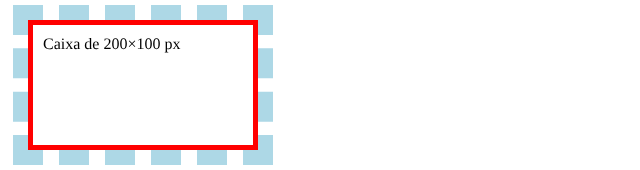

!!! tip "Valors abreujats"
    `margin` i `padding` admeten d'1 a 4 valors: `margin: 10px` (els quatre costats), `margin: 10px 20px` (dalt i baix, dreta i esquerra) i `margin: 10px 20px 5px 0` (dalt, dreta, baix i esquerra, en el sentit de les agulles del rellotge). Amb `margin: 0 auto`, un element amb amplada fixa queda centrat horitzontalment.

!!! info "Les eines de desenvolupament"
    Fes clic dret sobre qualsevol element d'una pàgina i tria **Inspecciona**. A les eines de desenvolupament del navegador veuràs el model de caixes de l'element, amb el valor de cada marge, vora i farciment, i podràs provar canvis de CSS en directe.

### 6.1. Caixes de bloc i caixes de línia

Hi ha dos tipus bàsics de caixes:

| Caixes de bloc (`div`, `p`, `h1`, `ul`…) | Caixes de línia (`span`, `a`, `strong`, `img`…) |
| --- | --- |
| Comencen en una línia nova i provoquen un salt de línia | No provoquen salts de línia |
| Ocupen tota l'amplada disponible | Ocupen només l'espai del seu contingut |
| Respecten `width` i `height` | Ignoren `width` i `height` |

```css
div { background-color: lightblue; }
span { background-color: lightgreen; }
```

```html
<div>Caixa de tipus bloc</div>
<span>Caixa de tipus línia</span>
<span>Una altra caixa de línia</span>
<div>Caixa de bloc amb <span>una caixa de línia</span> a dins.</div>
```

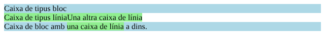

La propietat `display` canvia el comportament d'una caixa. Si afegim `display: block;` als `span`, es comporten com a blocs:

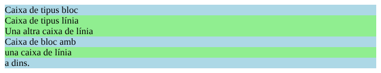

!!! example "Exercici 5. Caixes"
    1. Posa a un paràgraf una vora negra contínua d'1 píxel i un marge de 20 píxels.
    2. Crea una «targeta»: un `div` de 300 píxels d'amplada, centrat a la pàgina, amb farciment de 15 píxels, vora gris amb les cantonades arrodonides i un títol i un paràgraf a dins.

    ??? success "Solució"
        ```css
        p.amb-vora {
            border: 1px solid black;
            margin: 20px;
        }

        .targeta {
            width: 300px;
            margin: 20px auto;
            padding: 15px;
            border: 1px solid gray;
            border-radius: 8px;
        }
        ```

        ```html
        <p class="amb-vora">Paràgraf amb vora.</p>
        <div class="targeta">
            <h2>Títol de la targeta</h2>
            <p>Contingut de la targeta.</p>
        </div>
        ```

## 7. Propietats més habituals

### 7.1. Text

| Propietat | Funció | Valors habituals |
| --- | --- | --- |
| `color` | Color del text | Qualsevol color |
| `font-family` | Tipus de lletra | Llista de fonts acabada en un tipus genèric |
| `font-size` | Mida | `16px`, `1.2em`, `120%`… |
| `font-style` | Estil | `normal`, `italic` |
| `font-weight` | Gruix | `normal`, `bold`, o de `100` a `900` |
| `text-align` | Alineació horitzontal | `left`, `right`, `center`, `justify` |
| `text-decoration` | Línies decoratives | `none`, `underline`, `line-through` |
| `text-transform` | Majúscules i minúscules | `uppercase`, `lowercase`, `capitalize` |
| `line-height` | Interlineat | `1.5`, `24px`… |
| `letter-spacing` | Espai entre lletres | `2px`… |

### 7.2. Llistes

| Propietat | Funció | Valors habituals |
| --- | --- | --- |
| `list-style-type` | Tipus de vinyeta o de numeració | `disc`, `circle`, `square`, `decimal`, `upper-roman`, `lower-latin`, `none` |
| `list-style-position` | Vinyeta dins o fora del text | `inside`, `outside` |
| `list-style-image` | Una imatge com a vinyeta | `url(img/vinyeta.png)` |

`list-style-type: none` és molt útil per fer menús a partir d'una llista d'enllaços.

### 7.3. Taules

| Propietat | Funció |
| --- | --- |
| `border-collapse: collapse` | Uneix les vores de les cel·les en una sola línia |
| `border-spacing` | Distància entre les vores de les cel·les (si no estan unides) |
| `caption-side` | Posició del títol de la taula (`<caption>`): `top` o `bottom` |
| `vertical-align` | Alineació vertical del contingut de les cel·les: `top`, `middle`, `bottom` |

!!! example "Exercici 6. Una taula amb estil"
    Dona estil a la taula de les illes del mòdul d'HTML, **sense l'atribut `border`**: vores fines grises unides, farciment a les cel·les, encapçalament amb fons de color i files alternes acolorides (pista: `:nth-child(even)`).

    ??? success "Solució"
        ```css
        table { border-collapse: collapse; }
        th, td {
            border: 1px solid #999;
            padding: 6px 12px;
        }
        th {
            background-color: #2c6e9b;
            color: white;
        }
        tr:nth-child(even) { background-color: #eef4f8; }
        ```

### 7.4. Fons i vores

Les propietats de **fons** comencen per `background`: `background-color`, `background-image`, `background-repeat` (si la imatge es repeteix o no), `background-position` (on es col·loca) i `background-size` (amb `cover`, la imatge cobreix tot l'element). Es poden escriure totes juntes amb `background`. La propietat `opacity` fa transparent tot l'element, amb un valor de 0 a 1.

Les propietats de **vora** comencen per `border`: `border-width` (gruix), `border-style` (tipus de línia), `border-color` (color) i `border-radius` (arrodoniment de les cantonades). Es poden escriure juntes: `border: 3px dotted red;`.

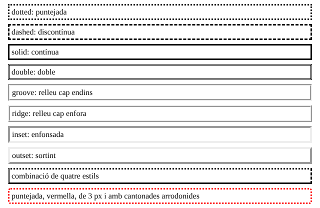

### 7.5. Enllaços

Els enllaços tenen diversos estats, i cada un es pot seleccionar amb una pseudoclasse. S'han d'escriure **en aquest ordre**, perquè les regles posteriors no anul·lin les anteriors:

| Selector | Estat |
| --- | --- |
| `a:link` | Enllaç no visitat |
| `a:visited` | Enllaç visitat. Per protegir la privacitat, els navegadors només hi deixen canviar propietats de color |
| `a:hover` | El ratolí hi passa per damunt |
| `a:focus` | Té el focus (per exemple, s'hi ha arribat amb la tecla de tabulació) |
| `a:active` | S'està fent clic |

```css
a:link { color: #1a5276; text-decoration: none; }
a:visited { color: #6c3483; }
a:hover { color: white; background-color: #1a5276; }
a:focus { outline: 2px solid orange; }
a:active { color: red; }
```

!!! example "Exercici 7. Un menú horitzontal"
    Converteix aquesta llista d'enllaços en un menú horitzontal: sense vinyetes, amb els elements un al costat de l'altre, els enllaços sense subratllar i amb el fons canviant de color en passar-hi el ratolí per damunt.

    ```html
    <ul class="menu">
        <li><a href="index.html">Inici</a></li>
        <li><a href="aficions.html">Aficions</a></li>
        <li><a href="contacte.html">Contacte</a></li>
    </ul>
    ```

    ??? success "Solució"
        ```css
        .menu {
            list-style-type: none;
            padding: 0;
            background-color: #333;
        }
        .menu li { display: inline-block; }
        .menu a {
            display: block;
            padding: 10px 16px;
            color: white;
            text-decoration: none;
        }
        .menu a:hover { background-color: #2c6e9b; }
        ```

        Amb `display: inline-block`, els `li` es col·loquen un al costat de l'altre però continuen acceptant marges i farciment. Posar `display: block` als enllaços fa que tota la zona de color sigui clicable, no només el text.

### 7.6. Formularis

Als formularis s'hi apliquen les mateixes propietats que ja coneixes. Mira la diferència entre un formulari sense CSS i el mateix formulari amb aquest full d'estil:

```html
<div id="formulari">
    <h1>Crea un compte</h1>
    <form action="#">
        <div>
            <label for="nom">Nom</label>
            <input type="text" id="nom" name="nom" class="entrada vora-arrodonida">
        </div>
        <div>
            <label for="correu">Correu electrònic</label>
            <input type="email" id="correu" name="correu" class="entrada vora-arrodonida">
        </div>
        <div>
            <label for="contrasenya">Contrasenya</label>
            <input type="password" id="contrasenya" name="contrasenya" class="entrada vora-arrodonida">
        </div>
        <div>
            <label for="confirmacio">Confirma la contrasenya</label>
            <input type="password" id="confirmacio" name="confirmacio" class="entrada vora-arrodonida">
        </div>
        <div>
            <input type="submit" id="boto-acceptar" value="Crea el compte" class="entrada vora-arrodonida">
        </div>
    </form>
</div>
```

```css
body { font-family: sans-serif; }
h1 { margin-top: 5px; }
label {
    display: block;           /* cada etiqueta, damunt del seu camp */
    font-weight: bold;
    margin-bottom: 0.2em;
}
#formulari { width: 350px; margin: auto; }   /* formulari centrat */
#boto-acceptar {
    margin-top: 30px;
    width: 100%;
    padding: 12px 3px;
    background-color: #ffd904;
}
.entrada { width: 97%; padding: 7px 3px; margin-bottom: 1em; }
.entrada:focus { outline: none; border-color: #ca5f07; }
.vora-arrodonida { border: 1px solid #aaa; border-radius: 3px; }
```

=== "Sense CSS"

    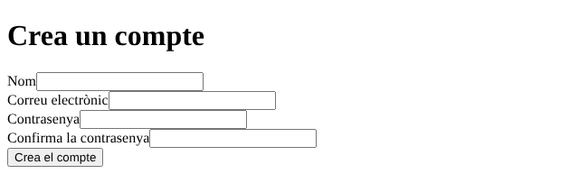

=== "Amb CSS"

    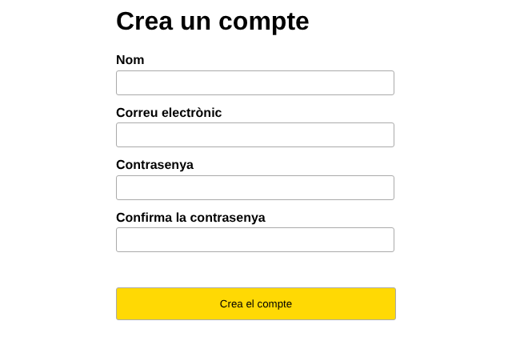

## 8. Frameworks de CSS

Un **framework de CSS** és una biblioteca d'estils ja fets. En lloc d'escriure el CSS, s'afegeixen a l'HTML unes **classes** que el framework ja té definides. Un dels més utilitzats és [Tailwind CSS](https://tailwindcss.com/).

Per provar-lo, no cal instal·lar res: només s'ha d'afegir un `script` a la capçalera.

```html
<!DOCTYPE html>
<html lang="ca">
<head>
    <meta charset="utf-8">
    <meta name="viewport" content="width=device-width, initial-scale=1">
    <script src="https://cdn.jsdelivr.net/npm/@tailwindcss/browser@4"></script>
</head>
<body>
    <h1 class="text-3xl font-bold underline">Hola, món!</h1>
</body>
</html>
```

Sense escriure cap línia de CSS, el títol surt gros (`text-3xl`), en negreta (`font-bold`) i subratllat (`underline`). Cada classe de Tailwind correspon a una o poques propietats de CSS, i a la [documentació](https://tailwindcss.com/docs) hi ha la llista completa.

!!! warning "Només per provar"
    Segons la documentació de Tailwind, aquesta manera d'enllaçar-lo, el *Play CDN*, serveix per a proves i desenvolupament, no per publicar webs reals. Per a una web real s'ha d'instal·lar seguint la seva documentació.

Els frameworks permeten fer pàgines d'aspecte professional molt de pressa, però tenen un preu: **si no entens el CSS que hi ha al darrere, no sabràs modificar-les**. Per això primer has d'aprendre CSS, i després, si vols, un framework. Altres frameworks molt utilitzats són [Bootstrap](https://getbootstrap.com/) i [Bulma](https://bulma.io/).

## 9. Reptes

!!! example "Repte 1. La teva pàgina, amb estil"
    Fes un full d'estil per a la pàgina personal o la web que vas crear al mòdul d'HTML. Ha de tenir, com a mínim:

    - Un fitxer `estils.css` enllaçat des de totes les pàgines.
    - Una font de Google Fonts per als títols.
    - Una paleta de 3 o 4 colors, aplicada de manera coherent.
    - Un menú horitzontal (exercici 7).
    - Una taula amb estil (exercici 6).
    - Algun efecte amb `:hover`.
    - El contingut centrat, amb una amplada màxima (pista: `max-width` i `margin: auto`).

!!! example "Repte 2. Comprova l'accessibilitat"
    Una web ha de ser llegible per a tothom. Comprova la teva:

    1. El text i el fons tenen prou **contrast**? Comprova'l amb el [verificador de contrast de WebAIM](https://webaim.org/resources/contrastchecker/).
    2. Amplia la pàgina al 200 % amb ++ctrl+plus++: encara es pot llegir i fer servir?
    3. Pots arribar a tots els enllaços i camps del formulari només amb la tecla ++tab++? Es veu on és el focus en cada moment?

    Escriu què has trobat i què has corregit.

!!! example "Repte 3 (opcional). Prova un framework"
    Refés la pàgina d'inici de la teva web fent servir Tailwind en lloc del teu full d'estil. Després, escriu un paràgraf comparant les dues maneres de treballar: què t'ha resultat més fàcil i què més difícil?

---

!!! quote "Font"
    Mòdul elaborat a partir de materials de Lope González Vázquez ([CC BY-NC-SA 4.0](https://creativecommons.org/licenses/by-nc-sa/4.0/deed.ca)): [«Tema 7. CSS»](https://lopegonzalez.es/eso-y-bachillerato/programacion-y-computacion-2o-bachillerato/tema-7-css/) (Programación y computación) i [«Prácticas de CSS»](https://lopegonzalez.es/eso-y-bachillerato/tic-ii-2o-bachillerato/tema-5-la-web/practicas-de-css/) (TIC II). Canvis: traducció al català, unió de les dues fonts en un mòdul, reorganització i exemples adaptats. S'han corregit o actualitzat alguns detalls: la definició de les unitats `em` i `ex` (aquesta darrera s'ha suprimit), el comportament de `a:visited`, un valor no vàlid de `font-weight` i un `label` mal associat a l'exemple del formulari, i l'enllaç de Tailwind, que ara és el de la versió 4 segons la [seva documentació](https://tailwindcss.com/docs/installation/play-cdn). No s'han reproduït les imatges originals; les captures són pròpies. Les tasques de l'«Ejercicio 7.1» de Lope s'han distribuït en els exercicis 1, 2, 3 i 5, i la «Práctica de selectores» és l'exercici 4, adaptada. Són propis la nota sobre la cascada, els exercicis 6 i 7, els reptes i totes les solucions.
