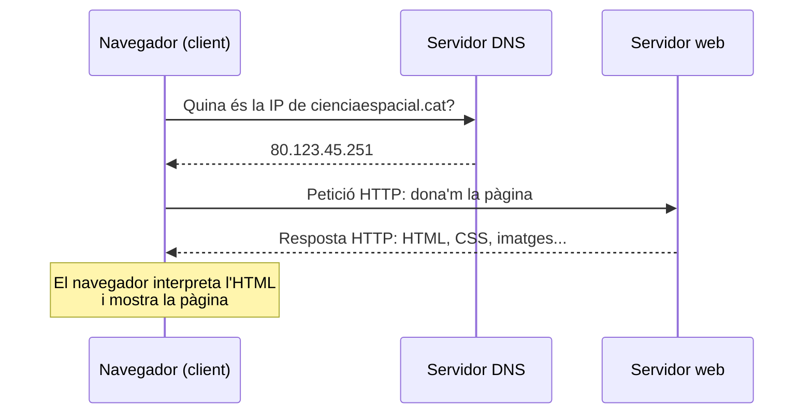
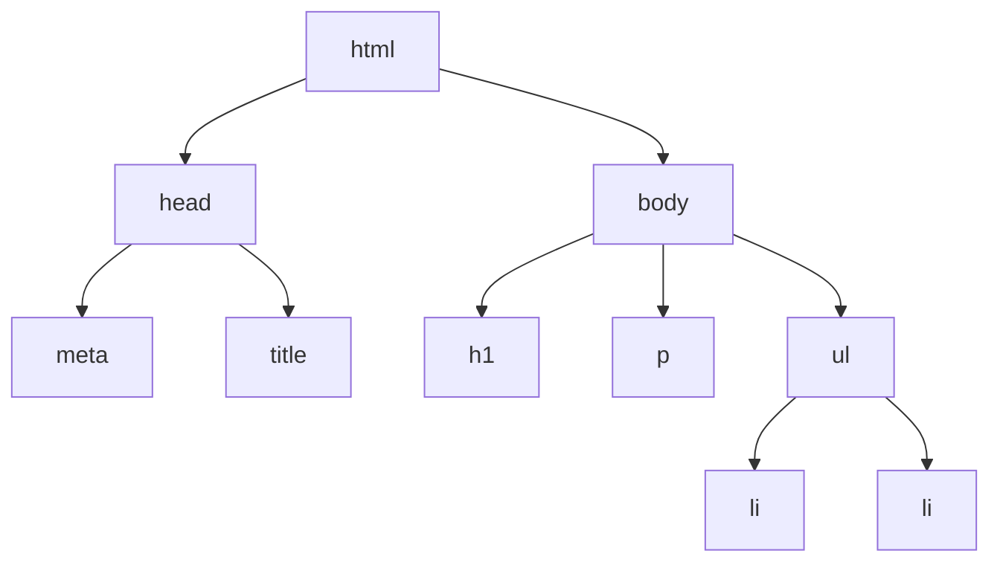
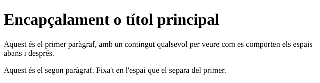
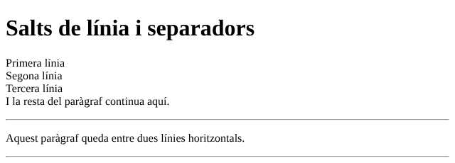
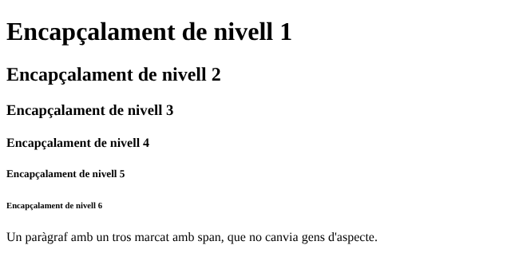
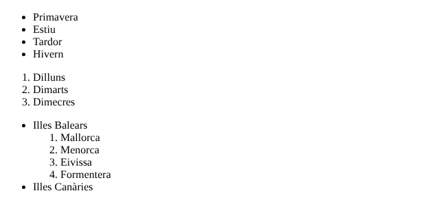
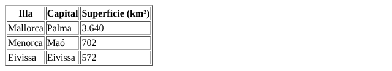
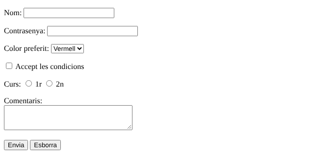
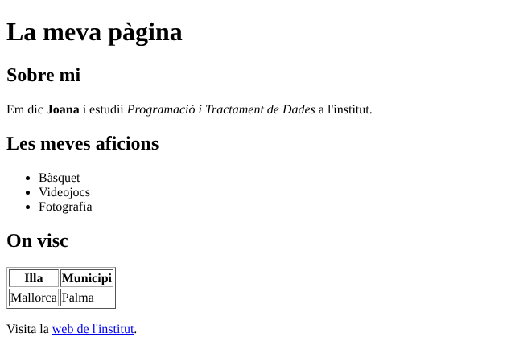

# HTML: l'estructura de les pàgines web

Tota pàgina web que visites està feta, com a mínim, amb **HTML**. En aquest mòdul entendràs com arriba una pàgina des d'un servidor fins al teu navegador i aprendràs a construir-ne l'estructura: títols, paràgrafs, enllaços, imatges, llistes, taules i formularis. Al mòdul de [CSS](css.md) aprendràs a donar-li aspecte.

| Fitxa del mòdul | |
| --- | --- |
| **Nivell** | Itinerari opcional per a PTD I i PTD II. També adequat per a Digitalització |
| **Requisits previs** | Cap |
| **Eines** | Visual Studio Code amb l'extensió Live Server, i un navegador |
| **Durada orientativa** | 6-8 sessions |
| **Relació amb el currículum** | PTD: competència específica 4 (publicar els programes i les dades en diferents formats). Digitalització: desenvolupament d'aplicacions senzilles per a dispositius mòbils i web |

## 1. Com funciona la web

La web va néixer al CERN, a Ginebra, a final dels anys vuitanta i principi dels noranta, quan **Tim Berners-Lee** va idear una manera d'interconnectar documents mitjançant **hipertext**: textos que contenen enllaços a altres textos. Avui és molt més que una manera de transmetre informació: és un espai on ens comunicam, compram, aprenem i ens informam.

### 1.1. Característiques de la web

- **És interactiva.** No és una via d'un sol sentit: els usuaris hi envien informació, per exemple quan omplen un formulari.
- **Ha de ser accessible.** Una web ha de poder funcionar per a qualsevol persona, en qualsevol dispositiu i navegador. La *Web Accessibility Initiative* (WAI) del W3C publica pautes perquè les persones amb discapacitat també la puguin fer servir.
- **Té contingut dinàmic.** Moltes pàgines canvien en temps real o són diferents per a cada usuari, com les xarxes socials.
- **Es basa en l'hipertext.** Els documents estan enllaçats entre ells. La Viquipèdia n'és l'exemple més clar.

### 1.2. Què passa quan escrius una adreça al navegador

Imagina que vols consultar una pàgina sobre el sistema solar i escrius `cienciaespacial.cat` al navegador. En un parell de segons passen aquestes coses:

1. **La petició.** El navegador (Chrome, Firefox, Safari…) fa una **petició HTTP** (*HTTP request*) per demanar aquella pàgina.
2. **Localitzar el servidor.** Cada pàgina té una adreça única, la **URL** (*Uniform Resource Locator*). Però els ordinadors de la xarxa s'identifiquen amb nombres, les **adreces IP**, com `80.123.45.251` (quatre nombres de 0 a 255 separats per punts). El **DNS** (*Domain Name System*) fa de guia telefònica: tradueix el nom del domini a l'adreça IP del servidor que allotja la web.
3. **La resposta del servidor.** El servidor rep la petició, prepara la pàgina i la torna al navegador: és la **resposta HTTP** (*HTTP response*). El que passa al servidor és el ***backend***, la part de la web que l'usuari no veu.
4. **El navegador mostra la pàgina.** El navegador llegeix l'**HTML** (l'estructura), hi aplica el **CSS** (l'aspecte) i executa el **JavaScript** (la interactivitat). El que veus a la pantalla és el ***frontend***.
5. **Més peticions.** Cada vegada que fas clic en un enllaç, el cicle torna a començar.



Aquesta manera de funcionar, en què un **client** demana i un **servidor** respon, s'anomena **arquitectura client-servidor**.

!!! info "Adreces IPv4 i IPv6"
    Les adreces de quatre nombres que hem vist són de la versió 4 del protocol IP (IPv4). Com que se n'estan acabant, s'està implantant la versió 6 (IPv6), amb adreces molt més llargues, com `2001:db8::1`.

!!! example "Exercici 1. Qui fa què?"
    Relaciona cada concepte amb la seva funció: **URL**, **adreça IP**, **DNS**, **servidor web**, **navegador**.

    a) Tradueix noms de domini a adreces numèriques. b) Guarda les pàgines i les envia quan les hi demanen. c) Interpreta l'HTML i mostra la pàgina. d) Adreça llegible que identifica una pàgina. e) Nombre que identifica un ordinador a la xarxa.

    ??? success "Solució"
        URL → d; adreça IP → e; DNS → a; servidor web → b; navegador → c.

!!! example "Exercici 2. Frontend o backend?"
    Classifica aquestes tasques segons si passen al client (*frontend*) o al servidor (*backend*): mostrar un botó de color blau; comprovar si la contrasenya d'un usuari és correcta; guardar una comanda en una base de dades; ampliar una imatge en passar-hi el ratolí per damunt.

    ??? success "Solució"
        *Frontend*: el botó blau i l'efecte en passar el ratolí per damunt. *Backend*: comprovar la contrasenya i guardar la comanda, perquè necessiten dades que només té el servidor.

## 2. Preparar l'entorn

Un document HTML és un fitxer de text. Es podria escriure amb qualsevol editor de text, però és molt més còmode fer-ho amb un **editor de codi**, que acoloreix les etiquetes, les tanca automàticament i detecta errors. Farem servir **Visual Studio Code**, el mateix que a programació.

1. A VS Code, instal·la l'extensió **Live Server** (de Ritwick Dey) des de la secció d'extensions.
2. Crea una carpeta per als teus exercicis i obre-la a VS Code (**File → Open Folder**).
3. Crea un fitxer anomenat `index.html`. Els fitxers HTML sempre han de tenir l'extensió `.html`.
4. Amb el fitxer obert, fes clic a **Go Live** a la barra inferior. S'obrirà el navegador amb la pàgina, i cada vegada que desis el fitxer es tornarà a carregar sola.

!!! tip "Escriu `!` i prem Tab"
    A VS Code, en un fitxer `.html` buit, escriu un signe d'exclamació `!` i prem ++tab++: l'editor hi escriurà l'estructura bàsica d'una pàgina, que veurem a l'apartat 4.

## 3. Elements i etiquetes

HTML (*HyperText Markup Language*) és un **llenguatge de marques**: no és un llenguatge de programació, perquè no té variables, condicions ni bucles. El que fa és **marcar** cada part del contingut per indicar al navegador què és: un títol, un paràgraf, un enllaç…

Les marques s'anomenen **etiquetes**. Un **element** està format normalment per una etiqueta d'obertura, el contingut i una etiqueta de tancament:

```html
<h1>HTML per a principiants</h1>
```

| Part | Exemple | Funció |
| --- | --- | --- |
| Etiqueta d'obertura | `<h1>` | Indica on comença l'element i de quin tipus és |
| Contingut | `HTML per a principiants` | El que es mostra |
| Etiqueta de tancament | `</h1>` | Indica on acaba. Duu una barra `/` |

Hi ha uns quants elements que no tenen contingut ni etiqueta de tancament, com `<br>` (salt de línia) o `` (imatge). Els anomenam **elements buits**.

!!! example "Exercici 3. Troba els errors"
    Cada línia té un error. Troba'l i corregeix-lo.

    ```html
    <p>Un paràgraf</p
    <h2>Un subtítol<h2>
    <p>Un paràgraf amb <strong>negreta</p></strong>
    ```

    ??? success "Solució"
        ```html
        <p>Un paràgraf</p>
        <h2>Un subtítol</h2>
        <p>Un paràgraf amb <strong>negreta</strong></p>
        ```

        A la primera línia hi falta el `>` de l'etiqueta de tancament. A la segona, l'etiqueta de tancament no té la barra. A la tercera, les etiquetes estan encreuades: l'últim element que s'obre ha de ser el primer que es tanca.

## 4. Estructura bàsica d'un document

Tota pàgina HTML té la mateixa estructura de base:

```html
<!DOCTYPE html>
<html lang="ca">
<head>
    <meta charset="utf-8">
    <meta name="viewport" content="width=device-width, initial-scale=1">
    <title>La meva primera web</title>
</head>
<body>
    <!-- Aquí va tot el que es veu a la pàgina -->
</body>
</html>
```

| Element | Funció |
| --- | --- |
| `<!DOCTYPE html>` | Indica al navegador que el document és HTML5, la versió actual |
| `<html lang="ca">` | És l'**arrel** del document: tot va a dins. L'atribut `lang` indica l'idioma, i ajuda els cercadors i els lectors de pantalla |
| `<head>` | La **capçalera**: informació sobre la pàgina que, en general, no es veu |
| `<meta charset="utf-8">` | Codificació de caràcters. Sense aquesta línia, els accents i la ç es poden veure malament |
| `<meta name="viewport" …>` | Fa que la pàgina s'adapti a la pantalla dels mòbils |
| `<title>` | El títol que surt a la pestanya del navegador i als resultats dels cercadors |
| `<body>` | El **cos**: tot el contingut que es veu |

### 4.1. L'arbre del document

Els elements es posen uns dins els altres i formen una estructura en forma d'**arbre**. L'arrel sempre és `html`. Un element que en conté d'altres és el **pare** d'aquests, que són els seus **fills**; els elements que tenen el mateix pare són **germans**, i tots els que pengen d'un element, a qualsevol nivell, en són **descendents**. Aquestes relacions seran molt importants a CSS.



!!! tip "Sagna el codi"
    Escriu cada element fill amb una sagnia més que el seu pare, com a l'exemple. Al navegador no li importa, però fa el codi molt més fàcil de llegir i de corregir. A VS Code, ++shift+alt+f++ ho fa automàticament.

!!! example "Exercici 4. La primera web"
    Crea una pàgina que tengui el títol «La meva primera web» a la pestanya del navegador i que mostri el text «Hola, món!» a la pàgina.

    ??? success "Solució"
        ```html
        <!DOCTYPE html>
        <html lang="ca">
        <head>
            <meta charset="utf-8">
            <title>La meva primera web</title>
        </head>
        <body>
            <p>Hola, món!</p>
        </body>
        </html>
        ```

## 5. Elements de text

| Element | Funció |
| --- | --- |
| `<h1>` … `<h6>` | Encapçalaments (títols) de nivell 1 a 6. El `h1` és el més important |
| `<p>` | Paràgraf. Deixa un espai abans i després |
| `<br>` | Salt de línia dins un paràgraf (element buit) |
| `<hr>` | Línia horitzontal de separació (element buit) |
| `<strong>` | Text important, que el navegador mostra en negreta |
| `<em>` | Text emfasitzat, que el navegador mostra en cursiva |
| `<span>` | Marca un tros de text sense canviar-ne l'aspecte. Serveix per aplicar-hi estils amb CSS |

```html
<h1>Encapçalament o títol principal</h1>
<p>Aquest és el primer paràgraf, amb un contingut qualsevol per veure com es comporten els espais abans i després.</p>
<p>Aquest és el segon paràgraf. Fixa't en l'espai que el separa del primer.</p>
```



```html
<h1>Salts de línia i separadors</h1>
<p>Primera línia<br>Segona línia<br>Tercera línia<br>I la resta del paràgraf continua aquí.</p>
<hr>
<p>Aquest paràgraf queda entre dues línies horitzontals.</p>
<hr>
```



Els sis nivells d'encapçalament i un `span`, que no canvia res per si mateix:



!!! warning "Els títols no són per fer el text gros"
    Tria el nivell de l'encapçalament segons la **importància** del títol, no segons la mida que vols. Un `h2` sempre ha d'anar dins una secció d'un `h1`, i així successivament. Els cercadors i els lectors de pantalla fan servir aquesta jerarquia per entendre la pàgina. La mida ja la canviaràs amb CSS.

### 5.1. Comentaris

Els comentaris són notes per als programadors. No es mostren a la pàgina, però **qualsevol usuari els pot llegir** amb les eines del navegador: no hi posis mai informació privada.

```html
<!-- Aquest és un comentari: no surt a la pàgina -->
```

!!! example "Exercici 5. Pàgina personal (I)"
    Crea una pàgina amb un títol principal «La meva pàgina personal» i, a sota, un subtítol «Sobre mi». Afegeix-hi dos paràgrafs on expliquis qui ets i què t'agrada fer. En un dels paràgrafs, posa una paraula en negreta i una altra en cursiva.

    ??? success "Solució (només el `body`)"
        ```html
        <h1>La meva pàgina personal</h1>
        <h2>Sobre mi</h2>
        <p>Em dic <strong>Joana</strong> i estudii primer de Batxillerat.</p>
        <p>M'agrada molt la <em>fotografia</em> i jugar a bàsquet els caps de setmana.</p>
        ```

## 6. Atributs

Els **atributs** donen informació addicional sobre un element. Sempre van **dins l'etiqueta d'obertura**, amb la forma `nom="valor"`:

```html
<p id="especial" class="destacat">Un paràgraf amb dos atributs.</p>
```

| Atribut | Funció |
| --- | --- |
| `id` | Identifica un element **únic**: el mateix valor no es pot repetir a la pàgina |
| `class` | Marca un **grup** d'elements que comparteixen alguna característica. Es pot repetir tantes vegades com calgui |
| `href` | Adreça de destinació d'un enllaç |
| `src` | Ubicació d'un recurs, com una imatge |
| `alt` | Text alternatiu d'una imatge |
| `title` | Text que apareix en passar el ratolí per damunt |
| `style` | Estils CSS aplicats directament a l'element. És una mala pràctica: fes-lo servir només en casos excepcionals |
| `data-*` | Atributs personalitzats, per guardar dades que farà servir un programa en JavaScript |

## 7. Enllaços

Els **enllaços** (o hipervincles) fan que la web sigui una web. Es creen amb l'element `a`:

```html
<a href="https://www.caib.es" target="_blank">Web del Govern de les Illes Balears</a>
```

- El **contingut** és el text on es fa clic. Ha de dir clarament on porta: evita «fes clic aquí».
- L'atribut `href` indica la **URL de destinació**.
- `target="_blank"` fa que la pàgina s'obri en una pestanya nova. Sense aquest atribut, la pàgina de destinació substitueix l'actual.

També es pot enllaçar:

- **A una altra pàgina de la mateixa web**, amb una ruta relativa: `<a href="contacte.html">Contacte</a>`.
- **A un punt concret d'una pàgina**, afegint `#` i l'`id` de l'element: `<a href="#horaris">Vés als horaris</a>` porta a l'element que té `id="horaris"`.

!!! example "Exercici 6. Un menú d'enllaços"
    Afegeix a la teva pàgina personal tres enllaços: un a un cercador, que s'obri en una pestanya nova; un a una altra pàgina teva, `aficions.html`, que hauràs de crear a la mateixa carpeta; i un que porti al subtítol «Sobre mi» de la mateixa pàgina.

    ??? success "Solució"
        ```html
        <a href="https://duckduckgo.com" target="_blank">Cercador DuckDuckGo</a>
        <a href="aficions.html">Les meves aficions</a>
        <a href="#sobre-mi">Sobre mi</a>
        <!-- ... -->
        <h2 id="sobre-mi">Sobre mi</h2>
        ```

        Perquè el tercer enllaç funcioni, el subtítol ha de tenir l'atribut `id="sobre-mi"`.

## 8. Imatges

Les imatges s'insereixen amb l'element buit `img`:

```html

```

| Atribut | Funció |
| --- | --- |
| `src` | On és la imatge |
| `alt` | Descripció del que es veu a la imatge |
| `title` | Text que surt en passar el ratolí per damunt |
| `width` | Amplada en píxels (l'altura s'ajusta sola per mantenir la proporció) |

L'atribut `alt` és **imprescindible** per tres motius: es mostra si la imatge no es pot carregar; el llegeixen els **lectors de pantalla** que fan servir les persones cegues; i ajuda els cercadors a entendre la pàgina.

### 8.1. Rutes relatives i absolutes

Es poden fer servir imatges d'una altra web posant-ne l'adreça completa, però si el propietari les esborra o les canvia de lloc, la teva pàgina es quedarà sense. **És millor guardar les imatges a la teva pròpia web**, i indicar-ne la ubicació amb una **ruta**. Suposa aquesta estructura de carpetes:

```text
web/
├── index.html
├── img/
│   └── paisatge.jpg
└── pagines/
    └── viatges.html
```

| Des de… | Per arribar a `paisatge.jpg` | Explicació |
| --- | --- | --- |
| `index.html` | `img/paisatge.jpg` | Ruta relativa: entra a la carpeta `img` |
| `pagines/viatges.html` | `../img/paisatge.jpg` | Ruta relativa: `..` puja un nivell |
| Qualsevol pàgina | `/img/paisatge.jpg` | Ruta absoluta: la `/` inicial és l'arrel de la web |

!!! warning "Majúscules, espais i accents"
    Als servidors web, `Foto.jpg` i `foto.jpg` són fitxers diferents. Posa noms en **minúscules**, **sense espais** ni **accents**: `serra-tramuntana.jpg`, no `Serra Tramuntana.JPG`.

!!! example "Exercici 7. Rutes"
    Amb l'estructura de carpetes anterior, quina ruta hauries d'escriure a `pagines/viatges.html` per enllaçar a `index.html`? I a `index.html` per enllaçar a `viatges.html`?

    ??? success "Solució"
        Des de `pagines/viatges.html`: `<a href="../index.html">Inici</a>`. Des de `index.html`: `<a href="pagines/viatges.html">Viatges</a>`.

## 9. Llistes

Hi ha dos tipus de llistes:

- **Llistes no ordenades**, `<ul>` (*unordered list*): cada element duu una vinyeta.
- **Llistes ordenades**, `<ol>` (*ordered list*): els elements es numeren.

En totes dues, cada element de la llista va dins un `<li>` (*list item*). Les llistes es poden **niar**: una llista dins un element d'una altra llista.

```html
<ul>
    <li>Primavera</li>
    <li>Estiu</li>
    <li>Tardor</li>
    <li>Hivern</li>
</ul>

<ol>
    <li>Dilluns</li>
    <li>Dimarts</li>
    <li>Dimecres</li>
</ol>

<ul>
    <li>Illes Balears
        <ol>
            <li>Mallorca</li>
            <li>Menorca</li>
            <li>Eivissa</li>
            <li>Formentera</li>
        </ol>
    </li>
    <li>Illes Canàries</li>
</ul>
```



!!! warning "On va la llista niada"
    La llista interior ha d'anar **dins** del `<li>` de l'element al qual pertany, abans del `</li>`. Posar-la directament dins el `<ul>`, entre dos `<li>`, és un error freqüent: el navegador la mostra, però el codi no és correcte.

!!! example "Exercici 8. Llistes"
    1. Crea una llista no ordenada amb tres aficions.
    2. Crea una llista ordenada amb les passes per fer un entrepà de pa amb oli.

    ??? success "Solució"
        ```html
        <ul>
            <li>Bàsquet</li>
            <li>Videojocs</li>
            <li>Fotografia</li>
        </ul>

        <ol>
            <li>Tallar una llesca de pa.</li>
            <li>Fregar-hi tomàtiga.</li>
            <li>Posar-hi oli i sal.</li>
            <li>Afegir-hi el que vulguis per damunt.</li>
        </ol>
        ```

## 10. Taules

Una **taula** està formada per files i columnes. Es construeix així:

- `<table>` conté tota la taula.
- `<tr>` (*table row*) és una fila.
- `<td>` (*table data*) és una cel·la de dades.
- `<th>` (*table header*) és una cel·la d'encapçalament. El navegador la mostra en negreta, i els cercadors i lectors de pantalla l'entenen com a títol de la columna.

```html
<table border="1">
    <tr>
        <th>Illa</th>
        <th>Capital</th>
        <th>Superfície (km²)</th>
    </tr>
    <tr>
        <td>Mallorca</td>
        <td>Palma</td>
        <td>3.640</td>
    </tr>
    <tr>
        <td>Menorca</td>
        <td>Maó</td>
        <td>702</td>
    </tr>
    <tr>
        <td>Eivissa</td>
        <td>Eivissa</td>
        <td>572</td>
    </tr>
</table>
```



Sense l'atribut `border`, la taula no té vores i costa veure on comença cada cel·la. Aquest atribut és antic i està desaconsellat: al mòdul de CSS veuràs com fer-ho correctament.

!!! info "Les taules són per a dades"
    Fa anys, les taules es feien servir per col·locar els elements de la pàgina (el menú a l'esquerra, el contingut a la dreta…). Avui això es fa amb CSS. Fes servir les taules **només per a dades tabulars**, com les d'aquest exemple.

!!! example "Exercici 9. Horari"
    Crea una taula amb el teu horari d'un dia: una columna per a l'hora i una altra per a la matèria, amb una fila d'encapçalament.

    ??? success "Solució (només les tres primeres hores)"
        ```html
        <table border="1">
            <tr>
                <th>Hora</th>
                <th>Matèria</th>
            </tr>
            <tr>
                <td>8:00</td>
                <td>Matemàtiques</td>
            </tr>
            <tr>
                <td>8:55</td>
                <td>Programació i Tractament de Dades</td>
            </tr>
            <tr>
                <td>9:50</td>
                <td>Anglès</td>
            </tr>
        </table>
        ```

## 11. Formularis

Els **formularis** recullen informació dels usuaris: un inici de sessió, una enquesta, una inscripció… Tot el formulari va dins l'element `<form>`:

```html
<form action="https://exemple.cat/processa" method="get">
    <!-- Camps del formulari -->
</form>
```

- `action` és l'adreça del programa del servidor que rebrà i processarà les dades.
- `method` indica com s'envien: amb `get`, les dades es veuen a la barra d'adreces; amb `post`, no. Per a dades privades, com una contrasenya, sempre s'ha de fer servir `post`, i la web ha de funcionar amb HTTPS.

!!! info "Qui processa les dades?"
    HTML només dibuixa el formulari. Per fer alguna cosa amb les dades (guardar-les, comprovar una contrasenya…) cal un programa al servidor, escrit en un llenguatge com Python, PHP o JavaScript. Als nostres exercicis, el botó d'enviar no farà res de profit, però el formulari es veurà i es podrà omplir.

### 11.1. Camps del formulari

La majoria de camps es creen amb l'element buit `<input>`, i l'atribut `type` en defineix el tipus:

| `type` | Camp |
| --- | --- |
| `text` | Text d'una línia |
| `password` | Contrasenya: els caràcters no es veuen |
| `email` | Correu electrònic: el navegador comprova que tengui `@` |
| `number` | Nombre |
| `date` | Data, amb calendari |
| `checkbox` | Casella de verificació: se'n poden marcar diverses |
| `radio` | Botó d'opció: només se'n pot triar un del grup amb el mateix `name` |
| `file` | Selecció d'un fitxer |
| `submit` | Botó d'enviar |
| `reset` | Botó d'esborrar el formulari |

Altres elements dels formularis:

- `<label>`: l'**etiqueta** que descriu un camp. Amb l'atribut `for` igual a l'`id` del camp, en fer clic a l'etiqueta s'activa el camp, i els lectors de pantalla saben quina etiqueta correspon a cada camp.
- `<select>` i `<option>`: una llista desplegable.
- `<textarea>`: un quadre de text de diverses línies.

L'atribut `name` de cada camp és el nom amb què el servidor rebrà la dada.

```html
<form action="#" method="get">
    <p><label for="nom">Nom:</label> <input type="text" id="nom" name="nom"></p>
    <p><label for="contrasenya">Contrasenya:</label> <input type="password" id="contrasenya" name="contrasenya"></p>
    <p>
        <label for="color">Color preferit:</label>
        <select id="color" name="color">
            <option>Vermell</option>
            <option>Verd</option>
            <option>Blau</option>
        </select>
    </p>
    <p><input type="checkbox" id="condicions" name="condicions"> <label for="condicions">Accept les condicions</label></p>
    <p>
        Curs:
        <input type="radio" id="c1" name="curs" value="1"> <label for="c1">1r</label>
        <input type="radio" id="c2" name="curs" value="2"> <label for="c2">2n</label>
    </p>
    <p>
        <label for="comentaris">Comentaris:</label><br>
        <textarea id="comentaris" name="comentaris" rows="3" cols="30"></textarea>
    </p>
    <p><input type="submit" value="Envia"> <input type="reset" value="Esborra"></p>
</form>
```



!!! example "Exercici 10. Inscripció a un torneig"
    Crea un formulari d'inscripció a un torneig de videojocs de l'institut que demani: nom i llinatges, correu electrònic, curs (desplegable amb 1r i 2n de Batxillerat), joc preferit (botons d'opció amb tres jocs), si vol rebre avisos per correu (casella) i un camp de comentaris. Cada camp ha de tenir la seva etiqueta `label`.

    ??? success "Solució"
        ```html
        <h1>Inscripció al torneig</h1>
        <form action="#" method="post">
            <p><label for="nom">Nom i llinatges:</label> <input type="text" id="nom" name="nom"></p>
            <p><label for="correu">Correu electrònic:</label> <input type="email" id="correu" name="correu"></p>
            <p>
                <label for="curs">Curs:</label>
                <select id="curs" name="curs">
                    <option value="1bat">1r de Batxillerat</option>
                    <option value="2bat">2n de Batxillerat</option>
                </select>
            </p>
            <p>
                Joc preferit:
                <input type="radio" id="joc1" name="joc" value="carreres"> <label for="joc1">Carreres</label>
                <input type="radio" id="joc2" name="joc" value="futbol"> <label for="joc2">Futbol</label>
                <input type="radio" id="joc3" name="joc" value="estrategia"> <label for="joc3">Estratègia</label>
            </p>
            <p><input type="checkbox" id="avisos" name="avisos"> <label for="avisos">Vull rebre avisos per correu</label></p>
            <p><label for="comentaris">Comentaris:</label><br><textarea id="comentaris" name="comentaris" rows="4" cols="40"></textarea></p>
            <p><input type="submit" value="Inscriu-me"></p>
        </form>
        ```

        Els tres botons d'opció han de tenir el mateix `name` perquè només se'n pugui triar un.

## 12. Reptes

!!! example "Repte 1. Reprodueix la pàgina"
    Crea una pàgina que es vegi exactament com aquesta. Fixa't en el tipus de cada element: títols de quin nivell, llistes de quin tipus, text en negreta o en cursiva…

    

    ??? success "Solució"
        ```html
        <!DOCTYPE html>
        <html lang="ca">
        <head>
            <meta charset="utf-8">
            <title>La meva pàgina</title>
        </head>
        <body>
            <h1>La meva pàgina</h1>
            <h2>Sobre mi</h2>
            <p>Em dic <strong>Joana</strong> i estudii <em>Programació i Tractament de Dades</em> a l'institut.</p>
            <h2>Les meves aficions</h2>
            <ul>
                <li>Bàsquet</li>
                <li>Videojocs</li>
                <li>Fotografia</li>
            </ul>
            <h2>On visc</h2>
            <table border="1">
                <tr><th>Illa</th><th>Municipi</th></tr>
                <tr><td>Mallorca</td><td>Palma</td></tr>
            </table>
            <p>Visita la <a href="https://www.iessoncladera.com">web de l'institut</a>.</p>
        </body>
        </html>
        ```

!!! example "Repte 2. Una petita web de diverses pàgines"
    Crea una web de com a mínim **tres pàgines** sobre un tema que t'agradi (un esport, un grup de música, la teva illa, un videojoc…):

    - Una pàgina d'inici (`index.html`) amb un menú d'enllaços a les altres pàgines.
    - Totes les pàgines han de tenir el mateix menú, per poder anar de qualsevol pàgina a qualsevol altra.
    - Hi ha d'haver, com a mínim, una imatge guardada en una carpeta `img`, una llista, una taula i un formulari de contacte.
    - Totes les imatges han de tenir un text alternatiu adequat.

    Quan facis el mòdul de [CSS](css.md), li donaràs un aspecte propi.

!!! example "Repte 3 (opcional). Publica-la"
    Publica la teva web a Internet amb **GitHub Pages**, el servei gratuït amb què es publica aquesta mateixa web. Necessitaràs un compte de GitHub: crea un repositori, puja-hi els fitxers i activa Pages a la configuració del repositori (**Settings → Pages**). La teva web quedarà publicada a una adreça com `https://el-teu-usuari.github.io/el-teu-repositori/`.

---

!!! quote "Font"
    Mòdul elaborat a partir de materials de Lope González Vázquez ([CC BY-NC-SA 4.0](https://creativecommons.org/licenses/by-nc-sa/4.0/deed.ca)): [«Tema 6. HTML»](https://lopegonzalez.es/eso-y-bachillerato/programacion-y-computacion-2o-bachillerato/tema-6-html/) (Programación y computación) i [«Prácticas de HTML»](https://lopegonzalez.es/eso-y-bachillerato/tic-ii-2o-bachillerato/tema-5-la-web/practicas-de-html/) (TIC II). Canvis: traducció al català, unió de les dues fonts en un mòdul, exemples adaptats a les Illes Balears, entorn de treball amb VS Code i Live Server, i correccions: l'estructura bàsica inclou `<!DOCTYPE html>`, `lang` i `charset`; les llistes niades van dins el `<li>`; els formularis fan servir `label`. Els diagrames i les captures de pantalla són propis. Les tasques de l'«Ejercicio 6.1» de Lope s'han distribuït en els exercicis 4, 5, 6, 8 i el repte 1. Són propis els exercicis 1-3, 7, 9 i 10, els reptes 2 i 3, i totes les solucions.
