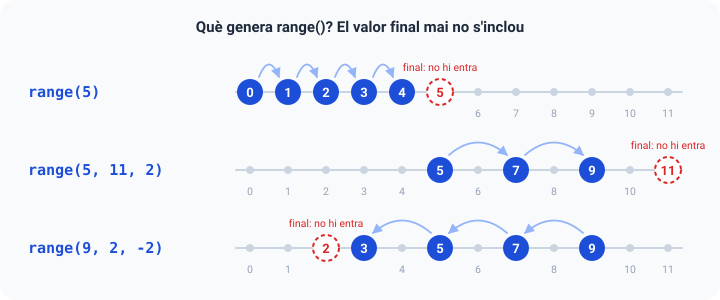
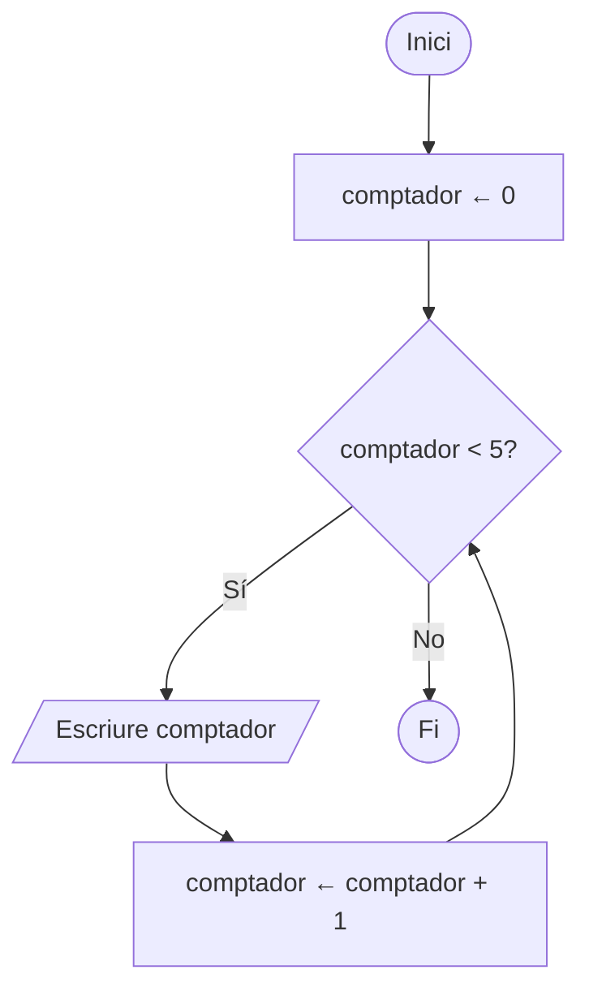

# Unitat 5. Estructures iteratives

Imagina que has de mostrar a la pantalla els nombres de l'1 al 1.000. Podries escriure mil vegades `print()`, però seria absurd. Els ordinadors són molt bons fent la mateixa feina moltes vegades sense cansar-se, i per aprofitar-ho tenim les **estructures iteratives** o **repetitives**, conegudes popularment com a **bucles**.

Cada repetició del bloc d'instruccions d'un bucle s'anomena **iteració**. En Python tenim dos tipus de bucles: `for` i `while`.


!!! tip "Vídeo recomanat"
    Curs de Python de MoureDev: [lliçó 11, «Bucles»](https://youtu.be/Kp4Mvapo5kc?t=23822). El vídeo és en castellà.

## 5.1. El bucle `for`

El bucle `for` s'utilitza per repetir un bloc de codi **quan sabem exactament quantes vegades el volem repetir**, o quan volem recórrer tots els elements d'una seqüència (una cadena, una llista…).

```python
for numero in range(5):
    print(numero)   # Mostra 0 1 2 3 4
```

A cada iteració, la variable `numero` pren el valor següent de la seqüència que genera `range()`. Com amb l'`if`, la línia acaba amb dos punts i el bloc que es repeteix va sagnat.

### 5.1.1. La funció `range()`

`range()` genera una seqüència de nombres enters i admet 1, 2 o 3 paràmetres:

| Crida | Significat | Valors que genera |
| --- | --- | --- |
| `range(5)` | Des de 0 fins a 5, **sense incloure el 5** | 0, 1, 2, 3, 4 |
| `range(5, 7)` | Des de 5 fins a 7, sense incloure el 7 | 5, 6 |
| `range(5, 11, 2)` | Des de 5 fins a 11, de 2 en 2 | 5, 7, 9 |
| `range(9, 2, -2)` | Des de 9 fins a 2, de 2 en 2 cap enrere | 9, 7, 5, 3 |


<figure markdown="span">
  { width="720" }
  <figcaption>Els valors que genera cada `range()`. El valor final, en vermell, sempre queda fora.</figcaption>
</figure>

!!! warning "El darrer valor no s'inclou"
    L'error més habitual amb `range()` és oblidar que el valor final no s'inclou. Per recórrer de l'1 al 10, has d'escriure `range(1, 11)`.

!!! example "Exercici 5.1. Quins valors genera?"
    Escriu els valors que genera cada `range()`. Després comprova-ho amb un bucle `for` que els mostri.

    `range(3)` · `range(2, 6)` · `range(0, 10, 3)` · `range(10, 0, -3)` · `range(5, 2)`

    ??? success "Solució"
        - `range(3)`: 0, 1, 2
        - `range(2, 6)`: 2, 3, 4, 5
        - `range(0, 10, 3)`: 0, 3, 6, 9
        - `range(10, 0, -3)`: 10, 7, 4, 1
        - `range(5, 2)`: cap valor. Per anar de 5 a 2 cap enrere cal un pas negatiu, `range(5, 2, -1)`; sense pas, el bucle no s'executa cap vegada.

!!! example "Exercici 5.2. Taula de multiplicar"
    Demana un nombre i mostra la seva taula de multiplicar de l'1 al 10.

    ??? success "Solució"
        ```python
        n = int(input("Quina taula vols? "))
        for i in range(1, 11):
            print(f"{n} x {i} = {n * i}")
        ```

!!! example "Exercici 5.3. Senars i parells"
    Demana un nombre i mostra, primer, tots els nombres senars des de l'1 fins a aquest nombre i, després, tots els parells.

    ??? success "Solució"
        ```python
        n = int(input("Escriu un nombre: "))
        print("Senars:")
        for i in range(1, n + 1, 2):
            print(i, end=" ")
        print()
        print("Parells:")
        for i in range(2, n + 1, 2):
            print(i, end=" ")
        print()
        ```

### 5.1.2. Recórrer una cadena

El `for` també pot recórrer directament els caràcters d'una cadena. Ho aprofitarem molt a la unitat 6.

```python
for lletra in "Python":
    print(lletra)   # P y t h o n, una lletra a cada línia
```

!!! example "Exercici 5.4. Lletra a lletra"
    Demana una paraula i mostra-la en vertical, amb cada lletra en majúscula i repetida dues vegades. Per exemple, amb `sol`:

    ```text
    SS
    OO
    LL
    ```

    ??? success "Solució"
        ```python
        paraula = input("Escriu una paraula: ")
        for lletra in paraula:
            print(lletra.upper() * 2)
        ```

        `upper()` converteix una cadena en majúscules. A la unitat 6 veurem molts més mètodes com aquest.

## 5.2. El bucle `while`

El bucle `while` («mentre»), a diferència del `for`, **es repeteix mentre una condició sigui vertadera**. És el bucle adequat quan **no sabem per endavant** quantes vegades s'haurà de repetir.

```python
comptador = 0

while comptador < 5:
    print(comptador)
    comptador = comptador + 1   # Mostra 0 1 2 3 4
```



Abans de cada iteració es comprova la condició. Si és vertadera, s'executa el bloc i es torna a comprovar; si és falsa, el bucle s'acaba i el programa continua amb la instrucció següent.

!!! danger "Bucles infinits"
    Si dins el bucle no canvia res que faci que la condició acabi sent falsa, el bucle no s'aturarà mai. Prova d'eliminar la línia `comptador = comptador + 1` de l'exemple anterior: el programa mostrarà zeros sense parar. Per aturar un programa penjat, prem ++ctrl+c++ o el botó d'aturar del teu IDE.

Un ús molt habitual del `while` és **validar dades**: tornar a demanar una dada fins que sigui correcta.

```python
nota = float(input("Nota (0-10): "))
while nota < 0 or nota > 10:
    print("La nota ha de ser entre 0 i 10.")
    nota = float(input("Nota (0-10): "))
print("Nota desada:", nota)
```

!!! tip "`for` o `while`?"
    - Saps quantes vegades s'ha de repetir, o has de recórrer una seqüència? → `for`.
    - Depèn d'una condició que no saps quan es complirà (l'usuari, un càlcul, un sensor…)? → `while`.

!!! example "Exercici 5.5. Validar l'edat"
    Demana l'edat de l'usuari i, mentre no sigui un nombre entre 0 i 120, torna-la a demanar amb un missatge que expliqui el problema. Al final, mostra «Edat desada: X».

    ??? success "Solució"
        ```python
        edat = int(input("Edat: "))
        while edat < 0 or edat > 120:
            print("L'edat ha de ser un nombre entre 0 i 120.")
            edat = int(input("Edat: "))
        print("Edat desada:", edat)
        ```

!!! example "Exercici 5.6. Endevina el nombre"
    El programa pensa un nombre a l'atzar entre 1 i 100 i l'usuari l'ha d'endevinar. Després de cada intent, el programa diu si el nombre secret és més gran o més petit. Quan l'encerta, mostra quants d'intents ha necessitat. Per generar el nombre, fes servir `random.randint(1, 100)` després d'escriure `import random`.

    ??? success "Solució"
        ```python
        import random

        secret = random.randint(1, 100)
        intents = 0
        intent = 0
        while intent != secret:
            intent = int(input("Quin nombre és? "))
            intents = intents + 1
            if intent < secret:
                print("És més gran")
            elif intent > secret:
                print("És més petit")
        print(f"Encertat en {intents} intents!")
        ```

!!! example "Exercici 5.7. Màxim comú divisor"
    Demana dos nombres enters positius i calcula'n el màxim comú divisor (MCD) amb l'**algorisme d'Euclides**: mentre el segon nombre no sigui 0, substitueix el primer pel segon i el segon pel residu de dividir el primer entre el segon. Quan el segon és 0, el primer és el MCD.

    ??? success "Solució"
        ```python
        a = int(input("Primer nombre: "))
        b = int(input("Segon nombre: "))
        x, y = a, b
        while y != 0:
            x, y = y, x % y
        print(f"El MCD de {a} i {b} és {x}")
        ```

        La línia `x, y = y, x % y` és una **assignació múltiple**: calcula primer els dos valors de la dreta i després els assigna a la vegada.

## 5.3. Comptadors i acumuladors

Dins els bucles, hi ha dos patrons que apareixen constantment:

- Un **comptador** és una variable que s'incrementa en una quantitat fixa (normalment 1) cada vegada que passa alguna cosa. Serveix per **comptar**.
- Un **acumulador** és una variable a la qual se suma (o multiplica) un valor que canvia a cada iteració. Serveix per **sumar** o **multiplicar** moltes quantitats.

Tots dos s'han d'**inicialitzar abans del bucle**: un comptador o un acumulador de sumes, a 0; un acumulador de productes, a 1.

```python
suma = 0        # acumulador
aprovats = 0    # comptador

for i in range(5):
    nota = float(input(f"Nota de l'alumne {i + 1}: "))
    suma = suma + nota
    if nota >= 5:
        aprovats = aprovats + 1

print(f"Mitjana: {suma / 5:.2f}")
print(f"Aprovats: {aprovats}")
```

!!! info "Operadors d'assignació abreujats"
    `suma = suma + nota` es pot escriure més curt com `suma += nota`. Igualment existeixen `-=`, `*=`, `/=`, `//=` i `%=`.

!!! example "Exercici 5.8. Suma fins a n"
    Demana un nombre i calcula la suma de tots els nombres des de l'1 fins a aquest nombre.

    ??? success "Solució"
        ```python
        n = int(input("Escriu un nombre: "))
        suma = 0
        for i in range(1, n + 1):
            suma += i
        print(f"La suma de l'1 al {n} és {suma}")
        ```

!!! example "Exercici 5.9. Factorial"
    El factorial d'un nombre n (s'escriu n!) és el producte de tots els enters des de l'1 fins a n. Per exemple, 5! = 5 × 4 × 3 × 2 × 1 = 120, i per definició 0! = 1. Demana un nombre i calcula'n el factorial.

    ??? success "Solució"
        ```python
        n = int(input("Escriu un nombre: "))
        factorial = 1   # acumulador de productes: comença a 1
        for i in range(2, n + 1):
            factorial *= i
        print(f"{n}! = {factorial}")
        ```

!!! example "Exercici 5.10. Successió de Fibonacci"
    La successió de Fibonacci comença amb 0 i 1, i cada terme és la suma dels dos anteriors: 0, 1, 1, 2, 3, 5, 8, 13… Demana un nombre i mostra tots els termes de la successió que no el superin.

    ??? success "Solució"
        ```python
        limit = int(input("Fins a quin nombre? "))
        a, b = 0, 1
        while a <= limit:
            print(a, end=" ")
            a, b = b, a + b
        print()
        ```

## 5.4. Instruccions de salt: `break` i `continue`

Les instruccions de salt permeten alterar el flux normal d'un bucle.

`break` acaba el bucle immediatament, encara que no hagi completat totes les iteracions:

```python
for numero in range(10):
    if numero == 5:
        break
    print(numero)   # Mostra 0 1 2 3 4
```

`continue` bota la resta del bloc en la iteració actual i passa directament a la següent:

```python
for numero in range(10):
    if numero == 5:
        continue
    print(numero)   # Mostra 0 1 2 3 4 6 7 8 9
```

Un patró molt comú és un bucle `while True` (infinit a propòsit) que s'acaba amb `break` quan es compleix una condició, per exemple un menú:

```python
while True:
    opcio = input("Escriu una ordre (o 'sortir'): ")
    if opcio == "sortir":
        break
    print("Has escrit:", opcio)
print("Adéu!")
```

!!! tip "Amb moderació"
    `break` i `continue` són útils, però si n'abuses el flux del programa es fa difícil de seguir. Sovint es pot escriure una condició del `while` més clara.

!!! example "Exercici 5.11. Recompte de vots"
    En una votació de delegat hi ha dos candidats, l'A i la B. Demana els vots un a un (`A`, `B` o `blanc`) fins que l'usuari escrigui `fi`. Els vots que no siguin cap d'aquests tres són nuls: no es compten i s'ha d'avisar l'usuari (fes servir `continue`). Al final, mostra el recompte i el guanyador.

    ??? success "Solució"
        ```python
        vots_a = 0
        vots_b = 0
        blancs = 0

        while True:
            vot = input("Vot (A, B, blanc o fi): ").strip().upper()
            if vot == "FI":
                break
            if vot != "A" and vot != "B" and vot != "BLANC":
                print("Vot nul, no es compta")
                continue
            if vot == "A":
                vots_a += 1
            elif vot == "B":
                vots_b += 1
            else:
                blancs += 1

        print(f"A: {vots_a}  B: {vots_b}  Blancs: {blancs}")
        if vots_a > vots_b:
            print("Guanya l'A")
        elif vots_b > vots_a:
            print("Guanya la B")
        else:
            print("Empat")
        ```

!!! example "Exercici 5.12. El primer múltiple"
    Troba el primer nombre més gran que 100 que és múltiple de 7 i de 13 alhora. Fes servir un bucle `while True` i `break`.

    ??? success "Solució"
        ```python
        n = 101
        while True:
            if n % 7 == 0 and n % 13 == 0:
                break
            n += 1
        print(n)   # 182
        ```

!!! example "Exercici 5.13. Nombre primer"
    Un nombre és **primer** si és major que 1 i només és divisible per ell mateix i per l'1. Demana un nombre i digues si és primer.

    ??? success "Solució"
        ```python
        n = int(input("Escriu un nombre: "))
        es_primer = n > 1
        divisor = 2
        while divisor * divisor <= n and es_primer:
            if n % divisor == 0:
                es_primer = False
            divisor += 1
        if es_primer:
            print(f"{n} és primer")
        else:
            print(f"{n} no és primer")
        ```

        No cal provar tots els divisors fins a n: si n té algun divisor, n'ha de tenir un que sigui menor o igual que la seva arrel quadrada. Per això el bucle s'atura quan `divisor * divisor` supera n.

## 5.5. Bucles niats

Un bucle pot contenir un altre bucle. Per cada iteració del bucle exterior, el bucle interior es fa **complet**.

```python
for fila in range(1, 4):
    for columna in range(1, 4):
        print(fila * columna, end="\t")
    print()   # salt de línia en acabar cada fila
```

```text title="Sortida"
1	2	3
2	4	6
3	6	9
```

Els bucles niats seran imprescindibles a la unitat 7 per recórrer taules (llistes de llistes).

!!! example "Exercici 5.14. Triangle d'asteriscs"
    Demana un nombre `n` i dibuixa un triangle de `n` files, amb un asterisc a la primera fila, dos a la segona, etc. Fes-ho amb **dos bucles niats**, sense fer servir `"*" * i`.

    ```text
    *
    **
    ***
    ****
    ```

    ??? success "Solució"
        ```python
        n = int(input("Nombre de files: "))
        for fila in range(1, n + 1):
            for columna in range(fila):
                print("*", end="")
            print()
        ```

        El bucle interior es repeteix tantes vegades com indica el número de fila. Ampliació: aconsegueix que el triangle quedi alineat a la dreta.

## 5.6. Reptes

!!! example "Repte 5.1. Nombres d'Armstrong"
    Un nombre d'Armstrong és igual a la suma de cadascuna de les seves xifres elevada al nombre total de xifres. Per exemple, 153 té 3 xifres i 1³ + 5³ + 3³ = 153. Demana un nombre i digues si és d'Armstrong. Pista: `n % 10` dona la darrera xifra i `n // 10` l'elimina.

    ??? success "Solució"
        ```python
        n = int(input("Escriu un nombre enter positiu: "))

        # Primer comptam les xifres
        xifres = 0
        resta = n
        while resta > 0:
            xifres += 1
            resta //= 10
        if n == 0:
            xifres = 1

        # Després sumam cada xifra elevada al nombre de xifres
        suma = 0
        resta = n
        while resta > 0:
            suma += (resta % 10) ** xifres
            resta //= 10

        if suma == n:
            print(f"{n} és un nombre d'Armstrong")
        else:
            print(f"{n} no és un nombre d'Armstrong")
        ```

        A la unitat 6 veurem que, convertint el nombre en cadena amb `str(n)`, les xifres es poden comptar amb `len()`.

!!! example "Repte 5.2. Estadístiques de notes"
    Demana notes a l'usuari fins que escrigui `-1`. En acabar, mostra quantes notes ha introduït, la mitjana, la nota més alta i la més baixa. No acceptis notes fora de l'interval 0-10.

    ??? success "Solució"
        ```python
        quantes = 0
        suma = 0
        maxima = None
        minima = None

        while True:
            nota = float(input("Nota (-1 per acabar): "))
            if nota == -1:
                break
            if nota < 0 or nota > 10:
                print("Nota no vàlida")
                continue
            quantes += 1
            suma += nota
            if maxima is None or nota > maxima:
                maxima = nota
            if minima is None or nota < minima:
                minima = nota

        if quantes > 0:
            print(f"Notes: {quantes}")
            print(f"Mitjana: {suma / quantes:.2f}")
            print(f"Màxima: {maxima}  Mínima: {minima}")
        else:
            print("No has introduït cap nota")
        ```

        `None` és un valor especial de Python que vol dir «cap valor». L'utilitzam perquè, abans de la primera nota, encara no hi ha ni màxim ni mínim.

## 5.7. Exercicis de repàs

Més exercicis per practicar tota la unitat, ordenats de menys a més dificultat. Els dos primers es resolen sense ordinador. Abans d'escriure cada programa, decideix si necessites un `for` (saps quantes voltes farà) o un `while` (depèn d'una condició).

!!! example "Repàs 5.1. Segueix els bucles"
    Sense executar-los, digues què mostra cada fragment.

    ```python
    # Fragment 1
    for i in range(2, 11, 3):
        print(i, end=" ")

    # Fragment 2
    n = 20
    while n > 3:
        n = n // 2
        print(n, end=" ")

    # Fragment 3
    total = 0
    for i in range(1, 5):
        total = total + i * i
    print(total)
    ```

    ??? success "Solució"
        1. `2 5 8`
        2. `10 5 2`: el bucle comprova la condició **abans** de cada volta. Amb `n = 5` encara hi entra i mostra 2; amb `n = 2` ja no.
        3. `30`, que és 1 + 4 + 9 + 16.

!!! example "Repàs 5.2. Quantes vegades?"
    Quantes vegades s'executa el `print` en cada cas?

    ```python
    # A
    for i in range(10):
        print("Hola")

    # B
    for i in range(3, 9):
        print("Hola")

    # C
    for i in range(4):
        for j in range(3):
            print("Hola")

    # D
    n = 100
    while n > 1:
        print("Hola")
        n = n // 3
    ```

    ??? success "Solució"
        A: 10. B: 6 (del 3 al 8). C: 12 (4 voltes del bucle exterior per 3 de l'interior). D: 4 (quan s'executa el `print`, `n` val 100, 33, 11 i 3; després passa a valer 1 i el bucle acaba).

!!! example "Repàs 5.3. Caça d'errors"
    Aquest programa hauria de mostrar la suma dels nombres de l'1 al 10, però té tres errors. Un d'ells fa que no acabi mai. Troba'ls i corregeix-los.

    ```python
    i = 1
    while i <= 10:
        suma = 0
        suma = suma + i
    print(suma)
    ```

    ??? success "Solució"
        ```python
        suma = 0
        i = 1
        while i <= 10:
            suma = suma + i
            i = i + 1
        print(suma)
        ```

        1. `suma = 0` és dins el bucle: a cada volta, l'acumulador torna a zero. S'ha d'inicialitzar **abans** del bucle.
        2. Falta incrementar `i`: com que sempre val 1, la condició no deixa de complir-se mai (bucle infinit).
        3. Conseqüència dels anteriors: tal com estava, el `print` no arribava a executar-se.

        Si un programa es queda penjat, atura'l amb ++ctrl+c++.

!!! example "Repàs 5.4. Compte enrere"
    Mostra un compte enrere del 10 a l'1, amb un nombre a cada línia, i al final el missatge «Enlairament!».

    ??? success "Solució"
        ```python
        for i in range(10, 0, -1):
            print(i)
        print("Enlairament!")
        ```

!!! example "Repàs 5.5. Suma dels parells"
    Calcula i mostra la suma de tots els nombres parells de l'1 al 100.

    ??? success "Solució"
        ```python
        suma = 0
        for n in range(2, 101, 2):
            suma = suma + n
        print("Suma dels parells:", suma)
        ```

        També es pot recórrer `range(1, 101)` i sumar només els nombres que compleixin `n % 2 == 0`.

!!! example "Repàs 5.6. Múltiples de 7"
    Mostra en una sola línia tots els múltiples de 7 menors de 100 i, a sota, quants n'hi ha.

    ??? success "Solució"
        ```python
        comptador = 0
        for n in range(7, 100, 7):
            print(n, end=" ")
            comptador = comptador + 1
        print()
        print("N'hi ha", comptador)
        ```

!!! example "Repàs 5.7. Potència sense **"
    Demana una base i un exponent enter no negatiu i calcula la potència **sense** fer servir l'operador `**`: només amb un bucle i multiplicacions.

    ??? success "Solució"
        ```python
        base = int(input("Base: "))
        exponent = int(input("Exponent: "))

        resultat = 1
        for i in range(exponent):
            resultat = resultat * base

        print(f"{base} elevat a {exponent} és {resultat}")
        ```

        L'acumulador d'un producte comença en 1, no en 0. Així, a més, l'exponent 0 dona 1 sense haver de tractar-lo com un cas especial.

!!! example "Repàs 5.8. Mitjana de n notes"
    Demana quantes notes s'han d'introduir, llegeix-les una a una i mostra'n la mitjana amb dues xifres decimals.

    ??? success "Solució"
        ```python
        quantes = int(input("Quantes notes? "))

        suma = 0
        for i in range(quantes):
            nota = float(input(f"Nota {i + 1}: "))
            suma = suma + nota

        print(f"Mitjana: {suma / quantes:.2f}")
        ```

!!! example "Repàs 5.9. Sumar fins a zero"
    Llegeix nombres enters fins que l'usuari escrigui un 0. Aleshores mostra quants nombres ha introduït (sense comptar el 0) i quina n'és la suma.

    ??? success "Solució"
        ```python
        suma = 0
        quants = 0

        n = int(input("Nombre (0 per acabar): "))
        while n != 0:
            suma = suma + n
            quants = quants + 1
            n = int(input("Nombre (0 per acabar): "))

        print("Nombres introduïts:", quants)
        print("Suma:", suma)
        ```

        Quan no se sap quantes voltes farà el bucle, es fa servir `while`. El valor que el fa acabar (aquí, el 0) s'anomena **sentinella**.

!!! example "Repàs 5.10. El més gran i el més petit"
    Demana quants nombres s'introduiran, llegeix-los i mostra el més gran i el més petit. No pots fer servir llistes.

    ??? success "Solució"
        ```python
        quants = int(input("Quants nombres? "))

        n = float(input("Nombre: "))
        maxim = n
        minim = n

        for i in range(quants - 1):
            n = float(input("Nombre: "))
            if n > maxim:
                maxim = n
            if n < minim:
                minim = n

        print("El més gran:", maxim)
        print("El més petit:", minim)
        ```

        El màxim i el mínim s'inicialitzen amb el **primer nombre** llegit. Si s'inicialitzassin amb 0, el programa fallaria quan tots els nombres fossin negatius.

!!! example "Repàs 5.11. Quantes xifres té?"
    Demana un nombre enter positiu i mostra quantes xifres té, sense convertir-lo a text.

    ??? success "Solució"
        ```python
        n = int(input("Nombre: "))

        xifres = 0
        while n > 0:
            n = n // 10
            xifres = xifres + 1

        print("Té", xifres, "xifres")
        ```

        Cada divisió entera entre 10 elimina la darrera xifra: es compten les voltes fins que no en queda cap.

!!! example "Repàs 5.12. Suma de les xifres"
    Demana un nombre enter positiu de qualsevol longitud i mostra la suma de les seves xifres, sense convertir-lo a text.

    ??? success "Solució"
        ```python
        n = int(input("Nombre: "))

        suma = 0
        while n > 0:
            suma = suma + n % 10
            n = n // 10

        print("Suma de les xifres:", suma)
        ```

!!! example "Repàs 5.13. El nombre al revés"
    Demana un nombre enter positiu i mostra'l amb les xifres en ordre invers (1234 → 4321), fent servir només operacions aritmètiques.

    ??? success "Solució"
        ```python
        n = int(input("Nombre: "))

        invers = 0
        while n > 0:
            invers = invers * 10 + n % 10
            n = n // 10

        print("Al revés:", invers)
        ```

        A cada volta, les xifres que ja tenim es desplacen una posició a l'esquerra (`invers * 10`) i s'hi afegeix la darrera xifra de `n`.

!!! example "Repàs 5.14. Els divisors"
    Demana un nombre enter positiu i mostra tots els seus divisors en una línia i, a sota, quants en té.

    ??? success "Solució"
        ```python
        n = int(input("Nombre: "))

        quants = 0
        for d in range(1, n + 1):
            if n % d == 0:
                print(d, end=" ")
                quants = quants + 1
        print()
        print("Té", quants, "divisors")
        ```

!!! example "Repàs 5.15. Nombres perfectes"
    Un nombre és **perfecte** si és igual a la suma dels seus divisors, sense comptar-se ell mateix. Per exemple, 6 = 1 + 2 + 3. Demana un nombre i digues si és perfecte.

    ??? success "Solució"
        ```python
        n = int(input("Nombre: "))

        suma = 0
        for d in range(1, n):
            if n % d == 0:
                suma = suma + d

        if suma == n:
            print(n, "és perfecte")
        else:
            print(n, "no és perfecte")
        ```

!!! example "Repàs 5.16. Tres intents"
    Programa un control d'accés: la contrasenya correcta és `python`. L'usuari té tres intents. Si l'encerta, mostra «Accés permès» i no demanis res més; si esgota els intents, mostra «Compte bloquejat».

    ??? success "Solució"
        ```python
        CONTRASENYA = "python"
        INTENTS = 3

        encertada = False
        for i in range(INTENTS):
            intent = input("Contrasenya: ")
            if intent == CONTRASENYA:
                encertada = True
                break
            print("Incorrecta")

        if encertada:
            print("Accés permès")
        else:
            print("Compte bloquejat")
        ```

        La variable booleana `encertada` fa de **bandera**: recorda, en sortir del bucle, si s'ha sortit per haver encertat o per haver esgotat els intents.

!!! example "Repàs 5.17. Doblar els estalvis"
    Demana un capital inicial i un interès anual en percentatge. Cada any, els interessos se sumen al capital. Calcula quants d'anys han de passar perquè el capital sigui, com a mínim, el doble de l'inicial.

    ??? success "Solució"
        ```python
        capital = float(input("Capital inicial: "))
        interes = float(input("Interès anual (%): "))

        objectiu = capital * 2
        anys = 0
        while capital < objectiu:
            capital = capital + capital * interes / 100
            anys = anys + 1

        print("Anys necessaris:", anys)
        ```

        L'objectiu es calcula **abans** del bucle, perquè dins el bucle el capital va canviant.

!!! example "Repàs 5.18. La conjectura de Collatz"
    Partint d'un nombre enter positiu, repeteix aquesta regla fins a arribar a 1: si el nombre és parell, divideix-lo entre 2; si és senar, multiplica'l per 3 i suma-hi 1. Mostra tots els nombres de la seqüència i quantes passes han fet falta. Amb el 6, la seqüència és 6, 3, 10, 5, 16, 8, 4, 2, 1 (8 passes).

    ??? success "Solució"
        ```python
        n = int(input("Nombre inicial: "))

        passes = 0
        print(n, end=" ")
        while n != 1:
            if n % 2 == 0:
                n = n // 2
            else:
                n = 3 * n + 1
            print(n, end=" ")
            passes = passes + 1

        print()
        print("Passes:", passes)
        ```

        Ningú no ha pogut demostrar encara que aquesta seqüència acabi sempre en 1, però s'ha comprovat amb nombres enormes.

!!! example "Repàs 5.19. Un rectangle d'asteriscs"
    Demana un nombre de files i un de columnes i dibuixa un rectangle d'asteriscs, separats per un espai. Amb 3 files i 5 columnes:

    ```text
    * * * * *
    * * * * *
    * * * * *
    ```

    ??? success "Solució"
        ```python
        files = int(input("Files: "))
        columnes = int(input("Columnes: "))

        for f in range(files):
            for c in range(columnes):
                print("*", end=" ")
            print()
        ```

        El `print()` buit que hi ha després del bucle interior fa el salt de línia en acabar cada fila.

!!! example "Repàs 5.20. Una piràmide"
    Demana una altura i dibuixa una piràmide centrada. Amb una altura de 4:

    ```text
       *
      ***
     *****
    *******
    ```

    Pista: a la fila `i` (començant per 1) hi ha `altura - i` espais i `2 * i - 1` asteriscs.

    ??? success "Solució"
        ```python
        altura = int(input("Altura: "))

        for i in range(1, altura + 1):
            print(" " * (altura - i) + "*" * (2 * i - 1))
        ```

!!! example "Repàs 5.21. Els nombres primers fins a 50"
    Mostra tots els nombres primers entre 2 i 50. Recorda que un nombre és primer si només és divisible entre 1 i ell mateix.

    ??? success "Solució"
        ```python
        for n in range(2, 51):
            es_primer = True
            for d in range(2, n):
                if n % d == 0:
                    es_primer = False
                    break
            if es_primer:
                print(n, end=" ")
        print()
        ```

        El `break` atura només el bucle interior: quan es troba un divisor, no cal provar-ne més, i es passa al nombre següent.

!!! example "Repàs 5.22. Fins que surti un 6"
    Simula el llançament d'un dau fins que surti un 6. Mostra cada tirada i, al final, quantes n'han fet falta. Recorda: `import random` i `random.randint(1, 6)`.

    ??? success "Solució"
        ```python
        import random

        tirades = 0
        dau = 0
        while dau != 6:
            dau = random.randint(1, 6)
            tirades = tirades + 1
            print("Tirada", tirades, "→", dau)

        print("Han fet falta", tirades, "tirades")
        ```

        `dau` s'inicialitza amb un valor que no és 6 perquè el bucle faci, com a mínim, una volta. Cada execució dona un resultat diferent.

---

!!! quote "Font"
    Unitat elaborada a partir de materials de Lope González Vázquez ([CC BY-NC-SA 4.0](https://creativecommons.org/licenses/by-nc-sa/4.0/deed.ca)): [«Tema 11. Fundamentos de programación»](https://lopegonzalez.es/eso-y-bachillerato/tic-i-1o-bachillerato/tema-11-fundamentos-de-programacion/) (TIC I) i [«Tema 1. Introducción a la programación»](https://lopegonzalez.es/eso-y-bachillerato/creacion-digital-y-pensamiento-computacional-1o-bachillerato/tema-1-introduccion-a-la-programacion/) (Creación digital y pensamiento computacional). Canvis: traducció al català, adaptació al currículum de Programació i Tractament de Dades I de les Illes Balears i explicació de `range()` en taula. Els enunciats dels exercicis 5.2, 5.3, 5.7 a 5.10 i 5.13 i del repte 5.1 provenen dels exercicis resolts de Lope (el 5.3 uneix dos exercicis i el 5.7 hi afegeix l'algorisme d'Euclides). Són propis els apartats 5.1.2, 5.3 i 5.5, la validació amb `while`, el patró `while True`, el diagrama de flux, els requadres, la resta d'exercicis i reptes i totes les solucions.
