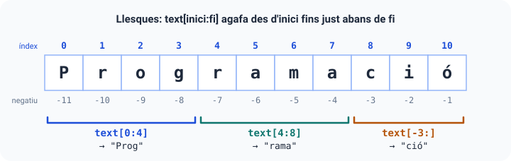
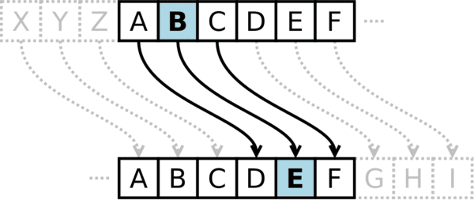

# Unitat 6. Cadenes de caràcters

Una gran part de les dades amb què treballam són text: noms, missatges, contrasenyes, adreces electròniques, codis postals… A la unitat 3 vam veure que en Python el text es guarda en **cadenes de caràcters** (tipus `str`) i que es poden unir amb `+` i repetir amb `*`. En aquesta unitat aprendrem a accedir als caràcters d'una cadena, a extreure'n trossos, a recórrer-la amb bucles i a transformar-la amb els mètodes que ofereix Python. Acabarem programant un sistema de xifratge.


!!! tip "Vídeo recomanat"
    Curs de Python de MoureDev: [lliçó 5, «Cadenes»](https://youtu.be/Kp4Mvapo5kc?t=8643). El vídeo és en castellà.

## 6.1. Com es guarda una cadena

Una cadena és una **seqüència ordenada de caràcters**. Cada caràcter ocupa una posició, que s'anomena **índex**. El primer caràcter té l'índex **0**, no l'1. També es pot comptar des del final amb índexs negatius: -1 és el darrer caràcter, -2 el penúltim, etc.

| Caràcter | `P` | `y` | `t` | `h` | `o` | `n` |
| --- | --- | --- | --- | --- | --- | --- |
| Índex positiu | 0 | 1 | 2 | 3 | 4 | 5 |
| Índex negatiu | -6 | -5 | -4 | -3 | -2 | -1 |

```python
paraula = "Python"
print(paraula[0])     # P
print(paraula[3])     # h
print(paraula[-1])    # n
print(len(paraula))   # 6: la funció len() retorna la longitud
```

!!! warning "Índex fora de rang"
    Si demanes una posició que no existeix, Python dona un error `IndexError`. A `"Python"`, el darrer índex positiu és el 5, és a dir, `len(paraula) - 1`.

### 6.1.1. Les cadenes són immutables

Una vegada creada, una cadena **no es pot modificar**. Si intentes canviar-ne un caràcter, obtens un error:

```python
paraula = "Pithon"
paraula[1] = "y"   # TypeError: 'str' object does not support item assignment
```

El que sí podem fer és **crear una cadena nova** i guardar-la a la mateixa variable:

```python
paraula = "Pithon"
paraula = paraula[0] + "y" + paraula[2:]
print(paraula)   # Python
```

### 6.1.2. Caràcters especials

Hi ha caràcters que no es poden escriure directament dins una cadena. Per escriure'ls, feim servir una **seqüència d'escapament**, que comença amb una barra inversa `\`:

| Seqüència | Significat |
| --- | --- |
| `\n` | Salt de línia |
| `\t` | Tabulador |
| `\'` i `\"` | Cometa simple o doble dins una cadena delimitada per aquestes mateixes cometes |
| `\\` | Barra inversa |

```python
print("Primera línia\nSegona línia")
print('L\'ordinador')
```

Per escriure un text de diverses línies també es poden fer servir **cometes triples** (`"""` o `'''`).

!!! example "Exercici 6.1. Índexs"
    Amb `text = "Menorca"`, quin és el resultat de cada expressió?

    `text[0]` · `text[-1]` · `text[3]` · `len(text)` · `text[len(text) - 1]` · `text[7]`

    ??? success "Solució"
        `"M"`, `"a"`, `"o"`, `7`, `"a"` i un error `IndexError`: la cadena té 7 caràcters, però els índexs van del 0 al 6.

!!! example "Exercici 6.2. Caràcters especials"
    Amb **una sola** instrucció `print()`, mostra exactament aquest text, amb un tabulador després dels dos punts:

    ```text
    Nom:	Anna
    Ciutat:	"Maó"
    ```

    ??? success "Solució"
        ```python
        print("Nom:\tAnna\nCiutat:\t\"Maó\"")
        ```

        També podries delimitar la cadena amb cometes simples i així no caldria escapar les dobles: `print('Nom:\tAnna\nCiutat:\t"Maó"')`.

## 6.2. Llesques (*slicing*)

Una **llesca** és un tros d'una cadena. S'escriu amb la sintaxi `cadena[inici:fi:pas]`, que funciona igual que `range()`: el caràcter de la posició `fi` **no s'inclou**.

```python
text = "Programació"
print(text[0:4])    # Prog     (posicions 0, 1, 2 i 3)
print(text[4:])     # ramació  (des de la 4 fins al final)
print(text[:4])     # Prog     (des del principi fins a la 3)
print(text[-3:])    # ció      (els tres darrers)
print(text[::2])    # Pormcó   (un caràcter sí i un no)
print(text[::-1])   # óicamargorP (al revés)
```

<figure markdown="span">
  { width="720" }
  <figcaption>Tres llesques de `"Programació"`. Cada llesca comença a l'índex `inici` i s'atura just abans de l'índex `fi`.</figcaption>
</figure>

!!! tip "Girar una cadena"
    `text[::-1]` és la manera més curta de girar una cadena en Python: recorre tota la cadena amb pas -1, és a dir, de darrere cap endavant.

!!! example "Exercici 6.3. Llesques"
    Amb `p = "Tramuntana"`, quin és el resultat de cada llesca?

    `p[:4]` · `p[4:]` · `p[-4:]` · `p[::3]` · `p[2:6]`

    ??? success "Solució"
        `"Tram"`, `"untana"`, `"tana"`, `"Tmta"` (posicions 0, 3, 6 i 9) i `"amun"` (posicions 2 a 5).

!!! example "Exercici 6.4. Paraula al revés"
    Demana una paraula i mostra-la al revés. Resol-ho de dues maneres: amb una llesca i amb un bucle.

    ??? success "Solució"
        ```python
        paraula = input("Escriu una paraula: ")

        # Amb una llesca
        print(paraula[::-1])

        # Amb un bucle: afegim cada lletra davant de les anteriors
        reves = ""
        for lletra in paraula:
            reves = lletra + reves
        print(reves)
        ```

## 6.3. Recórrer una cadena

Com vam veure a la unitat 5, el bucle `for` pot recórrer directament els caràcters d'una cadena:

```python
for lletra in "Hola":
    print(lletra)
```

Si, a més del caràcter, necessitam la seva posició, podem recórrer els índexs amb `range(len(...))`:

```python
paraula = "Hola"
for i in range(len(paraula)):
    print(f"Posició {i}: {paraula[i]}")
```

### 6.3.1. L'operador `in`

L'operador `in` comprova si un caràcter o un tros de text és dins una cadena, i retorna `True` o `False`:

```python
print("a" in "Mallorca")       # True
print("orca" in "Mallorca")    # True
print("z" not in "Mallorca")   # True

vocals = "aeiouàèéíòóú"
lletra = "e"
if lletra in vocals:
    print("És una vocal")
```

!!! example "Exercici 6.5. Comptar vocals"
    Demana una frase i compta quantes vocals té, incloses les accentuades.

    ??? success "Solució"
        ```python
        frase = input("Escriu una frase: ")
        vocals = "aeiouàèéíòóúïü"
        comptador = 0
        for lletra in frase.lower():
            if lletra in vocals:
                comptador += 1
        print(f"La frase té {comptador} vocals")
        ```

!!! example "Exercici 6.6. On apareix la lletra?"
    Demana una frase i una lletra. Mostra quantes vegades apareix la lletra a la frase i en quines posicions, sense fer servir el mètode `count()`.

    ??? success "Solució"
        ```python
        frase = input("Frase: ")
        lletra = input("Lletra: ")
        vegades = 0
        for i in range(len(frase)):
            if frase[i] == lletra:
                vegades += 1
                print("Posició", i)
        print(f"La lletra '{lletra}' apareix {vegades} vegades")
        ```

        Com que necessitam la posició, recorrem els índexs amb `range(len(frase))` en lloc de recórrer directament els caràcters.

## 6.4. Mètodes de les cadenes

Els **mètodes** són funcions que pertanyen a un tipus de dada. S'escriuen després de la variable i un punt: `cadena.metode()`. Com que les cadenes són immutables, **els mètodes no modifiquen la cadena original**: en retornen una de nova.

```python
nom = "anna"
nom.upper()          # retorna "ANNA", però nom continua sent "anna"
nom = nom.upper()    # ara sí: nom passa a ser "ANNA"
```

Aquests són alguns dels mètodes més útils:

| Mètode | Què fa | Exemple | Resultat |
| --- | --- | --- | --- |
| `upper()` | Tot en majúscules | `"hola".upper()` | `"HOLA"` |
| `lower()` | Tot en minúscules | `"HoLa".lower()` | `"hola"` |
| `capitalize()` | Primera lletra en majúscula | `"hola món".capitalize()` | `"Hola món"` |
| `title()` | Primera lletra de cada paraula en majúscula | `"hola món".title()` | `"Hola Món"` |
| `strip()` | Elimina els espais del principi i del final | `"  hola  ".strip()` | `"hola"` |
| `replace(a, b)` | Substitueix `a` per `b` | `"cotxe".replace("t", "")` | `"coxe"` |
| `count(a)` | Compta quantes vegades apareix `a` | `"banana".count("a")` | `3` |
| `find(a)` | Posició de la primera aparició de `a` (-1 si no hi és) | `"banana".find("n")` | `2` |
| `startswith(a)` | Comprova si comença per `a` | `"Palma".startswith("Pa")` | `True` |
| `endswith(a)` | Comprova si acaba per `a` | `"foto.png".endswith(".png")` | `True` |
| `isdigit()` | Comprova si tots els caràcters són xifres | `"2024".isdigit()` | `True` |
| `isalpha()` | Comprova si tots els caràcters són lletres | `"Sóller".isalpha()` | `True` |
| `isupper()` / `islower()` | Comprova si està en majúscules o en minúscules | `"ABC".isupper()` | `True` |
| `split(sep)` | Divideix la cadena en trossos per `sep` (per defecte, pels espais) | `"a,b,c".split(",")` | `['a', 'b', 'c']` |
| `sep.join(llista)` | Uneix els trossos amb `sep` entre ells | `"-".join(["a", "b", "c"])` | `"a-b-c"` |

`split()` i `join()` treballen amb **llistes**, que veurem a la unitat 7. De moment, n'hi ha prou de saber que `split()` retorna una llista i que `len()` ens diu quants elements té:

```python
frase = "Aprendre a programar és divertit"
paraules = frase.split()
print(len(paraules))   # 5
```

!!! tip "Validar dades abans de convertir-les"
    A la unitat 3 vam veure que `int("hola")` provoca un error. Amb `isdigit()` podem comprovar-ho abans:

    ```python
    text = input("Quants d'anys tens? ")
    if text.isdigit():
        edat = int(text)
        print(f"L'any que ve en faràs {edat + 1}")
    else:
        print("Això no és un nombre enter positiu")
    ```

!!! example "Exercici 6.7. Mètodes"
    Amb `s = "  Ciutadella de Menorca  "` (fixa't en els espais del principi i del final), quin és el resultat de cada expressió?

    `s.strip()` · `s.strip().upper()` · `s.count("a")` · `s.strip().split()` · `s.strip().replace(" de ", "-")` · `s.find("x")`

    ??? success "Solució"
        - `"Ciutadella de Menorca"`
        - `"CIUTADELLA DE MENORCA"`: els mètodes es poden encadenar, i cada un s'aplica al resultat de l'anterior.
        - `3`: `count()` distingeix majúscules i minúscules.
        - `["Ciutadella", "de", "Menorca"]`
        - `"Ciutadella-Menorca"`
        - `-1`, perquè no hi ha cap `x`.

!!! example "Exercici 6.8. Palíndroms"
    Un **palíndrom** és una paraula o frase que es llegeix igual d'esquerra a dreta que de dreta a esquerra, com «Anna» o «radar». Demana una paraula i digues si és un palíndrom, sense tenir en compte les majúscules. Ampliació: fes que funcioni també amb frases, sense tenir en compte els espais, com «Català a l'atac».

    ??? success "Solució"
        ```python
        text = input("Escriu una paraula o frase: ")
        net = text.lower().replace(" ", "")
        if net == net[::-1]:
            print("És un palíndrom")
        else:
            print("No és un palíndrom")
        ```

        Per a l'ampliació amb «Català a l'atac» cal eliminar també els apòstrofs i els accents. Una manera és quedar-se només amb les lletres (`isalpha()`) i substituir cada vocal accentuada per la vocal sense accent amb `replace()`.

!!! example "Exercici 6.9. Sigles"
    Demana el nom d'una organització i mostra'n les sigles amb les inicials en majúscula de cada paraula. Per exemple, «institut d'educació secundària» → «IDS». Pista: `split()`.

    ??? success "Solució"
        ```python
        nom = input("Nom de l'organització: ")
        sigles = ""
        for paraula in nom.split():
            sigles += paraula[0].upper()
        print(sigles)
        ```

!!! example "Exercici 6.10. Adreça electrònica"
    Demana una adreça electrònica i comprova que té exactament una `@`, que hi ha text abans i després de l'`@`, i que després de l'`@` hi ha almenys un punt. Si és correcta, mostra el nom d'usuari (la part anterior a l'`@`) i el domini (la part posterior).

    ??? success "Solució"
        ```python
        adreca = input("Adreça electrònica: ").strip()
        posicio = adreca.find("@")
        if adreca.count("@") != 1 or posicio == 0 or posicio == len(adreca) - 1:
            print("Adreça no vàlida")
        else:
            usuari = adreca[:posicio]
            domini = adreca[posicio + 1:]
            if "." not in domini:
                print("Adreça no vàlida: al domini hi falta un punt")
            else:
                print(f"Usuari: {usuari}")
                print(f"Domini: {domini}")
        ```

        Aquesta validació és molt bàsica: comprovar de debò que una adreça és vàlida és força més complicat.

!!! example "Exercici 6.11. Contrasenya segura"
    Demana una contrasenya i comprova que té almenys 8 caràcters, alguna majúscula, alguna minúscula i alguna xifra. Si no compleix alguna condició, digues quina.

    ??? success "Solució"
        ```python
        contrasenya = input("Contrasenya: ")
        te_majuscula = False
        te_minuscula = False
        te_xifra = False
        for c in contrasenya:
            if c.isupper():
                te_majuscula = True
            elif c.islower():
                te_minuscula = True
            elif c.isdigit():
                te_xifra = True

        segura = True
        if len(contrasenya) < 8:
            print("Ha de tenir almenys 8 caràcters")
            segura = False
        if not te_majuscula:
            print("Ha de tenir alguna majúscula")
            segura = False
        if not te_minuscula:
            print("Ha de tenir alguna minúscula")
            segura = False
        if not te_xifra:
            print("Ha de tenir alguna xifra")
            segura = False
        if segura:
            print("Contrasenya segura")
        ```

## 6.5. Repte: el xifratge de Cèsar

El **xifratge de Cèsar** és un dels mètodes de xifratge més antics i senzills que existeixen. S'atribueix a **Juli Cèsar**, que l'hauria utilitzat per enviar missatges secrets als seus generals. Consisteix a **desplaçar cada lletra del missatge un nombre fix de posicions a l'alfabet**.



El mecanisme és simple:

- Es tria un nombre de desplaçament, que és la **clau**.
- Cada lletra del missatge se substitueix per la lletra que hi ha aquest nombre de posicions més endavant a l'alfabet.
- En arribar al final de l'alfabet, es torna a començar per la A.

Amb clau 3: A → D, B → E, C → F… X → A, Y → B, Z → C. Així, el missatge `HOLA MON` es converteix en `KROD PRQ`. Per desxifrar-lo, s'aplica el mateix procés amb la clau negativa (-3).

Per programar-lo, aprofitarem les funcions `ord()` i `chr()` de la unitat 3, i l'operador `%` per tornar a començar l'alfabet. Treballarem amb l'alfabet anglès de 26 lletres (de la A a la Z, sense Ç ni vocals accentuades); els altres caràcters es deixen tal com estan.

```python
missatge = input("Missatge: ")
clau = int(input("Clau (negativa per desxifrar): "))

resultat = ""
for caracter in missatge:
    if "a" <= caracter <= "z" or "A" <= caracter <= "Z":
        if caracter.isupper():
            base = ord("A")
        else:
            base = ord("a")
        posicio = ord(caracter) - base            # 0 per a la A, 25 per a la Z
        nova_posicio = (posicio + clau) % 26      # si passa de 25, torna a començar
        resultat += chr(base + nova_posicio)
    else:
        resultat += caracter                      # espais, signes, accents... no canvien

print("Resultat:", resultat)
```

```text title="Exemple d'execució"
Missatge: Hola Mon
Clau (negativa per desxifrar): 3
Resultat: Krod Prq
```

!!! info "Per què fa falta `% 26`?"
    La Y és la posició 24. Amb clau 3, 24 + 3 = 27, que no correspon a cap lletra. Però 27 % 26 = 1, que és la B. El mòdul fa que, en passar de la Z, es torni a començar per la A. També funciona amb claus negatives: en Python, (0 - 3) % 26 = 23, que és la X.

El xifratge de Cèsar és **molt insegur**: com que només hi ha 25 claus possibles, es pot trencar per **força bruta** provant-les totes en un instant. A més, no amaga els patrons de la llengua: la lletra més freqüent del missatge original continua sent la més freqüent del missatge xifrat. Tot i això, és una eina excel·lent per entendre els conceptes de clau, xifratge, desxifratge i vulnerabilitat.

!!! example "Repte 6.1. Trencar el xifratge per força bruta"
    Fes un programa que demani un missatge xifrat amb el xifratge de Cèsar i mostri el resultat de desxifrar-lo amb **totes** les claus possibles (de l'1 al 25). Llegeix-los i descobreix quin és el missatge original d'aquest text: `Vxumxgsgx éy jobkxzoz`.

    ??? success "Solució"
        ```python
        xifrat = input("Missatge xifrat: ")
        for clau in range(1, 26):
            resultat = ""
            for caracter in xifrat:
                if "a" <= caracter <= "z" or "A" <= caracter <= "Z":
                    if caracter.isupper():
                        base = ord("A")
                    else:
                        base = ord("a")
                    resultat += chr(base + (ord(caracter) - base - clau) % 26)
                else:
                    resultat += caracter
            print(f"Clau {clau:2}: {resultat}")
        ```

        El missatge es llegeix amb la clau 6.

!!! example "Repte 6.2. Xifratge de Vigenère"
    El **xifratge de Vigenère** millora el de Cèsar fent servir una **paraula clau**: cada lletra del missatge es desplaça segons la lletra corresponent de la paraula clau (A = 0, B = 1, C = 2…), que es repeteix tantes vegades com calgui. Per exemple, amb la paraula clau `LLUM`, la primera lletra del missatge es desplaça 11 posicions (L), la segona 11 (L), la tercera 20 (U), la quarta 12 (M), la cinquena torna a desplaçar-se 11, etc. Programa'l per a missatges en majúscules i sense espais.

    ??? success "Solució"
        ```python
        missatge = input("Missatge (majúscules, sense espais): ").upper()
        paraula_clau = input("Paraula clau: ").upper()

        resultat = ""
        for i in range(len(missatge)):
            lletra_clau = paraula_clau[i % len(paraula_clau)]
            desplacament = ord(lletra_clau) - ord("A")
            posicio = ord(missatge[i]) - ord("A")
            resultat += chr(ord("A") + (posicio + desplacament) % 26)
        print("Missatge xifrat:", resultat)
        ```

        `i % len(paraula_clau)` fa que, quan s'acaba la paraula clau, es torni a començar per la primera lletra.

## 6.6. Exercicis de repàs

Més exercicis per practicar tota la unitat, ordenats de menys a més dificultat. Els dos primers es resolen sense ordinador. Recorda que els mètodes de les cadenes no les modifiquen: retornen una cadena nova.

!!! example "Repàs 6.1. Índexs i llesques"
    Amb `s = "Mallorca"`, quin és el resultat de cada expressió? Respon sense executar-les.

    `s[0]` · `s[-1]` · `s[2:5]` · `s[:3]` · `s[5:]` · `s[::2]` · `s[::-1]` · `len(s)`

    ??? success "Solució"
        `"M"`, `"a"`, `"llo"`, `"Mal"`, `"rca"`, `"Mloc"`, `"acrollaM"` i `8`.

!!! example "Repàs 6.2. Què fan aquests mètodes?"
    Indica el resultat de cada expressió.

    1. `"  Hola, món  ".strip().upper()`
    2. `"programació".count("a")`
    3. `"programació".find("gra")`
    4. `"programació".find("z")`
    5. `"un dos tres".split()`
    6. `"-".join(["2026", "11", "16"])`
    7. `"Palma de Mallorca".replace("a", "")`
    8. `"abc123".isdigit()`

    ??? success "Solució"
        1. `"HOLA, MÓN"`
        2. `2`
        3. `3`
        4. `-1`: la cadena no hi és.
        5. `["un", "dos", "tres"]`
        6. `"2026-11-16"`
        7. `"Plm de Mllorc"`
        8. `False`: no tots els caràcters són xifres.

!!! example "Repàs 6.3. Caça d'errors"
    Aquest programa hauria de posar en majúscula la primera lletra d'un nom, però dona error. Explica per què i corregeix-lo sense fer servir `capitalize()` ni `title()`.

    ```python
    nom = "aina"
    nom[0] = "A"
    print(nom)
    ```

    ??? success "Solució"
        ```python
        nom = "aina"
        nom = nom[0].upper() + nom[1:]
        print(nom)
        ```

        Les cadenes són **immutables**: no se'n pot canviar un caràcter. S'ha de construir una cadena nova amb la primera lletra en majúscula i la resta igual, i guardar-la a la mateixa variable.

!!! example "Repàs 6.4. Sense espais"
    Demana el nom complet d'una persona i mostra quantes lletres té, sense comptar els espais.

    ??? success "Solució"
        ```python
        nom = input("Nom complet: ")
        sense_espais = nom.replace(" ", "")
        print("Lletres:", len(sense_espais))
        ```

!!! example "Repàs 6.5. Comptar una lletra"
    Demana una frase i una lletra, i mostra quantes vegades apareix la lletra a la frase, sense distingir majúscules de minúscules. Fes-ho de dues maneres: amb un bucle i amb el mètode `count()`.

    ??? success "Solució"
        ```python
        frase = input("Frase: ").lower()
        lletra = input("Lletra: ").lower()

        # Amb un bucle
        vegades = 0
        for caracter in frase:
            if caracter == lletra:
                vegades = vegades + 1
        print("Amb bucle:", vegades)

        # Amb el mètode
        print("Amb count():", frase.count(lletra))
        ```

!!! example "Repàs 6.6. Capgirar amb un bucle"
    Demana una paraula i mostra-la al revés **sense** fer servir la llesca `[::-1]`: construeix la cadena nova caràcter a caràcter.

    ??? success "Solució"
        ```python
        paraula = input("Paraula: ")

        girada = ""
        for caracter in paraula:
            girada = caracter + girada

        print(girada)
        ```

        A cada volta, el caràcter nou es posa **davant** del que ja teníem. Si es posàs darrere (`girada + caracter`), obtindríem la mateixa paraula.

!!! example "Repàs 6.7. Majúscules alternes"
    Demana una paraula i mostra-la alternant majúscules i minúscules, començant per majúscula: `programa` → `PrOgRaMa`.

    ??? success "Solució"
        ```python
        paraula = input("Paraula: ")

        resultat = ""
        for i in range(len(paraula)):
            if i % 2 == 0:
                resultat = resultat + paraula[i].upper()
            else:
                resultat = resultat + paraula[i].lower()

        print(resultat)
        ```

        Aquí cal recórrer els **índexs**, i no directament els caràcters, perquè la decisió depèn de la posició.

!!! example "Repàs 6.8. Comptar paraules"
    Demana una frase i mostra quantes paraules té.

    ??? success "Solució"
        ```python
        frase = input("Frase: ")
        paraules = frase.split()
        print("Paraules:", len(paraules))
        ```

        `split()` sense paràmetres separa pels espais i ignora els espais repetits.

!!! example "Repàs 6.9. La paraula més llarga"
    Demana una frase i mostra la paraula més llarga i quantes lletres té. Si n'hi ha diverses d'igual de llargues, mostra la primera.

    ??? success "Solució"
        ```python
        frase = input("Frase: ")

        mes_llarga = ""
        for paraula in frase.split():
            if len(paraula) > len(mes_llarga):
                mes_llarga = paraula

        print(f"La més llarga és «{mes_llarga}», amb {len(mes_llarga)} lletres")
        ```

!!! example "Repàs 6.10. Amagar les vocals"
    Demana una frase i mostra-la substituint totes les vocals (sense accent) per un asterisc.

    ??? success "Solució"
        ```python
        frase = input("Frase: ")

        resultat = ""
        for caracter in frase:
            if caracter.lower() in "aeiou":
                resultat = resultat + "*"
            else:
                resultat = resultat + caracter

        print(resultat)
        ```

!!! example "Repàs 6.11. Quantes de cada vocal?"
    Demana un text i mostra quantes vegades hi apareix cada una de les cinc vocals, sense distingir majúscules de minúscules ni tenir en compte els accents.

    ??? success "Solució"
        ```python
        text = input("Text: ").lower()

        for vocal in "aeiou":
            print(vocal, "→", text.count(vocal))
        ```

        Es pot recórrer amb `for` qualsevol cadena, també una d'escrita directament al codi.

!!! example "Repàs 6.12. Majúscules, minúscules i xifres"
    Demana una contrasenya i mostra quantes lletres majúscules, quantes lletres minúscules, quantes xifres i quants altres caràcters té.

    ??? success "Solució"
        ```python
        contrasenya = input("Contrasenya: ")

        majuscules = 0
        minuscules = 0
        xifres = 0
        altres = 0

        for caracter in contrasenya:
            if caracter.isupper():
                majuscules = majuscules + 1
            elif caracter.islower():
                minuscules = minuscules + 1
            elif caracter.isdigit():
                xifres = xifres + 1
            else:
                altres = altres + 1

        print("Majúscules:", majuscules)
        print("Minúscules:", minuscules)
        print("Xifres:", xifres)
        print("Altres:", altres)
        ```

!!! example "Repàs 6.13. Nom d'usuari"
    L'institut crea els noms d'usuari amb la primera lletra del nom seguida dels llinatges, tot en minúscules i sense espais. Demana el nom i els llinatges i mostra el nom d'usuari: `Aina` i `Ferrer Pons` → `aferrerpons`.

    ??? success "Solució"
        ```python
        nom = input("Nom: ").strip()
        llinatges = input("Llinatges: ").strip()

        usuari = nom[0] + llinatges.replace(" ", "")
        print(usuari.lower())
        ```

!!! example "Repàs 6.14. L'extensió d'un fitxer"
    Demana el nom d'un fitxer i mostra'n l'extensió en minúscules. Pensa què passa amb un nom com `foto.vacances.PNG`: l'extensió és el que hi ha després del **darrer** punt.

    ??? success "Solució"
        ```python
        fitxer = input("Nom del fitxer: ")

        trossos = fitxer.split(".")
        extensio = trossos[-1].lower()
        print("Extensió:", extensio)
        ```

        `split(".")` retorna una llista amb els trossos, i l'índex `-1` n'agafa el darrer.

!!! example "Repàs 6.15. De l'hora als minuts"
    Demana una hora amb el format `hh:mm` (per exemple, `07:45`) i mostra quants minuts han passat des de mitjanit.

    ??? success "Solució"
        ```python
        hora = input("Hora (hh:mm): ")

        trossos = hora.split(":")
        minuts = int(trossos[0]) * 60 + int(trossos[1])
        print("Minuts des de mitjanit:", minuts)
        ```

!!! example "Repàs 6.16. Un telèfon ben escrit"
    Demana un número de telèfon, que l'usuari pot escriure amb espais o sense. Elimina'n els espais i comprova que té exactament 9 xifres. Si és correcte, mostra'l amb el format `971 123 456`; si no, mostra un missatge d'error.

    ??? success "Solució"
        ```python
        telefon = input("Telèfon: ").replace(" ", "")

        if len(telefon) == 9 and telefon.isdigit():
            print(telefon[0:3], telefon[3:6], telefon[6:9])
        else:
            print("Número incorrecte")
        ```

!!! example "Repàs 6.17. Espais de més"
    Demana una frase que pot tenir espais repetits o espais al principi i al final, i mostra-la amb un sol espai entre paraula i paraula.

    ??? success "Solució"
        ```python
        frase = input("Frase: ")
        neta = " ".join(frase.split())
        print(neta)
        ```

        `split()` separa les paraules i descarta tots els espais; `join()` les torna a unir amb un sol espai.

!!! example "Repàs 6.18. Censurar una paraula"
    Demana una frase i una paraula prohibida, i mostra la frase amb la paraula substituïda per tants asteriscs com lletres té.

    ??? success "Solució"
        ```python
        frase = input("Frase: ")
        prohibida = input("Paraula prohibida: ")

        print(frase.replace(prohibida, "*" * len(prohibida)))
        ```

!!! example "Repàs 6.19. La lletra del DNI"
    La lletra del DNI es calcula a partir del número: es divideix entre 23 i el residu indica la posició de la lletra dins la cadena `"TRWAGMYFPDXBNJZSQVHLCKE"`. Demana un DNI complet (8 xifres i una lletra) i comprova:

    1. Que té el format correcte.
    2. Que la lletra és la que correspon al número.

    ??? success "Solució"
        ```python
        LLETRES = "TRWAGMYFPDXBNJZSQVHLCKE"

        dni = input("DNI: ").strip().upper()

        if len(dni) != 9 or not dni[:8].isdigit() or not dni[8].isalpha():
            print("Format incorrecte")
        else:
            numero = int(dni[:8])
            lletra = LLETRES[numero % 23]
            if dni[8] == lletra:
                print("DNI correcte")
            else:
                print("La lletra no és correcta: hauria de ser", lletra)
        ```

        El residu de dividir entre 23 és un nombre entre 0 i 22, i la cadena té exactament 23 lletres: el residu es fa servir directament com a índex.

---

!!! quote "Font"
    Unitat elaborada en bona part amb material propi, a partir de la base de Lope González Vázquez ([CC BY-NC-SA 4.0](https://creativecommons.org/licenses/by-nc-sa/4.0/deed.ca)). De [«Tema 11. Fundamentos de programación»](https://lopegonzalez.es/eso-y-bachillerato/tic-i-1o-bachillerato/tema-11-fundamentos-de-programacion/) (TIC I) provenen els enunciats dels exercicis 6.4, 6.5 i 6.8. De [«Tema 8. Criptografía»](https://lopegonzalez.es/eso-y-bachillerato/creacion-digital-y-pensamiento-computacional-1o-bachillerato/tema-8-criptografia/) (Creación digital y pensamiento computacional) provenen l'explicació del xifratge de Cèsar, les seves limitacions i la imatge. El codi de Lope, que utilitza funcions, s'ha reescrit sense funcions perquè aquestes no es treballen fins a PTD II. Són propis els apartats 6.1 a 6.4, la resta d'exercicis i reptes i totes les solucions.
