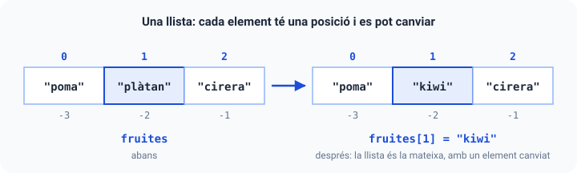
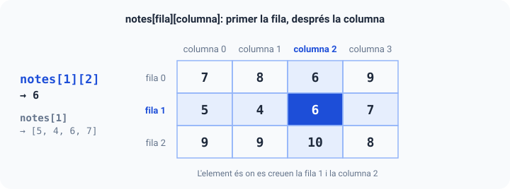

# Unitat 7. Arrays: llistes i taules

Imagina que has de guardar les notes dels 25 alumnes d'un grup. Amb el que sabem fins ara, necessitaríem 25 variables: `nota1`, `nota2`, `nota3`… I si després volguéssim calcular la mitjana, hauríem d'escriure una suma amb 25 termes. I si el grup tingués 26 alumnes, hauríem de canviar el programa.

Per resoldre aquest problema, els llenguatges de programació tenen **estructures de dades**: maneres d'organitzar moltes dades sota un sol nom. La més bàsica és l'**array** (en català també s'anomena **vector** si té una dimensió i **matriu** si en té dues o més): un conjunt de dades guardades una darrere l'altra, a les quals s'accedeix per la seva **posició** o **índex**.

!!! info "Arrays en Python"
    Molts de llenguatges, com C o Java, tenen arrays «purs»: tenen una mida fixa que s'ha de declarar en crear-los, i tots els elements han de ser del mateix tipus. Python no té aquest tipus bàsic; en lloc seu fa servir les **llistes**, que són més flexibles: poden créixer i minvar, i poden barrejar tipus. En aquesta unitat treballarem els arrays **amb llistes de Python**: les llistes per als arrays unidimensionals i les **llistes de llistes** per als multidimensionals.

    Per a càlcul científic amb grans volums de dades hi ha la biblioteca NumPy, que sí que ofereix arrays de mida i tipus fixos i molt més ràpids. No la farem servir en aquest curs.


!!! tip "Vídeo recomanat"
    Curs de Python de MoureDev: [lliçó 6, «Llistes»](https://youtu.be/Kp4Mvapo5kc?t=10872), [lliçó 7, «Tuples»](https://youtu.be/Kp4Mvapo5kc?t=14711), [lliçó 8, «Conjunts»](https://youtu.be/Kp4Mvapo5kc?t=16335) i [lliçó 9, «Diccionaris»](https://youtu.be/Kp4Mvapo5kc?t=18506). El vídeo és en castellà.

## 7.1. Llistes: arrays unidimensionals

Una **llista** és una col·lecció **ordenada** i **mutable** d'elements. Ordenada vol dir que cada element té una posició; mutable vol dir que, a diferència de les cadenes, es pot modificar després de crear-la. Les llistes s'escriuen entre claudàtors `[]`, amb els elements separats per comes.

```python
notes = [7.5, 4, 9, 6.25, 8]
fruites = ["poma", "plàtan", "cirera"]
buida = []
```

### 7.1.1. Accedir als elements i modificar-los

Els índexs funcionen igual que a les cadenes: el primer element és el 0 i el darrer, el -1. També es poden fer llesques.

```python
fruites = ["poma", "plàtan", "cirera"]
print(fruites[0])     # poma
print(fruites[-1])    # cirera
print(fruites[0:2])   # ['poma', 'plàtan']
print(len(fruites))   # 3

# Substituir un element (amb les cadenes no es podia!)
fruites[1] = "kiwi"
print(fruites)        # ['poma', 'kiwi', 'cirera']
```

<figure markdown="span">
  { width="720" }
  <figcaption>Les llistes són mutables: es pot substituir un element sense crear una llista nova.</figcaption>
</figure>

!!! example "Exercici 7.1. Accés als elements"
    Amb `l = [3, 8, 1, 9, 4]`, quin és el resultat de `l[0]`, `l[-2]`, `l[1:3]` i `len(l)`? I com queda la llista després d'executar `l[2] = 7`?

    ??? success "Solució"
        `3`, `9`, `[8, 1]` i `5`. Després de `l[2] = 7`, la llista és `[3, 8, 7, 9, 4]`: s'ha substituït l'element de la posició 2, que era l'1.

### 7.1.2. Operacions bàsiques

| Operació | Com es fa | Exemple amb `l = [4, 12, 15]` | Resultat |
| --- | --- | --- | --- |
| Afegir al final | `l.append(x)` | `l.append(9)` | `[4, 12, 15, 9]` |
| Inserir en una posició | `l.insert(pos, x)` | `l.insert(1, 7)` | `[4, 7, 12, 15]` |
| Eliminar per valor | `l.remove(x)` (el primer que troba) | `l.remove(12)` | `[4, 15]` |
| Eliminar per posició | `l.pop(pos)` (retorna l'element eliminat) o `del l[pos]` | `l.pop(0)` | `[12, 15]` |
| Intercanviar dos elements | `l[i], l[j] = l[j], l[i]` | `l[0], l[2] = l[2], l[0]` | `[15, 12, 4]` |
| Ordenar | `l.sort()` (de menor a major) o `l.sort(reverse=True)` | `l.sort(reverse=True)` | `[15, 12, 4]` |
| Girar | `l.reverse()` | `l.reverse()` | `[15, 12, 4]` |
| Comprovar si hi és | `x in l` | `12 in l` | `True` |
| Cercar la posició | `l.index(x)` (error si no hi és) | `l.index(15)` | `2` |
| Comptar aparicions | `l.count(x)` | `l.count(4)` | `1` |
| Unir llistes | `l + altra` | `l + [1, 2]` | `[4, 12, 15, 1, 2]` |

També hi ha funcions que treballen amb llistes de nombres: `sum(l)`, `max(l)`, `min(l)` i `sorted(l)` (que retorna una llista ordenada nova sense modificar l'original).

!!! warning "Mètodes que modifiquen la llista"
    Al contrari que els de les cadenes, molts de mètodes de les llistes (`append`, `insert`, `remove`, `sort`, `reverse`…) **modifiquen la llista original** i no retornen res. Per tant, `l = l.sort()` és un error: deixa `l` amb el valor `None`. Escriu simplement `l.sort()`.

!!! example "Exercici 7.2. Segueix la llista"
    Partint de `l = [4, 12, 15]`, s'executen aquestes instruccions una darrere l'altra. Com queda la llista després de cada una?

    1. `l.append(9)`
    2. `l.insert(0, 1)`
    3. `l.remove(12)`
    4. `x = l.pop()`
    5. `l[0], l[2] = l[2], l[0]`
    6. `l.sort()`

    ??? success "Solució"
        1. `[4, 12, 15, 9]`
        2. `[1, 4, 12, 15, 9]`
        3. `[1, 4, 15, 9]`
        4. `[1, 4, 15]`, i `x` val 9: `pop()` sense posició elimina i retorna el darrer element.
        5. `[15, 4, 1]`
        6. `[1, 4, 15]`

!!! example "Exercici 7.3. Dies de la setmana (revisat)"
    Torna a fer l'exercici 4.10 (mostrar el dia de la setmana a partir d'un nombre de l'1 al 7), però ara amb una llista en lloc d'una cadena d'`elif`.

    ??? success "Solució"
        ```python
        dies = ["Dilluns", "Dimarts", "Dimecres", "Dijous", "Divendres", "Dissabte", "Diumenge"]
        n = int(input("Escriu un nombre de l'1 al 7: "))
        if 1 <= n <= 7:
            print(dies[n - 1])   # la posició és n - 1 perquè els índexs comencen a 0
        else:
            print("Nombre no vàlid")
        ```

### 7.1.3. Recórrer una llista

Hi ha dues maneres de recórrer una llista. Si només necessitam els elements, recorrem la llista directament:

```python
fruites = ["poma", "pera", "cirera"]
for fruita in fruites:
    print(fruita)
```

Si també necessitam la posició (per exemple, per modificar els elements), recorrem els índexs:

```python
preus = [10, 25, 8]
for i in range(len(preus)):
    preus[i] = preus[i] * 1.21   # afegim l'IVA a cada preu
print(preus)
```

Quina manera has de fer servir? Depèn del que necessitis per resoldre cada problema.

!!! example "Exercici 7.4. Operacions bàsiques"
    Donada la llista `[4, 12, 15, 9, 31]`, escriu un programa que mostri: la suma de tots els elements, el nombre més gran, quants d'elements té, només els nombres senars i la llista girada. Resol-lo primer **sense** fer servir `sum()`, `max()` ni `reverse()`, i després comprova els resultats amb aquestes funcions.

    ??? success "Solució"
        ```python
        llista = [4, 12, 15, 9, 31]

        suma = 0
        maxim = llista[0]
        for x in llista:
            suma += x
            if x > maxim:
                maxim = x
        print("Suma:", suma)
        print("Màxim:", maxim)
        print("Elements:", len(llista))

        print("Senars:", end=" ")
        for x in llista:
            if x % 2 != 0:
                print(x, end=" ")
        print()

        girada = []
        for i in range(len(llista) - 1, -1, -1):
            girada.append(llista[i])
        print("Girada:", girada)

        # Comprovació amb les funcions de Python
        print(sum(llista), max(llista), llista[::-1])
        ```

### 7.1.4. Construir una llista pas a pas

Sovint no coneixem les dades per endavant: les llegim de l'usuari o les calculam. En aquests casos, començam amb una llista buida i hi anam afegint elements amb `append()`:

```python
n = int(input("Quantes notes vols introduir? "))
notes = []
for i in range(n):
    notes.append(float(input(f"Nota {i + 1}: ")))

print("Notes:", notes)
print(f"Mitjana: {sum(notes) / len(notes):.2f}")
print("Nota màxima:", max(notes))
```

Fixa't que aquest programa funciona igual amb 3 notes que amb 300. Aquest és el gran avantatge dels arrays respecte de les variables individuals.

!!! example "Exercici 7.5. Temperatures de la setmana"
    Demana la temperatura màxima de cada dia de la setmana i guarda-les en una llista. Després mostra la mitjana, el dia més calorós (pel nom) i quants dies han superat la mitjana.

    ??? success "Solució"
        ```python
        dies = ["dilluns", "dimarts", "dimecres", "dijous", "divendres", "dissabte", "diumenge"]
        temperatures = []
        for dia in dies:
            temperatures.append(float(input(f"Temperatura de {dia}: ")))

        mitjana = sum(temperatures) / len(temperatures)
        posicio_max = temperatures.index(max(temperatures))
        per_sobre = 0
        for t in temperatures:
            if t > mitjana:
                per_sobre += 1

        print(f"Mitjana: {mitjana:.1f} °C")
        print(f"Dia més calorós: {dies[posicio_max]}")
        print(f"Dies per sobre de la mitjana: {per_sobre}")
        ```

!!! example "Exercici 7.6. Llista de la compra"
    Fes un programa amb un menú que permeti gestionar una llista de la compra: afegir un producte, eliminar un producte, mostrar la llista ordenada alfabèticament i sortir. Si l'usuari vol eliminar un producte que no hi és, mostra un missatge d'avís.

    ??? success "Solució"
        ```python
        compra = []
        while True:
            print("\n1. Afegir  2. Eliminar  3. Mostrar  4. Sortir")
            opcio = input("Opció: ")
            if opcio == "1":
                producte = input("Producte: ").strip().lower()
                compra.append(producte)
            elif opcio == "2":
                producte = input("Producte a eliminar: ").strip().lower()
                if producte in compra:
                    compra.remove(producte)
                else:
                    print("Aquest producte no és a la llista")
            elif opcio == "3":
                for producte in sorted(compra):
                    print("-", producte)
            elif opcio == "4":
                break
            else:
                print("Opció no vàlida")
        ```

### 7.1.5. Ordenar a mà: el mètode de la bombolla

`sort()` ordena una llista en un instant, però com ho fa? Ordenar dades és un dels problemes clàssics de la programació, i hi ha molts d'algorismes per fer-ho. El més senzill d'entendre és el **mètode de la bombolla** (*bubble sort*): es recorre la llista comparant cada element amb el següent i, si estan en l'ordre incorrecte, s'intercanvien. Després de la primera passada, el més gran ha «pujat» fins al final, com una bombolla. Es repeteix el procés fins que la llista està ordenada.

```python
llista = [31, 4, 15, 9, 12]
n = len(llista)
for passada in range(n - 1):
    for i in range(n - 1 - passada):
        if llista[i] > llista[i + 1]:
            llista[i], llista[i + 1] = llista[i + 1], llista[i]   # intercanvi
print(llista)   # [4, 9, 12, 15, 31]
```

El mètode de la bombolla és fàcil d'entendre, però és lent amb llistes grans. `sort()` fa servir un algorisme molt més eficient.

!!! example "Exercici 7.7. Ordenar de major a menor"
    Modifica el mètode de la bombolla de l'apartat 7.1.5 perquè ordeni de major a menor. Després, compta quants d'intercanvis ha fet per ordenar la llista `[5, 1, 4, 2, 8]`.

    ??? success "Solució"
        ```python
        llista = [5, 1, 4, 2, 8]
        intercanvis = 0
        n = len(llista)
        for passada in range(n - 1):
            for i in range(n - 1 - passada):
                if llista[i] < llista[i + 1]:   # només canvia el signe de la comparació
                    llista[i], llista[i + 1] = llista[i + 1], llista[i]
                    intercanvis += 1
        print(llista)        # [8, 5, 4, 2, 1]
        print(intercanvis)   # 6
        ```

### 7.1.6. Avantatges i inconvenients dels arrays

| Avantatges | Inconvenients |
| --- | --- |
| Un sol nom per a moltes dades relacionades. | Cal recordar què representa cada posició; si l'ordre canvia, les posicions deixen de tenir el mateix significat. |
| Es poden processar totes les dades amb un bucle, siguin quantes siguin. | Inserir o eliminar elements enmig d'un array gran és més lent, perquè s'han de desplaçar tots els que hi ha darrere. |
| L'accés a un element per la seva posició és immediat. | Cercar un element sense conèixer-ne la posició obliga a recórrer l'array. |
| En molts de llenguatges ocupen un bloc continu de memòria, i això els fa eficients. | En els llenguatges amb arrays de mida fixa, s'ha de preveure la mida: si és massa petita no hi caben les dades, i si és massa gran es malbarata memòria. |

!!! example "Exercici 7.8. Array o variables?"
    Per a cada situació, decideix si faries servir un array o variables separades, i justifica-ho:

    1. Les temperatures de cada hora d'un dia.
    2. El nom, l'edat i el curs d'un alumne.
    3. Les puntuacions de tots els jugadors d'una partida en línia, que poden ser de 2 a 100.
    4. L'amplada i l'altura d'un rectangle.

    ??? success "Solució orientativa"
        1. **Array**: són 24 dades del mateix tipus i amb el mateix significat, i segurament les voldrem processar amb un bucle (mitjana, màxima…).
        2. **Variables separades** (o un diccionari): són poques dades, de tipus diferents i amb significats diferents. En una llista hauríem de recordar que la posició 0 és el nom, l'1 l'edat, etc.
        3. **Array**: no sabem per endavant quantes dades hi haurà, i amb una llista el programa funciona igual amb 2 jugadors que amb 100.
        4. **Variables separades**: són només dues dades amb significats diferents, i `amplada` i `altura` s'entenen millor que `rectangle[0]` i `rectangle[1]`.

## 7.2. Taules: arrays multidimensionals

Moltes dades tenen forma de **taula**: files i columnes. Per exemple, les notes de diversos alumnes en diverses assignatures, un tauler d'escacs, els píxels d'una imatge o un full de càlcul. Per representar-les, feim servir un **array bidimensional** o **matriu**. En Python, es construeix com una **llista de llistes**: una llista en què cada element és una fila, que al seu torn és una llista.

```python
# Notes de 3 alumnes en 4 assignatures
notes = [
    [7, 8, 6, 9],   # fila 0: alumne 0
    [5, 4, 6, 7],   # fila 1: alumne 1
    [9, 9, 10, 8],  # fila 2: alumne 2
]
```

|  | Col. 0 | Col. 1 | Col. 2 | Col. 3 |
| --- | --- | --- | --- | --- |
| **Fila 0** | 7 | 8 | 6 | 9 |
| **Fila 1** | 5 | 4 | 6 | 7 |
| **Fila 2** | 9 | 9 | 10 | 8 |

Per accedir a un element, s'indiquen **dos índexs**: primer la fila i després la columna.

```python
print(notes[1])       # [5, 4, 6, 7]: tota la fila 1
print(notes[1][2])    # 6: fila 1, columna 2
notes[1][1] = 5       # modificar un element
print(len(notes))     # 3: nombre de files
print(len(notes[0]))  # 4: nombre de columnes
```

<figure markdown="span">
  { width="720" }
  <figcaption>`notes[1]` és tota la fila 1; `notes[1][2]` és l'element d'aquesta fila que és a la columna 2.</figcaption>
</figure>

### 7.2.1. Recórrer una taula

Per recórrer tots els elements d'una taula feim servir **dos bucles niats**, com vam veure a la unitat 5: l'exterior recorre les files i l'interior, les columnes de cada fila.

```python
notes = [[7, 8, 6, 9], [5, 4, 6, 7], [9, 9, 10, 8]]

for fila in range(len(notes)):
    suma = 0
    for col in range(len(notes[fila])):
        suma += notes[fila][col]
    print(f"Alumne {fila}: mitjana {suma / len(notes[fila]):.2f}")
```

Per recórrer per **columnes** (per exemple, per fer la mitjana de cada assignatura), s'inverteix l'ordre dels bucles:

```python
for col in range(len(notes[0])):
    suma = 0
    for fila in range(len(notes)):
        suma += notes[fila][col]
    print(f"Assignatura {col}: mitjana {suma / len(notes):.2f}")
```

### 7.2.2. Crear una taula buida

Per crear una taula de, per exemple, 3 files i 4 columnes plena de zeros, cal construir cada fila per separat:

```python
files = 3
columnes = 4
taula = []
for f in range(files):
    fila = []
    for c in range(columnes):
        fila.append(0)
    taula.append(fila)
print(taula)   # [[0, 0, 0, 0], [0, 0, 0, 0], [0, 0, 0, 0]]
```

!!! danger "Trampa: `[[0] * 4] * 3`"
    Sembla que `[[0] * 4] * 3` crea la mateixa taula, i fins i tot es mostra igual. Però **no crea tres files diferents, sinó tres referències a la mateixa fila**. Si modifiques un element, canvia a totes les files:

    ```python
    taula = [[0] * 4] * 3
    taula[0][0] = 5
    print(taula)   # [[5, 0, 0, 0], [5, 0, 0, 0], [5, 0, 0, 0]]
    ```

    Crea sempre cada fila per separat, com a l'exemple anterior.

### 7.2.3. I amb més dimensions?

La idea es pot estendre: una llista de taules és un array tridimensional. Per exemple, les notes de cada alumne, en cada assignatura, en cada una de les tres avaluacions: `notes[avaluacio][alumne][assignatura]`. A la pràctica, però, quan tenim més de dues dimensions sol ser més clar fer servir altres estructures.

!!! example "Exercici 7.9. Accés a una taula"
    Amb `t = [[1, 2, 3], [4, 5, 6]]`, quin és el resultat de `t[1][0]`, `t[0][-1]`, `len(t)`, `len(t[0])` i `t[1]`?

    ??? success "Solució"
        `4`, `3`, `2` (files), `3` (columnes de la fila 0) i `[4, 5, 6]` (tota la fila 1).

!!! example "Exercici 7.10. Taula de notes"
    Fes un programa que demani les notes de 3 alumnes en 3 assignatures i les guardi en una taula (llista de llistes). Després, mostra la taula amb format de files i columnes, la mitjana de cada alumne i la mitjana de cada assignatura.

    ??? success "Solució"
        ```python
        ALUMNES = 3
        ASSIGNATURES = 3

        notes = []
        for a in range(ALUMNES):
            fila = []
            for s in range(ASSIGNATURES):
                fila.append(float(input(f"Nota de l'alumne {a + 1}, assignatura {s + 1}: ")))
            notes.append(fila)

        # Mostrar la taula
        for fila in notes:
            for nota in fila:
                print(f"{nota:6.2f}", end="")
            print()

        # Mitjana de cada alumne (per files)
        for a in range(ALUMNES):
            print(f"Mitjana de l'alumne {a + 1}: {sum(notes[a]) / ASSIGNATURES:.2f}")

        # Mitjana de cada assignatura (per columnes)
        for s in range(ASSIGNATURES):
            suma = 0
            for a in range(ALUMNES):
                suma += notes[a][s]
            print(f"Mitjana de l'assignatura {s + 1}: {suma / ALUMNES:.2f}")
        ```

## 7.3. Altres col·leccions: diccionaris, tuples i conjunts

A més de les llistes, Python té tres col·leccions més que faràs servir molt sovint. Cada una és adequada per a un tipus de dades diferent.

### 7.3.1. Diccionaris

Els arrays accedeixen a les dades per **posició**. De vegades, però, és més natural accedir-hi per **nom**. Per a això, Python té els **diccionaris**: col·leccions de parells **clau-valor**. Cada clau és única i serveix per accedir al valor associat. S'escriuen entre claus `{}`, amb cada clau separada del valor per dos punts.

```python
persona = {
    "nom": "Joan",
    "edat": 30,
    "ciutat": "Inca"
}

print(persona["nom"])          # Joan
persona["edat"] = 31           # modificar un valor
persona["professio"] = "fuster"  # afegir un parell nou
del persona["ciutat"]          # eliminar un parell

for clau, valor in persona.items():
    print(f"{clau}: {valor}")
```

També es poden recórrer només les claus amb `persona.keys()` o només els valors amb `persona.values()`. Tornarem a trobar els diccionaris a PTD II, quan treballem amb fitxers JSON.

!!! example "Exercici 7.11. Agenda amb diccionaris"
    Crea un diccionari amb el nom, l'edat i la ciutat d'una persona, demanant aquestes dades a l'usuari. Mostra el diccionari. Després demana una edat nova i actualitza-la; afegeix-hi una adreça electrònica; demana una clau a l'usuari i elimina aquest parell si existeix. Finalment, mostra només els valors del diccionari.

    ??? success "Solució"
        ```python
        persona = {
            "nom": input("Nom: "),
            "edat": int(input("Edat: ")),
            "ciutat": input("Ciutat: "),
        }
        print(persona)

        persona["edat"] = int(input("Edat nova: "))
        persona["correu"] = input("Correu electrònic: ")
        print(persona)

        clau = input("Quina dada vols eliminar? ")
        if clau in persona:
            del persona[clau]
        else:
            print("Aquesta clau no existeix")

        for valor in persona.values():
            print(valor)
        ```

### 7.3.2. Tuples

Una **tupla** és com una llista, però **no es pot modificar** un cop creada: no s'hi poden afegir, treure ni canviar elements. Es diu que és **immutable**, com les cadenes. S'escriu entre parèntesis:

```python
punt = (3, 5)
color = (255, 128, 0)
dies_feiners = ("dilluns", "dimarts", "dimecres", "dijous", "divendres")

print(punt[0])               # 3: s'accedeix per índex, com a les llistes
print(len(dies_feiners))     # 5
print(dies_feiners[1:3])     # ('dimarts', 'dimecres'): també admet llesques
print("dijous" in dies_feiners)  # True
```

Si s'intenta modificar, Python dona un error:

```python
punt[0] = 10    # TypeError: 'tuple' object does not support item assignment
```

Per què voldríem una llista que no es pot canviar?

- **Seguretat**: les dades que no han de canviar (les coordenades d'un lloc, els dies de la setmana, un color) queden protegides contra modificacions per error.
- **Agrupar dades relacionades** que van juntes, com el nom i l'edat d'una persona, o la fila i la columna d'una casella.

Una de les coses més útils de les tuples és el **desempaquetament**: repartir els elements entre diverses variables en una sola línia.

```python
punt = (3, 5)
x, y = punt              # x val 3 i y val 5
print(f"x = {x}, y = {y}")

# Intercanviar dues variables sense una variable auxiliar
a = 1
b = 2
a, b = b, a
print(a, b)              # 2 1
```

Ja havies fet servir tuples sense saber-ho: a l'apartat anterior, `for clau, valor in persona.items()` reparteix cada parella del diccionari entre dues variables.

!!! info "Una tupla d'un sol element"
    `(5)` no és una tupla, sinó el nombre 5 entre parèntesis. Una tupla d'un sol element necessita una coma: `(5,)`.

Una llista es pot convertir en tupla amb `tuple()`, i una tupla en llista amb `list()`.

!!! example "Exercici 7.12. Coordenades"
    Guarda en una llista les coordenades `(x, y)` de quatre punts com a tuples: `(0, 0)`, `(3, 4)`, `(-2, 1)` i `(5, -1)`. Recorre la llista desempaquetant cada tupla i mostra, per a cada punt, a quina distància és de l'origen (l'arrel quadrada de x² + y²), amb dues xifres decimals. Al final, mostra el punt més allunyat.

    ??? success "Solució"
        ```python
        punts = [(0, 0), (3, 4), (-2, 1), (5, -1)]

        mes_lluny = punts[0]
        distancia_max = 0

        for x, y in punts:
            distancia = (x ** 2 + y ** 2) ** 0.5
            print(f"({x}, {y}) és a {distancia:.2f} de l'origen")
            if distancia > distancia_max:
                distancia_max = distancia
                mes_lluny = (x, y)

        print("El punt més allunyat és", mes_lluny)
        ```

        ```text
        (0, 0) és a 0.00 de l'origen
        (3, 4) és a 5.00 de l'origen
        (-2, 1) és a 2.24 de l'origen
        (5, -1) és a 5.10 de l'origen
        El punt més allunyat és (5, -1)
        ```

### 7.3.3. Conjunts

Un **conjunt** (*set*) és una col·lecció **sense ordre** i **sense elements repetits**. S'escriu entre claus, com un diccionari, però sense parelles clau-valor:

```python
colors = {"vermell", "verd", "blau", "verd"}
print(colors)        # {'blau', 'vermell', 'verd'} (l'ordre pot canviar)
print(len(colors))   # 3: el "verd" repetit només hi és una vegada

colors.add("groc")       # afegir
colors.discard("blau")   # treure (si no hi és, no dona error)
print("verd" in colors)  # True
```

Com que no tenen ordre, els conjunts **no tenen índexs**: `colors[0]` dona error. Per crear un conjunt buit s'escriu `set()`, perquè `{}` crea un diccionari buit.

La manera més ràpida d'eliminar els repetits d'una llista és convertir-la en conjunt:

```python
noms = ["Aina", "Biel", "Aina", "Carla", "Biel"]
diferents = set(noms)
print(len(diferents))        # 3
print(sorted(diferents))     # ['Aina', 'Biel', 'Carla']
```

Els conjunts permeten fer les **operacions de conjunts** de les matemàtiques:

```python
robotica = {"Aina", "Biel", "Carla", "Dani"}
escacs = {"Carla", "Elena", "Aina"}

print(robotica | escacs)   # unió: alumnes de robòtica o d'escacs (o de totes dues)
print(robotica & escacs)   # intersecció: alumnes de totes dues activitats
print(robotica - escacs)   # diferència: de robòtica, però no d'escacs
```

| Operació | Símbol | Mètode | Resultat |
| --- | --- | --- | --- |
| Unió | `a \| b` | `a.union(b)` | Els elements que són a `a`, a `b` o a tots dos |
| Intersecció | `a & b` | `a.intersection(b)` | Els elements que són a tots dos |
| Diferència | `a - b` | `a.difference(b)` | Els elements de `a` que no són a `b` |

!!! example "Exercici 7.13. Activitats extraescolars"
    Amb els conjunts `robotica = {"Aina", "Biel", "Carla", "Dani"}` i `escacs = {"Carla", "Elena", "Aina"}`, mostra, ordenats alfabèticament:

    1. Quants alumnes diferents fan alguna activitat.
    2. Quins alumnes fan totes dues activitats.
    3. Quins només fan robòtica.
    4. Quins fan només una de les dues activitats.

    ??? success "Solució"
        ```python
        robotica = {"Aina", "Biel", "Carla", "Dani"}
        escacs = {"Carla", "Elena", "Aina"}

        print("Alumnes diferents:", len(robotica | escacs))
        print("Totes dues:", sorted(robotica & escacs))
        print("Només robòtica:", sorted(robotica - escacs))
        print("Només una:", sorted((robotica | escacs) - (robotica & escacs)))
        ```

        ```text
        Alumnes diferents: 5
        Totes dues: ['Aina', 'Carla']
        Només robòtica: ['Biel', 'Dani']
        Només una: ['Biel', 'Dani', 'Elena']
        ```

        Per a la darrera hi ha un operador específic, la **diferència simètrica**: `robotica ^ escacs`.

!!! example "Exercici 7.14. Llista, tupla, conjunt o diccionari?"
    Quina estructura triaries per guardar cada cosa? Justifica-ho.

    1. Les notes d'un alumne al llarg del curs, en l'ordre en què les treu.
    2. Les coordenades GPS de l'institut.
    3. Les paraules diferents que apareixen en un text.
    4. El telèfon de cada alumne, per cercar-lo pel nom.
    5. Els noms dels mesos de l'any.

    ??? success "Solució"
        1. **Llista**: l'ordre importa i se n'hi afegiran més.
        2. **Tupla**: dues dades que van juntes i no han de canviar.
        3. **Conjunt**: no vols repetits i l'ordre no importa.
        4. **Diccionari**: la clau és el nom i el valor, el telèfon.
        5. **Tupla**: l'ordre importa i no canviaran mai.

## 7.4. Reptes

!!! example "Repte 7.1. Tres en ratlla"
    Representa un tauler de tres en ratlla amb una llista de llistes de 3 × 3, on cada casella conté `" "`, `"X"` o `"O"`. Fes un programa que permeti a dos jugadors col·locar fitxes per torns indicant la fila i la columna, que mostri el tauler després de cada jugada i que no permeti col·locar una fitxa en una casella ocupada. Ampliació: detecta quan un jugador ha guanyat.

    ??? success "Solució (sense l'ampliació)"
        ```python
        tauler = []
        for f in range(3):
            tauler.append([" ", " ", " "])

        jugador = "X"
        for torn in range(9):
            # Mostrar el tauler
            for fila in tauler:
                print(" | ".join(fila))
                print("-" * 9)

            f = int(input(f"Jugador {jugador}, fila (0-2): "))
            c = int(input(f"Jugador {jugador}, columna (0-2): "))
            while tauler[f][c] != " ":
                print("Casella ocupada")
                f = int(input(f"Jugador {jugador}, fila (0-2): "))
                c = int(input(f"Jugador {jugador}, columna (0-2): "))
            tauler[f][c] = jugador

            if jugador == "X":
                jugador = "O"
            else:
                jugador = "X"

        for fila in tauler:
            print(" | ".join(fila))
        ```

        Per a l'ampliació, després de cada jugada s'han de comprovar les 3 files, les 3 columnes i les 2 diagonals, i acabar el bucle amb `break` si alguna té tres fitxes iguals del jugador que acaba de tirar.

!!! example "Repte 7.2. El canvi en monedes, revisat"
    Torna a fer el repte 3.2 (el canvi amb el menor nombre de monedes), però ara guarda els valors de les monedes en una llista i fes els càlculs amb un bucle. Mostra només les monedes que s'han de tornar.

    ??? success "Solució"
        ```python
        MONEDES = [200, 100, 50, 20, 10, 5, 2, 1]   # en cèntims

        canvi = int(input("Canvi en cèntims: "))
        for moneda in MONEDES:
            quantes = canvi // moneda
            canvi = canvi % moneda
            if quantes > 0:
                print(f"{quantes} de {moneda} cèntims")
        ```

        Compara-ho amb la solució del repte 3.2: amb la llista, el programa passa de 17 línies a 7, i per afegir o treure un tipus de moneda només cal canviar la llista.

## 7.5. Exercicis de repàs

Més exercicis per practicar tota la unitat, ordenats de menys a més dificultat. Els dos primers es resolen sense ordinador. En molts d'ells es demana resoldre «a mà», amb bucles, el que Python ja fa amb una funció: és la millor manera d'entendre què passa per dins.

!!! example "Repàs 7.1. Segueix la llista"
    Escriu com queda la llista després de cada instrucció, sense executar el programa.

    ```python
    l = [5, 2, 9]
    l.append(4)
    l.insert(1, 7)
    l.remove(9)
    x = l.pop(0)
    l[1] = l[1] * 10
    ```

    Quant val `x` al final?

    ??? success "Solució"
        ```text
        [5, 2, 9, 4]
        [5, 7, 2, 9, 4]
        [5, 7, 2, 4]
        [7, 2, 4]
        [7, 20, 4]
        ```

        `x` val 5: `pop()` elimina l'element i el retorna.

!!! example "Repàs 7.2. Accés a una taula"
    Amb aquesta taula, quin és el valor de cada expressió?

    ```python
    t = [
        [1, 2, 3],
        [4, 5, 6],
        [7, 8, 9],
        [10, 11, 12],
    ]
    ```

    `t[0][0]` · `t[2][1]` · `t[3]` · `t[-1][-1]` · `len(t)` · `len(t[0])` · `t[1][0] + t[0][1]`

    ??? success "Solució"
        `1`, `8`, `[10, 11, 12]`, `12`, `4` (files), `3` (columnes) i `6`.

!!! example "Repàs 7.3. Caça d'errors"
    Aquest programa hauria de mostrar tots els elements de la llista, però dona un error `IndexError`. Explica per què, corregeix-lo i escriu-ne també una versió que no necessiti índexs.

    ```python
    colors = ["vermell", "verd", "blau"]
    for i in range(1, len(colors) + 1):
        print(colors[i])
    ```

    ??? success "Solució"
        ```python
        colors = ["vermell", "verd", "blau"]

        # Versió amb índexs
        for i in range(len(colors)):
            print(colors[i])

        # Versió sense índexs
        for color in colors:
            print(color)
        ```

        Els índexs d'una llista de 3 elements van del 0 al 2. El `range(1, 4)` original se salta el primer element i, a la darrera volta, demana la posició 3, que no existeix.

!!! example "Repàs 7.4. Suma i mitjana a mà"
    Donada la llista `notes = [7.5, 4, 9, 6.25, 8]`, calcula'n la suma i la mitjana **sense** fer servir `sum()`. Després comprova el resultat amb `sum()` i `len()`.

    ??? success "Solució"
        ```python
        notes = [7.5, 4, 9, 6.25, 8]

        suma = 0
        for nota in notes:
            suma = suma + nota

        print("Suma:", suma)
        print("Mitjana:", suma / len(notes))
        print("Comprovació:", sum(notes) / len(notes))
        ```

!!! example "Repàs 7.5. El màxim i on és"
    Donada la llista `temperatures = [18, 22, 31, 27, 31, 19]`, troba la temperatura més alta i la posició on apareix per primera vegada, **sense** fer servir `max()` ni `index()`.

    ??? success "Solució"
        ```python
        temperatures = [18, 22, 31, 27, 31, 19]

        maxim = temperatures[0]
        posicio = 0
        for i in range(1, len(temperatures)):
            if temperatures[i] > maxim:
                maxim = temperatures[i]
                posicio = i

        print("Màxim:", maxim)
        print("Posició:", posicio)
        ```

        Com que es compara amb `>` i no amb `>=`, quan torna a aparèixer el 31 no se substitueix, i es conserva la primera posició.

!!! example "Repàs 7.6. Quants d'aprovats?"
    Donada la llista `notes = [3, 7.5, 5, 4.9, 9, 6, 2, 5.5]`, mostra quants d'aprovats i quants de suspesos hi ha, i el percentatge d'aprovats.

    ??? success "Solució"
        ```python
        notes = [3, 7.5, 5, 4.9, 9, 6, 2, 5.5]

        aprovats = 0
        for nota in notes:
            if nota >= 5:
                aprovats = aprovats + 1

        suspesos = len(notes) - aprovats
        print("Aprovats:", aprovats)
        print("Suspesos:", suspesos)
        print(f"Percentatge d'aprovats: {aprovats / len(notes) * 100:.1f} %")
        ```

!!! example "Repàs 7.7. Els quadrats"
    Crea una llista buida i omple-la, amb un bucle, amb els quadrats dels nombres de l'1 al 10. Mostra la llista.

    ??? success "Solució"
        ```python
        quadrats = []
        for n in range(1, 11):
            quadrats.append(n ** 2)

        print(quadrats)
        ```

!!! example "Repàs 7.8. Separar parells i senars"
    Donada la llista `nombres = [12, 7, 3, 20, 15, 8, 1, 6]`, crea dues llistes noves: una amb els nombres parells i una altra amb els senars. Mostra-les.

    ??? success "Solució"
        ```python
        nombres = [12, 7, 3, 20, 15, 8, 1, 6]

        parells = []
        senars = []
        for n in nombres:
            if n % 2 == 0:
                parells.append(n)
            else:
                senars.append(n)

        print("Parells:", parells)
        print("Senars:", senars)
        ```

!!! example "Repàs 7.9. Girar una llista a mà"
    Donada la llista `lletres = ["a", "b", "c", "d"]`, crea una llista nova amb els mateixos elements en ordre invers, **sense** fer servir `reverse()` ni llesques. La llista original no ha de canviar.

    ??? success "Solució"
        ```python
        lletres = ["a", "b", "c", "d"]

        girada = []
        for i in range(len(lletres) - 1, -1, -1):
            girada.append(lletres[i])

        print(girada)
        print(lletres)
        ```

        El `range(len(lletres) - 1, -1, -1)` recorre els índexs del darrer al 0. També es pot recórrer la llista en ordre normal i inserir cada element al principi amb `girada.insert(0, element)`.

!!! example "Repàs 7.10. Sense repetits"
    Donada la llista `noms = ["Aina", "Biel", "Aina", "Carla", "Biel", "Aina"]`, crea una llista nova sense elements repetits, conservant l'ordre en què apareixen per primera vegada.

    ??? success "Solució"
        ```python
        noms = ["Aina", "Biel", "Aina", "Carla", "Biel", "Aina"]

        unics = []
        for nom in noms:
            if nom not in unics:
                unics.append(nom)

        print(unics)
        ```

!!! example "Repàs 7.11. Totes les posicions"
    Demana un nombre i mostra totes les posicions on apareix dins la llista `l = [4, 7, 4, 1, 9, 4, 7]`. Si no hi és, mostra un missatge. Recorda que `index()` només troba la primera aparició.

    ??? success "Solució"
        ```python
        l = [4, 7, 4, 1, 9, 4, 7]

        cercat = int(input("Nombre que cerques: "))

        posicions = []
        for i in range(len(l)):
            if l[i] == cercat:
                posicions.append(i)

        if len(posicions) > 0:
            print("Apareix a les posicions", posicions)
        else:
            print("No hi és")
        ```

!!! example "Repàs 7.12. Elements en comú"
    Dues amigues han fet la llista de les pel·lícules que volen veure. Mostra quines pel·lícules són a totes dues llistes.

    ```python
    llista1 = ["Up", "Coco", "Brave", "Soul"]
    llista2 = ["Soul", "Luca", "Up", "Cars"]
    ```

    ??? success "Solució"
        ```python
        llista1 = ["Up", "Coco", "Brave", "Soul"]
        llista2 = ["Soul", "Luca", "Up", "Cars"]

        comunes = []
        for pelicula in llista1:
            if pelicula in llista2:
                comunes.append(pelicula)

        print(comunes)
        ```

!!! example "Repàs 7.13. Rotar la llista"
    Donada la llista `torn = ["Aina", "Biel", "Carla", "Dani"]`, fes que el darrer element passi a ser el primer i que la resta es desplaci una posició: `["Dani", "Aina", "Biel", "Carla"]`.

    ??? success "Solució"
        ```python
        torn = ["Aina", "Biel", "Carla", "Dani"]

        darrer = torn.pop()
        torn.insert(0, darrer)

        print(torn)
        ```

        `pop()` sense paràmetres elimina i retorna el darrer element.

!!! example "Repàs 7.14. Estadístiques de notes"
    Llegeix notes del teclat fins que l'usuari escrigui `-1`, i guarda-les en una llista. Després mostra la llista, la nota mitjana, la més alta, la més baixa i quantes notes superen la mitjana.

    ??? success "Solució"
        ```python
        notes = []

        nota = float(input("Nota (-1 per acabar): "))
        while nota != -1:
            notes.append(nota)
            nota = float(input("Nota (-1 per acabar): "))

        if len(notes) == 0:
            print("No has introduït cap nota")
        else:
            mitjana = sum(notes) / len(notes)

            per_sobre = 0
            for n in notes:
                if n > mitjana:
                    per_sobre = per_sobre + 1

            print("Notes:", notes)
            print(f"Mitjana: {mitjana:.2f}")
            print("Més alta:", max(notes))
            print("Més baixa:", min(notes))
            print("Per sobre de la mitjana:", per_sobre)
        ```

        Aquí la llista és imprescindible: per saber quantes notes superen la mitjana, primer s'ha de calcular la mitjana i després **tornar a recórrer** les notes.

!!! example "Repàs 7.15. Sumes de files i de columnes"
    Amb la taula de notes següent (cada fila és un alumne i cada columna, una assignatura), mostra la suma de cada fila i la suma de cada columna.

    ```python
    notes = [
        [7, 8, 6, 9],
        [5, 4, 6, 7],
        [9, 9, 10, 8],
    ]
    ```

    ??? success "Solució"
        ```python
        notes = [
            [7, 8, 6, 9],
            [5, 4, 6, 7],
            [9, 9, 10, 8],
        ]

        for f in range(len(notes)):
            print(f"Suma de la fila {f}: {sum(notes[f])}")

        for c in range(len(notes[0])):
            suma = 0
            for f in range(len(notes)):
                suma = suma + notes[f][c]
            print(f"Suma de la columna {c}: {suma}")
        ```

        Una fila ja és una llista, i per això es pot sumar amb `sum()`. Una columna no ho és: s'ha de recórrer fixant la columna i canviant la fila.

!!! example "Repàs 7.16. El màxim d'una taula"
    Amb la mateixa taula de notes de l'exercici anterior, troba la nota més alta i mostra a quina fila i a quina columna és.

    ??? success "Solució"
        ```python
        notes = [
            [7, 8, 6, 9],
            [5, 4, 6, 7],
            [9, 9, 10, 8],
        ]

        maxim = notes[0][0]
        fila_max = 0
        columna_max = 0

        for f in range(len(notes)):
            for c in range(len(notes[f])):
                if notes[f][c] > maxim:
                    maxim = notes[f][c]
                    fila_max = f
                    columna_max = c

        print(f"La nota més alta és {maxim}, a la fila {fila_max} i la columna {columna_max}")
        ```

!!! example "Repàs 7.17. La diagonal"
    Demana una mida `n` i crea una taula de `n` × `n` plena de zeros, amb uns a la diagonal principal (la que va de dalt a l'esquerra fins a baix a la dreta). Mostra-la fila a fila.

    ??? success "Solució"
        ```python
        n = int(input("Mida: "))

        taula = []
        for f in range(n):
            fila = []
            for c in range(n):
                if f == c:
                    fila.append(1)
                else:
                    fila.append(0)
            taula.append(fila)

        for fila in taula:
            print(fila)
        ```

        Els elements de la diagonal principal són els que tenen el mateix índex de fila que de columna.

!!! example "Repàs 7.18. La taula de multiplicar, en una taula"
    Construeix amb bucles una taula de 5 × 5 on cada element sigui el producte del número de la seva fila pel de la seva columna, tots dos comptats des de l'1. Mostra-la fila a fila.

    ??? success "Solució"
        ```python
        taula = []
        for f in range(1, 6):
            fila = []
            for c in range(1, 6):
                fila.append(f * c)
            taula.append(fila)

        for fila in taula:
            print(fila)
        ```

!!! example "Repàs 7.19. Enfonsar la flota"
    En aquest tauler de 4 × 4, una `"V"` indica que hi ha un vaixell i un `"~"`, aigua. Demana una fila i una columna (del 0 al 3) i digues «Tocat!» o «Aigua». Si les coordenades són fora del tauler, mostra un missatge d'error. Al final, mostra quants vaixells hi ha en total al tauler.

    ```python
    tauler = [
        ["~", "V", "~", "~"],
        ["~", "~", "~", "V"],
        ["V", "~", "~", "~"],
        ["~", "~", "V", "~"],
    ]
    ```

    ??? success "Solució"
        ```python
        tauler = [
            ["~", "V", "~", "~"],
            ["~", "~", "~", "V"],
            ["V", "~", "~", "~"],
            ["~", "~", "V", "~"],
        ]

        fila = int(input("Fila (0-3): "))
        columna = int(input("Columna (0-3): "))

        if fila < 0 or fila > 3 or columna < 0 or columna > 3:
            print("Coordenades fora del tauler")
        elif tauler[fila][columna] == "V":
            print("Tocat!")
        else:
            print("Aigua")

        vaixells = 0
        for f in tauler:
            vaixells = vaixells + f.count("V")
        print("Vaixells al tauler:", vaixells)
        ```

        La comprovació de les coordenades ha d'anar **abans** d'accedir al tauler; si no, el programa s'aturaria amb un `IndexError`.

!!! example "Repàs 7.20. Freqüència de paraules"
    Amb un **diccionari**, compta quantes vegades apareix cada paraula a la frase `"el ca i el moix i el ratolí"` i mostra el resultat.

    ??? success "Solució"
        ```python
        frase = "el ca i el moix i el ratolí"

        frequencia = {}
        for paraula in frase.split():
            if paraula in frequencia:
                frequencia[paraula] = frequencia[paraula] + 1
            else:
                frequencia[paraula] = 1

        for paraula, vegades in frequencia.items():
            print(f"{paraula}: {vegades}")
        ```

        Amb un diccionari, l'operador `in` comprova si una **clau** existeix.

!!! example "Repàs 7.21. El preu de la compra"
    Tens un **diccionari** amb el preu de cada producte i una llista amb el que has comprat. Calcula el total de la compra. Si un producte de la llista no és al diccionari, avisa i no el comptis.

    ```python
    preus = {"pa": 1.2, "llet": 0.95, "ous": 2.4, "formatge": 3.75}
    compra = ["pa", "ous", "pa", "suc", "formatge"]
    ```

    ??? success "Solució"
        ```python
        preus = {"pa": 1.2, "llet": 0.95, "ous": 2.4, "formatge": 3.75}
        compra = ["pa", "ous", "pa", "suc", "formatge"]

        total = 0
        for producte in compra:
            if producte in preus:
                total = total + preus[producte]
            else:
                print("No sé el preu de:", producte)

        print(f"Total: {total:.2f} €")
        ```

---

!!! quote "Font"
    Unitat elaborada a partir de materials de Lope González Vázquez ([CC BY-NC-SA 4.0](https://creativecommons.org/licenses/by-nc-sa/4.0/deed.ca)): [«Tema 11. Fundamentos de programación»](https://lopegonzalez.es/eso-y-bachillerato/tic-i-1o-bachillerato/tema-11-fundamentos-de-programacion/) (TIC I) i [«Tema 1. Introducción a la programación»](https://lopegonzalez.es/eso-y-bachillerato/creacion-digital-y-pensamiento-computacional-1o-bachillerato/tema-1-introduccion-a-la-programacion/) (Creación digital y pensamiento computacional). De Lope provenen la introducció a les llistes (apartats 7.1.1 i 7.1.3), la de diccionaris (7.3.1) i els enunciats dels exercicis 7.4 (que n'uneix cinc) i 7.11 (que n'uneix cinc). Canvis: traducció al català i adaptació al currículum de Programació i Tractament de Dades I de les Illes Balears, que demana treballar arrays unidimensionals i multidimensionals. Són propis la presentació dels arrays i la seva relació amb les llistes de Python, la taula d'operacions, els apartats 7.1.4 a 7.1.6 7.2 (taules), 7.3.2 (tuples) i 7.3.3 (conjunts), la resta d'exercicis i reptes i totes les solucions.
