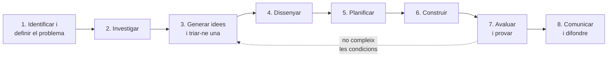
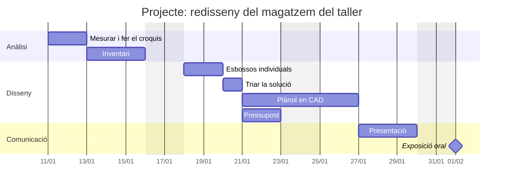
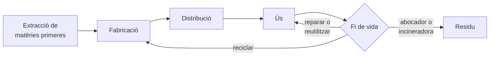

# Unitat 1. Procés de resolució de problemes i projectes

Cada objecte que tens a prop (la cadira, el carregador del mòbil, la motxilla, l'interruptor de la llum) va néixer perquè algú tenia un **problema** i el va resoldre. La persona que va dissenyar la teva motxilla es va preguntar com repartir el pes a l'esquena, quins materials resistirien la pluja o com evitar que les cremalleres s'obrissin soles.

La tecnologia no consisteix només a saber com funcionen les coses, sinó sobretot a **resoldre problemes de manera ordenada**. En aquesta unitat aprendràs el mètode que fan servir enginyers, dissenyadors i arquitectes per passar d'una necessitat a una solució que funcioni, i l'aplicaràs en un projecte real al teu centre.

## 1.1. Què és un problema tecnològic

Un **problema tecnològic** és una necessitat o una situació millorable que es pot resoldre construint o modificant un **producte**, un **sistema** o un **servei**:

| Tipus de solució | Què és | Exemple |
| --- | --- | --- |
| **Producte** | Un objecte físic | Un suport per al mòbil, una llum de lectura |
| **Sistema** | Un conjunt d'elements que treballen junts | El reg automàtic d'un hort, l'alarma d'un edifici |
| **Servei** | Una organització o activitat, sovint amb suport tecnològic | Un sistema de préstec de llibres, un punt de reciclatge al pati |

Els problemes tecnològics tenen dues característiques que els diferencien dels problemes de matemàtiques:

- **No tenen una sola solució correcta.** Per guardar les eines del taller hi ha moltes solucions vàlides; unes seran més barates, unes altres més pràctiques o més sostenibles.
- **Estan sotmesos a condicions.** Sempre hi ha límits de pressupost, de temps, d'espai, de materials o de seguretat. Una solució brillant que costa deu vegades el que tenim no és una solució.

!!! question "Pensa-hi"
    Pensa en un objecte que facis servir cada dia. Quin problema resol? Saps quina solució feia servir la gent abans que existís?

## 1.2. El procés de resolució de problemes

Per no anar a les palpentes, els projectes tecnològics segueixen unes **fases**. No sempre es diuen igual ni es fan en el mateix ordre exacte, però la idea és la mateixa:

1. **Identificar i definir el problema.** Què passa? A qui afecta? Quines condicions ha de complir la solució? Un problema mal definit porta gairebé sempre a una solució dolenta.
2. **Investigar.** Recollir informació: mesurar, observar, preguntar als usuaris, cercar solucions que ja existeixen i analitzar-les.
3. **Generar idees i triar-ne una.** Proposar moltes alternatives, sense descartar-ne cap massa aviat, i després escollir la millor amb criteris clars.
4. **Dissenyar.** Concretar la solució triada: esbossos, plànols amb mides, materials, peces i, si cal, models en 3D.
5. **Planificar.** Decidir qui fa què, en quin ordre, quant de temps durarà i quant costarà.
6. **Construir.** Fabricar la solució, o un **prototip** (una primera versió per provar-la), seguint el disseny i les normes de seguretat.
7. **Avaluar i provar.** Comprovar si la solució compleix totes les condicions. Si no ho fa, es torna enrere: es modifica el disseny o fins i tot es tria una altra idea.
8. **Comunicar i difondre.** Explicar el projecte a altres persones: memòria tècnica, presentació, vídeo o publicació a internet.

Fixa't en la fletxa discontínua: el procés és **iteratiu**. Gairebé cap projecte surt bé al primer intent, i tornar enrere no és fracassar, sinó millorar.

!!! info "El *design thinking*"
    Moltes empreses fan servir una variant d'aquest procés anomenada ***design thinking*** (pensament de disseny), amb cinc fases: **empatitzar** (entendre les persones que tenen el problema), **definir**, **idear**, **prototipar** i **provar**. Posa l'accent en les persones usuàries i en fer prototips ràpids i barats per aprendre dels errors com més aviat millor.

## 1.3. Definir bé el problema

Imagina que el departament de Tecnologia diu: «El magatzem del taller està desordenat, arreglau-lo». És un encàrrec massa vague. Abans de proposar res, cal convertir-lo en un **enunciat** amb **condicions** concretes i comprovables:

| Tipus de condició | Pregunta | Exemple per al magatzem del taller |
| --- | --- | --- |
| **Funcional** | Què ha de fer la solució? | Totes les eines i els materials han de tenir un lloc assignat i identificat. |
| **D'ús i accessibilitat** | Qui la farà servir i com? | Els elements d'ús freqüent han d'estar a l'abast sense pujar a una escala. Hi ha d'haver un pas lliure d'almanco 90 cm. |
| **De seguretat** | Quins riscs hi ha? | El recorregut d'evacuació ha de quedar lliure. Els productes químics han d'estar separats. |
| **Econòmica** | Quant pot costar? | Pressupost màxim de 1.000 €, IVA inclòs. |
| **Física i d'espai** | Quins límits hi ha? | No es poden enderrocar parets ni ampliar la superfície. |
| **De temps** | Per a quan ha d'estar llesta? | La proposta s'ha de presentar en sis setmanes. |
| **Ambiental** | Quin impacte té? | S'han de reutilitzar tots els mobles que estiguin en bon estat. |

Com en programació, les condicions han de ser **concretes i comprovables**. «Ha de quedar endreçat» no es pot comprovar; «cada calaix ha de dur una etiqueta amb el seu contingut» sí.

!!! example "Exercici 1.1. Condicions comprovables"
    Reescriu aquestes condicions perquè es puguin comprovar:

    1. El suport per al mòbil ha de ser estable.
    2. La làmpada ha de ser barata.
    3. L'hort vertical ha de ser fàcil de regar.

    ??? success "Solució"
        Hi ha moltes respostes vàlides. Per exemple:

        1. El suport no ha de bolcar quan s'hi col·loca un mòbil de fins a 250 g en posició vertical i es toca la pantalla.
        2. El cost dels materials no ha de superar els 15 €.
        3. S'han de poder regar totes les plantes en menys de 2 minuts i sense moure-les del lloc.

## 1.4. Tècniques per generar idees

Quan s'ha de cercar una solució, la primera idea que ens ve al cap no sol ser la millor. Hi ha tècniques per generar **moltes** idees i després triar-ne una amb criteri.

### 1.4.1. La pluja d'idees

La **pluja d'idees** (*brainstorming*) és la tècnica més coneguda. El grup proposa idees en veu alta durant un temps limitat i una persona les apunta totes. Té quatre regles:

1. **No es critica cap idea** mentre dura la pluja. L'avaluació ve després.
2. **Com més idees, millor.** La quantitat porta a la qualitat.
3. **Les idees rares són benvingudes.** Una idea impossible pot inspirar-ne una de bona.
4. **Es poden combinar i millorar** les idees dels altres.

Una variant útil és la **pluja d'idees escrita**: cada persona escriu les seves idees en silenci uns minuts i després es posen en comú. Així participen també els que parlen menys.

### 1.4.2. El mètode SCAMPER

**SCAMPER** és una llista de preguntes per millorar un producte que ja existeix. Cada lletra correspon a una manera de transformar-lo:

| Lletra | Acció | Pregunta | Exemple: una motxilla escolar |
| --- | --- | --- | --- |
| **S** | Substituir | Què puc canviar per una altra cosa? | Tela impermeable de botelles reciclades |
| **C** | Combinar | Què puc ajuntar? | Motxilla amb cadira plegable incorporada |
| **A** | Adaptar | Quina idea d'un altre àmbit puc aprofitar? | Corretges acolxades com les de muntanya |
| **M** | Modificar | Què puc fer més gran, més petit o diferent? | Butxaca exterior per a l'ampolla d'aigua |
| **P** | Posar altres usos | Per a què més pot servir? | Que es converteixi en coixí |
| **E** | Eliminar | Què puc llevar? | Eliminar les cremalleres i tancar amb imants |
| **R** | Reordenar | Què puc canviar d'ordre o de posició? | Obertura per l'esquena, a prova de lladres |

### 1.4.3. Mapes mentals i anàlisi morfològica

- Un **mapa mental** posa el problema al centre d'un full i hi va afegint branques amb idees relacionades. Ajuda a veure totes les parts del problema d'un cop d'ull.
- L'**anàlisi morfològica** descompon el producte en parts i, per a cada part, proposa diverses opcions. Combinant una opció de cada columna sorgeixen solucions noves:

| Estructura | Unió de les peces | Material | Acabat |
| --- | --- | --- | --- |
| Prestatgeria fixa a la paret | Cargols | Fusta reutilitzada | Envernissat |
| Mòdul amb rodes | Encaixos sense cargols | Tauler DM | Pintura |
| Penjador perforat | Abraçadores | Metall | Sense acabat |

Per exemple, «mòdul amb rodes + encaixos + fusta reutilitzada + envernissat» és una proposta completa per al magatzem.

### 1.4.4. Triar la millor idea: la matriu de decisió

Un cop tenim diverses idees, n'hem de triar una de manera **objectiva**. Una **matriu de decisió ponderada** funciona així:

1. Es trien els **criteris** importants i se'ls dona un **pes** segons la importància (en total, el 100 %).
2. Es puntua cada idea en cada criteri, per exemple de 1 a 5.
3. Es multiplica cada puntuació pel pes del criteri i se sumen els resultats.

Exemple amb tres propostes per al magatzem:

| Criteri (pes) | A. Prestatgeries noves | B. Mòduls amb rodes | C. Reorganitzar el que hi ha |
| --- | --- | --- | --- |
| Cost (30 %) | 4 | 2 | 5 |
| Facilitat de construcció (20 %) | 3 | 2 | 4 |
| Utilitat (40 %) | 3 | 5 | 2 |
| Sostenibilitat (10 %) | 2 | 4 | 2 |
| **Total ponderat** | 4·0,3 + 3·0,2 + 3·0,4 + 2·0,1 = **3,2** | 2·0,3 + 2·0,2 + 5·0,4 + 4·0,1 = **3,4** | 5·0,3 + 4·0,2 + 2·0,4 + 2·0,1 = **3,3** |

Guanya la **B**, encara que sigui la més cara, perquè és la més útil i la utilitat és el criteri amb més pes. Si el grup hagués decidit que el cost pesa més, el resultat podria canviar: per això els pesos s'han d'acordar **abans** de puntuar.

!!! example "Exercici 1.2. SCAMPER"
    Aplica almanco quatre lletres de SCAMPER a un **estoig escolar**. Per a cada lletra, escriu la pregunta que t'has fet i la idea que en surt.

    ??? success "Solució"
        Exemple de resposta:

        - **S**: substituir la cremallera per una tapa magnètica, perquè la cremallera s'espenya.
        - **C**: combinar l'estoig amb un regle plegable que faci de tapa.
        - **E**: eliminar l'estoig com a bossa i convertir-lo en una tira enrotllable amb butxaques.
        - **P**: que l'estoig obert serveixi de suport per al mòbil.

!!! example "Exercici 1.3. Matriu de decisió"
    Torna a calcular la matriu de l'exemple suposant que el grup decideix aquests pesos: cost 50 %, facilitat 20 %, utilitat 20 % i sostenibilitat 10 %. Quina proposta guanya ara?

    ??? success "Solució"
        - A: 4·0,5 + 3·0,2 + 3·0,2 + 2·0,1 = 2 + 0,6 + 0,6 + 0,2 = **3,4**
        - B: 2·0,5 + 2·0,2 + 5·0,2 + 4·0,1 = 1 + 0,4 + 1 + 0,4 = **2,8**
        - C: 5·0,5 + 4·0,2 + 2·0,2 + 2·0,1 = 2,5 + 0,8 + 0,4 + 0,2 = **3,9**

        Guanya la **C**. Amb els mateixos punts, canviar els pesos canvia la decisió. Per això cal acordar-los abans de puntuar i justificar-los.

## 1.5. L'anàlisi d'objectes

Abans d'inventar, convé estudiar el que ja existeix. L'**anàlisi d'objectes** és l'estudi ordenat d'un producte des de diversos punts de vista. Serveix per entendre per què està fet així, detectar-ne els defectes i trobar idees per millorar-lo.

| Aspecte | Preguntes | Exemple: una grapadora |
| --- | --- | --- |
| **Formal** | Quina forma, mides, colors i textures té? Per què? | Allargada, uns 15 cm, la part superior corbada per adaptar-se al palmell |
| **Tècnic** | Quines peces té, de quins materials, com estan unides i com s'han fabricat? | Cos d'acer doblegat, base de plàstic injectat, molla d'acer, peces unides amb un passador |
| **Funcional** | Com funciona? Quins principis científics aplica? | És una palanca: en prémer, una làmina empeny la grapa, que travessa el paper i es doblega contra la base |
| **Econòmic** | Quant costa? Per què té aquest preu? Qui el compra? | Uns pocs euros; fabricació en sèrie molt barata |
| **Socioambiental** | Quin impacte té en les persones i el medi? Es pot reparar o reciclar? | Dura anys; els metalls i els plàstics es poden separar i reciclar |
| **Històric** | Com era abans? Com ha evolucionat? | Abans es feien servir cosidores i agulles; avui hi ha grapadores elèctriques |

L'anàlisi tècnica sol acabar amb una **llista de peces** i un **esquema** o **dibuix en perspectiva explosionada**, en què les peces es dibuixen separades però en la posició de muntatge.

!!! example "Exercici 1.4. Anàlisi d'un objecte"
    Tria un objecte senzill que tenguis a mà (un bolígraf retràctil, una pinça d'estendre, una cinta mètrica…) i fes-ne l'anàlisi formal, tècnica i funcional. Inclou la llista de peces amb el material de cada una.

    ??? success "Solució"
        Exemple amb un **bolígraf retràctil**:

        - **Formal**: cilíndric, uns 14 cm, amb una zona de goma per agafar-lo i una pinça per subjectar-lo a la butxaca.
        - **Tècnic**: carcassa superior i inferior de plàstic (unides amb rosca), polsador de plàstic, mecanisme giratori de plàstic, molla d'acer i recanvi (tub de plàstic, tinta i punta metàl·lica amb una boleta).
        - **Funcional**: en prémer el polsador, el mecanisme gira i encaixa en una posició que manté la punta fora; en tornar a prémer, gira de nou i la molla fa tornar la punta a dins. La boleta de la punta gira i diposita la tinta sobre el paper.

## 1.6. Planificar el projecte

Un bon disseny pot fracassar si la feina està mal organitzada. Planificar vol dir respondre quatre preguntes: **què** s'ha de fer, **qui** ho fa, **quan** i **amb quins recursos**.

### 1.6.1. Llista de tasques i repartiment de rols

El primer pas és descompondre el projecte en **tasques** petites i concretes, com en el disseny descendent de la programació. Després, cada tasca s'assigna a una persona. En els projectes de grup a l'aula és habitual repartir **rols** que van rotant:

| Rol | Responsabilitat |
| --- | --- |
| **Coordinador** | Vetla perquè es compleixi la planificació i reparteix la feina |
| **Secretari** | Duu el quadern de projecte i guarda les evidències (fotos, esbossos, versions) |
| **Responsable de materials** | Controla les eines, els materials i el pressupost |
| **Responsable de seguretat i ordre** | Comprova que es fan servir les proteccions i que el lloc de feina queda net |

Tenir un rol no vol dir fer només aquella feina: **tothom** dissenya, construeix i presenta.

### 1.6.2. El diagrama de Gantt

El **diagrama de Gantt** representa les tasques en una taula: cada fila és una tasca i cada barra indica quan comença i quan acaba. Permet veure d'un cop d'ull quines tasques es fan alhora, quines depenen d'altres i si anam endarrerits.

Fixa't que el plànol i el pressupost comencen el mateix dia: són tasques **en paral·lel**, que poden fer persones diferents. En canvi, no es pot triar la solució abans de tenir els esbossos: és una tasca **dependent**.

Per fer diagrames de Gantt pots emprar un **full de càlcul** (pintant cel·les) o aplicacions específiques de gestió de projectes.

### 1.6.3. El tauler Kanban

El **Kanban** és una manera visual de seguir l'estat de les tasques. Es fa amb un tauler dividit en columnes, i cada tasca és una nota adhesiva que es mou d'esquerra a dreta:

| Per fer | En curs | Fet |
| --- | --- | --- |
| Pressupost | Plànol en CAD *(Marta)* | Croquis acotat |
| Presentació | Inventari zona 3 *(Joan)* | Inventari zones 1 i 2 |
| | | Esbossos |

Una regla important del Kanban és **limitar les tasques en curs**: és millor acabar una cosa abans de començar-ne tres. El Kanban es pot fer amb paper a la paret o amb aplicacions de taulers en línia. El Gantt i el Kanban es complementen: el primer mira el **calendari** i el segon, l'**estat** de la feina.

### 1.6.4. El pressupost

El **pressupost** detalla el cost previst del projecte. Ha d'incloure cada element amb la quantitat, el preu unitari i l'import, i al final l'**IVA** (a Espanya, el tipus general és del 21 %):

| Concepte | Quantitat | Preu unitari | Import |
| --- | --- | --- | --- |
| Prestatgeria metàl·lica | 3 | 45,90 € | 137,70 € |
| Caixa d'emmagatzematge | 10 | 6,50 € | 65,00 € |
| Etiquetes adhesives (paquet) | 1 | 12,00 € | 12,00 € |
| Cargols i tacs (capsa) | 1 | 8,40 € | 8,40 € |
| | | **Base imposable** | **223,10 €** |
| | | **IVA (21 %)** | **46,85 €** |
| | | **Total** | **269,95 €** |

En un projecte real també s'hi afegeix la **mà d'obra** (hores de feina × preu per hora). Cada compra s'ha de **justificar**: per què aquest producte i no un altre més barat?

!!! example "Exercici 1.5. Diagrama de Gantt"
    Un grup ha de fer aquest projecte. Les durades són en sessions de classe:

    | Tasca | Durada | Pot començar quan s'ha acabat… |
    | --- | --- | --- |
    | A. Definir el problema | 1 | — |
    | B. Investigar | 2 | A |
    | C. Generar idees i triar-ne una | 1 | B |
    | D. Dissenyar | 2 | C |
    | E. Fer el pressupost | 1 | D |
    | F. Construir el prototip | 4 | E |
    | G. Provar el prototip | 1 | F |
    | H. Redactar la memòria | 2 | D |
    | I. Presentar | 1 | G i H |

    1. Dibuixa el diagrama de Gantt (en paper o amb un full de càlcul).
    2. Quantes sessions dura, com a mínim, el projecte?
    3. Hi ha alguna tasca que es pugui endarrerir sense endarrerir el projecte? Quant?

    ??? success "Solució"
        1. Les tasques A, B, C, D, E, F i G van una darrere l'altra. La H comença en acabar la D, en paral·lel amb E, F i G.
        2. El camí més llarg és A → B → C → D → E → F → G → I: 1 + 2 + 1 + 2 + 1 + 4 + 1 + 1 = **13 sessions**.
        3. La **H**. La D acaba a la sessió 6. La H podria acabar a la sessió 8, però la presentació no pot començar fins que acabi la G, a la sessió 12. Per tant, la H té **4 sessions de marge**. Les tasques que no tenen marge formen el **camí crític**: si qualsevol s'endarrereix, s'endarrereix tot el projecte.

!!! example "Exercici 1.6. Pressupost"
    Fes en un full de càlcul el pressupost de l'apartat 1.6.4, amb fórmules per a cada import, la base imposable, l'IVA i el total. Després, afegeix-hi 2 prestatgeries més i comprova si el total supera els 400 €.

    ??? success "Solució"
        Si els conceptes són a les files 2 a 5, la quantitat a la columna B i el preu a la C:

        - Import: `=B2*C2` (i s'arrossega fins a la fila 5)
        - Base imposable: `=SUMA(D2:D5)`
        - IVA: `=D6*0,21` (amb la configuració en català o castellà, el separador decimal és la coma)
        - Total: `=D6+D7`

        Amb 5 prestatgeries, la base imposable passa a 223,10 + 2 · 45,90 = 314,90 €, l'IVA és de 66,13 € i el total, **381,03 €**. No supera els 400 €.

## 1.7. Documentar el projecte

Un projecte tecnològic no s'acaba quan l'objecte funciona: s'ha de poder **explicar** i **reproduir**. Per això es documenta.

- El **quadern de projecte** (o bitàcola) es fa mentre es treballa: cada sessió s'hi apunta què s'ha fet, quins problemes han sorgit, com s'han resolt i què es farà la sessió següent. S'hi enganxen esbossos, fotos i proves.
- La **memòria tècnica** es redacta al final i recull tot el projecte de manera ordenada. Els apartats habituals són:
    1. Portada i índex.
    2. Enunciat del problema i condicions.
    3. Investigació prèvia i anàlisi de solucions existents.
    4. Idees proposades i justificació de la triada.
    5. Disseny: plànols, esquemes i llista de peces.
    6. Planificació: tasques, rols i diagrama de Gantt.
    7. Pressupost.
    8. Procés de construcció, amb fotos.
    9. Proves i avaluació: compleix les condicions?
    10. Conclusions i propostes de millora.
- La **presentació** resumeix el projecte per a un públic. Una bona presentació té **poc text i moltes imatges**, segueix l'ordre del procés i es fa **sense llegir**.

!!! tip "Treballar amb IA"
    Les eines d'intel·ligència artificial poden ajudar a cercar idees o a revisar l'ortografia de la memòria, però **no poden substituir la vostra feina**: el croquis, les mides, l'inventari i la decisió han de ser vostres. Si en feis servir, indicau-ho a la memòria i explicau per a què. Seguiu sempre les normes de la classe.

## 1.8. El cicle de vida d'un producte

L'expressió **cicle de vida d'un producte** té dos significats, i tots dos són importants en tecnologia.

### 1.8.1. El cicle de vida comercial

Des del punt de vista de les vendes, un producte passa per quatre etapes:

| Etapa | Què passa | Exemple |
| --- | --- | --- |
| **Introducció** | El producte arriba al mercat. Es ven poc i és car. | Les primeres ulleres de realitat virtual |
| **Creixement** | Es dona a conèixer i les vendes pugen ràpidament. Apareixen competidors. | Els patinets elèctrics fa uns anys |
| **Maduresa** | Les vendes s'estabilitzen. Els preus baixen i hi ha molta competència. | Els telèfons intel·ligents |
| **Declivi** | Les vendes cauen perquè apareixen productes millors. | Els reproductors de DVD |

### 1.8.2. El cicle de vida material

Des del punt de vista ambiental, el cicle de vida és tot el recorregut del producte, **del bressol a la tomba**:

L'**anàlisi del cicle de vida** estudia l'energia, els materials i la contaminació de cada etapa. Sovint dona sorpreses: en molts aparells electrònics, la major part de l'impacte ambiental es produeix en la **fabricació**, no en l'ús. Per això allargar la vida útil d'un mòbil és més important que estalviar en la seva càrrega.

L'**economia circular** vol tancar el cicle: dissenyar productes que es puguin **reparar**, **reutilitzar** i **reciclar** perquè els materials tornin a la fabricació en lloc d'acabar a l'abocador. És just el contrari de l'**obsolescència programada**, que veurem a la unitat 7.

!!! example "Exercici 1.7. Cicle de vida"
    1. En quina etapa del cicle de vida comercial creus que són avui els rellotges intel·ligents? I les càmeres de fotos compactes? Justifica-ho.
    2. Proposa tres decisions de disseny que facin que una motxilla sigui més fàcil de reparar o reciclar.

    ??? success "Solució"
        1. Resposta oberta, però ben justificada. Per exemple: els rellotges intel·ligents són en una etapa de **maduresa**, perquè hi ha molts de fabricants i models a preus molt diferents; les càmeres compactes són en **declivi**, perquè el mòbil n'ocupa la funció.
        2. Per exemple: fer servir un sol tipus de material (més fàcil de reciclar), cosir les peces en lloc d'enganxar-les (es poden separar i substituir) i fer les sivelles i les cremalleres estàndard i recanviables.

## 1.9. Reptes

!!! example "Repte 1.1. Un problema del teu entorn"
    Identifica un problema real del centre, de casa o del barri que es pugui resoldre amb tecnologia. Escriu:

    1. L'enunciat del problema i a qui afecta.
    2. Almanco sis condicions comprovables, de tipus diferents.
    3. Tres idees de solució generades amb una de les tècniques de l'apartat 1.4.
    4. Una matriu de decisió per triar-ne una.

!!! example "Repte 1.2. El cicle de vida d'un objecte"
    Tria un objecte que tenguis a casa i descriu-ne tot el cicle de vida material: d'on surten els materials, on es va fabricar (cerca-ho a l'etiqueta), com va arribar fins a tu, quant de temps el faràs servir i què en faràs quan s'acabi la seva vida útil. Proposa dues millores de disseny per reduir-ne l'impacte.

## 1.10. Projecte de la unitat: redissenyar un espai del centre

Aplicarem tot el procés a un problema real: **millorar la distribució d'un espai del centre** que ara no s'aprofita bé. El professor us indicarà quin espai: el magatzem del taller, un racó de l'aula, una zona del pati…

!!! abstract "Enunciat i condicions"
    L'espai s'utilitza, però la distribució és millorable. El departament vol estudiar propostes per aprofitar-lo millor. El vostre equip ha d'analitzar la situació actual, detectar-ne els problemes i dissenyar una distribució nova adequada a les necessitats. Condicions:

    - No es pot modificar l'estructura (enderrocar parets, obrir forats, canviar baranes) ni ampliar la superfície.
    - S'ha de mantenir un recorregut d'accés i d'evacuació lliure, i l'espai ha de ser accessible.
    - Els elements d'ús freqüent han de quedar fàcilment a l'abast.
    - Es poden retirar objectes o mobles, i es pot proposar un ús diferent per a l'espai.
    - Pressupost màxim de **1.000 €** per a prestatgeries, caixes, organitzadors, etiquetes, materials o ferreteria, amb la justificació de cada compra.

Les activitats segueixen les fases del procés:

| # | Activitat | Organització | Fase |
| --- | --- | --- | --- |
| 1 | **Presa de mides.** Croquis a mà alçada, però precís i acotat segons les normes, amb llargària, amplària i alçada, i la posició de portes, finestres, endolls, elements fixos i mobles. | Grup | Investigar |
| 2 | **Inventari.** Llista de tots els objectes de la zona assignada amb nom, família (electricitat, electrònica, eines, oficina…), quantitat i estat (bo, acceptable, dolent). Primer en paper i després en un full de càlcul. | Grup | Investigar |
| 3 | **Inventari col·laboratiu.** Tota la classe completa un sol full de càlcul compartit amb tot l'espai. | Classe | Investigar |
| 4 | **Disseny de la solució I.** Cada membre aporta un esbós amb una proposta d'ús i de distribució. Es debaten i es tria una solució amb una matriu de decisió. | Grup i individual | Idear |
| 5 | **Disseny de la solució II.** Plànol de distribució en CAD 2D, amb el màxim detall (vegeu la [unitat 2](u2-disseny-fabricacio-digital.md)). | Individual | Dissenyar |
| 6 | **Planificació i pressupost.** Diagrama de Gantt del muntatge i pressupost justificat. | Grup | Planificar |
| 7 | **Presentació.** Presentació digital feta per vosaltres i exposició oral sense llegir. Ha d'incloure l'estat inicial, les propostes, la solució adoptada, els esbossos, el pressupost, els plànols finals i les conclusions. | Grup | Comunicar |

!!! info "Avaluació"
    Les evidències de cada activitat (croquis, inventari, esbossos, plànol, Gantt, pressupost i presentació) es recullen al quadern de projecte. En la presentació es valora especialment que cada apartat estigui recolzat en evidències, que predominin les imatges sobre el text i que l'exposició sigui clara i sense llegir. El professor us donarà la rúbrica concreta.

!!! example "Ampliació. Una millora per a la vida al centre"
    En parelles, identificau i dissenyau una millora per a l'alumnat i el professorat del centre:

    1. **Anàlisi** (1 sessió): feis enquestes o entrevistes i detectau almanco tres àrees de millora (espais d'estudi, zones d'esbarjo, accessibilitat…).
    2. **Idees** (1 sessió): pluja d'idees i elecció d'una proposta.
    3. **Disseny** (1 sessió): dibuixos, maqueta o model 3D i tria de materials per durabilitat, cost i sostenibilitat.
    4. **Viabilitat** (1 sessió): es pot fer amb els recursos del centre? Pressupost detallat i possibles fonts de finançament.
    5. **Presentació** (1-2 sessions): problema, solució, disseny, avantatges davant d'altres alternatives, pressupost i viabilitat.
    6. **Reflexió** (1 sessió): què heu après i què milloraríeu amb els comentaris rebuts.

---

!!! quote "Font"
    Les activitats del projecte de l'apartat 1.10 i l'ampliació s'han adaptat de la unitat [«Resolución de problemas en el Centro»](https://www.aulademartin.com/tyd/tecnolog%C3%ADa-4%C2%BA-eso/resoluci%C3%B3n-de-problemas-en-el-centro) de l'[Aula de Martín](https://www.aulademartin.com/tyd/tecnolog%C3%ADa-4%C2%BA-eso) ([CC BY 4.0](https://creativecommons.org/licenses/by/4.0/deed.ca)). Canvis: traducció al català, generalització de l'espai (l'original proposa el redisseny de l'altell de l'aula de Tecnologia), reordenació de les activitats segons les fases del procés, incorporació de la planificació i el pressupost com a activitat i remissió a la unitat 2 per al plànol en CAD. La resta de la unitat (apartats 1.1 a 1.9, exemples, exercicis, solucions i reptes) és de creació pròpia.
