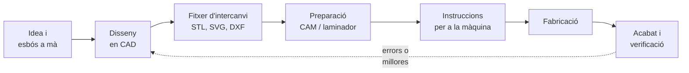
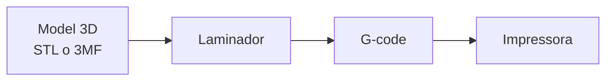

# Unitat 2. Disseny i fabricació digital

Fa unes dècades, per fabricar una peça calia dibuixar-ne els plànols amb regle i escaire, portar-los a un taller i esperar que un operari expert la fes a mà o amb una màquina. Avui, la mateixa peça es pot dissenyar a l'ordinador una tarda i tenir-la feta l'endemà amb una **impressora 3D** o una **talladora làser**, sense sortir de l'institut.

Aquest canvi s'anomena **fabricació digital**: el disseny es fa amb programes d'ordinador i són màquines controlades per ordinador les que el converteixen en un objecte real. En aquesta unitat aprendràs a representar objectes, a dissenyar-los en 2D i en 3D, i a preparar-los per fabricar-los amb seguretat.

## 2.1. De la idea a l'objecte

El camí que recorre una idea fins a convertir-se en un objecte fabricat digitalment té sempre les mateixes etapes:



- **CAD** (*Computer-Aided Design*, disseny assistit per ordinador) són els programes per dibuixar i modelar l'objecte.
- **CAM** (*Computer-Aided Manufacturing*, fabricació assistida per ordinador) són els programes que converteixen el disseny en les ordres que entén la màquina: per on s'ha de moure, a quina velocitat, amb quina potència…

Fixa't que la fabricació digital encaixa perfectament amb el procés de resolució de problemes de la [unitat 1](u1-resolucio-problemes.md): permet fer **prototips** ràpids i barats, provar-los i tornar a dissenyar tantes vegades com calgui.

## 2.2. Representar objectes

Abans d'obrir cap programa, convé saber dibuixar a mà. L'esbós és la manera més ràpida de pensar i de comunicar una idea.

### 2.2.1. Esbós, croquis i plànol

| Tipus | Com es fa | Per a què serveix |
| --- | --- | --- |
| **Esbós** | A mà alçada, ràpid, sense mides exactes | Pensar i comparar idees |
| **Croquis** | A mà alçada, però proporcionat i **amb totes les mides** | Recollir les mides d'un objecte o d'un espai real |
| **Plànol** | Amb instruments o amb CAD, a **escala** i seguint les normes | Fabricar o construir l'objecte |

### 2.2.2. Les vistes

Un objecte de tres dimensions es pot representar en un paper amb diverses **vistes**, com si el miràssim des de davant, des de dalt i des d'un costat. Les tres principals són:

- **Alçat**: l'objecte vist **de davant**.
- **Planta**: l'objecte vist **des de dalt**.
- **Perfil**: l'objecte vist **des d'un costat** (normalment l'esquerre).

En el **sistema europeu**, que és el que s'utilitza a Espanya, l'alçat es dibuixa a dalt a l'esquerra, la planta **just davall** de l'alçat i el perfil esquerre **a la dreta** de l'alçat. Les vistes han d'estar alineades: l'amplada de l'alçat i de la planta coincideix, i l'alçada de l'alçat i del perfil també.

Les arestes que es veuen es dibuixen amb línia contínua gruixada, i les que queden **amagades** darrere de l'objecte, amb **línia discontínua**.

A més de les vistes, l'objecte es pot dibuixar en **perspectiva**, que el mostra en tres dimensions d'un sol cop d'ull. La més habitual en dibuix tècnic és la **perspectiva isomètrica**, en què els tres eixos formen angles de 120° entre ells.

### 2.2.3. L'escala

Quan l'objecte és massa gran o massa petit per dibuixar-lo a la mida real, es dibuixa a **escala**. L'escala indica la relació entre la mida del dibuix i la mida real:

**Escala = mida al dibuix / mida real**

| Escala | Tipus | Significat | Ús |
| --- | --- | --- | --- |
| 1:1 | Natural | El dibuix fa el mateix que l'objecte | Peces petites |
| 1:50 | De reducció | 1 cm al dibuix són 50 cm reals | Plànols d'habitacions |
| 5:1 | D'ampliació | 5 mm al dibuix són 1 mm real | Peces molt petites |

!!! warning "Les mides sempre són reals"
    Encara que el dibuix estigui a escala, **les cotes indiquen sempre la mida real** de l'objecte. Les mides es donen en **mil·límetres** sense escriure la unitat, excepte en plànols d'edificis, on se solen donar en metres.

### 2.2.4. L'acotació

**Acotar** és indicar les mides en un dibuix. Algunes normes bàsiques:

- Cada mida s'indica **una sola vegada**, a la vista on es veu millor.
- Les **línies de cota** són fines, paral·leles a la mida que indiquen i acaben amb fletxes. Les **línies auxiliars** perllonguen l'aresta fins a la línia de cota.
- La xifra es col·loca **damunt** de la línia de cota, centrada.
- Els diàmetres s'indiquen amb el símbol **⌀** i els radis, amb **R**.
- No s'han de creuar les línies de cota amb altres línies si es pot evitar.

!!! example "Exercici 2.1. Escales"
    1. En un plànol a escala 1:50, una paret mesura 7,2 cm. Quant mesura en realitat?
    2. Vols dibuixar a escala 1:20 una paret de 4,5 m. Quant ha de mesurar al dibuix?
    3. Una peça de rellotge fa 8 mm. Quant mesurarà en un dibuix a escala 5:1?
    4. Has de dibuixar una aula de 8 m × 6 m en un full A4 (29,7 cm × 21 cm, i deixa un marge). Et serveix l'escala 1:20? I la 1:50?

    ??? success "Solució"
        1. 7,2 cm · 50 = 360 cm = **3,6 m**.
        2. 450 cm / 20 = **22,5 cm**.
        3. 8 mm · 5 = **40 mm**.
        4. A 1:20, l'aula faria 40 cm × 30 cm: **no hi cap**. A 1:50, faria 16 cm × 12 cm: **sí que hi cap**, amb espai per a les cotes.

!!! example "Exercici 2.2. Vistes"
    Descriu quina forma tenen l'alçat i la planta d'aquests objectes, col·locats damunt la taula:

    1. Un cilindre dret (una llauna).
    2. Un con amb la base damunt la taula.
    3. Una piràmide de base quadrada.
    4. Una pilota de ping-pong (una esfera).

    ??? success "Solució"
        1. Alçat: un **rectangle**. Planta: un **cercle**.
        2. Alçat: un **triangle**. Planta: un **cercle** amb un punt al centre (el vèrtex).
        3. Alçat: un **triangle**. Planta: un **quadrat** amb les dues diagonals (les arestes que van al vèrtex).
        4. Alçat i planta: un **cercle**.

        Fixa't que un sol dibuix no basta: el cilindre i el con tenen la mateixa planta. Per això calen almanco dues vistes.

## 2.3. El disseny en 2D

Els programes de **CAD 2D** dibuixen en un pla, com si fos un paper infinit, però amb una precisió molt més gran que a mà. Es fan servir per fer plànols de peces, de mobles i d'habitatges, i per preparar els fitxers de les talladores làser.

Algunes ordres són comunes a gairebé tots els programes:

| Ordre | Què fa |
| --- | --- |
| Línia, rectangle, cercle, arc | Dibuixar elements bàsics |
| Desplaçar, copiar, girar | Moure i duplicar elements |
| Simetria | Fer la còpia simètrica respecte d'un eix |
| Retallar i allargar | Tallar una línia on en creua una altra o perllongar-la |
| Matriu | Repetir un element en files i columnes o al voltant d'un centre |
| Cota | Afegir les mides |
| Capes | Organitzar el dibuix (per exemple, una capa per al tall i una altra per al gravat) |

Les claus del CAD són dues: **introduir les mides exactes** (no «a ull» amb el ratolí) i fer servir les **referències a objectes** (*snaps*) per enganxar-se exactament al final, al mig o al centre d'un element.

Alguns programes gratuïts:

- **LibreCAD**: CAD 2D tècnic, de codi obert. Desa en format **DXF**, l'estàndard per intercanviar plànols.
- **Inkscape**: dibuix vectorial, molt emprat per preparar dissenys per a la talladora làser. Desa en **SVG**.
- **Sweet Home 3D**: específic per distribuir habitacions i mobiliari; a partir del plànol en 2D genera una vista en 3D. És útil per al projecte de la unitat 1.

!!! info "Vectorial o de mapa de bits"
    Els programes de CAD treballen amb **gràfics vectorials**: guarden les figures com a fórmules (una línia d'aquest punt a aquest altre, un cercle d'aquest radi…). Per això es poden ampliar tant com es vulgui sense perdre qualitat. Una fotografia, en canvi, és un **mapa de bits**: una quadrícula de punts (píxels). Les màquines que tallen necessiten **vectors**, perquè han de saber exactament per on han de passar.

## 2.4. El disseny en 3D

Amb el **CAD 3D** es construeix un model virtual de l'objecte que es pot girar, mirar des de qualsevol costat, comprovar si encaixa amb altres peces i enviar a fabricar. Hi ha tres maneres principals de modelar.

### 2.4.1. Modelatge amb sòlids bàsics

S'agafen figures senzilles (prismes, cilindres, esferes, cons) i es combinen amb tres operacions, anomenades **booleanes**:

| Operació | Què fa | Exemple |
| --- | --- | --- |
| **Unió** | Ajunta dos sòlids en un de sol | Un cilindre damunt d'un cub fa una torre |
| **Diferència** | Resta un sòlid d'un altre | Un cilindre restat d'un cub fa un forat |
| **Intersecció** | Es queda només amb la part comuna | Un cub i una esfera fan un cub amb les cantonades arrodonides |

**Tinkercad**, que funciona al navegador i és gratuït, utilitza aquest sistema: cada figura pot ser **sòlida** o **forat**, i en agrupar-les el forat es resta.

### 2.4.2. Modelatge paramètric

És el sistema dels programes professionals. Es comença dibuixant un **esbós 2D** sobre un pla, amb mides i **restriccions** (aquesta línia és horitzontal, aquests dos cercles són iguals…). Després s'aplica una operació que el converteix en 3D:

- **Extrusió**: «estira» l'esbós en línia recta (un rectangle extruït fa un prisma).
- **Revolució**: fa girar l'esbós al voltant d'un eix (així es fan gots, rodes o peces de torn).

L'avantatge és que el model recorda **com** s'ha fet. Si canvies una mida de l'esbós, tot el model s'actualitza. Programes d'aquest tipus són **FreeCAD**, gratuït i de codi obert, i **Onshape**, que funciona al navegador i té un pla gratuït per a l'educació.

### 2.4.3. Modelatge amb codi

En lloc de dibuixar, l'objecte es descriu **programant**. El programa més conegut és **OpenSCAD**, gratuït. Aquest codi crea una placa de 40 × 20 × 5 mm amb dos forats de 6 mm de diàmetre:

```openscad
ample = 40;    // mides en mm
fons = 20;
gruix = 5;
diametre = 6;

difference() {
    cube([ample, fons, gruix]);
    for (x = [10, ample - 10])
        translate([x, fons / 2, -1])
            cylinder(h = gruix + 2, d = diametre, $fn = 50);
}
```

- `cube` crea el prisma amb una cantonada a l'origen.
- `difference` resta del primer sòlid tots els que van després.
- `translate` mou els cilindres al seu lloc; el bucle `for` en fa un a x = 10 i un altre a x = 30.
- Els cilindres comencen a −1 i fan 2 mm més que la placa perquè el forat la travessi del tot sense deixar una làmina finíssima.

És **disseny paramètric pur**: canviant una variable, la peça es redibuixa. Si ja programes, és una manera molt potent de dissenyar.

### 2.4.4. Els formats de fitxer

| Format | Què conté | Ús |
| --- | --- | --- |
| **STL** | Només la superfície, dividida en triangles | El format clàssic per a la impressió 3D |
| **3MF** | Superfície, colors, materials i configuració | Substitut modern de l'STL |
| **STEP** | El sòlid exacte, sense triangles | Intercanviar models entre programes de CAD |
| **SVG / DXF** | Dibuix vectorial en 2D | Talladora làser, plotter de tall, CAD 2D |

!!! example "Exercici 2.3. OpenSCAD"
    1. Modifica el codi de l'apartat 2.4.3 perquè la placa tengui **tres** forats repartits: un a cada extrem i un al centre.
    2. Què canviaries per fer la placa el doble d'ampla, mantenint els forats a 10 mm dels extrems?

    ??? success "Solució"
        1. Només cal afegir la posició central a la llista del bucle:

            ```openscad
            for (x = [10, ample / 2, ample - 10])
            ```

        2. Només cal canviar `ample = 80;`. Com que les posicions dels forats depenen de la variable `ample`, s'actualitzen soles: quedaran a x = 10, x = 40 i x = 70.

## 2.5. Tècniques de fabricació

Les tècniques per donar forma a un material es poden classificar en tres grans famílies:

| Família | Com funciona | Exemples | Avantatges i inconvenients |
| --- | --- | --- | --- |
| **Additiva** | Afegeix material capa a capa | Impressió 3D | Formes molt complexes, poc residu; lenta, peces menys resistents |
| **Subtractiva** | Lleva material d'un bloc o d'una planxa | Tall làser, fresadora CNC, torn | Precisa i ràpida; genera retalls i residus |
| **Conformativa** | Canvia la forma del material sense afegir-ne ni llevar-ne | Emmotllament per injecció, doblegat, forja | Ideal per fabricar milers de peces; motlles molt cars |

Les màquines de fabricació digital són de **control numèric** (**CNC**): un ordinador controla els seus motors amb precisió de dècimes de mil·límetre. A més de les impressores 3D i les talladores làser, en un taller de fabricació digital hi pot haver **fresadores CNC** (tallen fusta, plàstic o metalls tous amb una broca que gira) i **plotters de tall** (tallen vinil i paper amb una fulla).

!!! example "Exercici 2.4. Triar la tècnica"
    Quina tècnica faries servir per fabricar cada objecte? Justifica-ho.

    1. Una sola peça de recanvi d'una persiana, amb una forma complicada.
    2. 50 peces planes de fusta d'un trencaclosques.
    3. Un milió de taps de plàstic per a ampolles.
    4. Un rètol amb lletres adhesives per a la porta de l'aula.

    ??? success "Solució"
        1. **Impressió 3D**: és una sola peça i té una forma complexa. No compensa fer un motlle.
        2. **Tall làser**: són peces planes i el làser les talla ràpidament i amb precisió a partir d'un fitxer vectorial.
        3. **Emmotllament per injecció**: per a milions de peces iguals, el motlle es paga i cada tap surt baratíssim i en pocs segons.
        4. **Plotter de tall** de vinil.

## 2.6. La impressió 3D

La tècnica d'impressió 3D més estesa en centres educatius és la **FDM** (*Fused Deposition Modeling*, modelatge per deposició de material fos). Funciona com una pistola de cola calenta controlada per ordinador: un fil de plàstic (el **filament**) entra en un **broquet** calent, es fon i es diposita sobre una **base** o llit, capa a capa, fins a completar la peça.

### 2.6.1. Del model a la peça



El **laminador** (*slicer*) és el programa que «talla» el model en capes horitzontals i calcula el recorregut del broquet a cada capa. Alguns d'habituals són UltiMaker Cura, PrusaSlicer i Bambu Studio. El resultat és un fitxer de **G-code**, una llista d'ordres que la impressora executa una darrere l'altra:

```gcode
G28              ; tornar a l'origen de tots els eixos
M104 S205        ; escalfar el broquet a 205 °C
M140 S60         ; escalfar el llit a 60 °C
G1 X50 Y50 F3000 ; desplaçar-se fins al punt (50, 50)
G1 X80 Y50 E2.5  ; anar fins a (80, 50) mentre s'extrudeixen 2,5 mm de filament
```

### 2.6.2. Els paràmetres d'impressió

| Paràmetre | Què és | Efecte |
| --- | --- | --- |
| **Alçada de capa** | Gruix de cada capa (sol ser de 0,1 a 0,3 mm) | Capes primes: més qualitat, però més temps |
| **Farciment** (*infill*) | Percentatge de l'interior que s'omple, amb un patró | Més farciment: més resistència, temps i material. Per a peces normals basta un 15-20 % |
| **Perímetres** | Nombre de parets exteriors | Més parets: peça més resistent |
| **Suports** | Estructures provisionals davall de les parts en l'aire | Permeten voladissos, però gasten material i deixen marques |
| **Vora** (*brim*) | Unes voltes extra al voltant de la primera capa | Ajuda la peça a no despegar-se del llit |
| **Temperatures** | Del broquet i del llit | Depenen del material |

### 2.6.3. Els materials

| Material | Característiques | Temperatura de broquet orientativa |
| --- | --- | --- |
| **PLA** | El més fàcil d'imprimir. Rígid, però es deforma amb la calor (per damunt de 55-60 °C, aproximadament) | 190-220 °C |
| **PETG** | Més resistent als cops i a la calor. Una mica més difícil | 220-250 °C |
| **TPU** | Flexible, com la goma. Per a fundes o rodes | 210-230 °C |
| **ABS** | Resistent, però es contrau en refredar-se i desprèn fums: necessita impressora tancada i ventilació | 230-260 °C |

Comprova sempre les temperatures recomanades pel fabricant del filament: poden variar d'una marca a una altra.

!!! info "El PLA és biodegradable?"
    Es diu sovint que el PLA és biodegradable perquè es fabrica a partir de midó de plantes. És cert que es pot compostar, però **només en plantes de compostatge industrial**, a temperatures altes. En un compostador casolà o al mar dura molts d'anys. No és una excusa per imprimir sense pensar: el millor residu és el que no es genera.

### 2.6.4. Dissenyar per imprimir

Una peça que es veu bé a la pantalla pot ser impossible d'imprimir. Algunes regles:

- **Voladissos**: la impressora no pot posar plàstic damunt del no-res. Les parets inclinades més de **45°** respecte de la vertical solen necessitar suports.
- **Ponts**: un tram horitzontal entre dos suports es pot imprimir si no és massa llarg.
- **Orientació**: tria la cara que va damunt el llit perquè sigui plana i gran i calguin pocs suports. Recorda que la peça és **més dèbil entre capes**: si ha d'aguantar esforç, orienta-la perquè les capes no se separin.
- **Toleràncies**: si dues peces han d'encaixar, deixa un **joc** d'uns 0,2-0,3 mm entre elles. Una peça de 10 mm no entrarà en un forat de 10 mm.
- **Gruix mínim**: les parets han de fer almanco dues vegades l'amplada del broquet (el més comú és de 0,4 mm).

!!! example "Exercici 2.5. Cost d'una impressió"
    El laminador indica que una peça necessita **18 g** de PLA i **1 h 30 min** d'impressió. Una bobina d'1 kg costa **20 €**, la impressora consumeix uns **120 W** i el kWh costa **0,20 €**. Calcula el cost del material i de l'electricitat. Quin dels dos costs és més important?

    ??? success "Solució"
        - Material: 18 g · (20 € / 1.000 g) = **0,36 €**.
        - Electricitat: 0,12 kW · 1,5 h = 0,18 kWh; 0,18 kWh · 0,20 €/kWh = **0,036 €** (uns 4 cèntims).
        - Total: uns **0,40 €**. El cost més important és el **material**: deu vegades el de l'electricitat. Per això val la pena ajustar el farciment i evitar suports innecessaris. I sobretot, no imprimir peces fallades: revisa el model i la primera capa.

## 2.7. El tall i el gravat làser

Una **talladora làser** concentra un raig de llum molt potent en un punt minúscul. On toca el raig, el material es crema o es vaporitza. Movent el capçal per damunt d'una planxa, la màquina **talla** formes o **grava** dibuixos a la superfície.

### 2.7.1. Tallar o gravar

| Operació | Com es defineix al fitxer | Resultat |
| --- | --- | --- |
| **Tall** | Línies vectorials, normalment molt primes | El raig travessa la planxa |
| **Gravat vectorial** | Línies vectorials amb menys potència | Una línia marcada a la superfície |
| **Gravat ràster** | Zones plenes o imatges | El capçal escombra la zona línia a línia, com una impressora |

En molts de programes de làser, cada operació s'assigna amb un **color** diferent al fitxer (per exemple, vermell per tallar i negre per gravar). La convenció exacta depèn de cada màquina i programa: consulta la del taller. L'ordre també importa: primer es grava i es fan els talls interiors, i al final es talla el contorn exterior, perquè si la peça es desprèn abans es pot moure.

### 2.7.2. El *kerf*

El raig làser té un gruix, i en tallar crema una franja de material d'uns pocs dècims de mil·límetre. Aquesta amplada s'anomena ***kerf***. Com que el raig passa just per damunt de la línia, crema la meitat del *kerf* a cada costat:

- Les peces **exteriors** surten una mica **més petites** que el dibuix.
- Els **forats** surten una mica **més grans**.

Per a la majoria de peces no importa, però sí quan han d'**encaixar**, per exemple en les capses amb unions de dents (*finger joints*). En aquests casos s'ha de compensar el *kerf* en el disseny.

### 2.7.3. Materials

Les talladores làser més habituals als tallers educatius són de **CO₂** o de **díode**. Què poden tallar depèn del tipus de làser i de la potència:

| Es pot tallar o gravar | No s'ha de posar mai a la màquina |
| --- | --- |
| Fusta i contraxapat prims, DM, cartó, paper, feltre, cuir natural | **PVC** i vinil: en cremar-se desprenen clor, un gas tòxic que a més corroeix la màquina |
| Metacrilat (amb làser de CO₂; el transparent no el talla un làser de díode) | **Policarbonat**, **ABS** i escumes: es fonen, s'encenen o desprenen fums perillosos |
| | Materials dels quals **no sabeu la composició** |

!!! danger "Seguretat amb el làser"
    - **No deixis mai la màquina funcionant sense vigilància.** El material pot encendre's.
    - La tapa ha d'estar tancada mentre treballa: el raig pot causar lesions greus als ulls. No anul·lis mai les proteccions.
    - L'**extracció de fums** ha d'estar en marxa.
    - Tingues a prop un extintor adequat i coneix com s'atura la màquina en cas d'emergència.
    - Fes servir la màquina només amb l'autorització i les instruccions del professor.

!!! example "Exercici 2.6. El *kerf*"
    Una talladora té un *kerf* de **0,2 mm**. Dibuixes una pestanya de 30 mm d'ample i una ranura de 30 mm on ha d'entrar.

    1. Quant mesuraran la pestanya i la ranura després de tallar-les?
    2. Encaixaran de manera ajustada o quedaran fluixes?
    3. Com ho podries corregir en el dibuix?

    ??? success "Solució"
        1. A cada costat es crema la meitat del *kerf*, 0,1 mm. La pestanya, que és una peça exterior, perd 0,1 mm per cada costat: **29,8 mm**. La ranura, que és un forat, guanya 0,1 mm per cada costat: **30,2 mm**.
        2. Queda un joc de 0,4 mm: l'encaix serà **fluix**.
        3. Compensant el *kerf*: dibuixar la pestanya més ampla, de 30,2 mm, i la ranura més estreta, de 29,8 mm. Després de tallar, totes dues faran 30 mm. És recomanable provar-ho primer amb una peça petita de prova.

## 2.8. Les fases de fabricació d'un producte

Fabricar un objecte no és només fer funcionar una màquina. Cal ordenar les **operacions** en una seqüència lògica i preveure, per a cada una, quina eina o màquina es fa servir i quines mesures de seguretat calen. Aquesta informació es recull en un **full de processos**.

Exemple: un **suport per al mòbil** de DM de 3 mm, tallat a làser i muntat amb encaixos.

| # | Operació | Màquina o eina | Seguretat |
| --- | --- | --- | --- |
| 1 | Dissenyar les peces en CAD 2D i comprovar les mides | Ordinador | — |
| 2 | Exportar el fitxer en SVG o DXF i assignar tall i gravat | Ordinador | — |
| 3 | Fer una peça de prova per comprovar l'encaix | Talladora làser | Tapa tancada, extracció en marxa, vigilància |
| 4 | Tallar totes les peces | Talladora làser | Ídem |
| 5 | Llimar o polir les vores cremades | Paper de vidre, llima | Mascareta si es fa pols |
| 6 | Muntar les peces amb cola blanca | Cola, mordasses | — |
| 7 | Aplicar l'acabat | Vernís a l'aigua, pinzell | Ventilació, guants |
| 8 | Control de qualitat: compleix les condicions de disseny? | Regle, peu de rei, prova d'ús | — |

Aquest full es pot incloure a la **memòria tècnica** del projecte (apartat 1.7 de la unitat 1).

## 2.9. La fabricació digital i la societat

La fabricació digital ha canviat qui pot fabricar coses:

- Els **fab labs** i espais *maker* són tallers oberts on qualsevol persona pot fer servir impressores 3D, talladores làser i fresadores, i compartir-hi coneixements.
- El **maquinari obert** (*open hardware*) publica els plànols i el codi perquè tothom els pugui estudiar, fabricar i millorar. Moltes impressores 3D van néixer així.
- Hi ha repositoris en línia amb milers de models llestos per imprimir. Abans de descarregar, modificar o vendre'n un, **comprova la llicència**: alguns només permeten un ús personal i no comercial, i cal citar-ne l'autor.
- La fabricació local i sota demanda pot reduir el transport i permet **reparar** objectes imprimint la peça trencada, en lloc de llençar-los.

Però té també una cara menys bona: és molt fàcil imprimir objectes inútils que acaben a la paperera. Fes-te sempre la pregunta de la unitat 1: **quin problema resol aquesta peça?**

## 2.10. Reptes

!!! example "Repte 2.1. Peça per al projecte de la unitat 1"
    Dissenya un element que ajudi a organitzar l'espai del projecte de la unitat 1: un suport per a eines, un separador de calaixos, un penjador o un porta-etiquetes. Has de lliurar:

    1. L'esbós a mà i el croquis acotat.
    2. El model 3D (amb Tinkercad, FreeCAD, Onshape o OpenSCAD) o el dibuix 2D per al làser.
    3. La justificació de la tècnica de fabricació escollida i dels paràmetres (material, alçada de capa, farciment o potència…).
    4. Una estimació del material i del temps de fabricació.
    5. Si es pot fabricar al taller, la peça acabada i una valoració: compleix el que esperaves? Què milloraries?

!!! example "Repte 2.2. Capsa amb encaixos"
    Dissenya en 2D una capsa de 60 × 60 × 40 mm, sense tapa, amb parets de DM de 3 mm unides amb dents, perquè es pugui tallar a làser i muntar sense cola. Tingues en compte el gruix del material en les dents i compensa el *kerf*. Abans de tallar-la tota, prova l'encaix amb una cantonada.

---

!!! quote "Font"
    Unitat de creació pròpia, sense material de l'Aula de Martín: aquesta matèria no hi té una unitat dedicada al disseny i la fabricació digital. El projecte dels reptes es vincula amb el de la unitat 1, que sí que s'ha adaptat de l'Aula de Martín.
