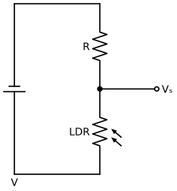

# Unitat 3. Electrònica analògica

L'**electrònica** estudia els circuits que controlen el corrent amb components com díodes, transistors o circuits integrats. Gràcies a ella, un circuit pot «decidir»: encendre un llum quan es fa fosc, fer sonar una alarma si la temperatura puja massa o fer parpellejar un LED a un ritme determinat.

Un **senyal analògic** pot prendre **qualsevol valor** dins d'un interval, com la temperatura d'una habitació o el volum d'un so. Un **senyal digital** només pot prendre uns quants valors (normalment dos: 0 i 1). En aquesta unitat estudiarem els components i circuits que treballen amb senyals analògics; a la unitat 4 veurem l'electrònica digital.

## 3.1. Resistències

### 3.1.1. Resistències fixes i codi de colors

Les **resistències** limiten el corrent i reparteixen la tensió. Les més habituals al taller porten el valor pintat amb **bandes de colors**. En el codi de 4 bandes:

- **1a i 2a banda**: les dues primeres xifres.
- **3a banda**: el multiplicador (quants de zeros cal afegir).
- **4a banda**: la tolerància, separada una mica de les altres.

| Color | Xifra | Multiplicador | Tolerància |
| --- | --- | --- | --- |
| Negre | 0 | ×1 | — |
| Marró | 1 | ×10 | ±1 % |
| Vermell | 2 | ×100 | ±2 % |
| Taronja | 3 | ×1.000 | — |
| Groc | 4 | ×10.000 | — |
| Verd | 5 | ×100.000 | ±0,5 % |
| Blau | 6 | ×1.000.000 | ±0,25 % |
| Violeta | 7 | — | ±0,1 % |
| Gris | 8 | — | — |
| Blanc | 9 | — | — |
| Or | — | ×0,1 | ±5 % |
| Argent | — | ×0,01 | ±10 % |

Exemple: groc, violeta, vermell, or → 4, 7, ×100 → **4.700 Ω = 4,7 kΩ**, amb una tolerància de **±5 %**.

La **tolerància** indica quant es pot desviar el valor real del nominal. Una resistència de 4,7 kΩ ± 5 % pot fer entre 4.465 Ω i 4.935 Ω. Per això les resistències no es fabriquen de qualsevol valor, sinó en **sèries normalitzades**. La més comuna és la **E12**, amb aquests valors per a cada dècada:

**10 · 12 · 15 · 18 · 22 · 27 · 33 · 39 · 47 · 56 · 68 · 82**

És a dir, existeixen resistències de 220 Ω, 2,2 kΩ o 22 kΩ, però no de 250 Ω. Quan un càlcul dona un valor que no existeix, es tria el valor normalitzat més proper, normalment el **superior** per seguretat.

### 3.1.2. Resistències variables

| Component | Abreviatura | Què fa variar la resistència | Ús típic |
| --- | --- | --- | --- |
| **Potenciòmetre** | POT | Un cursor que es gira o es llisca | Control de volum, regulació manual |
| **LDR** (*Light Dependent Resistor*) | LDR | La **llum**: com més llum, **menys** resistència | Llums automàtics, detectors de dia i nit |
| **NTC** (*Negative Temperature Coefficient*) | NTC | La **temperatura**: com més calor, **menys** resistència | Termòmetres, termòstats |
| **PTC** (*Positive Temperature Coefficient*) | PTC | La **temperatura**: com més calor, **més** resistència | Proteccions contra sobreescalfament |

Una LDR típica pot passar d'uns pocs centenars d'ohms amb molta llum a centenars de kΩ o més a les fosques. Són valors orientatius: depenen molt del model.

!!! example "Exercici 3.1. Codi de colors"
    1. Quin valor tenen aquestes resistències? (a) marró, negre, vermell, or; (b) vermell, vermell, taronja, or; (c) taronja, blanc, marró, argent.
    2. Quins colors tendrà una resistència de 330 Ω ± 5 %? I una de 68 kΩ ± 5 %?
    3. Entre quins valors pot estar una resistència de 1 kΩ ± 10 %?

    ??? success "Solució"
        1. (a) 1, 0, ×100 = **1 kΩ ± 5 %**; (b) 2, 2, ×1.000 = **22 kΩ ± 5 %**; (c) 3, 9, ×10 = **390 Ω ± 10 %**.
        2. 330 Ω = 3, 3, ×10 → **taronja, taronja, marró, or**. 68 kΩ = 6, 8, ×1.000 → **blau, gris, taronja, or**.
        3. El 10 % de 1.000 és 100: entre **900 Ω i 1.100 Ω**.

## 3.2. El divisor de tensió

Dues resistències en sèrie es reparteixen la tensió del generador. Si agafam la tensió del punt del mig, tenim un **divisor de tensió**:

{ width="280" }

La tensió de sortida, mesurada entre el punt del mig i el negatiu, és la que cau a la resistència de baix:

**Vₛ = V · R_baix / (R_dalt + R_baix)**

Si la resistència de baix és una **LDR**, la tensió de sortida canvia amb la llum: amb molta llum, la LDR té poca resistència i Vₛ és **baixa**; a les fosques, la LDR té molta resistència i Vₛ és **alta**. Així convertim una magnitud física (la llum) en una tensió que pot controlar un altre circuit. És el principi de gairebé tots els **sensors** analògics.

!!! example "Exercici 3.2. Divisor de tensió"
    En el divisor de la figura, V = 9 V i R = 10 kΩ. Suposa que la LDR fa 500 Ω amb llum i 50 kΩ a les fosques. Calcula la tensió de sortida en tots dos casos.

    ??? success "Solució"
        - Amb llum: Vₛ = 9 · 0,5 / (10 + 0,5) ≈ **0,43 V**.
        - A les fosques: Vₛ = 9 · 50 / (10 + 50) = **7,5 V**.

        La diferència és molt gran, i la podrem aprofitar per activar un transistor (apartat 3.5).

## 3.3. Condensadors

Un **condensador** emmagatzema càrrega elèctrica, com un petit dipòsit. Està format per dues plaques conductores separades per un aïllant. La seva capacitat de guardar càrrega és la **capacitat**, que es mesura en **farads** (F). El farad és una unitat molt gran, i per això es fan servir el **µF**, el **nF** i el **pF**.

- Els condensadors **ceràmics** són petits, de poca capacitat i **sense polaritat**.
- Els condensadors **electrolítics** tenen més capacitat, però **tenen polaritat**: la pota llarga és el positiu, i el negatiu està marcat amb una franja al cos. Si es connecten al revés es poden espenyar i fins i tot rebentar.

### 3.3.1. Càrrega i descàrrega

Quan un condensador es carrega a través d'una resistència, la tensió no puja de cop, sinó **poc a poc**. La rapidesa depèn de la **constant de temps**:

**τ = R · C** (amb R en ohms i C en farads, τ surt en segons)

- Després d'un temps τ, el condensador ha arribat aproximadament al **63 %** de la tensió final.
- Després de **5τ** es considera **completament carregat**.

La descàrrega funciona igual, però al revés. Aquest retard permet fer **temporitzadors**: per exemple, el llum de l'escala que s'apaga sol al cap d'una estona, o un LED que s'encén i s'apaga a poc a poc.

!!! example "Exercici 3.3. Constant de temps"
    1. Un condensador de 100 µF es carrega a través d'una resistència de 10 kΩ. Quant tarda a carregar-se del tot?
    2. Quina resistència necessites perquè un condensador de 470 µF tardi uns 10 s a carregar-se del tot?

    ??? success "Solució"
        1. τ = 10.000 · 0,0001 = **1 s**. Es carrega del tot en 5τ ≈ **5 s**.
        2. 5τ = 10 s → τ = 2 s → R = 2 / 0,000 47 ≈ 4.255 Ω. El valor normalitzat més proper és **4,7 kΩ** (tardarà uns 11 s).

## 3.4. Díodes i LED

### 3.4.1. El díode

Un **díode** deixa passar el corrent **només en un sentit**, de l'**ànode** (A) al **càtode** (K). El càtode està marcat amb una franja.

- **Polarització directa** (ànode al positiu): el díode condueix. Hi cau una tensió gairebé constant d'uns **0,7 V** en els díodes de silici.
- **Polarització inversa** (ànode al negatiu): el díode no condueix.

S'utilitzen per protegir circuits contra connexions al revés, per convertir corrent altern en continu (**rectificadors**) i per protegir els transistors de les puntes de tensió dels relés i dels motors.

### 3.4.2. El LED

Un **LED** (*Light Emitting Diode*) és un díode que fa llum quan condueix. La pota **llarga** és l'ànode (+). Té dues característiques que cal tenir en compte:

- Necessita una tensió directa més alta que un díode normal. Depèn del color: com a valors orientatius, uns **2 V** per als vermells, grocs i verds, i uns **3 V** per als blaus i blancs. Consulta el full de característiques del model concret.
- Si hi passa massa corrent, es crema. La majoria de LED de 5 mm treballen bé amb **10-20 mA**.

Per això, un LED **sempre** s'ha de connectar amb una **resistència limitadora** en sèrie:

{ width="280" }

**R = (V_font − V_LED) / I_LED**

Exemple: un LED vermell (2 V) amb una pila de 9 V i 15 mA: R = (9 − 2) / 0,015 ≈ 467 Ω → **470 Ω**.

!!! example "Exercici 3.4. Resistència per a un LED"
    1. Vols connectar un LED verd (2,2 V, 10 mA) a una font de 5 V. Quina resistència necessites? Quin valor de la sèrie E12 triaries?
    2. Un company connecta un LED blau (3 V) directament a una pila de 4,5 V, sense resistència. Què passarà?
    3. Quatre LED vermells (2 V) en paral·lel, cada un amb la seva resistència, s'alimenten amb 9 V. Quina resistència porta cada un si volem 15 mA per LED? Quina intensitat total dona la pila?

    ??? success "Solució"
        1. R = (5 − 2,2) / 0,01 = **280 Ω**. A la sèrie E12 hi ha 270 Ω i 330 Ω. Per seguretat es tria **330 Ω**: passaran uns 8,5 mA, suficient perquè faci llum.
        2. Sense resistència, l'única cosa que limita el corrent és la resistència interna de la pila, que és molt petita. Passarà massa corrent i el LED **es cremarà**, probablement en pocs segons.
        3. Cada LED: R = (9 − 2) / 0,015 ≈ 467 Ω → **470 Ω**. Total: 4 · 15 mA = **60 mA** (aproximadament, perquè amb 470 Ω cada un rep unes 14,9 mA).

## 3.5. El transistor

El **transistor** és el component més important de l'electrònica: amb un corrent petit en controla un de molt més gran. Els processadors moderns en contenen milers de milions. Al taller farem servir **transistors bipolars NPN** (per exemple, el BC547 o el 2N2222), que tenen tres potes:

| Pota | Funció |
| --- | --- |
| **Base** (B) | Entrada de control: hi entra un corrent petit |
| **Col·lector** (C) | Hi entra el corrent gran que volem controlar |
| **Emissor** (E) | Per on surten tots dos corrents, cap al negatiu |

L'ordre de les potes depèn del model: consulta sempre el full de característiques.

### 3.5.1. Funcionament

Si no hi entra corrent per la base, el transistor no deixa passar corrent entre el col·lector i l'emissor. Quan hi entra corrent per la base (cal que la base estigui uns **0,7 V** per damunt de l'emissor), el transistor deixa passar un corrent de col·lector **β vegades** més gran:

**I_C = β · I_B**

β és el **guany** del transistor, i sol estar entre 100 i 300 en els transistors petits. Segons el corrent de base, el transistor pot estar en tres estats:

| Estat | Corrent de base | Comportament | Ús |
| --- | --- | --- | --- |
| **Tall** | Nul | Interruptor **obert** | Interruptor electrònic |
| **Actiu** | Moderat | I_C és proporcional a I_B | **Amplificador** (de so, de senyals de sensors) |
| **Saturació** | Gran | Interruptor **tancat** (deixa passar tot el que permet el circuit) | Interruptor electrònic |

### 3.5.2. El transistor com a interruptor: una llum nocturna

Combinant un divisor de tensió amb una LDR i un transistor podem fer un llum que s'encén sol quan es fa fosc:

{ width="360" }

- **De dia**, la LDR té poca resistència: la tensió del divisor és baixa, no arriba prou corrent a la base, el transistor està **en tall** i el LED està **apagat**.
- **De nit**, la LDR té molta resistència: la tensió del divisor puja, entra corrent a la base, el transistor es **satura** i el LED s'**encén**.

Si intercanviam la LDR i la resistència R, el circuit fa el contrari: s'encén amb llum. I si substituïm la LDR per una **NTC**, tenim un detector de temperatura. Si la resistència R és un **potenciòmetre**, podem ajustar a partir de quina llum s'encén.

!!! example "Exercici 3.5. Guany del transistor"
    1. Un transistor amb β = 150 rep un corrent de base de 0,1 mA. Quin corrent de col·lector deixarà passar si el circuit ho permet?
    2. Volem que circulin 30 mA pel col·lector d'un transistor amb β = 100. Quin corrent de base com a mínim necessitam?

    ??? success "Solució"
        1. I_C = 150 · 0,1 mA = **15 mA**.
        2. I_B = I_C / β = 30 / 100 = **0,3 mA**. A la pràctica es dona una mica més de corrent de base per assegurar que el transistor se satura.

## 3.6. El relé

Un transistor petit no pot controlar directament un motor gros o un aparell de 230 V. Per això es fa servir un **relé**: un interruptor que es mou gràcies a un electroimant.

- Quan passa corrent per la **bobina**, aquesta atreu una làmina metàl·lica que canvia la posició dels **contactes**.
- Els contactes estan **aïllats** de la bobina. Així, un circuit de 5 V pot controlar un altre circuit de més potència.
- Els contactes poden ser **normalment oberts** (NO, es tanquen en activar el relé), **normalment tancats** (NC, s'obren) o **commutats** (tenen tots dos).

!!! warning "El díode de protecció"
    Quan es talla el corrent d'una bobina, es produeix una punta de tensió que pot espenyar el transistor. Per evitar-ho, es col·loca un **díode en paral·lel amb la bobina**, en sentit invers (el càtode cap al positiu). Aquest díode es diu **díode de lliure circulació**.

## 3.7. El circuit integrat 555

Un **circuit integrat** conté molts de components (transistors, resistències, díodes) dins una sola càpsula. El **555** és un dels més coneguts i serveix per generar temps i senyals que parpellegen. Té 8 potes:

| Pota | Nom | Funció |
| --- | --- | --- |
| 1 | GND | Negatiu |
| 2 | TRG (*trigger*, disparador) | Inicia el temps quan baixa per davall d'1/3 de Vcc |
| 3 | OUT | Sortida |
| 4 | RST (*reset*) | Reinicia el circuit si es connecta a negatiu; normalment va a positiu |
| 5 | CTL (control) | Normalment no es fa servir, o va a negatiu amb un condensador petit |
| 6 | THR (*threshold*, llindar) | Acaba el temps quan puja per damunt de 2/3 de Vcc |
| 7 | DIS (*discharge*) | Descarrega el condensador |
| 8 | Vcc | Positiu (de 4,5 V a 15 V, aproximadament) |

### 3.7.1. Muntatge astable: un LED que parpelleja

En el **muntatge astable**, la sortida canvia contínuament entre nivell alt i baix: el LED s'encén i s'apaga sense parar.

{ width="460" }

El condensador es carrega a través de R₁ i R₂, i es descarrega només a través de R₂. Els temps són:

- Temps en nivell alt: **t_alt = 0,693 · (R₁ + R₂) · C**
- Temps en nivell baix: **t_baix = 0,693 · R₂ · C**
- Període: T = t_alt + t_baix; freqüència: **f = 1 / T**

### 3.7.2. Muntatge monostable: un temporitzador

En el **muntatge monostable**, la sortida està normalment a nivell baix. Quan es prem un polsador connectat a la pota 2, la sortida passa a nivell alt durant un temps fix i després torna a baixar tota sola. És el principi del llum de l'escala:

**T = 1,1 · R · C**

!!! example "Exercici 3.6. Càlculs amb el 555"
    1. En un astable, R₁ = 1 kΩ, R₂ = 10 kΩ i C = 100 µF. Calcula el temps encès, el temps apagat i la freqüència.
    2. Vols un temporitzador monostable de 10 s amb un condensador de 100 µF. Quina resistència necessites?
    3. En l'astable de l'apartat 1, què hauries de canviar perquè el LED parpellegi el doble de ràpid?

    ??? success "Solució"
        1. t_alt = 0,693 · 11.000 · 0,0001 ≈ **0,76 s**; t_baix = 0,693 · 10.000 · 0,0001 ≈ **0,69 s**; T ≈ 1,45 s; f ≈ **0,69 Hz** (una mica menys d'un parpelleig per segon).
        2. R = T / (1,1 · C) = 10 / (1,1 · 0,0001) ≈ 90.900 Ω. El valor normalitzat més proper és **91 kΩ** (sèrie E24) o **82 kΩ** de la E12 (uns 9 s), o un potenciòmetre de 100 kΩ per ajustar-lo.
        3. Reduir el condensador a la meitat (**47 µF**, el valor normalitzat més proper a 50 µF), o reduir les resistències a la meitat.

## 3.8. Del simulador a la placa

### 3.8.1. Simular abans de muntar

Abans de muntar un circuit, convé provar-lo amb un **simulador**. Permet comprovar si funciona, mesurar tensions i intensitats i provar valors diferents sense cremar cap component. Alguns simuladors gratuïts en línia:

- **Tinkercad Circuits** (tinkercad.com): components reals amb aspecte realista, protoboard, polímetre i també placa Arduino.
- **Falstad Circuit Simulator** (falstad.com/circuit): mostra el corrent amb animacions i té molts circuits d'exemple, inclòs el 555.

### 3.8.2. La placa de proves

La **placa de proves** o **protoboard** permet muntar circuits sense soldar. Els forats estan connectats internament:

- Les **files laterals** (marcades amb + i −) estan connectades al llarg de tota la placa i serveixen per a l'alimentació.
- Les **columnes centrals** de 5 forats estan connectades entre elles, però no amb la del costat de l'altra meitat de la placa.
- Els circuits integrats es col·loquen **a cavall** del canal central, perquè cada pota quedi en una columna diferent.

### 3.8.3. La soldadura

Per fer un circuit definitiu, els components se **solden** en una placa perforada o en un circuit imprès, amb un **soldador** i **estany**:

1. Neteja la punta del soldador amb l'esponja humida.
2. Escalfa alhora la pota del component i la pista de la placa durant un o dos segons.
3. Acosta l'estany a la unió (no a la punta del soldador) i deixa que es fongui i s'escampi.
4. Retira l'estany i després el soldador. No moguis la peça fins que la soldadura s'hagi refredat.
5. Una bona soldadura és **brillant** i té forma de **con**. Si és grisa i en forma de bolla, és una **soldadura freda** i pot fallar.
6. Talla les potes sobrants amb els alicates de tall.

!!! danger "Seguretat amb el soldador"
    La punta del soldador arriba a uns 300-400 °C. Deixa'l sempre al **suport**, mai damunt la taula. Treballa en un lloc **ventilat** i no respiris els fums de la resina. Renta't les mans en acabar, sobretot si l'estany conté plom. Fes servir **ulleres** per tallar les potes: poden sortir disparades.

## 3.9. Reptes

!!! example "Repte 3.1. Llum nocturna"
    Simula i després munta a la placa de proves el circuit de l'apartat 3.5.2 amb una LDR, un transistor BC547, un LED i les resistències adequades. Substitueix R per un potenciòmetre de 10 kΩ per ajustar la sensibilitat. Explica què passa amb la tensió a la base quan tapes la LDR.

!!! example "Repte 3.2. Intermitent amb 555"
    Dissenya un intermitent amb un 555 en muntatge astable que encengui dos LED alternativament (un quan la sortida està a nivell alt i l'altre quan està a nivell baix), amb una freqüència d'aproximadament 1 Hz. Justifica els valors dels components, simula'l i, si tens temps, solda'l en una placa perforada.

---

!!! quote "Font"
    Unitat de creació pròpia. L'Aula de Martín té una unitat equivalent («UD2. Electrónica analógica»), amb una presentació de components, vídeos i pràctiques en PDF a Google Drive que no s'han pogut consultar en preparar aquesta versió. Esquemes elaborats amb [Schemdraw](https://schemdraw.readthedocs.io/).
