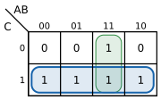

# Unitat 4. Electrònica digital

El mòbil, l'ordinador, la rentadora o el semàfor del carrer prenen decisions amb circuits que només entenen dues coses: **sí o no**, **encès o apagat**, **1 o 0**. Són circuits **digitals**. En aquesta unitat aprendràs a comptar com ells, a conèixer les portes lògiques que fan les operacions bàsiques i a dissenyar un circuit que resolgui un problema a partir d'una descripció en paraules.

## 4.1. Senyals analògics i digitals

| | Senyal analògic | Senyal digital |
| --- | --- | --- |
| **Valors** | Qualsevol valor dins un interval | Només uns quants valors; en electrònica digital, dos |
| **Exemples** | Temperatura, so d'un micròfon, tensió d'una LDR | Polsador premut o no, LED encès o apagat, dades d'un ordinador |
| **Representació** | Una corba contínua | Esglaons entre el nivell baix (0) i l'alt (1) |

En un circuit digital, el **0** correspon a una tensió **baixa** (prop de 0 V) i l'**1** a una tensió **alta** (per exemple, 5 V o 3,3 V). Els circuits digitals tenen avantatges importants:

- Són molt **resistents al soroll**: si un 1 arriba una mica degradat, continua sent un 1.
- La informació es pot **guardar, copiar i transmetre** sense perdre qualitat.
- Es poden fabricar milions de portes en un sol xip, i **programar-les**.

Per això el món real (analògic) es converteix en digital amb **convertidors analògic-digitals** (per exemple, quan el micròfon del mòbil grava la teva veu) i es torna a convertir en analògic quan cal (els altaveus).

## 4.2. Els sistemes de numeració

### 4.2.1. El sistema binari

Nosaltres comptam en **sistema decimal** (base 10): feim servir deu xifres (0-9), i cada posició val deu vegades més que la de la dreta. Els circuits digitals fan servir el **sistema binari** (base 2): només hi ha dues xifres, **0 i 1**, i cada posició val **el doble** que la de la dreta.

| Posició | 7 | 6 | 5 | 4 | 3 | 2 | 1 | 0 |
| --- | --- | --- | --- | --- | --- | --- | --- | --- |
| Valor | 128 | 64 | 32 | 16 | 8 | 4 | 2 | 1 |

Cada xifra binària és un **bit**. Un grup de **8 bits** és un **byte**. Amb **n bits** es poden representar **2ⁿ** combinacions diferents: amb 3 bits, 8 combinacions (del 0 al 7); amb 8 bits, 256 (del 0 al 255).

### 4.2.2. Conversions

**De binari a decimal**: se sumen els valors de les posicions on hi ha un 1.

Exemple: 101101₂ = 32 + 8 + 4 + 1 = **45**

**De decimal a binari**: es divideix successivament per 2 i es llegeixen els residus **de baix a dalt**.

Exemple amb 25:

| Divisió | Quocient | Residu |
| --- | --- | --- |
| 25 / 2 | 12 | **1** |
| 12 / 2 | 6 | **0** |
| 6 / 2 | 3 | **0** |
| 3 / 2 | 1 | **1** |
| 1 / 2 | 0 | **1** |

Llegint de baix a dalt: 25 = **11001₂**. Comprovació: 16 + 8 + 1 = 25. ✔

!!! info "El sistema hexadecimal"
    Els números binaris llargs són difícils de llegir. Per això en informàtica es fa servir també el **sistema hexadecimal** (base 16), amb les xifres 0-9 i les lletres A-F (A = 10, …, F = 15). Cada xifra hexadecimal equival a 4 bits: 1100 1000₂ = **C8₁₆** = 200. El trobaràs en els colors de les pàgines web (#FF0000 és vermell pur) i en les adreces MAC.

!!! example "Exercici 4.1. Conversions"
    1. Passa a binari: 100 i 200.
    2. Passa a decimal: 1011₂, 101010₂ i 11111111₂.
    3. Quants de bits necessites per numerar les 28 taquilles d'una classe?

    ??? success "Solució"
        1. 100 = **1100100₂**; 200 = **11001000₂**.
        2. 1011₂ = 8 + 2 + 1 = **11**; 101010₂ = 32 + 8 + 2 = **42**; 11111111₂ = **255**.
        3. Amb 4 bits hi ha 16 combinacions (no basten); amb 5 bits, 32 (basten). Necessites **5 bits**.

## 4.3. Les portes lògiques

Les **portes lògiques** són els circuits digitals més senzills. Reben un o més senyals d'entrada (0 o 1) i en donen un de sortida segons una regla. El comportament de cada porta es descriu amb una **taula de veritat**, que recull la sortida per a totes les combinacions possibles de les entrades.

### 4.3.1. Les portes bàsiques

| Porta | Símbol | Expressió | Regla |
| --- | --- | --- | --- |
| **NOT** (negació) | { width="120" } | S = Ā | La sortida és la **contrària** de l'entrada |
| **AND** (producte, «i») | { width="120" } | S = A · B | Val 1 **només si totes** les entrades valen 1 |
| **OR** (suma, «o») | { width="120" } | S = A + B | Val 1 **si almanco una** entrada val 1 |

Taules de veritat de les portes AND i OR:

| A | B | A · B (AND) | A + B (OR) |
| --- | --- | --- | --- |
| 0 | 0 | 0 | 0 |
| 0 | 1 | 0 | 1 |
| 1 | 0 | 0 | 1 |
| 1 | 1 | 1 | 1 |

Una manera d'entendre-les és amb interruptors: una porta **AND** és com dos interruptors **en sèrie** (el llum només s'encén si tots dos estan tancats), i una porta **OR**, com dos interruptors **en paral·lel** (s'encén si qualsevol està tancat).

!!! warning "Compte amb el «+»"
    En l'àlgebra de Boole, «+» vol dir **OR**, no suma: 1 + 1 = **1**.

### 4.3.2. Les portes derivades

| Porta | Símbol | Expressió | Regla |
| --- | --- | --- | --- |
| **NAND** | { width="120" } | S = (A · B)‾ | AND negada: val 0 només si totes les entrades valen 1 |
| **NOR** | { width="120" } | S = (A + B)‾ | OR negada: val 1 només si totes les entrades valen 0 |
| **XOR** (o exclusiva) | { width="120" } | S = A ⊕ B | Val 1 si les entrades són **diferents** |

| A | B | NAND | NOR | XOR |
| --- | --- | --- | --- | --- |
| 0 | 0 | 1 | 1 | 0 |
| 0 | 1 | 1 | 0 | 1 |
| 1 | 0 | 1 | 0 | 1 |
| 1 | 1 | 0 | 0 | 0 |

Les portes **NAND** i **NOR** es diuen **universals**, perquè combinant només portes NAND (o només NOR) es pot construir qualsevol altra porta i, per tant, qualsevol circuit digital.

!!! example "Exercici 4.2. Interpretar un circuit"
    Escriu l'expressió i la taula de veritat d'aquest circuit:

    { width="360" }

    ??? success "Solució"
        La porta AND fa A · B; la porta NOT, C̄; la porta OR les suma: **S = A · B + C̄**.

        | A | B | C | A · B | C̄ | S |
        | --- | --- | --- | --- | --- | --- |
        | 0 | 0 | 0 | 0 | 1 | 1 |
        | 0 | 0 | 1 | 0 | 0 | 0 |
        | 0 | 1 | 0 | 0 | 1 | 1 |
        | 0 | 1 | 1 | 0 | 0 | 0 |
        | 1 | 0 | 0 | 0 | 1 | 1 |
        | 1 | 0 | 1 | 0 | 0 | 0 |
        | 1 | 1 | 0 | 1 | 1 | 1 |
        | 1 | 1 | 1 | 1 | 0 | 1 |

## 4.4. L'àlgebra de Boole

L'**àlgebra de Boole** és el conjunt de regles per operar amb variables que només valen 0 o 1. Serveix per **simplificar** les expressions: una expressió més curta vol dir un circuit amb menys portes, més barat i més ràpid.

| Propietat | Per a la suma (OR) | Per al producte (AND) |
| --- | --- | --- |
| Element neutre | A + 0 = A | A · 1 = A |
| Element absorbent | A + 1 = 1 | A · 0 = 0 |
| Idempotència | A + A = A | A · A = A |
| Complementació | A + Ā = 1 | A · Ā = 0 |
| Commutativa | A + B = B + A | A · B = B · A |
| Distributiva | A · (B + C) = A · B + A · C | A + B · C = (A + B) · (A + C) |
| Absorció | A + A · B = A | A · (A + B) = A |
| Doble negació | (Ā)‾ = A | |

Els **teoremes de De Morgan** permeten passar d'una suma negada a un producte i al revés:

- **(A + B)‾ = Ā · B̄**
- **(A · B)‾ = Ā + B̄**

!!! example "Exercici 4.3. Simplificar"
    Simplifica aquestes expressions amb les propietats de l'àlgebra de Boole:

    1. S = A · B + A · B̄
    2. S = A + A · B · C
    3. S = (Ā · B̄)‾

    ??? success "Solució"
        1. Treient factor comú: S = A · (B + B̄) = A · 1 = **A**. La variable B no influeix.
        2. Per absorció (A + A · X = A, amb X = B · C): **S = A**.
        3. Per De Morgan: (Ā · B̄)‾ = (Ā)‾ + (B̄)‾ = **A + B**.

## 4.5. Dissenyar un circuit a partir d'un problema

Aquest és el procés que segueix un enginyer per passar d'un enunciat en paraules a un circuit digital:

1. **Identificar les entrades i les sortides** i decidir què vol dir 0 i 1 per a cada una.
2. **Fer la taula de veritat** amb totes les combinacions de les entrades.
3. **Obtenir la funció lògica**: per cada fila on la sortida val 1, s'escriu el producte de les entrades (negant les que valen 0) i se sumen tots els productes. És la **suma de productes**.
4. **Simplificar** la funció, amb àlgebra de Boole o amb mapes de Karnaugh.
5. **Dibuixar el circuit** amb portes lògiques i comprovar-lo amb un simulador.

Exemple: el **llum d'un passadís** s'ha de poder encendre i apagar des de dos interruptors, un a cada extrem (A i B). Si es canvia qualsevol interruptor, el llum canvia d'estat.

| A | B | S |
| --- | --- | --- |
| 0 | 0 | 0 |
| 0 | 1 | 1 |
| 1 | 0 | 1 |
| 1 | 1 | 0 |

Files amb S = 1: la segona (Ā · B) i la tercera (A · B̄). Per tant, **S = Ā · B + A · B̄**, que és exactament una porta **XOR**: S = A ⊕ B.

## 4.6. Els mapes de Karnaugh

Simplificar amb àlgebra de Boole requereix pràctica i és fàcil deixar-se alguna simplificació. Els **mapes de Karnaugh** són un mètode gràfic que ho fa de manera sistemàtica per a funcions de 2, 3 o 4 variables.

### 4.6.1. Com es construeix el mapa

El mapa és una taula amb una casella per a cada combinació de les entrades. Les files i columnes s'ordenen de manera que entre dues caselles veïnes **només canviï una variable**. Per això, amb dues variables l'ordre és **00, 01, 11, 10** (no 00, 01, 10, 11). Dins de cada casella s'escriu el valor de la sortida.

### 4.6.2. Com se simplifica

1. S'agrupen els **1** en rectangles de **1, 2, 4 o 8 caselles** (potències de 2).
2. Els grups han de ser **tan grans com sigui possible**, i n'hi ha d'haver **tan pocs com sigui possible**.
3. Un 1 pot formar part de diversos grups.
4. El mapa és «circular»: la primera i l'última columna es consideren veïnes.
5. De cada grup s'escriu un producte només amb les variables que **no canvien** dins del grup.
6. La funció és la suma dels productes de tots els grups.

Exemple: una funció de tres variables val 1 en les combinacions 001, 011, 101, 110 i 111.

{ width="300" }

- **Grup blau** (la fila C = 1 sencera): A i B canvien, C sempre val 1 → **C**.
- **Grup verd** (la columna AB = 11): A i B valen sempre 1, C canvia → **A · B**.

Resultat: **S = A · B + C**. Sense simplificar, la suma de productes tenia cinc termes de tres variables cada un; ara té dues portes.

!!! example "Exercici 4.4. Karnaugh"
    Una funció de tres variables (A, B, C) val 1 en les combinacions 000, 010, 100, 101 i 110, i 0 en la resta. Fes el mapa de Karnaugh, simplifica la funció i dibuixa el circuit.

    ??? success "Solució"
        | C \ AB | 00 | 01 | 11 | 10 |
        | --- | --- | --- | --- | --- |
        | **0** | 1 | 1 | 1 | 1 |
        | **1** | 0 | 0 | 0 | 1 |

        - La fila C = 0 sencera forma un grup de 4 → **C̄**.
        - Les dues caselles de la columna AB = 10 (A = 1, B = 0) formen un grup de 2 → **A · B̄**.

        **S = C̄ + A · B̄**. Circuit: una porta NOT per a C, una NOT per a B, una AND per a A i B̄, i una OR final.

!!! example "Exercici 4.5. La votació"
    Un concurs té tres jutges (A, B i C). Cadascun prem un polsador (1) si vol aprovar el concursant. El concursant passa si **almanco dos** jutges hi voten a favor, i llavors s'encén un llum verd (S). Fes la taula de veritat, simplifica la funció i dibuixa el circuit.

    ??? success "Solució"
        | A | B | C | S |
        | --- | --- | --- | --- |
        | 0 | 0 | 0 | 0 |
        | 0 | 0 | 1 | 0 |
        | 0 | 1 | 0 | 0 |
        | 0 | 1 | 1 | 1 |
        | 1 | 0 | 0 | 0 |
        | 1 | 0 | 1 | 1 |
        | 1 | 1 | 0 | 1 |
        | 1 | 1 | 1 | 1 |

        Mapa de Karnaugh:

        | C \ AB | 00 | 01 | 11 | 10 |
        | --- | --- | --- | --- | --- |
        | **0** | 0 | 0 | 1 | 0 |
        | **1** | 0 | 1 | 1 | 1 |

        Tres grups de 2, tots compartint la casella 111: AB = 11 → **A · B**; columnes 01 i 11 amb C = 1 → **B · C**; columnes 11 i 10 amb C = 1 → **A · C**.

        **S = A · B + B · C + A · C**: tres portes AND de dues entrades i una OR de tres entrades.

## 4.7. Els circuits integrats digitals

A la pràctica, les portes lògiques venen dins de **circuits integrats**. Les famílies més conegudes són la **74HC** i la **4000**, que contenen diverses portes del mateix tipus en una càpsula de 14 potes:

| Circuit | Contingut |
| --- | --- |
| 74HC00 | 4 portes NAND de 2 entrades |
| 74HC02 | 4 portes NOR de 2 entrades |
| 74HC04 | 6 portes NOT |
| 74HC08 | 4 portes AND de 2 entrades |
| 74HC32 | 4 portes OR de 2 entrades |
| 74HC86 | 4 portes XOR de 2 entrades |

En tots aquests, la pota **14** és l'alimentació positiva i la **7**, el negatiu. Com que la distribució de les portes pot variar, consulta sempre el **full de característiques** (*datasheet*) del fabricant abans de muntar-lo.

Avui, molts circuits que abans es feien amb portes lògiques es fan amb un **microcontrolador** programable, com la micro:bit o l'Arduino: en lloc de cablejar portes, s'escriu un programa amb condicions (`if`, `and`, `or`, `not`). És el que veurem a la unitat 6. Però dins del microcontrolador, tot continua funcionant amb portes lògiques.

## 4.8. Simuladors

Per comprovar els circuits sense muntar-los, pots fer servir aquests simuladors gratuïts:

- **Logisim Evolution**: programa d'escriptori, molt usat a l'ensenyament. Permet crear circuits amb portes, obtenir la taula de veritat i fins i tot generar el circuit a partir de la taula.
- **CircuitVerse** (circuitverse.org): simulador en línia de circuits digitals, sense instal·lar res.
- **Tinkercad Circuits**: permet muntar els circuits integrats 74HC en una placa de proves virtual.

## 4.9. Reptes

!!! example "Repte 4.1. La caixa forta"
    Una caixa forta té quatre interruptors (A, B, C i D). Només s'obre (S = 1) amb la combinació **A = 1, B = 0, C = 1, D = 1**. A més, un llum d'alarma (L) s'encén si s'activa l'interruptor B, perquè és una trampa. Escriu les funcions S i L, dibuixa el circuit i comprova'l en un simulador.

!!! example "Repte 4.2. L'hivernacle"
    Un hivernacle té tres sensors digitals: temperatura alta (T), humitat baixa (H) i dia (D). La ventilació (V) s'ha d'activar si fa massa calor. El reg (R) s'ha d'activar si la humitat és baixa, però **només de nit**, per evitar que l'aigua s'evapori. A més, si fa calor i la humitat és baixa alhora, s'ha d'encendre un llum d'avís (A). Fes la taula de veritat de les tres sortides, obtén les funcions simplificades i dibuixa el circuit. Després, pensa com ho programaries amb una micro:bit.

---

!!! quote "Font"
    Unitat de creació pròpia. L'Aula de Martín té una unitat equivalent («UD3. Electrónica digital»), amb una presentació, activitats i exercicis a Google Drive que no s'han pogut consultar en preparar aquesta versió. Esquemes i mapa de Karnaugh elaborats amb [Schemdraw](https://schemdraw.readthedocs.io/).
