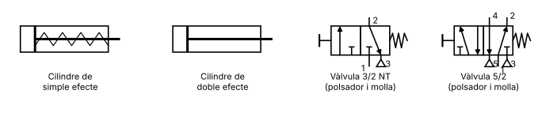
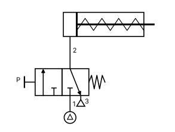
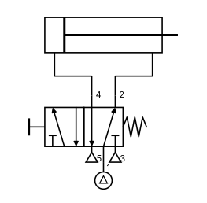

# Unitat 5. Pneumàtica i hidràulica

Les portes d'un autobús que s'obren amb un xiulet, la cadira del dentista que puja i baixa, l'excavadora que aixeca tones de terra o els frens d'un camió tenen una cosa en comú: funcionen amb un **fluid a pressió**. Si el fluid és **aire**, parlam de **pneumàtica**; si és un **líquid** (normalment oli), d'**hidràulica**.

Aquests sistemes permeten fer forces molt grans amb aparells petits i controlar moviments lineals (empènyer, estirar, pujar, baixar) de manera senzilla i segura. Per això són a gairebé totes les fàbriques automatitzades.

## 5.1. La pressió

La **pressió** és la força que s'exerceix sobre cada unitat de superfície:

**P = F / S**

A la unitat del Sistema Internacional, el **pascal** (Pa), 1 N actua sobre 1 m². És una unitat molt petita, i per això en pneumàtica i hidràulica es fan servir altres unitats:

| Unitat | Equivalència | Ús |
| --- | --- | --- |
| **bar** | 1 bar = 100.000 Pa | La més habitual en pneumàtica i hidràulica |
| **atmosfera** (atm) | 1 atm ≈ 1,013 bar | Pressió atmosfèrica al nivell del mar |
| **kp/cm²** | 1 kp/cm² ≈ 0,98 bar | Unitat antiga, encara als manòmetres |

!!! info "Pressió absoluta i pressió relativa"
    Els **manòmetres** mesuren la pressió **per damunt de l'atmosfèrica** (pressió **relativa** o manomètrica). Si un manòmetre marca 6 bar, la pressió real (absoluta) és d'uns 7 bar. Quan parlam de la pressió d'una instal·lació, sempre ens referirem a la relativa.

!!! tip "Treballar en metres quadrats"
    Les superfícies dels cilindres solen ser molt petites. Com que 1 bar = 100.000 Pa = 100.000 N/m², passa sempre els diàmetres a **metres** abans de calcular la superfície. Un error típic és fer-ho en cm o mm i obtenir forces mil vegades massa grans o massa petites.

## 5.2. Els elements d'un circuit pneumàtic

Un circuit pneumàtic té una estructura semblant a la d'un circuit elèctric:

| Elèctric | Pneumàtic | Funció |
| --- | --- | --- |
| Generador (pila) | **Compressor** | Proporciona l'aire a pressió |
| Cables | **Conductes** (tubs de plàstic) | Transporten l'aire |
| Interruptors | **Vàlvules** | Controlen el pas de l'aire |
| Receptors (motor) | **Actuadors** (cilindres, motors pneumàtics) | Transformen la pressió en moviment |

### 5.2.1. Producció i tractament de l'aire

El **compressor** agafa aire de l'atmosfera i el comprimeix en un **dipòsit** o calderí. L'aire comprimit conté pols, aigua i, a vegades, oli del compressor, que podrien espenyar els components. Per això, abans d'arribar al circuit, passa per una **unitat de manteniment** (sovint anomenada FRL):

- **Filtre** (F): reté les partícules i l'aigua condensada.
- **Regulador** (R) amb **manòmetre**: manté la pressió de treball constant, per exemple a 6 bar, encara que la del dipòsit variï.
- **Lubricador** (L): afegeix una boira d'oli per lubricar els components. Molts components moderns ja no en necessiten.

### 5.2.2. Els cilindres

Els **cilindres** són els actuadors més habituals. Tenen un **èmbol** que llisca dins un tub i una **tija** que surt a l'exterior.

- **Cilindre de simple efecte**: l'aire entra per un sol costat i empeny l'èmbol cap a fora (**avanç**). La tornada (**retrocés**) la fa una **molla** interior quan s'allibera l'aire. Gasta menys aire, però la carrera és curta i la molla resta força.
- **Cilindre de doble efecte**: té dues entrades. L'aire fa avançar l'èmbol per un costat i retrocedir-lo per l'altre. Pot fer força en tots dos sentits i tenir carreres més llargues.

### 5.2.3. La força d'un cilindre

La força teòrica d'un cilindre és la pressió per la superfície sobre la qual actua l'aire:

**F = P · S**

- En l'**avanç**, l'aire actua sobre tot l'èmbol: **S = π · D² / 4**, on D és el diàmetre de l'èmbol.
- En el **retrocés** d'un cilindre de doble efecte, la tija ocupa una part de la superfície: **S = π · (D² − d²) / 4**, on d és el diàmetre de la tija. Per això un cilindre fa **menys força en tornar** que en avançar.
- En un cilindre de **simple efecte**, a la força d'avanç cal restar-hi la força de la molla.

A la pràctica, la força real és una mica menor per culpa dels **fregaments**.

!!! example "Exercici 5.1. Força d'un cilindre"
    Un cilindre de doble efecte té un èmbol de 40 mm de diàmetre i una tija de 12 mm. Treballa a 6 bar.

    1. Calcula la força teòrica d'avanç.
    2. Calcula la força teòrica de retrocés.
    3. Si fos un cilindre de simple efecte amb una molla que fa 50 N, quina força d'avanç tendria?

    ??? success "Solució"
        P = 6 bar = 600.000 Pa; D = 0,04 m; d = 0,012 m.

        1. S = π · 0,04² / 4 ≈ 0,001 257 m². F = 600.000 · 0,001 257 ≈ **754 N**.
        2. S = π · (0,04² − 0,012²) / 4 ≈ 0,001 144 m². F = 600.000 · 0,001 144 ≈ **686 N**.
        3. F = 754 − 50 = **704 N**.

!!! example "Exercici 5.2. Triar un cilindre"
    Necessites un cilindre que faci una força d'avanç de 1.000 N amb una pressió de 6 bar. Quin diàmetre mínim ha de tenir l'èmbol? Els diàmetres comercials són 32, 40, 50 i 63 mm. Quin triaries?

    ??? success "Solució"
        S = F / P = 1.000 / 600.000 ≈ 0,001 667 m².

        D = √(4 · S / π) = √(4 · 0,001 667 / π) ≈ 0,046 m = **46 mm**.

        Es tria el diàmetre comercial superior: **50 mm**. Així queda marge per als fregaments.

## 5.3. Les vàlvules

Les **vàlvules** dirigeixen, obren o tallen el pas de l'aire. Les més importants són les **distribuïdores**.

### 5.3.1. Les vàlvules distribuïdores

Una vàlvula distribuïdora es designa amb dos nombres: **vies / posicions**.

- Les **vies** són els orificis per on entra o surt l'aire.
- Les **posicions** són els estats que pot tenir la vàlvula.

En el símbol, cada **posició** és un **quadrat**. Dins de cada quadrat, les fletxes indiquen per on passa l'aire, i les T, les vies tancades. Els conductes es connecten al quadrat que representa la **posició de repòs** (la que té la vàlvula quan no s'acciona), que és el que queda al costat de la molla.

Les vies es numeren segons la norma:

| Número | Funció |
| --- | --- |
| **1** | Alimentació (entrada d'aire a pressió) |
| **2** i **4** | Utilització (sortides cap als actuadors) |
| **3** i **5** | Escapament a l'atmosfera (triangle) |

Les vàlvules més habituals:

- **3/2** (3 vies, 2 posicions): per governar cilindres de **simple efecte**. Pot ser **normalment tancada** (NT: en repòs no deixa passar l'aire) o **normalment oberta** (NO).
- **5/2** (5 vies, 2 posicions): per governar cilindres de **doble efecte**. En repòs, l'aire va per una sortida (per exemple, la 2) i en accionar-la, per l'altra (la 4).

### 5.3.2. Els accionaments

Als costats del símbol es dibuixa com s'acciona la vàlvula i com torna a la posició de repòs:

| Accionament | Exemple d'ús |
| --- | --- |
| **Polsador** | Accionament manual mentre es prem |
| **Palanca** o **pedal** | Accionament manual, amb enclavament o sense |
| **Rodet** (final de carrera) | L'acciona el mateix cilindre en arribar al final del recorregut |
| **Molla** | Fa tornar la vàlvula a la posició de repòs |
| **Pilotatge pneumàtic** | L'acciona un senyal d'aire procedent d'una altra vàlvula |
| **Electrovàlvula** (solenoide) | L'acciona un senyal elèctric: permet controlar el circuit amb un autòmat o un microcontrolador |

### 5.3.3. Altres vàlvules

| Vàlvula | Funció |
| --- | --- |
| **Antiretorn** | Deixa passar l'aire en un sol sentit, com un díode |
| **Reguladora de cabal** | Estreny el pas de l'aire per controlar la **velocitat** del cilindre. Si és **unidireccional**, només regula en un sentit |
| **Selectora** (funció **OR**) | Té dues entrades i una sortida: hi surt aire si n'arriba per **qualsevol** de les entrades |
| **De simultaneïtat** (funció **AND**) | Només hi surt aire si n'arriba per **totes dues** entrades alhora |

Fixa't que les vàlvules selectora i de simultaneïtat fan les mateixes funcions que les portes OR i AND de la unitat 4. Els circuits pneumàtics també poden prendre decisions lògiques.

## 5.4. Circuits bàsics

### 5.4.1. Control directe d'un cilindre de simple efecte

{ width="300" }

- **En repòs**, la vàlvula 3/2 NT està en la posició de la dreta: l'entrada 1 està tancada i el cilindre està connectat a l'escapament (2 → 3). La molla manté la tija a dins.
- **En prémer el polsador**, la vàlvula passa a la posició de l'esquerra: l'aire va de 1 a 2 i la tija **avança**.
- **En deixar anar el polsador**, la molla de la vàlvula la torna a la posició de repòs, l'aire del cilindre surt per l'escapament i la molla del cilindre fa **retrocedir** la tija.

### 5.4.2. Control directe d'un cilindre de doble efecte

{ width="320" }

- **En repòs**, l'aire va de 1 a 2 i entra pel costat de la tija: el cilindre es manté **retrocedit**. El costat de l'èmbol és connectat a l'escapament (4 → 5).
- **En prémer el polsador**, l'aire va de 1 a 4 i entra pel costat de l'èmbol: la tija **avança**. L'aire de l'altre costat surt per 2 → 3.

### 5.4.3. Altres circuits habituals

- **Control des de dos punts**: dues vàlvules 3/2 amb polsador connectades a una **vàlvula selectora**. El cilindre avança si es prem **qualsevol** dels dos polsadors (funció OR).
- **Control amb les dues mans**: dues vàlvules 3/2 connectades a una **vàlvula de simultaneïtat**. El cilindre només avança si es premen **tots dos** polsadors alhora (funció AND). És una mesura de **seguretat** típica de les premses: l'operari té les dues mans ocupades i no les pot tenir davall de l'eina.
- **Regulació de velocitat**: es col·loca una **reguladora de cabal unidireccional** a la sortida del cilindre per frenar l'aire que surt i fer que la tija avanci o retrocedeixi més a poc a poc.
- **Control indirecte**: per a cilindres grans, una vàlvula petita amb polsador envia un senyal d'aire que **pilota** una vàlvula més gran, que és la que alimenta el cilindre. Així els polsadors poden ser petits i estar lluny de la màquina.
- **Moviment automàtic de vaivé**: dues vàlvules amb **rodet** situades als finals de carrera fan que el cilindre, en arribar al final, inverteixi el moviment ell tot sol.

!!! example "Exercici 5.3. Interpretar un circuit"
    En una premsa, l'operari ha de prémer dos polsadors alhora perquè baixi un cilindre de doble efecte, que ha de baixar lentament. Quins elements necessites? Descriu com els connectaries.

    ??? success "Solució"
        - Dues vàlvules **3/2 NT amb polsador** i molla, una per a cada mà.
        - Una vàlvula de **simultaneïtat**, que rep el senyal de les dues 3/2.
        - Una vàlvula **5/2 pilotada** pneumàticament i amb retorn per molla, governada per la sortida de la vàlvula de simultaneïtat.
        - El cilindre de **doble efecte**.
        - Una vàlvula **reguladora de cabal unidireccional** al conducte del cilindre per on surt l'aire durant la baixada, perquè baixi lentament i torni a pujar ràpid.

        Si es deixa anar qualsevol polsador, la 5/2 torna a la posició de repòs i el cilindre puja.

## 5.5. El consum d'aire

L'aire comprimit és car de produir: el compressor gasta molta electricitat. Per calcular quant d'aire gasta un cilindre, es calcula el volum que s'omple a cada carrera:

- Volum en l'avanç: V = S_avanç · L, on L és la **carrera** (el recorregut de la tija).
- Volum en el retrocés: V = S_retrocés · L.

Però aquest aire està comprimit. Per saber a quant d'aire atmosfèric equival, es fa servir la **llei de Boyle-Mariotte**: a temperatura constant, P₁ · V₁ = P₂ · V₂, amb pressions **absolutes**.

!!! example "Exercici 5.4. Consum d'aire"
    El cilindre de l'exercici 5.1 (D = 40 mm, d = 12 mm) té una carrera de 100 mm i fa 10 cicles complets (avanç i retrocés) per minut a 6 bar. Quant d'aire atmosfèric consumeix cada minut?

    ??? success "Solució"
        - Volum per cicle d'aire comprimit: (0,001 257 + 0,001 144) · 0,1 ≈ 0,000 240 m³ = **0,24 L**.
        - La pressió absoluta és d'uns 7 bar (6 + 1). Per Boyle-Mariotte, aquest aire ocupa a pressió atmosfèrica 0,24 · 7 ≈ **1,68 L**.
        - En un minut: 1,68 · 10 ≈ **16,8 L** d'aire atmosfèric.

## 5.6. La hidràulica

La hidràulica funciona com la pneumàtica, però amb **oli**. La gran diferència és que els líquids són pràcticament **incompressibles**: no es poden comprimir com l'aire.

### 5.6.1. El principi de Pascal

La pressió que s'aplica en un punt d'un líquid tancat es transmet **igual** a tots els punts del líquid. Aquest principi permet multiplicar forces amb una **premsa hidràulica**: si empenyem un èmbol petit, la mateixa pressió actua sobre un èmbol gran i fa una força molt més gran.

**F₁ / S₁ = F₂ / S₂**

Però no hi ha res gratis: com que el volum de líquid que es desplaça és el mateix, l'èmbol gran es mou **molt menys**. El que es guanya en força es perd en recorregut:

**S₁ · d₁ = S₂ · d₂**

Les excavadores, els elevadors de cotxes dels tallers, els gats hidràulics i els frens dels cotxes funcionen així.

### 5.6.2. Cabal i equació de continuïtat

El **cabal** (Q) és el volum de fluid que passa per una secció cada segon. Es pot calcular com la superfície de la secció per la velocitat del fluid:

**Q = S · v**

Com que el líquid no es comprimeix ni es perd, el cabal és **el mateix a tots els punts** d'un conducte. Si el tub s'estreny, el líquid ha d'anar **més ràpid**:

**S₁ · v₁ = S₂ · v₂**

Aquesta és l'**equació de continuïtat**. Per això, quan tapes una part de la boca d'una mànega, l'aigua surt amb més velocitat. En un cilindre hidràulic, la mateixa equació relaciona el cabal de la bomba amb la velocitat de la tija.

!!! example "Exercici 5.5. Premsa hidràulica"
    En una premsa hidràulica, l'èmbol petit fa 10 cm² i el gran, 500 cm².

    1. Quina força fa l'èmbol gran si en el petit s'aplica una força de 100 N?
    2. Si l'èmbol petit baixa 20 cm, quant puja el gran?

    ??? success "Solució"
        1. F₂ = F₁ · S₂ / S₁ = 100 · 500 / 10 = **5.000 N** (la força es multiplica per 50).
        2. d₂ = d₁ · S₁ / S₂ = 20 · 10 / 500 = **0,4 cm**. El recorregut es divideix per 50.

!!! example "Exercici 5.6. Equació de continuïtat"
    1. Per una mànega de 2 cm de diàmetre circula aigua a 1 m/s. Quin és el cabal en litres per segon?
    2. A la boca hi posam un broquet de 0,5 cm de diàmetre. A quina velocitat surt l'aigua?
    3. Una bomba dona 10 L/min a un cilindre hidràulic de 50 mm de diàmetre. A quina velocitat avança la tija?

    ??? success "Solució"
        1. S = π · 0,01² ≈ 0,000 314 m². Q = 0,000 314 · 1 = 0,000 314 m³/s ≈ **0,31 L/s**.
        2. El diàmetre és 4 vegades més petit, així que la superfície és 4² = 16 vegades més petita. La velocitat és 16 vegades més gran: **16 m/s**.
        3. Q = 10 L/min = 0,01 / 60 m³/s ≈ 0,000 167 m³/s. S = π · 0,025² ≈ 0,001 963 m². v = Q / S ≈ **0,085 m/s** (8,5 cm/s).

## 5.7. Pneumàtica o hidràulica?

| | Pneumàtica | Hidràulica |
| --- | --- | --- |
| **Fluid** | Aire (gratuït, inesgotable) | Oli |
| **Pressions habituals** | 6-10 bar | Desenes o centenars de bar |
| **Forces** | Moderades | Molt grans |
| **Velocitat** | Ràpida | Més lenta |
| **Precisió de posició** | Baixa: l'aire es comprimeix | Alta: l'oli no es comprimeix |
| **Fuites** | L'aire surt a l'atmosfera sense embrutar | L'oli embruta i contamina |
| **Retorn del fluid** | L'aire s'escapa a l'atmosfera | Cal un circuit de retorn al dipòsit |
| **Sorolls** | Els escapaments fan renou | Més silenciosa |
| **Aplicacions** | Portes d'autobusos, robots de manipulació, eines de taller, indústria alimentària | Maquinària d'obres, premses, elevadors, frens, direccions assistides |

## 5.8. Simular els circuits

Els circuits pneumàtics es dissenyen i es proven amb simuladors abans de muntar-los. El més conegut als centres educatius és **FluidSIM**, de l'empresa Festo, que necessita llicència. L'Aula de Martín enllaça una [activitat interactiva de circuits pneumàtics bàsics](https://www.educa2.madrid.org/web/educamadrid/principal/files/a1c18b06-dde8-4e44-98a0-49f0e0f2c425/Cuestiones_Tecnologia_Industrial/Circuitos_neumatica.htm) d'EducaMadrid per practicar.

## 5.9. Reptes

!!! example "Repte 5.1. Braç hidràulic amb xeringues"
    Construeix un braç robòtic de cartó o fusta que es mogui amb **xeringues** plenes d'aigua connectades amb tubs: en prémer una xeringa, la de l'altre extrem del tub s'estira i mou una articulació. Ha de tenir almanco tres moviments (girar la base, aixecar el braç i obrir i tancar una pinça).

    1. Fes el disseny amb esbossos i el plànol de les peces (pots tallar-les a làser, vegeu la unitat 2).
    2. Prova què passa si una xeringa és més grossa que l'altra. Relaciona-ho amb el principi de Pascal.
    3. Prova què passa si els tubs tenen aire en lloc d'aigua. Per què?

!!! example "Repte 5.2. La porta de l'autobús"
    Dissenya el circuit pneumàtic de la porta d'un autobús, accionada per un cilindre de doble efecte. El conductor ha de poder obrir i tancar la porta amb un comandament, i la porta s'ha d'obrir també si es prem un polsador d'emergència a l'interior. A més, ha de tancar lentament per no fer mal a ningú. Dibuixa l'esquema, explica'n el funcionament i, si disposes d'un simulador, comprova'l.

---

!!! quote "Font"
    Unitat de creació pròpia. L'Aula de Martín té una unitat equivalent («Neumática básica»), amb una presentació, apunts i una relació d'exercicis resolts a Google Drive que no s'han pogut consultar en preparar aquesta versió; se n'ha recollit l'enllaç a l'activitat interactiva d'EducaMadrid. Símbols i esquemes simplificats elaborats amb Matplotlib.
