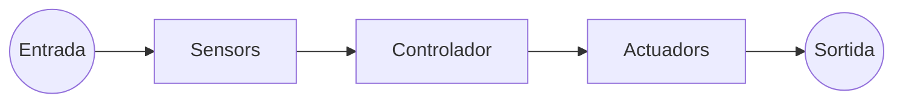
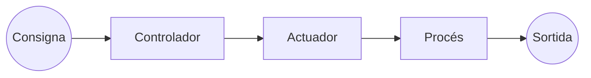
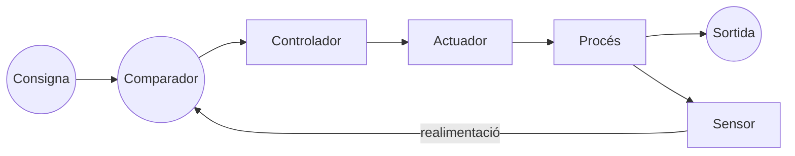
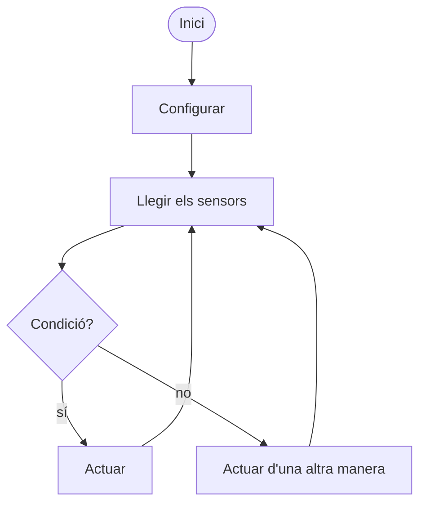
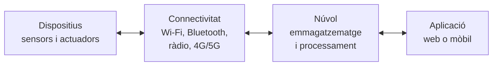

# Unitat 6. Control, robòtica i Internet de les coses

Un termòstat que encén la calefacció quan fa fred, un robot aspirador que esquiva els mobles, un hort que es rega tot sol quan la terra és seca o un rellotge que t'avisa si el teu pols s'accelera: tots són **sistemes automàtics**. Mesuren alguna cosa del seu entorn, decideixen què fer i actuen, sense que ningú els ho hagi de dir a cada moment.

En aquesta unitat estudiarem com funcionen aquests sistemes, programarem controladors com la micro:bit i l'mBot2, i veurem com, connectant-los a internet, formen l'**Internet de les coses**, que genera enormes quantitats de dades que s'analitzen amb **intel·ligència artificial**.

## 6.1. Sistemes de control

Un **sistema de control** és un conjunt d'elements que governa el funcionament d'una màquina o d'un procés perquè faci el que volem. Tots tenen tres parts:



- Els **sensors** (o elements d'entrada) mesuren una magnitud física (llum, temperatura, distància…) i la converteixen en un senyal elèctric.
- El **controlador** rep els senyals dels sensors, els processa i decideix què s'ha de fer. Pot ser un circuit electrònic (com els de les unitats 3 i 4) o un **microcontrolador** programable.
- Els **actuadors** (o elements de sortida) executen l'ordre del controlador: encenen un llum, mouen un motor, fan sonar una alarma…

### 6.1.1. Llaç obert i llaç tancat

Hi ha dos tipus de sistemes de control:

**Sistema en llaç obert.** L'acció del controlador **no depèn del resultat**. El sistema fa el que té programat, però no comprova si ho ha aconseguit.



Exemple: una torradora que torra durant un temps fix. Si el pa ja estava torrat, es cremarà, perquè la torradora no mira com està el pa.

**Sistema en llaç tancat** (o amb **realimentació**). Un sensor mesura contínuament la sortida i el controlador la **compara** amb el valor desitjat (la **consigna**). La diferència és l'**error**, i el controlador actua per corregir-lo.



Exemple: un termòstat. Si la consigna és 21 °C i el sensor mesura 18 °C, el controlador encén la calefacció; quan el sensor arriba a 21 °C, l'apaga.

| | Llaç obert | Llaç tancat |
| --- | --- | --- |
| **Comprova el resultat?** | No | Sí, amb un sensor |
| **Precisió** | Baixa: no corregeix les pertorbacions | Alta: s'adapta als canvis |
| **Complexitat i cost** | Baixos | Més alts |
| **Exemples** | Rentadora amb programa de temps, semàfor amb temporitzador, reg programat a una hora | Termòstat, control de velocitat de creuer d'un cotxe, reg amb sensor d'humitat, seguidor de línia |

!!! example "Exercici 6.1. Obert o tancat?"
    Classifica aquests sistemes en llaç obert o tancat i, en els de llaç tancat, indica quin és el sensor i quin és l'actuador:

    1. Un microones que escalfa durant 2 minuts.
    2. La porta automàtica d'un supermercat.
    3. Una nevera.
    4. Un aspersor que rega cada dia a les 7 del matí.
    5. Els llums del carrer que s'encenen quan es fa fosc.

    ??? success "Solució"
        1. **Obert**: escalfa durant un temps, sense comprovar la temperatura de l'aliment.
        2. **Tancat**: un sensor de presència (infraroig o radar) detecta si hi ha algú; l'actuador és el motor de la porta.
        3. **Tancat**: un sensor de temperatura (termòstat) controla el compressor (actuador) per mantenir la temperatura de consigna.
        4. **Obert**: rega a una hora fixa encara que hagi plogut.
        5. **Tancat**, en el sentit que el sistema reacciona a la llum que mesura un sensor (una LDR o una fotocèl·lula); l'actuador són els llums. Estrictament, el sensor no mesura l'efecte dels llums, sinó la llum natural: és un control **per detecció**, a mig camí entre els dos.

## 6.2. Sensors

Els sensors poden ser **digitals**, si només donen dos valors (activat o no), o **analògics**, si donen un valor dins un interval.

| Sensor | Tipus | Què detecta | Exemple d'ús |
| --- | --- | --- | --- |
| **Polsador** i **interruptor** | Digital | Una acció manual | Botons d'un comandament |
| **Final de carrera** | Digital | Que un objecte ha arribat a una posició | Porta de garatge que s'atura en obrir-se |
| **LDR**, fotodíode | Analògic | Nivell de llum | Fanals, detector de dia i nit |
| **NTC**, sensor de temperatura | Analògic | Temperatura | Termòstat |
| **Ultrasons** | Analògic | Distància, pel temps que tarda l'eco | Sensor d'aparcament, robot que esquiva obstacles |
| **Infraroig** | Digital o analògic | Presència, proximitat, línia negra o blanca | Portes automàtiques, seguidor de línia |
| **Humitat** del sòl o de l'aire | Analògic | Quantitat d'aigua | Reg automàtic, estació meteorològica |
| **Micròfon** | Analògic | Nivell de so | Llum que s'encén amb una picada de mans |
| **Acceleròmetre** i **giroscopi** | Analògic | Moviment, inclinació, cops | Mòbil que gira la pantalla, comptapassos |
| **Brúixola** (magnetòmetre) | Analògic | Orientació respecte del nord | Navegació |

La **micro:bit** ja porta incorporats dos botons, un acceleròmetre, una brúixola, un sensor de llum, un de temperatura i, la versió 2, un micròfon i un logo tàctil. El robot **mBot2** porta un sensor d'ultrasons i un sensor de color i de línia de quatre canals.

## 6.3. Actuadors

| Actuador | Què fa | Exemple d'ús |
| --- | --- | --- |
| **LED** i pantalles | Fan llum, mostren informació | Indicadors, pantalla de la micro:bit |
| **Brunzidor** i altaveu | Fan so | Alarmes, avisos |
| **Motor de corrent continu** | Gira contínuament; el sentit depèn de la polaritat | Rodes d'un robot, ventiladors |
| **Servomotor** | Gira fins a un angle concret (normalment de 0° a 180°) i s'hi manté | Barreres, braços robòtics, timons |
| **Motor pas a pas** | Gira en passos petits i precisos | Impressores 3D, talladores làser |
| **Relé** | Commuta un circuit de més potència (vegeu la unitat 3) | Encendre una bomba d'aigua o un llum de 230 V |
| **Electrovàlvula** | Obre o tanca el pas d'un fluid | Reg, circuits pneumàtics (vegeu la unitat 5) |

!!! warning "Els motors necessiten més corrent"
    Les sortides d'un microcontrolador donen molt poc corrent: basten per a un LED, però no per a un motor. Per moure motors cal un **controlador de motors** (un circuit amb transistors), un relé o una placa que ja l'inclogui, com l'mBot2.

!!! example "Exercici 6.2. El sensor d'aparcament"
    Un cotxe té un sensor d'aparcament: quan s'acosta a un obstacle per darrere, sona un pitit que s'accelera com més a prop és, i quan és a menys de 30 cm el so és continu i a la pantalla apareix un avís vermell. Identifica la consigna, els sensors, el controlador i els actuadors. És un sistema en llaç obert o tancat?

    ??? success "Solució"
        - **Sensors**: sensors d'ultrasons al para-xocs posterior (mesuren la distància). També hi ha un sensor que detecta que s'ha posat la marxa enrere, que activa el sistema.
        - **Controlador**: una centraleta electrònica (un microcontrolador) que calcula la distància i decideix la freqüència dels pitits.
        - **Actuadors**: un brunzidor o altaveu i la pantalla.
        - **Consigna**: les distàncies a partir de les quals canvia l'avís (per exemple, 30 cm per al so continu).
        - És un sistema que **reacciona a un sensor**, però no controla la sortida (no frena el cotxe): l'error el corregeix el conductor. Si el cotxe frenés tot sol, el sistema seria de **llaç tancat**.

## 6.4. Controladors programables

Avui, la majoria de controladors són **microcontroladors**: petits ordinadors en un sol xip, amb processador, memòria i **pins d'entrada i de sortida**. La micro:bit, l'Arduino i la CyberPi de l'mBot2 en són exemples.

Les entrades i sortides poden ser:

| | Entrades | Sortides |
| --- | --- | --- |
| **Digitals** | Llegeixen 0 o 1: un polsador | Donen 0 o 1: encendre o apagar un LED |
| **Analògiques** | Llegeixen un valor d'un interval: la tensió d'un divisor amb una LDR | Simulen un valor intermedi encenent i apagant molt ràpid (PWM): regular la llum d'un LED o la velocitat d'un motor |

### 6.4.1. Com és el programa d'un sistema de control

Gairebé tots els programes de control tenen la mateixa estructura: un **bucle infinit** que **llegeix** els sensors, **decideix** amb condicions i **actua**.



Exemple: un **termòstat** amb la micro:bit, en MicroPython (editor [python.microbit.org](https://python.microbit.org/)). Un relé connectat al pin 0 encén una estufa:

```python
from microbit import *

consigna = 21     # temperatura desitjada en °C
marge = 1         # histèresi: evita que l'estufa s'encengui i s'apagui contínuament

while True:
    t = temperature()
    if t < consigna - marge:
        pin0.write_digital(1)        # encén l'estufa
        display.show(Image.ARROW_N)
    elif t > consigna + marge:
        pin0.write_digital(0)        # apaga l'estufa
        display.show(Image.ARROW_S)
    sleep(5000)                      # torna a mesurar al cap de 5 s
```

!!! info "La histèresi"
    Si el termòstat encengués l'estufa just per davall de 21 °C i l'apagués just per damunt, quan la temperatura fos a prop de 21 °C l'estufa s'encendria i s'apagaria cada pocs segons, i el relé s'espenyaria. Per evitar-ho es deixa un **marge**: s'encén per davall de 20 °C i s'apaga per damunt de 22 °C. Aquest marge s'anomena **histèresi**.

!!! example "Exercici 6.3. Reg automàtic"
    Escriu en pseudocodi (o en MicroPython) el programa d'un reg automàtic per a un test. Un sensor d'humitat dona un valor de 0 (sec) a 1023 (molt humit). La bomba ha de regar si la humitat baixa de 300 i aturar-se quan supera 600. A més, no ha de regar mai de dia, quan el sensor de llum supera 150.

    ??? success "Solució"
        ```python
        from microbit import *

        while True:
            humitat = pin1.read_analog()     # sensor d'humitat al pin 1
            llum = display.read_light_level()
            if humitat < 300 and llum < 150:
                pin0.write_digital(1)        # bomba en marxa (relé al pin 0)
            elif humitat > 600 or llum >= 150:
                pin0.write_digital(0)        # bomba aturada
            sleep(2000)
        ```

        Fixa't que entre 300 i 600 la bomba manté l'estat que tenia: és la histèresi. Si és de dia, la bomba s'atura encara que la terra sigui seca.

## 6.5. Robòtica

Un **robot** és una màquina **programable** que pot percebre el seu entorn amb **sensors**, prendre decisions amb un **controlador** i actuar sobre el món amb **actuadors**, amb un cert grau d'autonomia. Que sigui **reprogramable** és el que el diferencia d'una màquina automàtica qualsevol: el mateix robot pot fer feines diferents si se li canvia el programa.

### 6.5.1. Tipus de robots

| Tipus | Característiques | Exemples |
| --- | --- | --- |
| **Industrials** (braços) | Fixos, molt precisos, repeteixen tasques | Soldadura i pintura de cotxes, embalatge |
| **Col·laboratius** (cobots) | Treballen al costat de les persones, amb sensors per no fer-los mal | Muntatge en petites empreses |
| **Mòbils** | Es desplacen amb rodes, potes o hèlices | Robots aspiradors, robots de magatzem, rovers de Mart |
| **Drons** | Robots aeris | Fotografia, agricultura, inspecció d'edificis |
| **Humanoides** | Imiten la forma humana | Investigació, atenció al públic |
| **Mèdics** | Molt precisos, sovint teledirigits | Cirurgia assistida |

### 6.5.2. Els braços robòtics

Un **braç robòtic** imita un braç humà. Les seves parts són:

- La **base**, fixa o mòbil.
- Les **articulacions**, que poden ser de **rotació** (giren) o **prismàtiques** (llisquen). Cada articulació aporta un **grau de llibertat**: un moviment independent. El braç humà en té set, sense comptar la mà; molts robots industrials en tenen sis.
- Els **segments** o eslabons, que uneixen les articulacions.
- L'**efector final** o **eina**: una pinça, una ventosa, una pistola de soldar, un pinzell…

### 6.5.3. Els robots mòbils

Molts robots mòbils, com l'mBot2, fan servir **tracció diferencial**: dues rodes amb motors independents. Si les dues giren igual, el robot va recte; si una gira més ràpid que l'altra, gira cap al costat de la més lenta; si giren en sentits contraris, gira sobre si mateix.

!!! example "Exercici 6.4. Programar un moviment"
    Un robot de tracció diferencial ha de recórrer un quadrat d'1 m de costat i tornar al punt de partida. Escriu l'algorisme. Quin problema hi pot haver si el robot funciona en llaç obert (només amb temps de motors)? Com el resoldries?

    ??? success "Solució"
        Algorisme: repetir 4 vegades { avançar 1 m; girar 90° a la dreta }.

        En llaç obert, el robot calcula la distància i l'angle només pel temps que funcionen els motors. Però les rodes poden patinar, la bateria es pot descarregar o el terra pot ser irregular: els errors s'acumulen i el robot no acabarà al punt de partida. Es resol **tancant el llaç**: amb **encoders** (sensors que compten les voltes de les rodes) per mesurar la distància real i amb un **giroscopi** per mesurar l'angle girat. L'mBot2 té tots dos.

## 6.6. L'Internet de les coses

L'**Internet de les coses** (IoT, *Internet of Things*) és la xarxa d'objectes quotidians que porten sensors, actuadors i connexió per **intercanviar dades** entre ells i amb serveis a internet: rellotges intel·ligents, termòstats, comptadors de llum, contenidors d'escombraries que avisen quan són plens, cotxes, màquines industrials…

### 6.6.1. Com està organitzat

Un sistema IoT s'organitza en capes:



1. **Dispositius**: els objectes amb sensors i actuadors i un microcontrolador.
2. **Connectivitat**: la manera de transmetre les dades. Depèn de la distància i del consum: **Bluetooth** per a distàncies curtes, **Wi-Fi** a casa, xarxes de **ràdio de llarg abast i baix consum** per a sensors que han de durar anys amb una pila, i **xarxes mòbils** per als vehicles.
3. **Núvol** (plataforma): servidors que **guarden** les dades, les **processen** i hi apliquen regles.
4. **Aplicació**: la interfície per veure les dades i donar ordres, normalment una aplicació mòbil o una web.

### 6.6.2. Aplicacions

| Àmbit | Exemples |
| --- | --- |
| **Ciutats intel·ligents** | Fanals que regulen la llum segons el trànsit de persones, aparcaments que indiquen les places lliures, sensors de qualitat de l'aire |
| **Agricultura** | Sensors d'humitat que decideixen quan regar, estacions meteorològiques, seguiment del bestiar |
| **Salut** | Rellotges que mesuren el pols, avisos de caigudes per a persones grans |
| **Indústria 4.0** | Màquines que avisen abans d'espenyar-se (manteniment predictiu), control de l'estoc |
| **Llar** | Domòtica (apartat 6.7) |

### 6.6.3. Riscs de l'IoT

- **Seguretat**: molts dispositius barats arriben amb contrasenyes per defecte i no s'actualitzen. Un atacant els pot controlar o fer-los servir per atacar altres sistemes. Canvia sempre la contrasenya de fàbrica i mantén el programari actualitzat.
- **Privacitat**: els dispositius recullen dades molt personals (quan som a casa, què miram, com dormim). Abans d'instal·lar-ne un, convé saber quines dades recull i qui les pot veure.
- **Dependència**: si el servei del fabricant tanca, alguns aparells deixen de funcionar.
- **Residus i energia**: milers de milions de dispositius consumeixen energia i acaben com a residus electrònics.

## 6.7. La domòtica

La **domòtica** és l'automatització d'un habitatge. Integra sensors, actuadors i un controlador per fer la casa més **confortable**, **segura**, **eficient** i **accessible**:

| Funció | Exemples |
| --- | --- |
| **Confort** | Climatització programada, persianes que baixen quan el sol pica, control per veu |
| **Seguretat** | Alarmes contra intrusos, detectors de fum, d'inundació i de fuites de gas que tallen l'aigua o el gas |
| **Estalvi energètic** | Termòstats intel·ligents, llums que s'apaguen si no hi ha ningú, electrodomèstics que funcionen quan l'electricitat és més barata |
| **Accessibilitat** | Obertura de portes i control de llums per a persones amb mobilitat reduïda, avisos lluminosos per a persones sordes |
| **Comunicacions** | Control remot des del mòbil, avisos quan passa alguna cosa |

Els dispositius de domòtica es comuniquen amb **protocols** específics. Durant molts d'anys cada marca feia servir el seu i els aparells no s'entenien entre ells; els estàndards nous volen que dispositius de marques diferents puguin funcionar junts.

!!! example "Exercici 6.5. Una casa intel·ligent"
    Dissenya un sistema domòtic per a la teva habitació amb almanco quatre funcions. Per a cada una, indica el sensor, l'actuador i la regla que seguiria el controlador (amb una condició del tipus «si… llavors…»). Indica quina funció és de confort, de seguretat, d'estalvi o d'accessibilitat.

    ??? success "Solució"
        Exemple de resposta:

        | Funció | Sensor | Actuador | Regla | Tipus |
        | --- | --- | --- | --- | --- |
        | Persiana automàtica | LDR | Motor de la persiana | Si hi ha molta llum i fa calor, baixar la persiana | Confort i estalvi |
        | Llum de nit | Sensor de presència i LDR | Tira de LED | Si és fosc i hi ha moviment, encendre la llum suau 1 minut | Confort i seguretat |
        | Avís de finestra oberta | Final de carrera a la finestra | Notificació al mòbil | Si la calefacció està encesa i la finestra s'obre, avisar | Estalvi |
        | Detector de fum | Sensor de fum | Alarma sonora i notificació | Si detecta fum, fer sonar l'alarma | Seguretat |

## 6.8. Big data i intel·ligència artificial

Els milers de milions de dispositius IoT generen una quantitat de dades enorme. Aquestes dades només són útils si es poden **analitzar**, i aquí entren el *big data* i la intel·ligència artificial.

### 6.8.1. El *big data*

El ***big data*** (dades massives) són conjunts de dades tan grans i complexos que no es poden tractar amb les eines habituals. Sovint es descriuen amb les **tres V**:

- **Volum**: quantitats enormes de dades.
- **Velocitat**: les dades arriben contínuament i s'han de processar al moment.
- **Varietat**: dades de tipus molt diferents (nombres, text, imatges, vídeo, posicions GPS…).

Analitzant aquestes dades es poden descobrir patrons: quins carrers s'embussen a cada hora, quan s'espenyarà una màquina, com es propaga una malaltia o quanta energia es consumirà demà.

### 6.8.2. La intel·ligència artificial

La **intel·ligència artificial** (IA) és la branca de la informàtica que crea sistemes capaços de fer tasques que associam a la intel·ligència humana: reconèixer imatges i veus, entendre i generar text, prendre decisions o aprendre.

En la programació tradicional, el programador escriu les regles (`if humitat < 300: regar`). En l'**aprenentatge automàtic** (*machine learning*), en canvi, el sistema **aprèn les regles a partir d'exemples**: si li donam milers de fotos de fulles sanes i de fulles malaltes, aprèn a distingir-les tot sol, sense que ningú li digui com.

| | Què li donam | Què n'obtenim |
| --- | --- | --- |
| **Programació tradicional** | Les regles (el programa) i les dades | Els resultats |
| **Aprenentatge automàtic** | Les dades i els resultats coneguts (exemples) | Un **model** amb les regles apreses, que després s'aplica a dades noves |

Amb eines gratuïtes com **Teachable Machine** de Google pots entrenar un model propi al navegador, per exemple perquè reconegui gestos amb la càmera, i comprovar com aprèn i com s'equivoca.

### 6.8.3. Qüestions ètiques

- **Biaixos**: un model aprèn el que hi ha a les dades. Si les dades d'entrenament no representen bé tothom, el sistema pot discriminar alguns grups de persones.
- **Privacitat**: per entrenar els models es necessiten moltes dades, sovint personals.
- **Transparència i responsabilitat**: molts models no expliquen per què prenen una decisió. Si un sistema s'equivoca, qui en respon?
- **Treball**: l'automatització fa desaparèixer algunes feines i en crea d'altres.

La Unió Europea ha aprovat un **Reglament d'intel·ligència artificial** que classifica els sistemes d'IA segons el risc que suposen i en prohibeix alguns usos.

!!! example "Exercici 6.6. Del sensor a la decisió"
    Una ciutat vol reduir els embussos. Proposa un sistema que combini IoT, *big data* i IA: quines dades recolliries i amb quins sensors, com les transmetries, què en faria la IA i quina acció automàtica es podria prendre. Indica també un risc del sistema.

    ??? success "Solució"
        Exemple de resposta:

        - **Dades i sensors**: espires o càmeres als semàfors que compten vehicles, dades de posició dels autobusos, sensors a les places d'aparcament.
        - **Transmissió**: xarxa mòbil o fibra fins a una plataforma al núvol.
        - **IA**: aprèn, a partir de les dades de mesos, com evoluciona el trànsit segons l'hora, el dia i el temps, i preveu on hi haurà embussos.
        - **Acció**: ajustar automàticament la durada dels semàfors, donar prioritat als autobusos i indicar a les pantalles i a les aplicacions on hi ha places lliures.
        - **Risc**: si les càmeres llegeixen les matrícules, es podrien seguir els moviments de les persones (privacitat); un atac informàtic podria col·lapsar els semàfors (seguretat).

## 6.9. Pràctiques

Per practicar el control i la robòtica farem servir les **pràctiques amb micro:bit i mBot2** que comparteixen aquesta matèria i Programació i Tractament de Dades I. Cada pràctica es pot fer a tres nivells: **amb blocs**, passant de blocs a Python o directament en Python. A 4t d'ESO, comença pel nivell 1 i puja de nivell quan et sentis segur. No et preocupis per les referències a les unitats de PTD I que hi trobaràs.

| Pràctica | Què hi treballes d'aquesta unitat |
| --- | --- |
| [1. El dau electrònic](../ptd1/practiques/microbit-1-dau.md) | Sensors (acceleròmetre) i actuadors (pantalla) |
| [2. Detector de dia i nit](../ptd1/practiques/microbit-2-dia-nit.md) | Sensor analògic de llum, llindars i condicions |
| [3. Esquivar obstacles](../ptd1/practiques/mbot2-3-obstacles.md) | Robot mòbil, sensor d'ultrasons, tracció diferencial |
| [4. Seguidor de línia](../ptd1/practiques/mbot2-4-seguidor-linia.md) | Control en llaç tancat amb sensors de línia |
| [5. Missatges xifrats per ràdio](../ptd1/practiques/microbit-5-missatges-xifrats.md) | Comunicació entre dispositius, base de l'IoT |
| [6. Registre de temperatures](../ptd1/practiques/microbit-6-temperatures.md) | Recollida i anàlisi de dades d'un sensor |
| [7. El robot gravadora](../ptd1/practiques/mbot2-7-gravadora.md) | Programació de moviments d'un robot |

## 6.10. Reptes

!!! example "Repte 6.1. Termòstat amb micro:bit"
    Programa el termòstat de l'apartat 6.4.1 amb una micro:bit. Com que probablement no tendràs un relé i una estufa, fes que un LED connectat al pin 0 (amb la seva resistència) faci d'estufa. Afegeix-hi:

    1. Que amb els botons A i B es pugui baixar i pujar la consigna, i que es mostri a la pantalla.
    2. Que la micro:bit enviï la temperatura per ràdio a una altra micro:bit, que la mostri: acabes de fer un sistema IoT en miniatura.

!!! example "Repte 6.2. Maqueta domòtica"
    En grup, construïu una maqueta d'una habitació (de cartó o tallada a làser, vegeu la unitat 2) amb almanco tres funcions domòtiques controlades per una micro:bit: per exemple, un llum que s'encén de nit, una alarma si s'obre la porta i un ventilador (o un LED que el representi) que s'engega si fa calor. Documentau el projecte seguint les fases de la unitat 1: problema, condicions, disseny, planificació, construcció, proves i presentació.

---

!!! quote "Font"
    Unitat de creació pròpia. L'Aula de Martín té una unitat equivalent («UD5. Control de sistemas automáticos»), que remet a tutorials de micro:bit i del robot Maqueen; els seus materials són a Google Drive i no s'han pogut consultar en preparar aquesta versió. Les pràctiques de l'apartat 6.9 són les de [PTD I](../ptd1/practiques/index.md).
