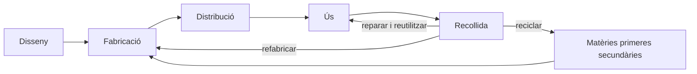

# Unitat 7. Materials i tecnologia sostenible

Cada objecte que dissenyam acaba tenint un impacte sobre el planeta: per les matèries primeres que s'extreuen per fabricar-lo, per l'energia que consumeix i pels residus que deixa quan ja no serveix. Una bona part d'aquest impacte es decideix **en el moment de dissenyar**, quan triam els materials, la manera d'unir les peces o com es podrà reparar.

En aquesta unitat repassarem com es classifiquen els materials i quines propietats tenen, i aprendrem a triar-los i a dissenyar productes més sostenibles i accessibles per a tothom.

## 7.1. Classificació dels materials

Segons el seu origen, els materials poden ser **naturals** (fusta, pedra, cotó, llana), **artificials** (obtinguts transformant materials naturals: acer, vidre, paper, formigó) o **sintètics** (creats per l'ésser humà, normalment a partir del petroli: plàstics, fibres sintètiques).

Segons les seves característiques, s'agrupen en famílies:

| Família | Exemples | Característiques principals |
| --- | --- | --- |
| **Fusta i derivats** | Pi, roure, contraxapat, DM, aglomerat | Renovable, bon aïllant, fàcil de treballar; es pot podrir i cremar |
| **Metalls fèrrics** | Ferro, acer, acer inoxidable | Molt resistents i tenaços; s'oxiden (excepte l'inoxidable); es reciclen bé |
| **Metalls no fèrrics** | Alumini, coure, llautó, titani | Lleugers (alumini, titani) o bons conductors (coure); resisteixen la corrosió |
| **Plàstics** | Termoplàstics (PET, PP, PVC, PLA), termostables (baquelita, resines), elastòmers (cautxú, silicona) | Lleugers, barats, aïllants, fàcils d'emmotllar; la majoria venen del petroli i es degraden molt lentament |
| **Petris i ceràmics** | Marès, marbre, granit, maó, porcellana, vidre | Durs, resistents a la compressió i a la calor; fràgils |
| **Tèxtils** | Cotó, llana, poliéster, niló | Flexibles; naturals o sintètics |
| **Materials compostos** | Fibra de carboni, fibra de vidre, formigó armat | Combinen dos o més materials per aprofitar el millor de cada un |

!!! info "Termoplàstics i termostables"
    Els **termoplàstics** s'estoven amb la calor i es poden tornar a fondre i emmotllar moltes vegades: per això són més fàcils de **reciclar**. Els **termostables**, un cop endurits, no es poden tornar a fondre: si s'escalfen massa, es cremen.

## 7.2. Propietats dels materials

| Tipus | Propietat | Què vol dir |
| --- | --- | --- |
| **Mecàniques** | Duresa | Resistència a ser ratllat o penetrat |
| | Tenacitat | Capacitat d'absorbir cops sense trencar-se. El contrari és la **fragilitat** |
| | Elasticitat | Capacitat de recuperar la forma quan deixa d'actuar la força |
| | Plasticitat | Capacitat de deformar-se sense trencar-se i mantenir la forma nova. Es parla de **ductilitat** si es pot estirar en fils i de **mal·leabilitat** si es pot aplanar en làmines |
| | Resistència mecànica | Capacitat de suportar esforços (tracció, compressió, flexió…) sense trencar-se |
| **Tèrmiques** | Conductivitat tèrmica | Facilitat per transmetre la calor. Els metalls són **conductors**; la fusta i els plàstics, **aïllants** |
| | Dilatació | Augment de mida quan s'escalfen |
| **Elèctriques** | Conductivitat elèctrica | Els metalls són **conductors**; els plàstics, la ceràmica i la fusta seca, **aïllants**. El silici és un **semiconductor** |
| **Òptiques** | Transparència, opacitat | Si deixen passar la llum o no |
| **Ecològiques** | Renovable | S'obté d'una font que es regenera (fusta de boscos gestionats, cotó) |
| | Reciclable | Es pot recuperar per fabricar productes nous |
| | Biodegradable | Els microorganismes el descomponen en un temps raonable |
| | Toxicitat | Si és perjudicial per a les persones o el medi ambient |

!!! example "Exercici 7.1. Propietats i usos"
    Explica quina propietat justifica cada una d'aquestes decisions:

    1. Els cables elèctrics són de coure recobert de plàstic.
    2. Les paelles són d'alumini o d'acer i el mànec, de fusta o de baquelita.
    3. Els cascs de moto tenen una carcassa de policarbonat o de fibra de vidre i un interior d'escuma.
    4. Les broques per foradar formigó tenen la punta de metall dur (carbur de tungstè).

    ??? success "Solució"
        1. El coure és un bon **conductor elèctric** i és **dúctil** (es pot estirar en fils); el plàstic és **aïllant elèctric** i protegeix contra les descàrregues.
        2. L'alumini i l'acer són bons **conductors tèrmics** i transmeten la calor als aliments; la fusta i la baquelita són **aïllants tèrmics** i no cremen la mà. La baquelita, a més, és **termostable**: no es fon amb la calor.
        3. La carcassa és **tenaç** i **resistent**: reparteix l'energia del cop; l'escuma és **elàstica** i el va absorbint a poc a poc.
        4. Perquè el carbur de tungstè és més **dur** que el formigó, i així el pot ratllar i foradar sense desgastar-se de seguida.

## 7.3. L'impacte dels materials

Cada material té un impacte ambiental al llarg de tot el seu **cicle de vida** (vegeu l'apartat 1.8 de la unitat 1):

- **Extracció**: mines, tala de boscos, extracció de petroli. Algunes matèries primeres s'extreuen en condicions que causen conflictes i explotació laboral, com passa amb alguns minerals necessaris per a l'electrònica.
- **Fabricació**: molts materials necessiten moltíssima energia per produir-se. L'alumini, per exemple, consumeix molta electricitat en l'obtenció a partir del mineral, però **reciclar-lo** en requereix una petita part.
- **Ús i transport**: un material més lleuger fa que un cotxe o un avió consumeixin menys combustible.
- **Fi de vida**: si no es recull i es recicla, el material acaba a l'abocador, a la incineradora o al medi natural. Els plàstics que arriben al mar es trenquen en **microplàstics** que entren a la cadena alimentària.

### 7.3.1. La regla de les R

Per reduir l'impacte, s'aplica la **regla de les R**, ordenada de més a menys efectiva:

1. **Repensar** i **rebutjar**: realment necessit aquest producte? Puc evitar l'envàs?
2. **Reduir**: consumir menys i fer productes que gastin menys material i energia.
3. **Reutilitzar**: donar una segona vida a l'objecte, per al mateix ús o per a un altre.
4. **Reparar**: allargar la vida útil en lloc de substituir-lo.
5. **Reciclar**: recuperar el material per fabricar productes nous. És la darrera opció, perquè reciclar també consumeix energia.

### 7.3.2. Identificar els plàstics

Per poder separar i reciclar els plàstics, molts productes porten un **codi d'identificació**: un número dins un triangle de fletxes.

| Codi | Plàstic | Exemples d'ús |
| --- | --- | --- |
| 1 | PET (polietilè tereftalat) | Ampolles d'aigua i de refrescs |
| 2 | PEAD / HDPE (polietilè d'alta densitat) | Ampolles de detergent, taps |
| 3 | PVC (policlorur de vinil) | Canonades, perfils de finestres |
| 4 | PEBD / LDPE (polietilè de baixa densitat) | Bosses, film transparent |
| 5 | PP (polipropilè) | Tàpers, taps, peces d'automòbil |
| 6 | PS (poliestirè) | Safates, gots d'un sol ús, porexpan |
| 7 | Altres | Barreges, policarbonat, PLA… |

Que un plàstic porti aquest símbol **no vol dir que sigui reciclable** a tot arreu: depèn del que acceptin les plantes de reciclatge de cada zona.

## 7.4. L'ecodisseny

L'**ecodisseny** consisteix a tenir en compte l'impacte ambiental del producte **des del moment de dissenyar-lo**, a totes les etapes del cicle de vida. Algunes estratègies:

| Etapa | Estratègia | Exemple |
| --- | --- | --- |
| **Materials** | Triar materials reciclats, reciclables, renovables i no tòxics | Mobles de fusta certificada, envasos de cartró reciclat |
| | Fer servir **menys material** i **menys tipus** de materials | Ampolles més primes; una peça d'un sol plàstic, més fàcil de reciclar |
| **Fabricació** | Processos amb menys energia i residus | Aprofitar els retalls; tall làser optimitzat |
| **Distribució** | Productes lleugers, plegables i amb poc embalatge | Mobles que es venen desmuntats |
| **Ús** | Que consumeixi poca energia i aigua | Electrodomèstics eficients |
| | Que duri molt | Materials resistents, disseny que no passi de moda |
| **Fi de vida** | Que es pugui **reparar**: peces de recanvi, cargols en lloc de cola | Mòbils amb bateria substituïble |
| | Que es pugui **desmuntar** i separar per materials | Peces marcades amb el tipus de plàstic |

### 7.4.1. Economia circular

L'**economia lineal** segueix l'esquema «extreure, fabricar, usar i llençar». L'**economia circular** vol que els productes i els materials es mantenguin en ús el màxim de temps possible: es reparen, es reutilitzen, es tornen a fabricar i, finalment, es reciclen perquè els materials tornin al principi del cicle.

### 7.4.2. L'obsolescència programada

L'**obsolescència** és la pèrdua d'utilitat d'un producte. Pot ser de diversos tipus:

- **Programada**: el producte es dissenya perquè falli o deixi de funcionar al cap d'un temps.
- **Percebuda**: el producte funciona, però es percep com a antiquat perquè ha sortit un model nou o ha canviat la moda.
- **De programari**: les actualitzacions deixen de donar suport a un aparell o el fan anar més lent.
- **Per impossibilitat de reparar**: no hi ha peces de recanvi, les peces estan enganxades o reparar costa més que comprar-ne un de nou.

Per combatre-la, s'impulsa el **dret a reparar**: normes que obliguen els fabricants a oferir peces de recanvi i informació de reparació durant uns anys. La Unió Europea ha aprovat normes en aquest sentit.

!!! example "Exercici 7.2. Analitzar un producte"
    Tria un producte que tenguis a casa (un ratolí, un raspall de dents elèctric, unes sabates esportives, un carregador…) i respon:

    1. De quins materials està fet? Estan marcats?
    2. Es pot desmuntar? Com estan unides les peces?
    3. Es pot reparar? Hi ha peces de recanvi?
    4. Proposa tres millores d'ecodisseny i indica a quina etapa del cicle de vida afecta cada una.

    ??? success "Solució"
        Exemple amb un **ratolí d'ordinador amb cable**:

        1. Carcassa de plàstic (ABS, sense marcar), circuit imprès amb components electrònics, cable de coure amb recobriment de PVC, rodeta de goma.
        2. Té cargols a sota, alguns amagats darrere les etiquetes de lliscament; algunes peces van encaixades a pressió.
        3. Difícilment: no hi ha recanvis de botons ni de cable.
        4. Millores: marcar el tipus de plàstic a les peces (**fi de vida**); fer servir plàstic reciclat a la carcassa (**materials**); fer el cable desmuntable amb un connector estàndard perquè sigui el primer que s'espenya i es pugui canviar (**ús** i **reparació**).

## 7.5. Accessibilitat i disseny universal

Un producte sostenible ha de ser, també, **socialment just**: l'ha de poder fer servir el màxim nombre de persones, incloses les que tenen alguna discapacitat, les persones grans o els infants. El **disseny universal** (o disseny per a tothom) parteix de set principis:

| Principi | Què vol dir | Exemple |
| --- | --- | --- |
| **1. Ús equitatiu** | Útil per a persones amb capacitats diferents, sense estigmatitzar ningú | Portes automàtiques |
| **2. Flexibilitat d'ús** | S'adapta a preferències i capacitats diverses | Tisores per a dretans i esquerrans |
| **3. Ús simple i intuïtiu** | Fàcil d'entendre, sense experiència prèvia | Icones clares en un caixer |
| **4. Informació perceptible** | La informació arriba per diversos sentits | Semàfors amb so per a persones cegues |
| **5. Tolerància a l'error** | Minimitza els perills de les accions accidentals | Funció «desfer» d'un programa, endolls que només entren en una posició |
| **6. Poc esforç físic** | Es fa servir còmodament i sense cansar-se | Manetes de palanca en lloc de poms |
| **7. Mida i espai adequats** | Espai per acostar-s'hi i fer-lo servir, sigui quina sigui la mida o la mobilitat | Taulells a diverses alçades, rampes |

!!! example "Exercici 7.3. Disseny universal"
    Identifica quin principi del disseny universal aplica cadascun d'aquests elements:

    1. Els subtítols d'un vídeo.
    2. Un ascensor amb botons en braille i amb veu que anuncia el pis.
    3. Un obridor de pots amb mànec gruixut i antilliscant.
    4. Una vorera rebaixada als passos de vianants.
    5. Una planxa que s'apaga sola si es deixa quieta un temps.

    ??? success "Solució"
        1. **Informació perceptible** (també ús equitatiu).
        2. **Informació perceptible**: la informació arriba per la vista, el tacte i l'oïda.
        3. **Poc esforç físic**.
        4. **Mida i espai adequats** i **ús equitatiu**: serveix per a cadires de rodes, cotxets i maletes.
        5. **Tolerància a l'error**.

## 7.6. Seleccionar materials

Triar el material d'un producte és buscar l'equilibri entre diversos criteris:

| Criteri | Preguntes |
| --- | --- |
| **Funcional** | Quines propietats necessita la peça? Ha de ser resistent, lleugera, aïllant, transparent…? |
| **Tecnològic** | Es pot treballar amb les màquines i les tècniques disponibles? |
| **Econòmic** | Quant costa el material? I la fabricació? |
| **Ambiental** | És renovable, reciclat, reciclable? Quanta energia necessita? És tòxic? |
| **Estètic i social** | Té l'aspecte i el tacte adequats? És agradable i segur per a l'usuari? |

Per decidir de manera objectiva, es pot fer servir la **matriu de decisió ponderada** de la unitat 1 (apartat 1.4.4).

!!! example "Exercici 7.4. Triar el material d'una ampolla"
    Vols fabricar una ampolla reutilitzable per dur aigua a l'institut. Les opcions són **acer inoxidable**, **vidre** i **plàstic** (PP). Els criteris i els pesos són: resistència als cops (30 %), pes (20 %), durabilitat i seguretat alimentària (30 %) i impacte ambiental (20 %). Puntua cada opció de 1 a 5, calcula la matriu i justifica el resultat.

    ??? success "Solució"
        Exemple de puntuació (pot variar si es justifica bé):

        | Criteri (pes) | Acer inoxidable | Vidre | Plàstic (PP) |
        | --- | --- | --- | --- |
        | Resistència als cops (30 %) | 5 | 1 | 4 |
        | Pes (20 %) | 3 | 2 | 5 |
        | Durabilitat i seguretat (30 %) | 5 | 5 | 3 |
        | Impacte ambiental (20 %) | 4 | 4 | 2 |
        | **Total** | 5·0,3 + 3·0,2 + 5·0,3 + 4·0,2 = **4,4** | 1·0,3 + 2·0,2 + 5·0,3 + 4·0,2 = **3,0** | 4·0,3 + 5·0,2 + 3·0,3 + 2·0,2 = **3,5** |

        Guanya l'**acer inoxidable**: resisteix els cops (important per a una motxilla), dura molts d'anys i no deixa gust. El vidre seria molt bo si no fos tan fràgil. El plàstic és el més lleuger, però dura menys i és més difícil de reciclar.

## 7.7. Materials nous i sostenibles

La recerca en materials avança molt ràpidament. Alguns exemples:

- **Grafè**: una làmina d'un sol àtom de gruix formada per àtoms de carboni. És molt resistent, flexible i conductor, i s'investiga per a bateries, sensors i pantalles.
- **Materials amb memòria de forma**: aliatges (com el níquel-titani) o polímers que, després de deformar-se, recuperen la forma original quan s'escalfen. S'utilitzen en ortodòncia, en *stents* mèdics i en actuadors.
- **Bioplàstics**: plàstics fabricats a partir de fonts renovables, com el midó de blat de moro (el PLA de la impressió 3D, vegeu la unitat 2). No tots són biodegradables en qualsevol condició.
- **Paviments fotocatalítics**: contenen substàncies que, amb la llum del sol, ajuden a descompondre alguns contaminants de l'aire.
- **Formigó translúcid**: incorpora fibres òptiques que deixen passar la llum a través de la paret.
- **Materials reciclats**: paviments de cautxú de pneumàtics vells, teixits fets amb ampolles de PET, taulers fets amb residus agrícoles.

Molts d'aquests materials encara són experimentals o cars. Un dels reptes de la tecnologia sostenible és portar-los del laboratori a la fabricació a gran escala.

## 7.8. Activitat: exposició sobre materials sostenibles

En parelles, preparareu una presentació sobre un material o una tècnica sostenible i l'exposareu a la classe.

!!! abstract "Objectius"
    - Fer un treball de recerca i sintetitzar la informació.
    - Treballar en equip de manera autònoma, cada membre des del seu ordinador, en una presentació compartida en línia.
    - Fer una presentació molt visual i exposar-la davant el grup, sense llegir.
    - Escoltar els companys i opinar amb respecte.

**Temes proposats** (el professor assignarà un tema a cada parella; podeu proposar-ne d'altres):

1. Paviments descontaminants
2. Ciment ecològic
3. Formigó translúcid
4. Nanomaterials
5. Habitatges impresos en 3D
6. Materials amb memòria de forma
7. El coltan i l'impacte de l'extracció de minerals
8. Grafè
9. Aerografè
10. Escuma de titani
11. Upsalita
12. Seda d'aranya artificial
13. Paviments de cautxú reciclat
14. Altres materials sostenibles proposats per l'alumnat

**Apartats obligatoris de la presentació:**

1. Presentació dels autors.
2. El problema que pretén resoldre el producte o la tècnica.
3. Què és el material o la tècnica.
4. Com funciona, com està fet i quines tècniques es fan servir per fabricar-lo o posar-lo en obra. Si és un producte químic, mostrau-ne la composició i les matèries primeres que necessita.
5. Beneficis: avantatges, si ja es fa servir o és experimental, on s'aplica i dades o gràfiques de la seva evolució.
6. Fonts consultades.

**Recomanacions:** tractau tots els punts; feis-la molt visual (fotos, gràfics, animacions) amb poc text; podeu incloure un vídeo explicatiu d'uns dos minuts; la durada ha de ser de 4 a 5 minuts; explicau el contingut amb les vostres paraules, sense llegir les diapositives. Es valora la creativitat.

| Criteri | Punts |
| --- | --- |
| Presentació feta amb una eina de presentacions en línia | 1 |
| Treball compartit: tots dos membres hi han treballat des d'ordinadors diferents | 1 |
| Fonts citades correctament | 1 |
| Component visual alt (fotos, vídeos, animacions, gràfics) | 1 |
| Tracta tots els apartats obligatoris | 1 |
| Informació sintetitzada, amb poc text | 1 |
| Mida de lletra adequada | 1 |
| Exposició oral ben preparada, sense llegir i aportant informació addicional | 2 |
| Estètica adequada | 1 |
| **Total** | **10** |

## 7.9. Reptes

!!! example "Repte 7.1. Redisseny sostenible"
    Tria un objecte del centre que es llenci o s'espenyi sovint (gomes de borrar, estoigs, cadires, rètols…). Aplicant les estratègies d'ecodisseny i els principis del disseny universal, proposa'n un redisseny. Presenta els esbossos, els materials triats amb una matriu de decisió i una explicació de com millora cada etapa del cicle de vida.

!!! example "Repte 7.2. Auditoria de residus"
    Durant una setmana, registrau en un full de càlcul quins residus es generen a la vostra aula (paper, envasos, restes de menjar…). Classificau-los per materials, calculau-ne el pes o el volum aproximat i proposau tres mesures, ordenades segons la regla de les R, per reduir-los. Podeu convertir aquesta proposta en el projecte de servei a la comunitat.

---

!!! quote "Font"
    L'activitat de l'apartat 7.8 s'ha adaptat de la proposta [«Los materiales sostenibles. Exposición en clase»](https://www.aulademartin.com/proyectos/presentaci%C3%B3n-de-materiales-sostenibles) de l'[Aula de Martín](https://www.aulademartin.com/tyd/tecnolog%C3%ADa-4%C2%BA-eso) ([CC BY 4.0](https://creativecommons.org/licenses/by/4.0/deed.ca)). Canvis: traducció al català; se substitueix el criteri «inserció de la presentació a la pàgina web personal» per «fonts citades correctament» i s'afegeix l'apartat obligatori de fonts. La resta de la unitat (apartats 7.1 a 7.7 i 7.9, exercicis i solucions) és de creació pròpia.
